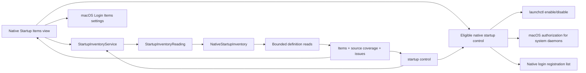

# Startup items

English | [简体中文](../zh-CN/product/startup-items.md)

The native page groups startup registrations by verified application path and provides state counts, All / Enabled / Disabled / Leftovers filters, search, inline controls and expandable details. Direct controls cover eligible LaunchAgents, third-party system daemons and native application login registrations. Unsupported registrations retain a macOS Settings entry point.

## User workflow

Open Startup Items to read launchd definitions and available login registrations. Search by application, publisher, label, definition path or executable. Expand an application to inspect each registration, its configured and runtime states, source and trigger clues; copy paths or reveal them in Finder. Apple system definitions remain optional under Startup Options. Scan Again reads fresh metadata; Stop requests cooperative cancellation. Existing results remain visible during a refresh.

Controls prepare a confirmation listing the exact affected definitions. Enable and Disable change launchd overrides in the current user’s GUI domain; Remove moves eligible, user-owned definitions to Trash through the existing verified filesystem adapter. These actions do not terminate processes. The platform rechecks source, parent, owner, file identity, contents and label, and verifies the resulting override or Trash operation. The catalog is refreshed after every attempted batch, including partial failures.

Eligible root-owned definitions directly inside `/Library/LaunchDaemons` use a fixed `launchctl enable/disable system/<label>` operation with macOS administrator authorization. Apple definitions remain protected. Native login controls insert or remove the exact local third-party application from the current account’s login list; complete snapshots and identity checks precede mutation, and a fresh snapshot verifies the result. BTM application records use the native list as their active-state authority; a BTM-only fallback remains read-only.

A missing executable is a leftover only when local filesystem evidence establishes absence. Inaccessible paths, unresolved executables, links and offline volumes remain unknown. Similar names do not merge application identities. Mixed groups are shown separately from fully enabled or disabled groups; unknown state is never shown as disabled. Login Items Settings uses the public `SMAppService.openSystemSettingsLoginItems()` API.

## Coverage and privacy

| Source | Default | Evidence |
| --- | --- | --- |
| `~/Library/LaunchAgents` | Included | Current-user definitions |
| `/Library/LaunchAgents` | Included | All-user agent definitions |
| `/Library/LaunchDaemons` | Included | All-user daemon definitions |
| `/System/Library/LaunchAgents`, `/System/Library/LaunchDaemons` | Optional | Apple system definitions |
| Active Login Items | Included when the native shared list is available | Complete native snapshot; eligible exact applications support enable/disable |
| Background application records | Included when BTM v13 is readable | Bounded data-only property-list parser; unavailable versions/permissions remain explicit |
| Embedded application helpers | Outside this scan | Inspect in System Settings |

`complete` means the requested definition sources were inspected. It does not mean all macOS startup registrations were enumerated. Missing sources, permission gaps, malformed definitions and budget limits retain distinct coverage. A failed read is not a claim that no startup item exists.

Reads use directory descriptors, reject ancestor and leaf links, reject special files and compare file metadata after reading. Each definition is limited to 256 KiB. Default traversal is 2,000 entries and five seconds, with cancellation/deadline checks between operations. These checks cannot interrupt an uninterruptible kernel filesystem call. Arguments and environment values are not retained or returned; the executable is only the Program field or first ProgramArguments value when it is an absolute printable path. The state queries return only allow-listed status values. Successful override queries fall back to the definition’s Disabled default when no override exists; failed queries remain unknown. BTM reads reject unrecognized archive versions and never instantiate archived classes. Discovery does not invoke a state-changing command.

## Ownership and flow



Core owns the portable result, pure application grouping/filtering and control contract. The platform adapter owns launchd source paths, property-list interpretation, physical reads, native login registrations and the authorization boundary. The desktop owns search, native presentation, confirmation and settings navigation. Discovery and control do not open the cleanup record store and cannot create cleanup plans. Windows explicitly reports this capability as unsupported until a separate adapter is implemented.

## CLI

```sh
shou startup list --json
shou startup list --include-system true --json
shou startup control --path "$HOME/Library/LaunchAgents/example.plist" --action disable
```

The envelope uses API `1.0`; `scope` is `macos_startup_items`. Items add optional `display_name`, `application_path`, `publisher`, `target_state` and `removable`; older payloads decode with safe defaults. Results include UTC `checked_at`, `include_system`, source coverage, issues and explicitly unavailable source families. A coverage gap returns status `partial` and exit `6`; invalid options return `2`, unsupported platforms `8`. `startup control` accepts only an exact current-user LaunchAgent path returned by discovery and an `enable` or `disable` action. It prints the label, path and impact, then requires `STARTUP ENABLE <label>` or `STARTUP DISABLE <label>` on the current TTY. Missing TTY, unsupported source, ownership mismatch or a changed plist all refuse the operation. It never uses `sudo`, terminates running processes or modifies system daemons.

## Local acceptance

Core/CLI and native desktop evidence is recorded in [acceptance](../engineering/acceptance-and-testing.md). Automated checks cover precise grouping and filtering, compatible decoding, bounded BTM parsing, daemon authorization command construction and readback, login registration identity and native control outcomes. State-changing checks use injected executors and isolated fixtures. Read-only desktop inspection covers the grouped list, filters and expanded details. Real administrator authorization, changes to installed startup registrations, complete registration enumeration, VoiceOver and GUI Stop timing remain separate runtime acceptance.
