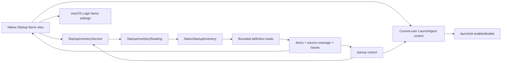

# Startup discovery

English | [简体中文](../zh-CN/product/startup-items.md)

Status: implemented first stage of F15, with the listed local runtime acceptance completed. The restricted current-user LaunchAgent control contract is now implemented; runtime evidence belongs in [acceptance](../engineering/acceptance-and-testing.md). System definitions, Login Items, background registrations and embedded helpers remain read-only and route to macOS Settings.

## User workflow

Open Startup Items to read current-user agents and locally installed agents/daemons. Search by label, definition path or executable path. Select a row to inspect its exact source, trigger clues and executable, reveal the definition in Finder or copy its path. Apple system definitions are hidden until explicitly included. Check Again reads fresh metadata; Stop requests cancellation between reads.

Open Login Items Settings uses the public `SMAppService.openSystemSettingsLoginItems()` API to open the native macOS page. Current-user `~/Library/LaunchAgents` definitions expose Enable and Disable actions. Each action requires a second confirmation; Shou rechecks the plist, owner, label and exact parent before invoking `launchctl enable/disable` for the current user. Existing processes are not terminated, and the inventory is refreshed after the command. For current-user agents, the read also performs bounded `launchctl print-disabled` and exact-service queries. It reports `enabled`, `disabled`, `loaded`, `running` or `not_loaded` when observed, and keeps `unknown` when the query is unavailable or expires. These are point-in-time observations and do not authorize changes. The Disabled key remains a separate definition hint.

## Coverage and privacy

| Source | Default | Evidence |
| --- | --- | --- |
| `~/Library/LaunchAgents` | Included | Current-user definitions |
| `/Library/LaunchAgents` | Included | All-user agent definitions |
| `/Library/LaunchDaemons` | Included | All-user daemon definitions |
| `/System/Library/LaunchAgents`, `/System/Library/LaunchDaemons` | Optional | Apple system definitions |
| Login Items, background-task registrations, embedded application helpers | Outside this scan | Inspect in System Settings |

`complete` means the requested definition sources were inspected. It does not mean all macOS startup registrations were enumerated. Missing sources, permission gaps, malformed definitions and budget limits retain distinct coverage. A failed read is not a claim that no startup item exists.

Reads use directory descriptors, reject ancestor and leaf links, reject special files and compare file metadata after reading. Each definition is limited to 256 KiB. Default traversal is 2,000 entries and five seconds, with cancellation/deadline checks between operations. These checks cannot interrupt an uninterruptible kernel filesystem call. Arguments and environment values are not retained or returned; the executable is only the Program field or first ProgramArguments value when it is an absolute printable path. The state queries return only allow-listed status values and never retain command output. Discovery does not invoke a state-changing command.

## Ownership and flow



Core owns the portable result and control contract. The platform adapter owns launchd source paths, property-list interpretation, physical reads and the current-user control boundary. The desktop owns search, native presentation, confirmation and settings navigation. Discovery and control do not open the cleanup record store and cannot create cleanup plans. Windows explicitly reports this capability as unsupported until a separate adapter is implemented.

## CLI

```sh
shou startup list --json
shou startup list --include-system true --json
shou startup control --path "$HOME/Library/LaunchAgents/example.plist" --action disable
```

The envelope uses API `1.0`; `scope` is `launchd_definitions`. Results include UTC `checked_at`, `include_system`, source coverage, issues and explicitly unavailable source families. A coverage gap returns status `partial` and exit `6`; invalid options return `2`, unsupported platforms `8`. `startup control` accepts only an exact current-user LaunchAgent path returned by discovery and an `enable` or `disable` action. It prints the label, path and impact, then requires `STARTUP ENABLE <label>` or `STARTUP DISABLE <label>` on the current TTY. Missing TTY, unsupported source, ownership mismatch or a changed plist all refuse the operation. It never uses `sudo`, terminates running processes or modifies system daemons.

## Local acceptance

Core/CLI and native desktop evidence is recorded in [acceptance](../engineering/acceptance-and-testing.md). The local run found 44 definitions from the default three sources, or 873 with Apple sources included; counts are observations of that machine, not expected totals. Coverage kept all read issues visible. The control contract, CLI discovery and restricted platform implementation are covered; a real desktop launchctl mutation remains a separate runtime acceptance because it changes a system setting. Complete registration enumeration, VoiceOver and GUI Stop timing remain outside this first stage.
