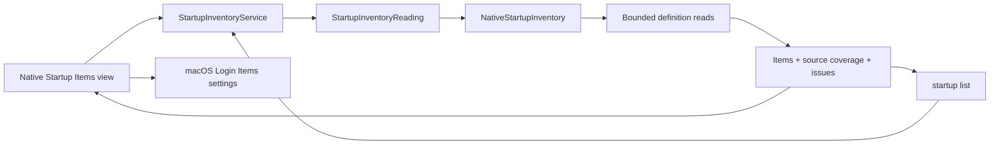

# Startup discovery

English | [简体中文](../zh-CN/product/startup-items.md)

Status: implemented first stage of F15, with the listed local runtime acceptance completed. Runtime evidence belongs in [acceptance](../engineering/acceptance-and-testing.md). This stage discovers launchd definitions and opens macOS Login Items settings; it does not change registrations, stop processes or remove files.

## User workflow

Open Startup Items to read current-user agents and locally installed agents/daemons. Search by label, definition path or executable path. Select a row to inspect its exact source, trigger clues and executable, reveal the definition in Finder or copy its path. Apple system definitions are hidden until explicitly included. Check Again reads fresh metadata; Stop requests cancellation between reads.

Open Login Items Settings uses the public `SMAppService.openSystemSettingsLoginItems()` API to open the native macOS page. A listed definition does not establish whether its job is registered, enabled or running. The Disabled key is displayed as a definition hint; launchd overrides may differ. Configured and runtime states therefore remain `unknown` in both entry points.

## Coverage and privacy

| Source | Default | Evidence |
| --- | --- | --- |
| `~/Library/LaunchAgents` | Included | Current-user definitions |
| `/Library/LaunchAgents` | Included | All-user agent definitions |
| `/Library/LaunchDaemons` | Included | All-user daemon definitions |
| `/System/Library/LaunchAgents`, `/System/Library/LaunchDaemons` | Optional | Apple system definitions |
| Login Items, background-task registrations, embedded application helpers | Outside this scan | Inspect in System Settings |

`complete` means the requested definition sources were inspected. It does not mean all macOS startup registrations were enumerated. Missing sources, permission gaps, malformed definitions and budget limits retain distinct coverage. A failed read is not a claim that no startup item exists.

Reads use directory descriptors, reject ancestor and leaf links, reject special files and compare file metadata after reading. Each definition is limited to 256 KiB. Default traversal is 2,000 entries and five seconds, with cancellation/deadline checks between operations. These checks cannot interrupt an uninterruptible kernel filesystem call. Arguments and environment values are not retained or returned; the executable is only the Program field or first ProgramArguments value when it is an absolute printable path. No command is executed.

## Ownership and flow



Core owns the portable result and read-service contract. The platform adapter owns launchd source paths, property-list interpretation and physical reads. The desktop owns search, native presentation and settings navigation. Discovery does not open the cleanup record store and cannot create cleanup plans or startup changes. Windows explicitly reports this capability as unsupported until a separate adapter is implemented.

## CLI

```sh
shou startup list --json
shou startup list --include-system true --json
```

The envelope uses API `1.0`; `scope` is `launchd_definitions`. Results include UTC `checked_at`, `include_system`, source coverage, issues and explicitly unavailable source families. A coverage gap returns status `partial` and exit `6`; invalid options return `2`, unsupported platforms `8`. This command works independently of cleanup storage. Direct enable/disable, privileged helpers and runtime process control are not exposed.

## Local acceptance

Core/CLI and native desktop evidence is recorded in [acceptance](../engineering/acceptance-and-testing.md). The local run found 44 definitions from the default three sources, or 873 with Apple sources included; counts are observations of that machine, not expected totals. Coverage kept all read issues visible. The installed build passed Chinese/English switching and settings navigation; all 882 inspected definition hashes and 36 existing record hashes remained unchanged. Startup Stop timing in the desktop was not exercised because these reads finished before the next observation; it remains separate from core cancellation tests. Direct startup controls and complete registration enumeration remain outside this first stage.
