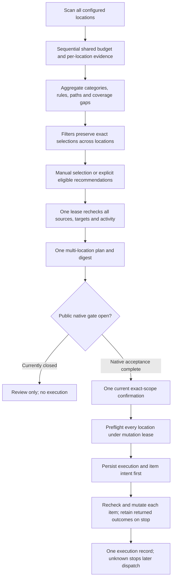
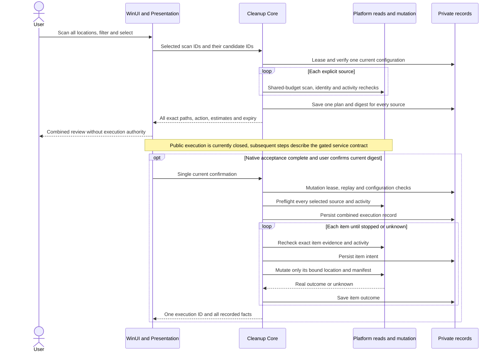
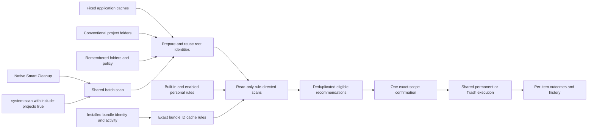
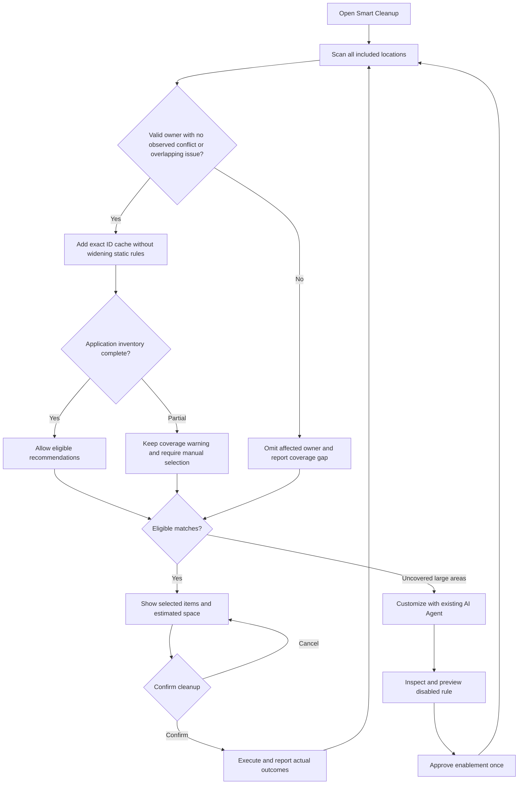
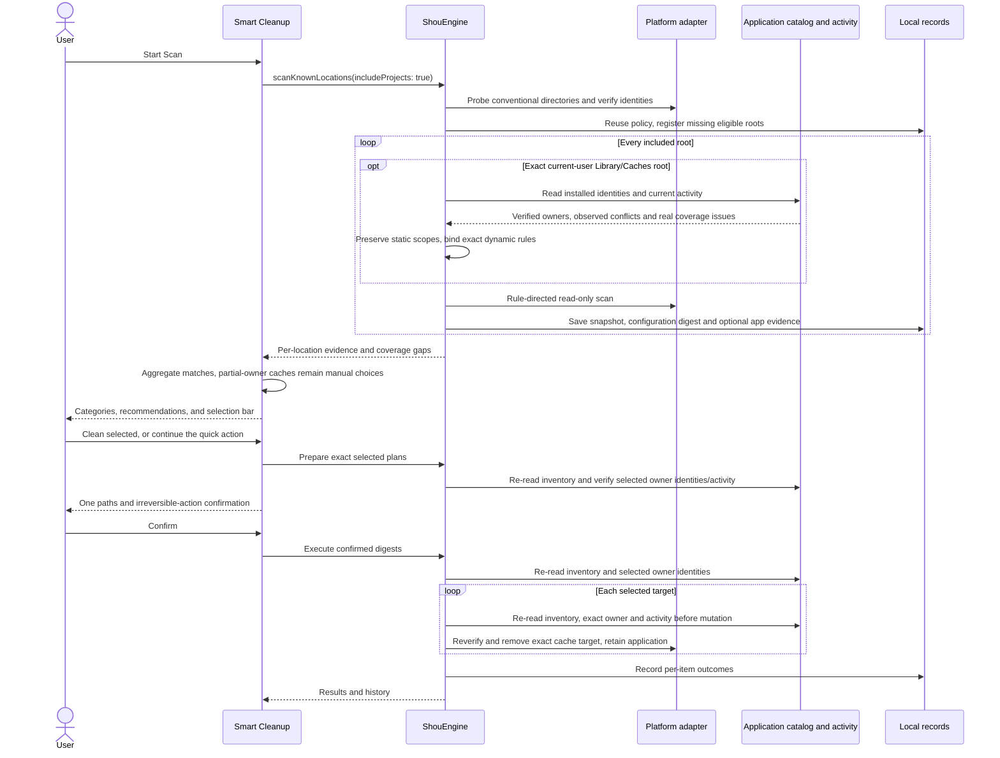

# Unified daily cleanup

English | [简体中文](../zh-CN/product/unified-cleanup.md)

Shou saves the user time by discovering cleanup targets together. Top navigation groups tasks, with Developer Projects under Apps & Projects; users do not need to register workspaces first. Smart Cleanup covers application caches, developer caches, project artifacts and enabled personal rules in one scan and one exact-scope cleanup confirmation.

## Windows scanning and review

Automatic discovery may read SYSTEM/Administrators-provisioned roots at exact bundled cache locations for the current account. The native adapter verifies the resolved current-user Home/AppData anchor, pins the path, rejects reparse points, and checks each directory's identity, owner and ACL, including foreign inheritable write grants. Discovery, registration and batch rescans revalidate access without changing ownership or ACLs. These roots publish read-only results: candidates carry `scan_root_read_only` and cannot enter cleanup plans. Manual registrations, project collections and mutation targets retain current-user ownership requirements. Owner mismatches and access failures use separate messages.

When scanning cannot start, the landing page shows a short status and an attention link. Paths are disclosed in a bounded flyout; Scan Locations opens the existing configuration page for adding folders. Diagnostics do not occupy the landing task area. Native handle and WinUI regression for this compatibility change remains pending; host logic checks are not native acceptance.

Windows source includes Scan All Locations and Scan Selected Location. All-location scanning uses only the configured locations currently listed on the page; Find Scan Locations remains a separate discovery and registration action. New registrations cannot silently expand an in-flight scan, and removed or changed registrations invalidate the old scope. Only source and Mac-hosted logic/reference checks have passed; native WinUI/system acceptance is pending and cleanup execution remains unavailable.

Locations run sequentially under one entry allowance and monotonic time budget. Each retains its own snapshot and coverage. Exhausted or failed locations report gaps; absent results do not mean empty directories. When a failure leaves entry consumption unknown, the remaining allowance is not reused for later locations. Stopping preserves previously published snapshots without presenting unfinished locations as successful.

The page shows observed and total location counts. Results initially span all observed locations, with filters for location, canonical built-in category, rule name and full path. Personal rules have their own category; rule groups and matching results expose tri-state selection. Filters retain selections in other locations and pages, and the footer counts the entire selection. A request selects at most 256 targets. Limit or overlap failures leave a whole group operation unchanged, without truncation.

**Select Recommended Items** explicitly replaces the current selection with reviewable, complete, non-high-risk targets from complete scans without analysis gaps. Partial or stopped batches offer no recommendations, although independently complete, unblocked targets remain manually selectable. Recommendations change selection without granting execution. Categories come from shared resources rather than path-based safety guesses. Grouping, search and combined review have source implementations; native WinUI/filesystem behavior still requires acceptance.

Review submits the selected `scan_id → candidate_ids` bindings to Core once. Under one configuration lease, Core reinspects every source, rule, complete manifest and activity state, rejecting repeated scans, multiple snapshots of one location, foreign-source candidates, overlapping paths and duplicate file identities. It saves one plan and digest for all locations. Each source binds its root identity and rules, and each item names its source. One current confirmation binds every exact path, action and the same digest; it does not create reusable per-location approvals.

Plan creation and each execution have one shared measured-entry and time budget, using the largest selected source limit for each dimension rather than summing limits by location. Execution preflights every source under one mutation lease before saving any execution intent; each subsequent mutation still rechecks its item and saves item intent first. Stopping prevents further dispatch while retaining returned outcomes. Unknown outcomes stop later items; querying never restores authority. Public execution remains disabled, and simulated checks do not establish real deletion or release readiness.

Configuration invalidation, page disposal and newer scans isolate late responses. Failed plan revalidation discards the reusable batch and selection and requires a fresh scan. Scanning, selection, recommendations and review cannot replace current-entry confirmation.

## User experience

1. Open Smart Cleanup and choose Start Scan. The adjacent menu offers Scan Common Locations and Scan Locations. Scanning only shows results and never deletes automatically.
2. Shou finds fixed cache roots, conventional project collections and previously included folders. It applies built-in and enabled personal rules and selects eligible results.
3. Review and select exact paths in the results. Click the prominent red Delete Permanently button once to confirm the current scope, validate and execute without a second dialog. Trash remains an explicit alternative; actual outcomes stay itemized.

The first page presents original folder artwork, a soft gradient and one primary scan action, followed by illustrated links to existing application/project, storage and rule pages. Its secondary row offers optional AI investigation; the native toolbar retains disk capacity. Scan Locations is an optional view in Smart Cleanup and Settings. Include Folder supports several extra folders at once and remembers them for later scans. Advanced rule previews can still open one folder's detail view, with a return action to Smart Cleanup.

The result browser separates User Cache Files, Application Caches, Browser Data, Developer Tools and Project Build Outputs, adding Personal Rules when they match. Categories and the footer count rule groups; expanding a group reveals every matching directory across projects, its file count, size, warnings and individual selection. Category and group checkboxes support mixed selection. Search matches rule names and full paths; large groups initially show ten locations and expose the remainder in batches. The footer selection menu applies across all categories; each category and rule checkbox controls only its own displayed group. High-risk outputs and dependencies require explicit selection and stay outside the recommended selection.

User cache groups include the maintained app/tool caches, pnpm, browser automation downloads and named macOS service caches. Homebrew, Node.js toolchain and SwiftPM cache groups retain the original shared rule binding. pnpm store discovery targets only `~/Library/pnpm/store`, preserving global executables and configuration. Unknown cache directories are not made removable merely because they reside inside a cache root.

Large Files lists matching files across folders; Space Analysis provides directory navigation and a treemap. Both support direct removal of explicit selections. Startup, Applications, Rules and History retain their separate purposes.

## Automatic discovery

`ProjectLocations` probes a fixed list of conventional project collections under the current user's home: `Developer`, `Projects`, `Code`, `code`, `dev`, `src`, `repos`, `GitHub`, and the `Developer`, `Projects`, `Code`, `dev`, `GitHub` children of `Documents`. This is directory metadata discovery, not recursive enumeration of the entire home folder. Windows discovery awaits a verified platform adapter.

Additional hints include Workspace/Workspaces, Development, Source/Sources, Git/Repos, corresponding supported collections under Documents and Projects/Code/dev under Desktop. Projects in other locations, including external volumes, participate after Include Folder. A collection is scanned recursively, so its nested repositories do not need individual registration.

The shipped project catalog covers Rust targets, Node dependencies and framework caches, Node build/dist outputs, Swift debug/release products, Python bytecode/test/type-checker caches, Gradle build/cache directories, Maven targets, Flutter build/.dart_tool directories and CMake build directories. Exact local manifests are required for generic build/cache names. All trusted project rules check Git tracking and project activity, including binary-only targets. Generated-source exceptions require the matching tool's verified output layout; handwritten sources, project manifests, credentials and tracked contents remain protected. Unsupported layouts remain visible with blocking reasons instead of acquiring deletion authority from their names.

Only existing local directories with a valid root identity are prepared for scanning. Missing directories are ignored; inaccessible directories and symbolic links produce explicit coverage issues. Aliases to the same identity are deduplicated. Discovery never treats a folder's name as deletion evidence: cleanup still requires matching rules, project markers, activity checks, exclusions and complete target manifests.

Batch scanning also respects the platform's read capacity. Native isolated readers permit at most two concurrent roots; direct readers retain the requested limit of up to four. Every prepared root receives a result or a reported issue, so scheduler capacity cannot silently omit cache or project collections.

Within a root, cleanup discovery visits directories before measuring candidate contents. Each remaining candidate receives a share of the remaining entry and time budgets, allowing later projects to produce independently complete results even when an earlier artifact directory is too large. The original root, rule bindings and exclusions stay in force. Incomplete directories remain outside automatic cleanup; discovery alone never grants cleanup eligibility.

Discovery probes literal rule components and project markers before bounded sibling listings, and prioritizes branches already inside a target pattern, such as Swift's `.build/<architecture>/debug`. Wide source directories therefore do not hide known targets or their markers at a listing cutoff. The same total entry/time limits, no-follow reads and full-target checks still apply. Enabled rules describe eligible locations; they do not guarantee that every target can be completely measured within one scan.

The cleanup footer exposes a primary permanent-cleanup button and a separate menu for Trash. Preparing a plan checks policy only for the explicit selection while preserving ancestor matches and all saved context. A changed activity or ownership check reports the affected path and blocking reasons and requires a new scan; it is not reported as a corrupt saved rule. No deletion occurs during preparation.

On macOS, matching directories outside automatic cleanup remain manually selectable, including incomplete targets and contents needing a personal decision. They never enter recommendations or the eligible-only selection commands. Manual review uses the existing Space Analysis direct-removal planner: it binds the original root and selected object identities, measures the current complete directories, enforces current exclusions, owner and protected-location checks, then freezes the selected whole directories on the deletion click and validates execution without a second dialog. The inline warning explains that automatic rule safety/rebuildability has not been established, related tasks should be stopped, and entire listed directories will be removed. Whole-directory selection includes all current contents; changes after plan creation reject execution. Excluded targets, protected record locations and draft previews remain unavailable. This explicit path does not change automatic rule eligibility or create unattended deletion authority. Windows manual selection/removal remains planned.

An incomplete directory offers Continue Scanning This Directory in its details and context menu. This read-only operation measures that exact target with a separate finite budget, under the original root, enabled rules, exclusions and safety checks. Progress identifies the directory and supports Stop. A successful result replaces only that directory's displayed evidence; other results and selections remain, and the refreshed target requires a new selection. Cancellation or failure keeps the previous result. Configuration or identity changes require a fresh scan. Completing one directory does not mark its parent collection complete, and a target that still exceeds the limit remains blocked.

Previously registered roots are reused with their exact logical references, rule bindings and exclusions. A conventional suggestion overlapping a registered root is skipped, preserving that root's policy instead of introducing a broader overlapping scope. Consequently, an explicitly registered child can limit automatic discovery of its parent collection. Users can include another nonoverlapping collection when needed.

All roots are prepared before the first snapshot is captured so every snapshot uses the same configuration digest. `Workspace` remains an internal identity and rule-scope record, and a compatible CLI entity. It is not a prerequisite screen or a separate user-managed product feature.

### Installed application caches

On macOS, the exact `~/Library/Caches` scan additionally reads installed applications from the platform catalog. A valid installed owner with no observed duplicate bundle identifier produces an exact relative rule for that identifier; application-name lists and identity hints are never execution authority. Existing maintained cache patterns take priority, including disabled rules and narrower descendants, so generic discovery cannot broaden them. Dynamic rule bindings can also be disabled.

Only independently complete, current-user cache manifests passing the shared exclusions, protected-content and no-follow checks can be recommended. System/Apple and current applications are protected; running or unknown activity blocks cleanup. The installed application bundle may be administrator-owned because it is read only. Cache cleanup uses the ordinary plan and receipt flow and does not uninstall the application or select its preferences, support data or containers.

Partial application inventory remains visible as a coverage gap. Valid owners in inspected sources can still provide manually selectable caches when failures concern unrelated paths, with a warning that other copies may be undiscovered. They are not selected by automatic recommendations. Issues on an owner, its descendants or ancestors, unavailable/uninspected owner sources and observed duplicate identifiers block that owner. An unavailable inventory omits generic discovery; fixed rules continue. `ScanSnapshot.status` still describes the filesystem scan; the aggregate system result becomes partial for these discovery issues. Arbitrary custom installation directories and other accounts remain outside the catalog scope, even when known directories are complete.

The optional partial-coverage flag is saved with owner evidence and bound into the plan digest. A complete scan becoming partial requires a new scan and explicit review. Plan creation, execution preflight and every item mutation re-read the inventory, exact bundle and activity; newly discovered owner conflicts or overlapping issues block cleanup.

## Personal rules

An existing Agent investigates uncovered large directories, asks about unclear purpose or rebuilding, writes a rule and previews a disabled draft. After the user approves enablement once, eligible matches participate in subsequent Smart Cleanup recommendations automatically. Disabled imports, draft previews, incomplete targets and blocked candidates stay outside recommendations. Each actual cleanup still requires confirmation of its current concrete scope.

Personal-rule enable/preview controls resolve the rule's own root reference; they do not depend on a separately selected location. The released version uses external agents/Skill/CLI for customization. Next-stage built-in cleanup AI shares the same rule, preview, enablement and confirmed-execution contracts; ordinary daily cleanup needs neither network access nor repeated inference.

## Architecture

## Flow

## Sequence

## CLI and verification

`shou system scan --include-projects true --json` uses the same discovery. The CLI default remains `false` for compatibility; explicit `scan --workspace` and `workspaces` commands remain available for Agent scope binding and advanced automation.

Verification must cover a fresh configuration, read-only discovery without registration, repeated scans preserving policy/digests, overlapping explicit roots, symlinks, cancellation before registration, disabled drafts, enabled personal-rule recommendations, actual isolated cleanup/restoration and the installed native interface. Record actual results in [acceptance](../engineering/acceptance-and-testing.md).
