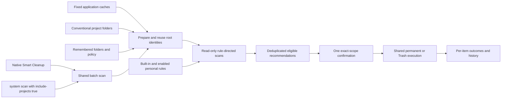
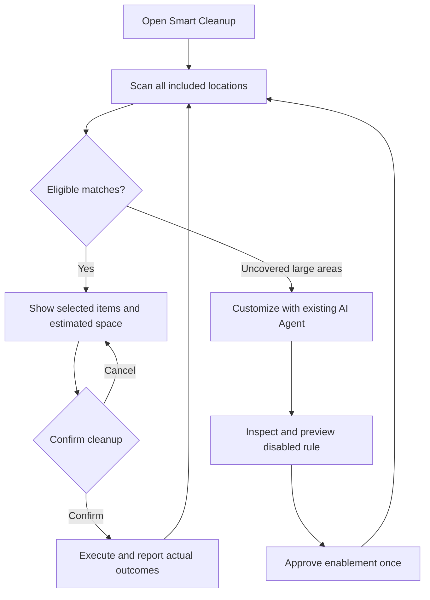

# Unified daily cleanup

English | [简体中文](../zh-CN/product/unified-cleanup.md)

Shou saves the user time by discovering cleanup targets together. Project Cleanup is no longer a primary destination, and the sidebar does not ask users to register workspaces. Smart Cleanup covers application caches, developer caches, project artifacts and enabled personal rules in one scan and one exact-scope cleanup confirmation.

## User experience

1. Open Smart Cleanup and choose Scan & Free Space, or Scan Only to inspect first.
2. Shou finds fixed cache roots, conventional project collections and previously included folders. It applies built-in and enabled personal rules and selects eligible results.
3. Confirm the concrete paths once. Permanent removal is the default; Trash is an explicit alternative. Outcomes and recovery capabilities remain itemized.

The first page summarizes discovered locations and enabled personal rules. It does not present a directory checklist. Scan Locations is an optional view in Smart Cleanup and Settings. Include Folder supports several extra folders at once and remembers them for later scans. Advanced rule previews can still open one folder's detail view, with a return action to Smart Cleanup.

Space Analysis stays independent for finding large files and directly removing explicit selections. Startup, Applications, Rules and History retain their separate purposes.

## Automatic discovery

`ProjectLocations` probes a fixed list of conventional project collections under the current user's home: `Developer`, `Projects`, `Code`, `code`, `dev`, `src`, `repos`, `GitHub`, and the `Developer`, `Projects`, `Code`, `dev`, `GitHub` children of `Documents`. This is directory metadata discovery, not recursive enumeration of the entire home folder. Windows discovery awaits a verified platform adapter.

Only existing local directories with a valid root identity are prepared for scanning. Missing directories are ignored; inaccessible directories and symbolic links produce explicit coverage issues. Aliases to the same identity are deduplicated. Discovery never treats a folder's name as deletion evidence: cleanup still requires matching rules, project markers, activity checks, exclusions and complete target manifests.

Previously registered roots are reused with their exact logical references, rule bindings and exclusions. A conventional suggestion overlapping a registered root is skipped, preserving that root's policy instead of introducing a broader overlapping scope. Consequently, an explicitly registered child can limit automatic discovery of its parent collection. Users can include another nonoverlapping collection when needed.

All roots are prepared before the first snapshot is captured so every snapshot uses the same configuration digest. `Workspace` remains an internal identity and rule-scope record, and a compatible CLI entity. It is not a prerequisite screen or a separate user-managed product feature.

## Personal rules

An existing Agent investigates uncovered large directories, asks about unclear purpose or rebuilding, writes a rule and previews a disabled draft. After the user approves enablement once, eligible matches participate in subsequent Smart Cleanup recommendations automatically. Disabled imports, draft previews, incomplete targets and blocked candidates stay outside recommendations. Each actual cleanup still requires confirmation of its current concrete scope.

Personal-rule enable/preview controls resolve the rule's own root reference; they do not depend on a separately selected location. Shou provides the Skill and CLI, without integrating a model or hosting an Agent.

## Architecture



## Flow



## Sequence

```mermaid
sequenceDiagram
  actor User
  participant UI as Smart Cleanup
  participant Engine as ShouEngine
  participant FS as Platform adapter
  participant Store as Local records
  User->>UI: Scan & Free Space
  UI->>Engine: scanKnownLocations(includeProjects: true)
  Engine->>FS: Probe conventional directories and verify identities
  Engine->>Store: Reuse policy; register missing eligible roots
  loop Every included root
    Engine->>FS: Rule-directed read-only scan
    Engine->>Store: Save snapshot with stable configuration digest
  end
  Engine-->>UI: Per-location evidence and coverage gaps
  UI->>UI: Aggregate built-in and enabled personal matches
  UI->>Engine: Prepare exact selected plans
  UI-->>User: One paths and irreversible-action confirmation
  User->>UI: Confirm
  UI->>Engine: Execute confirmed digests
  Engine->>FS: Reverify and remove exact targets
  Engine->>Store: Record per-item outcomes
  Engine-->>UI: Results and history
```

## CLI and verification

`shou system scan --include-projects true --json` uses the same discovery. The CLI default remains `false` for compatibility; explicit `scan --workspace` and `workspaces` commands remain available for Agent scope binding and advanced automation.

Verification must cover a fresh configuration, read-only discovery without registration, repeated scans preserving policy/digests, overlapping explicit roots, symlinks, cancellation before registration, disabled drafts, enabled personal-rule recommendations, actual isolated cleanup/restoration and the installed native interface. Record actual results in [acceptance](../engineering/acceptance-and-testing.md).
