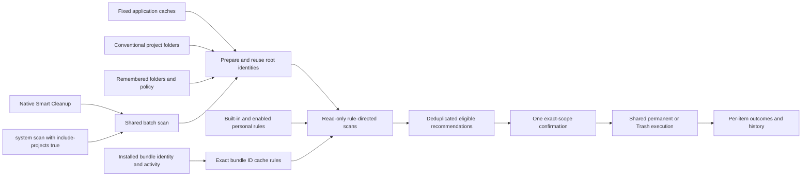
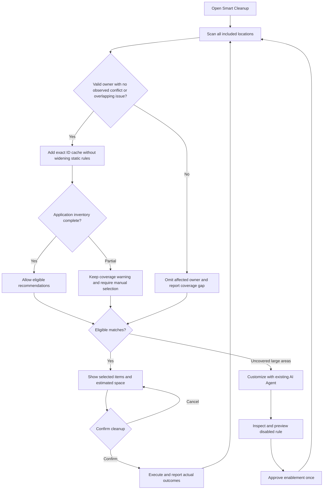

# Unified daily cleanup

English | [简体中文](../zh-CN/product/unified-cleanup.md)

Shou saves the user time by discovering cleanup targets together. Project Cleanup is no longer a primary destination, and the sidebar does not ask users to register workspaces. Smart Cleanup covers application caches, developer caches, project artifacts and enabled personal rules in one scan and one exact-scope cleanup confirmation.

## User experience

1. Open Smart Cleanup and choose Start Scan. The adjacent menu offers Scan & Free Space and Scan Locations.
2. Shou finds fixed cache roots, conventional project collections and previously included folders. It applies built-in and enabled personal rules and selects eligible results.
3. Confirm the concrete paths once. Permanent removal is the default; Trash is an explicit alternative. Outcomes and recovery capabilities remain itemized.

The first page presents one central scan action, the current disk capacity, and optional Agent customization. Scan Locations is an optional view in Smart Cleanup and Settings. Include Folder supports several extra folders at once and remembers them for later scans. Advanced rule previews can still open one folder's detail view, with a return action to Smart Cleanup.

Large Files lists matching files across folders; Space Analysis provides directory navigation and a treemap. Both support direct removal of explicit selections. Startup, Applications, Rules and History retain their separate purposes.

## Automatic discovery

`ProjectLocations` probes a fixed list of conventional project collections under the current user's home: `Developer`, `Projects`, `Code`, `code`, `dev`, `src`, `repos`, `GitHub`, and the `Developer`, `Projects`, `Code`, `dev`, `GitHub` children of `Documents`. This is directory metadata discovery, not recursive enumeration of the entire home folder. Windows discovery awaits a verified platform adapter.

Only existing local directories with a valid root identity are prepared for scanning. Missing directories are ignored; inaccessible directories and symbolic links produce explicit coverage issues. Aliases to the same identity are deduplicated. Discovery never treats a folder's name as deletion evidence: cleanup still requires matching rules, project markers, activity checks, exclusions and complete target manifests.

Previously registered roots are reused with their exact logical references, rule bindings and exclusions. A conventional suggestion overlapping a registered root is skipped, preserving that root's policy instead of introducing a broader overlapping scope. Consequently, an explicitly registered child can limit automatic discovery of its parent collection. Users can include another nonoverlapping collection when needed.

All roots are prepared before the first snapshot is captured so every snapshot uses the same configuration digest. `Workspace` remains an internal identity and rule-scope record, and a compatible CLI entity. It is not a prerequisite screen or a separate user-managed product feature.

### Installed application caches

On macOS, the exact `~/Library/Caches` scan additionally reads installed applications from the platform catalog. A valid installed owner with no observed duplicate bundle identifier produces an exact relative rule for that identifier; the Mole tested-app inventory and its identity hints are never execution input. Existing maintained cache patterns take priority, including disabled rules and narrower descendants, so generic discovery cannot broaden them. Dynamic rule bindings can also be disabled.

Only independently complete, current-user cache manifests passing the shared exclusions, protected-content and no-follow checks can be recommended. System/Apple and current applications are protected; running or unknown activity blocks cleanup. The installed application bundle may be administrator-owned because it is read only. Cache cleanup uses the ordinary plan and receipt flow and does not uninstall the application or select its preferences, support data or containers.

Partial application inventory remains visible as a coverage gap. Valid owners in inspected sources can still provide manually selectable caches when failures concern unrelated paths, with a warning that other copies may be undiscovered. They are not selected by automatic recommendations. Issues on an owner, its descendants or ancestors, unavailable/uninspected owner sources and observed duplicate identifiers block that owner. An unavailable inventory omits generic discovery; fixed rules continue. `ScanSnapshot.status` still describes the filesystem scan; the aggregate system result becomes partial for these discovery issues. Arbitrary custom installation directories and other accounts remain outside the catalog scope, even when known directories are complete.

The optional partial-coverage flag is saved with owner evidence and bound into the plan digest. A complete scan becoming partial requires a new scan and explicit review. Plan creation, execution preflight and every item mutation re-read the inventory, exact bundle and activity; newly discovered owner conflicts or overlapping issues block cleanup.

## Personal rules

An existing Agent investigates uncovered large directories, asks about unclear purpose or rebuilding, writes a rule and previews a disabled draft. After the user approves enablement once, eligible matches participate in subsequent Smart Cleanup recommendations automatically. Disabled imports, draft previews, incomplete targets and blocked candidates stay outside recommendations. Each actual cleanup still requires confirmation of its current concrete scope.

Personal-rule enable/preview controls resolve the rule's own root reference; they do not depend on a separately selected location. Shou provides the Skill and CLI, without integrating a model or hosting an Agent.

## Architecture



## Flow



## Sequence

```mermaid
sequenceDiagram
  actor User
  participant UI as Smart Cleanup
  participant Engine as ShouEngine
  participant FS as Platform adapter
  participant Apps as Application catalog and activity
  participant Store as Local records
  User->>UI: Start Scan, or Scan & Free Space
  UI->>Engine: scanKnownLocations(includeProjects: true)
  Engine->>FS: Probe conventional directories and verify identities
  Engine->>Store: Reuse policy; register missing eligible roots
  loop Every included root
    opt Exact current-user Library/Caches root
      Engine->>Apps: Read installed identities and current activity
      Apps-->>Engine: Verified owners, observed conflicts and real coverage issues
      Engine->>Engine: Preserve static scopes; bind exact dynamic rules
    end
    Engine->>FS: Rule-directed read-only scan
    Engine->>Store: Save snapshot, configuration digest and optional app evidence
  end
  Engine-->>UI: Per-location evidence and coverage gaps
  UI->>UI: Aggregate matches; partial-owner caches remain manual choices
  UI-->>User: Categories, recommendations, and selection bar
  User->>UI: Clean selected, or continue the quick action
  UI->>Engine: Prepare exact selected plans
  Engine->>Apps: Re-read inventory and verify selected owner identities/activity
  UI-->>User: One paths and irreversible-action confirmation
  User->>UI: Confirm
  UI->>Engine: Execute confirmed digests
  Engine->>Apps: Re-read inventory and selected owner identities
  loop Each selected target
    Engine->>Apps: Re-read inventory, exact owner and activity before mutation
    Engine->>FS: Reverify and remove exact cache target; retain application
  end
  Engine->>Store: Record per-item outcomes
  Engine-->>UI: Results and history
```

## CLI and verification

`shou system scan --include-projects true --json` uses the same discovery. The CLI default remains `false` for compatibility; explicit `scan --workspace` and `workspaces` commands remain available for Agent scope binding and advanced automation.

Verification must cover a fresh configuration, read-only discovery without registration, repeated scans preserving policy/digests, overlapping explicit roots, symlinks, cancellation before registration, disabled drafts, enabled personal-rule recommendations, actual isolated cleanup/restoration and the installed native interface. Record actual results in [acceptance](../engineering/acceptance-and-testing.md).
