# Declarative cleanup rule specification

English | [简体中文](../zh-CN/rules/rule-specification.md)

Status: format `1.0` development contract with a Swift engine implementation. Field structure is owned by the [JSON Schema](../../packages/shou-contracts/rule.schema.json); this document owns semantics. Complete release validation is pending.

Rule management configures Smart Cleanup and is reached through Cleanup Options → Cleanup Rules, without a primary navigation entry. Personal-rule changes, external AI drafts and review can still open the page directly; contextual navigation returns to Smart Cleanup.

## 1. Scope

Rules describe where to look, what directories to match, what retention conditions apply, and why processing may be appropriate. They grant no access or execution approval and contain no scripts or direct permanent-delete action.

Existing coding agents may generate and import drafts through CLI; next-stage built-in investigation constructs disabled drafts using the same format. Neither route treats generated text as trusted evidence, and model integration does not change the rule format. New paths/conditions expressible by the current format need no app release; new predicates, adapters, or platform capabilities do.

## 2. Validation layers

| Layer | Checks | Meaning |
| --- | --- | --- |
| Structural | Types, required/unknown fields, enums, lengths, schema version | Conforms to the schema |
| Semantic | Relative patterns, markers, bindings, budgets, platform capabilities | Can be evaluated within a bounded environment |
| Runtime | Actual access, protection, identities, current state, confirmation | Concrete targets meet execution preconditions |

Passing a schema never establishes that a real directory can be deleted.

## 3. Fields

| Field | Semantics |
| --- | --- |
| `schema_version` | Exactly `1.0`; reject unknown versions |
| `id`, `version` | Stable identifier and three-number version; no silent same-version mutation |
| `name`, `description` | Human text, displayed as untrusted content |
| `platforms` | Applicability, not proof of implemented platform support |
| `scope.root_ref` | Logical local binding, never a shared absolute path |
| `scope.max_depth` | Candidate-discovery depth, 1–32; not permission to truncate target verification |
| `scope.follow_symlinks` | Always `false` |
| `scope.cross_filesystems` | Always `false` |
| `match.kind` | Initially `directory` |
| `match.relative_patterns` | OR across workspace-relative candidate-directory patterns |
| `match.project_markers` | Optional; all listed ordinary files must exist in candidate parent |
| `conditions.min_allocated_bytes` | Required minimum allocation estimate in bytes; unknown estimate does not pass |
| `conditions.newest_descendant_modified_days_at_least` | Optional minimum age of newest modification across target/descendants |
| `exclude.relative_patterns` | Relative exclusions, combined with stronger user/system protection |
| `risk.declared_level` | `review` or `high`; cannot lower effective engine risk |
| `risk.rebuild_note`, `limitations` | Rebuild prerequisites and at least one limitation |
| `action.type` | Rule declarations remain `trash`-scoped; a reviewed cleanup plan may choose `action=permanent` separately, never from rule text |

`$schema` is an editor hint. The application uses its bundled schema and never fetches executable content or remote definitions based on this value.

## 4. Pattern semantics

Use `/` as separator. `*` matches zero or more characters within one segment; `?` matches one. `**` must occupy a complete segment and matches zero or more directory levels, so `**/target` includes a root child.

No regex, braces, Shell expansion, command substitution, environment variables, or `~`. Reject absolute paths, empty segments, `.`, `..`, backslashes, control characters, drive/UNC/device paths, and colon syntax. Literal wildcard characters in filenames are initially unsupported. Patterns cannot target the workspace root or broadly select its entire contents.

Markers are exact ordinary filenames in the candidate parent, with no separators or wildcards and no symlink following. Respect actual filesystem case behavior. Root depth is zero; direct children have depth one.

Protection and exclusions form a union and cannot be undone by a more specific rule. A directory containing a protected/excluded descendant cannot be moved as a whole.

Root/ancestor symlinks cannot become candidate paths. Known internal POSIX symlinks may be recorded as opaque entries without traversing or counting their targets. Moving/removing the parent processes the link only. Unknown Windows reparse types are not automatically equivalent.

## 5. Conditions and unknowns

Conditions combine with AND. Age uses scan UTC time and 24-hour days, never access time as proof of usage. Take the newest modification across the target and full descendants; symlinks contribute their own metadata only.

Candidate depth limits discovery, not the full safety manifest. Permission gaps, interrupted budgets, unreadable descendants, or unreliable sizes make relevant conditions unknown. Unknown does not pass; do not substitute zero, guesses, or old cached values. Old modification does not prove inactivity or reproducibility.

## 6. Budgets

Bound file size, number of rules/patterns, depth, visited entries, runtime, memory, and output pages. Initial rule-file budget is provisionally 256 KiB; execution budgets require benchmarks. Schema limits are only the first layer.

Return `resource_limit` and incomplete status rather than silently truncating a supposedly complete scan.

## 7. Lifecycle

```mermaid
flowchart LR
    Draft[User or existing agent draft] --> Validate[Structural and semantic validation]
    Validate --> Import[Import disabled draft]
    Import --> Bind[Bind local workspace]
    Bind --> Preview[Read-only preview]
    Preview --> Enable[Review and enable]
    Enable --> Scan[Fresh enabled-rule scan]
    Scan --> Plan[Concrete plan]
    Plan --> Confirm[Explicit confirmation]
```

Import, enablement, and execution permission are separate. Version/binding/exclusion changes invalidate affected pending plans.

## 8. Examples

[Rust target](../../examples/rules/rust-target.rule.json) and [high-risk npm dependencies](../../examples/rules/npm-node-modules.rule.json) are design examples, imported as disabled drafts, not validated production templates.

Rust requires parent `Cargo.toml`, a 14-day newest-modification condition, and 104,857,600 allocated bytes, excluding the current project. That threshold is approximately 104.9 decimal MB, not 100 MB. Review custom target locations and hand-saved data.

The npm example requires parent `package.json` and `package-lock.json`, which do not prove reinstallability. It excludes unverified local-workspace prerequisites, pnpm/shared stores, and Yarn zero-install. Known `.bin` symlinks remain opaque. Unknown descendants/link types or protection block execution.

Shared examples use English base text; personal rule text may use any language. See [internationalization](../product/internationalization.md).

## 9. Template inclusion

### Bundled artifact evidence

The catalog and fixed locations are counted by the [rule coverage check](../engineering/rule-coverage.md). The bundled Rust target and Swift build-product definitions are version `1.1.0`; this is a template version, not a change to rule-format `1.0`.

Generated-source exceptions require an exact bundled definition and read-only native facts. An imported rule, familiar ID or directory name cannot enable them. Rust requires the recognized `target` layout and limits generated source to build-script `OUT_DIR` under verified debug/release products with fingerprints. Swift targets generated products under `.build` debug/release paths with package/workspace/product evidence; source checkouts and the entire `.build` tree are not exempted.

Cargo extracted registry sources are separate from downloaded package archives. The trusted rule is restricted to the expected user Cargo root and registry/crate layout. Native verification checks the source file inventory, per-file checksums and exact retained archive contents; a matching local archive must be available at verification. Missing evidence, active relevant build processes, tracked content or modified sources block the candidate. None of these exceptions remove credential, repository, exclusion, identity or full-manifest protection. Personal rules retain conservative source protection.

Cleanup discovery follows enabled rule prefixes and may prune branches such as `.git`; every matched target is still measured in full. Candidate-discovery depth and scan mode cannot truncate target safety checks. A partial outer scan may retain a complete target, but missing legacy coverage cannot establish completeness. See [snapshot coverage](../architecture/data-model.md).

Require producer/purpose evidence, supported platforms, rebuild prerequisites, offline/activity/custom-layout limitations, positive/negative/protection/permission/change fixtures, version, and digest history.

Prioritize Rust, specific Node.js caches, and personal outputs; ordinary npm dependency removal is explicitly high-risk. DerivedData is a supplementary candidate. Arbitrary dependencies, `dist`, databases, container disks, and VM files are never universal default targets.

## 10. Sharing

Initially use local import/export rather than automatic remote catalogs. Strip paths, credentials, scan results, and history. Recipients bind, preview, and enable themselves. Provenance and digests provide traceability, not a safety guarantee.
