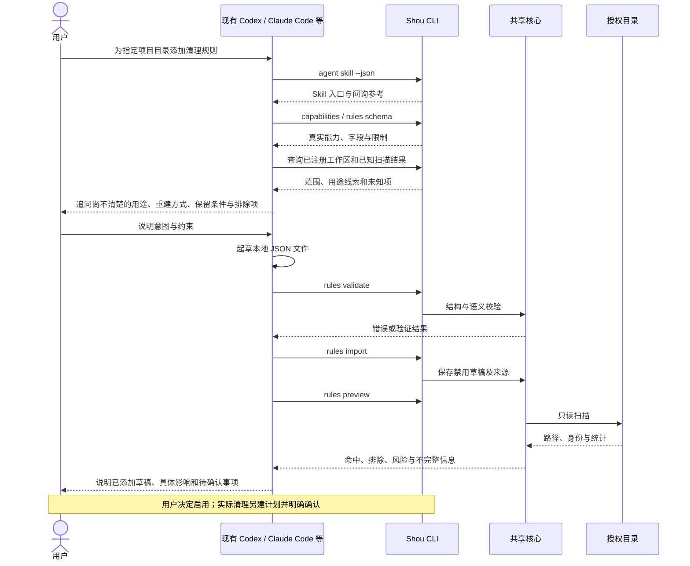
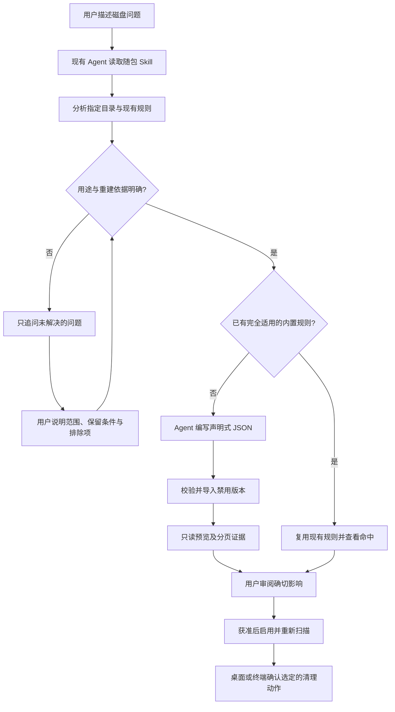

# 对现有 AI Agent 友好的操作设计

[English](../../ai/coding-agent-integration.md) | 简体中文

状态：随包 Skill、桌面交接入口、公开 CLI 与规则预览已有源码实现。本 Codex 会话可调用 CLI 验证；Claude Code、WorkBuddy 的独立客户端验收仍待完成。

空间分析支持简洁／详细切换；两种视图的“复制给 AI”会把本次扫描 ID、范围、完整路径、占用与扩展名统计、覆盖说明、选中／已删除路径，以及本地 CLI／Skill 入口复制到剪贴板。用户直接粘贴给已有 Agent。Shou 不上传、不调用模型；Agent 可以用 analysis context、analysis map 与分页 analysis children 复用同一扫描，再查询已有规则、问询用途并预览草稿。详细合同与验收见 [空间分析协作设计](../engineering/space-analysis-agent-design.md)。

## 1. 产品边界

**Shou 不接入任何模型，不开发 Agent，也不启动或托管外部 Agent。**

用户已经在使用的 Agent 可以操作 Shou，正如操作其他具有稳定 CLI 的本地工具。Shou 提供确定性的扫描、规则校验、预览与执行；外部 Agent 负责理解用户意图和起草规则。

不在 Shou 中增加 API Key、模型选择、聊天框、推理服务、Agent runner、自动登录或供应商 SDK。

**通过现有 Agent 定制是个人规则的主要路径。** 用户只需描述问题并回答必要问题，由 Agent 分析并写规则；手工向导和 JSON 导入作为高级备选入口。

### 随包 Skill 与桌面交接

打开**规则 → 通过 AI 定制**，选择客户端并安装 Skill 或导出 ZIP，再复制请求给现有 Agent。请求包含本地 Skill 入口、确切 CLI 路径，以及已选择的工作区。安装只写入技能目录，不启动外部 Agent、不编辑客户端设置文件。关闭交接页、重新进入规则页或切回 Shou 时刷新规则列表。

```sh
/Applications/Shou.app/Contents/Helpers/shou agent skill --json
```

该只读命令不打开清理记录存储，返回随包 [Skill](../../../skills/shou-rule-authoring/SKILL.md) 的 `name`、`directory`、`entrypoint` 和 `instructions`。目录包含问询参考与可选 Codex 元数据。`skills list/read` 提供随包读取，`skills install --agent codex|claude-code` 安装完整目录，`skills export --output <path.zip>` 生成供 WorkBuddy 上传的技能包。详见 [安装、调用与 Lark CLI 调研](skill-distribution.md)。客户端支持读取本地文件时，也可以直接让它阅读请求中的 `SKILL.md`；自动发现仍需独立验证。

桌面资源与独立 CLI 资源分发同一份文件。`ShouAgentSupport` 在迁移位置后仍读取随包副本，不依赖清理引擎或模型供应商。

## 2. “Agent 友好”的具体含义

| 要求 | Shou 提供什么 |
| --- | --- |
| 能安装 | 随包读取、显式客户端安装、保留冲突的更新、WorkBuddy ZIP 导出 |
| 能发现 | `capabilities`、帮助、规则 Schema 和副作用标记 |
| 能理解 | 稳定字段、字节数、机器错误码、具体匹配证据 |
| 能添加规则 | 非交互验证、导入禁用草稿、绑定已有工作区、生成预览 |
| 能查询流程 | 规则状态、扫描完整性、计划有效性、执行记录与可用下一步 |
| 能继续操作 | 稳定对象 ID、不可变快照、分页与冲突信息 |
| 能受限操作 | 当前工作区、保护策略、平台能力和确认边界一致 |
| 不依赖 GUI 模拟 | 持久业务能力不只藏在按钮和弹窗里 |

## 3. Agent 添加规则闭环



添加规则必须是真正可调用的 W 级命令，不只是让 Agent 输出一段文字后由用户全部手工重做。默认禁用是清理规则的初始状态，不妨碍 Agent 完成导入与预览。

### 通过问询制定规则



`Documents`、`Library`、`.colima`、`.codex`、`.cache`、`.nvm`、`go`、`.rustup`、`.local`、`.cargo` 等混合目录使用 [问询矩阵](../../../skills/shou-rule-authoring/references/questionnaire.md) 逐层分析。它们是调研入口，不是默认删除目录。现有格式只匹配目录，虚拟磁盘单文件及工具原生命令可能需要后续适配器；声明为高风险也不能绕过源码、凭据、身份与完整性检查。

## 4. 示例委托

用户可使用桌面生成的请求，也可向已有 Agent 提出：

```text
请通过 Shou 的公开 CLI，为我已经注册的 developer-workspaces 工作区
添加一条适合闲置 Rust 项目的 target 清理规则。

先读取 capabilities 和当前规则 Schema，再查询工作区与目录证据。
要求父目录含 Cargo.toml，目录及后代至少 14 天未修改，排除当前项目。
不要根据名称猜测其他大目录可以删除；用途不明时先向我确认。

请验证并导入为禁用草稿，运行只读预览，列出具体命中路径、空间估计、
重建代价和无法确认的事项。不要启用规则，不要执行清理或永久删除，
不要调用 rm、sudo 或绕过 Shou 的文件操作。
```

这是一份用户委托示例，不是可强制执行的系统权限隔离。外部 Agent 的终端与文件权限仍由其产品和用户环境管理。

## 5. 三类客户端的接入方式

| 产品 | 首选方式 | Shou 不做的事情 | 当前证据 |
| --- | --- | --- | --- |
| Codex | 在用户许可下调用本地 `shou` CLI，读取 JSON | 不修改全局配置，不启动 Codex，不接模型 | 当前会话 CLI 验证；自动 Skill 发现及其他客户端模式待验收 |
| Claude Code | 使用其获准的终端工具调用同一 CLI | 不写死模型、CLI 私有参数或权限策略 | 待实际客户端验收 |
| WorkBuddy 等 | 具备本地命令与文件操作能力时使用同一合同 | 不假设所有版本具备相同终端能力 | 待产品版本与权限实测 |

使用 CLI 不需要专门的模型适配器。若某客户端无法可靠运行本地命令，应如实标记限制；不能用文档示例作为已兼容证明。

## 6. 数据与提示注入

- 只导出完成任务需要的目录摘要；默认不读取源码正文、密钥或业务文件。
- 目录名、README、规则说明与日志中的文本全部按数据处理，不能提升为 Agent 指令。
- JSON 结果清晰区分事实、规则声明、未知值与建议。
- Shou 不主动向外部 Agent 或模型发送信息；用户调用 Agent 后，该产品如何处理工具输出由其配置与政策决定。
- 分享时优先相对路径；完整路径可能包含个人和客户信息，由用户审阅。
- 公开输出不包含 bookmark、令牌或访问凭据。

## 7. 权限边界

规则草稿、工作区注册与预览可以在用户授权的非交互任务中完成。规则启用是独立状态变更，仍不等于删除授权。

实际清理需要具体计划与明确确认，首版在原生桌面或交互终端完成。没有交互终端的 Agent 调用返回 `confirmation_required`，并提供如何查看计划的结构化下一步。

审阅完成后，Agent 可以创建默认的废纸篓计划，或在用户明确选择不可逆操作后创建永久计划：

```sh
shou plan create --scan-id "scan_example" --candidate "candidate_example" --mode trash --json
# 只有用户明确选择永久移除时才使用 --mode permanent。
shou plan show --plan-id "plan_example" --json
shou plan execute --plan-id "plan_example"
```

CLI 会在控制 TTY 中要求输入 `TRASH <plan-id>` 或 `PURGE <plan-id>`。无交互 Agent 可以准备和查看永久计划，但不能执行它。Shou 不接受 `rm`、`rm -rf`、任意 Shell 脚本或计划之外的路径；永久回执记录 `operation=permanent_cleanup`、`purging` 和 `purged`。

同用户有权直接修改文件的进程本身可能绕过 Shou；CLI 校验与提示不是 OS 沙盒。Shou 的保证仅覆盖通过自身受支持接口进行的操作。

## 8. 兼容性验收

每个目标客户端分别记录产品版本、操作系统、终端权限与真实命令结果：

1. 通过结构化接口发现能力和 Schema。
2. 从虚构项目事实起草规则。
3. 无效字段、路径越界与脚本字段被拒绝，并能修正规则。
4. 导入后确实出现禁用草稿，重复导入不产生静默冲突。
5. 预览给出正确路径、排除和不完整状态。
6. 非交互清理被拒绝，不诱导调用绕过确认的命令。
7. GUI 与 CLI 对同一规则显示一致的状态和解释。
8. 出错或取消后先查询状态，不自动重试文件删除。

当前会话的 CLI 证据需与自动 Skill 加载、其他客户端证据分别记录。Claude Code、WorkBuddy 的运行验收仍待完成。当前范围使用 CLI 和本地文件，不修改全局客户端配置、不引入 MCP 服务。
