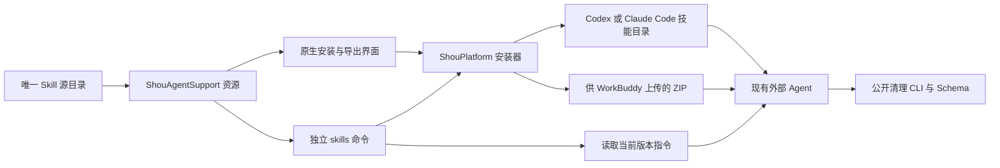
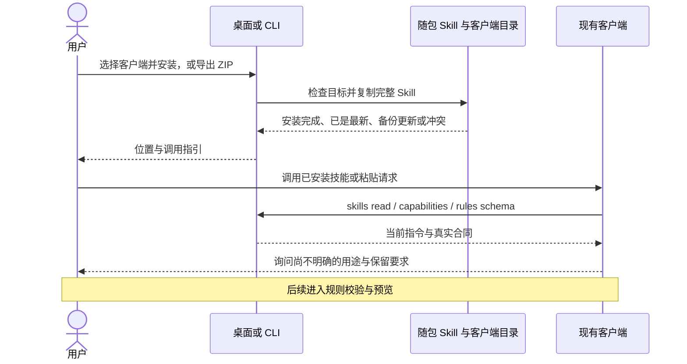

# Skill 安装与分发

[English](../../ai/skill-distribution.md) | 简体中文

调研日期：2026-10-20。本地安装、随包读取与 ZIP 导出已有实现；客户端发现与任务执行需分别实测，分发指令本身不代表兼容性验收完成。

此前 macOS 验证：137 项核心测试、114 项真实 CLI 合同检查、4 项终端确认检查及隔离原生清理／恢复／永久移除检查通过。安装测试覆盖重复安装、受管更新备份、本地修改保留、非法文件、链接与 ZIP 内容，不写入真实客户端目录。Computer Use 验证了安装版中文交接页、Codex／Claude Code 指引和复制请求；独立数据副本验证了 WorkBuddy 原生保存面板导出及英文规则页。ZIP 的三个文件与源码一致。后续 UI 读取返回超时／无窗口错误，因此不计完整英文交接页及本轮切回中文通过。未配置或启动外部客户端进行验收。

## Lark CLI 的做法

官方 [Lark CLI 指南](https://github.com/larksuite/cli/blob/main/README.zh.md) 提供 `npx @larksuite/cli@latest install`。[安装向导](https://github.com/larksuite/cli/blob/main/scripts/install-wizard.js) 安装 CLI 后，委托 `npx skills add <repository> -y -g` 安装 Skill。源码安装路径则明确列出 `npx skills add larksuite/cli -y -g`。

其 [skills 命令实现](https://github.com/larksuite/cli/blob/main/cmd/skill/skill.go) 还提供 `skills list` 和 `skills read <name> [relative-file]`。技能指令与参考文件在构建时嵌入，Agent 无需查找源码仓库，就能读取与当前 CLI 版本对应的内容；读取技能不需要业务认证。

Shou 学习这种分发与发现方式，使用自己的 Swift 实现。当前规则制定任务只需要一个标准 Skill。原生安装器复制随包文件，不要求 Node.js、账号或联网；Shou 不依赖 Lark CLI 或 Skills CLI。

## 安装随包 Skill

打开**规则 → 通过 AI 定制**，选择客户端，再点击**安装 Skill**或**导出 Skill 技能包…**。安装只写入指定技能目录，不启动客户端、不编辑其设置文件。将准备好的请求复制给客户端，即可提供确切 CLI 路径和选定工作区。

应用内的独立 CLI 提供相同能力。其他示例使用 `shou` 简写；未加入 `PATH` 时使用完整路径：

```sh
"/Applications/Shou.app/Contents/Helpers/shou" skills install --agent codex --json
"/Applications/Shou.app/Contents/Helpers/shou" skills install --agent claude-code --json
"/Applications/Shou.app/Contents/Helpers/shou" skills export --output "$HOME/Downloads/shou-rule-authoring.zip" --json
```

Windows Skill 安装与导出待实现，使用 .NET CLI 与原生确认，文件系统和界面行为需独立验收。

```powershell
& "C:/path/to/Shou/Engine/shou.exe" skills install --agent codex --directory "C:/path/to/project/.agents/skills" --json
& "C:/path/to/Shou/Engine/shou.exe" skills export --output "$env:USERPROFILE/Downloads/shou-rule-authoring.zip" --json
```


按需选择一条命令，无需为所有客户端安装。

| 客户端 | 安装位置／导入方式 | 调用方式 |
| --- | --- | --- |
| Codex | `~/.agents/skills/shou-rule-authoring/SKILL.md` | `$shou-rule-authoring`，或与描述匹配的自然语言任务 |
| Claude Code 本机会话 | `~/.claude/skills/shou-rule-authoring/SKILL.md` | `/shou-rule-authoring`，或与描述匹配的自然语言任务 |
| WorkBuddy | 导出 ZIP，在**专家·技能·连接器 → 技能 → 添加技能 → 上传技能**导入并启用 | 发起任务，要求使用 Shou 规则制定技能 |

[Codex 官方文档](https://developers.openai.com/codex/skills/) 明确用户目录为 `~/.agents/skills`，仓库目录为 `.agents/skills`。Codex 自动检测变更；未出现时重启客户端。[Claude Code 官方文档](https://code.claude.com/docs/en/skills) 明确用户目录为 `~/.claude/skills`、项目目录为 `.claude/skills`；本机文件不会自动提供给远程运行环境。

[WorkBuddy 官方文档](https://www.workbuddy.cn/docs/workbuddy/From-Beginner-to-Expert-Guide/Function-Description/Skills-Market) 明确自定义技能包通过上传安装；对话安装用于技能市场。已查页面没有确立稳定的用户级自动扫描目录。WorkBuddy 与 CodeBuddy 是不同产品，不能套用 CodeBuddy 的目录或 Agent 标识。ZIP 导出已实现，WorkBuddy 实际上传验收仍待完成。

如需仅对项目安装，明确指定父级技能目录：

```sh
shou skills install --agent codex --directory "/path/to/project/.agents/skills" --json
shou skills install --agent claude-code --directory "/path/to/project/.claude/skills" --json
```

安装器会追加 `shou-rule-authoring`，`--directory` 是父目录，不是最终技能目录。目标路径或已安装内容包含符号链接时拒绝写入；若客户端使用链接目录，可显式选择真实目录，或通过客户端支持的安装工具管理副本。

## 无需安装也能读取

```sh
shou skills list --json
shou skills read
shou skills read shou-rule-authoring references/questionnaire.md --json
shou skills read --file references/questionnaire.md --json
shou agent skill --json
```

`skills read` 默认输出原始 Markdown；`--json` 在标准信封中返回 `name`、`file`、`content`。只允许读取三个随包文件：`SKILL.md`、`references/questionnaire.md`、`agents/openai.yaml`。`agent skill` 另返回本地 `directory` 和 `entrypoint`。以上命令均不打开清理记录存储。

与 Lark CLI 类似，支持 `skills read shou-rule-authoring`、单独的相对文件参数，以及 `skills read shou-rule-authoring/references/questionnaire.md`。同时使用位置参数和 `--file` 选择文件会被拒绝。`shou skills --help` 只展示技能组，`shou capabilities --command skills --json` 返回该组机器合同；能力发现同样不依赖清理存储可用。

客户端支持本地文件与命令时，也可不安装，直接使用桌面复制的请求，让它读取随包 `SKILL.md`。这是显式交接，不代表自动发现。已安装 Skill 副本较旧时，以实际 CLI 的能力、Schema 与随包指令为准。

## 更新与冲突

桌面与独立 CLI 分发同一份源 Skill。更新 Shou 会替换随包副本，不会静默修改客户端中已安装的副本。升级后再次点击**安装 Skill**：

- 内容一致时返回 `already_current`。
- 旧副本由 Shou 管理且文件摘要与记录一致时，先移动到同级 `.shou-rule-authoring-backup-<id>`，再安装新版。
- 本地修改、未知文件或非 Shou 管理的冲突返回 `version_conflict`，保留已有内容。
- ZIP 导出不覆盖已有文件。

这些检查用于防止日常误覆盖，不能隔离具有相同文件权限的其他进程，也不承诺消除并发路径变化竞态。

## 可选仓库分发

待技能文件发布到远程仓库后，使用 [Vercel Skills CLI](https://github.com/vercel-labs/skills/blob/main/docs/commands.md) 的用户可以选择：

```sh
npx skills add limecloud/shou --skill shou-rule-authoring -g -a codex
npx skills add limecloud/shou --skill shou-rule-authoring -g -a claude-code
```

这些命令依赖远程发布。本地实现不代表远程已有相应文件。已查[支持客户端列表](https://github.com/vercel-labs/skills/blob/main/docs/agents.md) 包含 CodeBuddy，未确立 WorkBuddy 支持。随包安装器和 ZIP 导出不需要此可选工具。

## 架构与时序





后续见 [Agent 制定规则流程](coding-agent-integration.md) 和 [CLI 合同](agent-and-cli-contract.md)。安装技能只改变可读取的指令，不会启用规则或授予清理权限。
