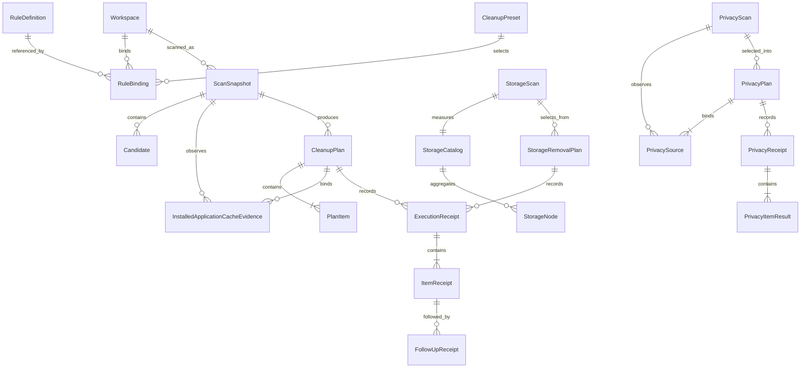
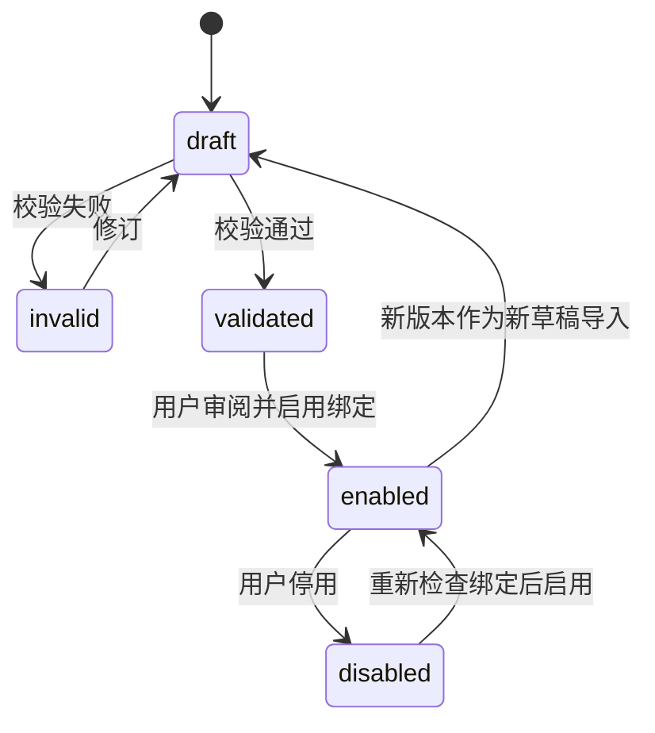
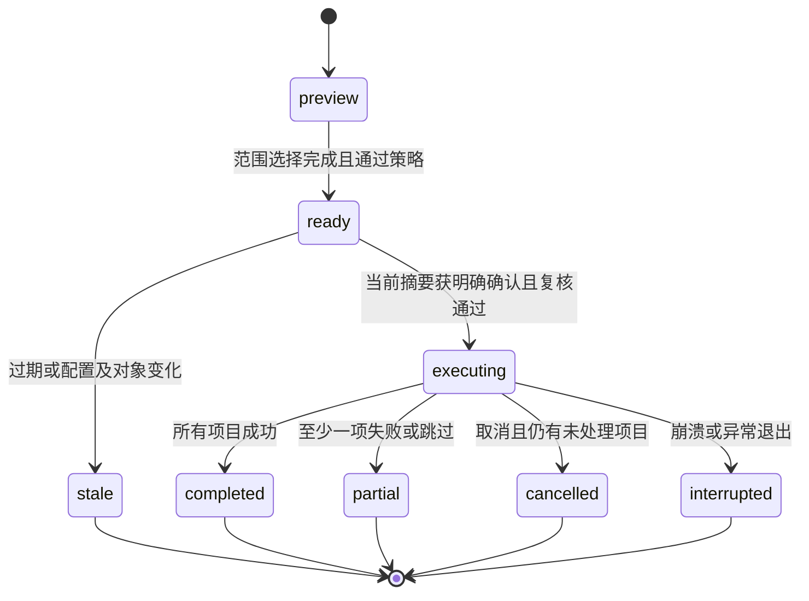
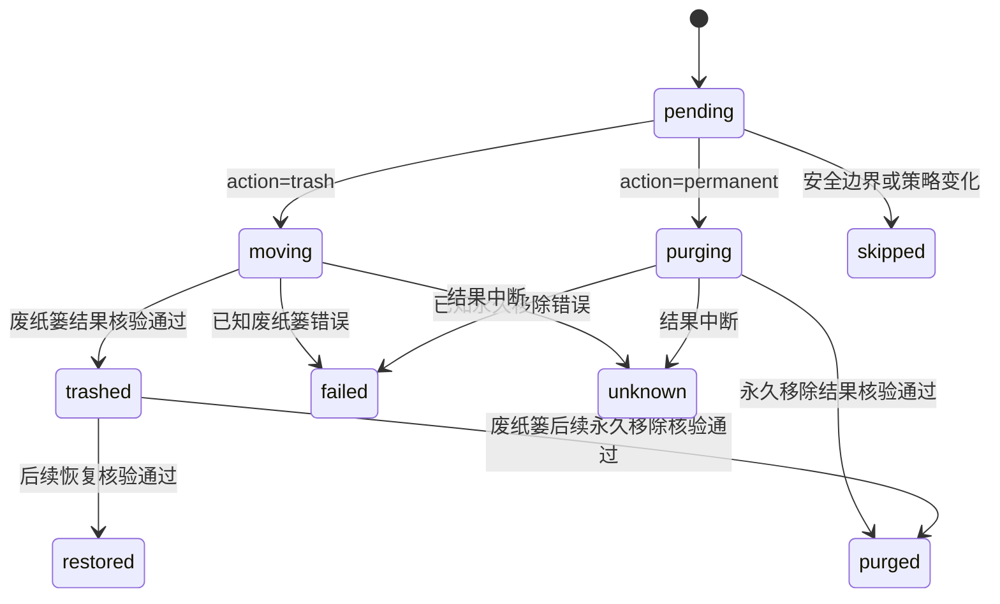

# 领域数据模型

AI 连接、调查、证据、Jev 判断及检查点的已有字段，以及总开关、Jev 优先路由／分服务统计的待实施扩展，统一见[AI 数据与持久化合同](embedded-ai.md)。AI 调查状态不等同清理计划或执行回执状态，模型结果不会生成删除许可。

[English](../../architecture/data-model.md) | 简体中文

状态：开发合同。[Swift 模型](../../../packages/shou-core/Sources/Models.swift)已实现当前实体；完整状态流转与中断验收仍待完成。

本文件的实体与安全语义跨端对齐，Swift 字段和已有记录读取策略属于 macOS 存储合同。Windows 使用独立的 C# 记录格式，见 [Windows 原生记录](#windows-原生记录)，不把平台存储布局作为共享 ABI。

## 1. 实体关系

关系为概念表达；规则绑定可被多个方案引用，计划项目必须保留扫描来源和规则版本快照。

## 2. 核心实体

| 实体 | 关键字段 | 约束 |
| --- | --- | --- |
| Configuration | 存储版本、修订号、工作区、绑定、可选 `global_exclusions` | 保护配置变化使此前扫描与计划证据失效 |
| Workspace | `id`、`root_ref`、本地路径、卷与根身份、访问凭据 | 凭据与路径不进入可分享规则；每个入口验证实际访问 |
| RuleDefinition | `id`、`version`、`schema_version`、来源、正文摘要、内容 | 同版本内容不可静默变化；草稿不等于启用 |
| RuleBinding | 工作区、规则版本、启用状态、排除与本地覆盖摘要 | 根引用在本机显式绑定；变更后旧计划失效 |
| CleanupPreset | 名称、规则绑定引用、选择偏好 | 保存选择逻辑，不保存通用删除许可 |
| ScanSnapshot | ID、`scope`、`treeComplete`、`completedPaths`、配置摘要、状态、统计 | 仅独立完整且符合策略的候选可生成可执行计划项目 |
| Candidate | ID、相对路径、项目线索、身份、占用、风险、证据 | 大目录可以无规则；无规则候选不能直接执行 |
| CleanupPlan | ID、合同版本、摘要、创建/过期时间、规则与配置摘要、`action`（`trash` 或 `permanent`）、状态 | 绑定具体候选、处理方式和完整清单，不动态扩展；确认后动作不可改变 |
| PlanItem | 候选引用、原路径、文件身份、目录清单摘要 | 同一计划内不得重复或存在未解决的父子目标冲突；完整清单是永久移除边界 |
| InstalledApplicationCacheEvidence | `rule_id`、完整 `application` 定义及可选 `ownership_coverage_incomplete` | 仅绑定一条缓存规则的实装归属证据和覆盖限制，不授予应用包移除权限 |
| Confirmation | 计划 ID 与摘要、入口、确认时间、范围 | 当前进程内一次性使用；不得把落盘布尔值当作授权 |
| ExecutionReceipt | 计划引用、执行 ID、入口、阶段、总体结果 | 执行意图先落盘，逐项追加结果；可表示部分成功 |
| ItemReceipt | 原路径、实际目标位置、前后身份、状态、错误 | `purging` 是持久化意图；只有平台成功结果才能进入 `purged`；恢复与永久移除必须重新核验 |
| FollowUpReceipt | 原项目引用、恢复/永久移除、时间、结果 | 独立确认；不修改原始执行事实 |
| StorageScan | 根目录身份、空间索引 ID、已计量数量、覆盖缺口 | 空间计量独立于删除清单 |
| StorageCatalog / StorageNode | 父目录 ID、名称、文件身份、实际占用与逻辑汇总、逐目录完整性 | SQLite 保存完整计量条目，浏览时按需查询直接子项 |
| StorageRemovalPlan | 所选路径、当前完整清单、准确动作与摘要 | 执行前独立重新核验，跳过位置不能提供删除证据 |
| PrivacyScan | 固定范围、用户目录及配置身份、来源汇总观察、过期时间 | 仅数量与来源描述，来源可用不授予删除权限 |
| PrivacyPlan | 确切可用来源、固定边界、证据、退出登录确认、摘要及状态 | 永久删除记录，仍需当前执行确认；最长有效五分钟 |
| PrivacyReceipt / PrivacyItemResult | 来源 ID、固定边界、数量、逐项状态与脱敏错误 | 独立于文件删除历史，无记录内容、废纸篓路径或恢复能力 |

有 catalog 的 macOS 新 `StorageScan` 只内联根身份、catalog 引用、实际条目计数和覆盖摘要，不因条目少于 10,000 而另存一份完整数组。完整明细仍保存在 catalog；浏览、选择审阅、历史比较、CLI 与 AI 通过现有查询读取。无 catalog 的旧内联记录继续可读；根条目数组长度不能代替 `entryCount` 或完整明细查询。

## Windows 原生记录

当前源码使用严格的版本化 JSON：拒绝未知或重复字段、无效引用、摘要不一致和不支持的版本。落盘确认字段不能授予执行权限。

| 记录 | 版本／限制 | 合同 |
| --- | --- | --- |
| `Configuration` | 1／16 MiB | 修订、工作区根与身份、导入定义、绑定及全局排除；最多 256 个工作区、512 个规则版本、4,096 个绑定，每组排除最多 1,024 条模式 |
| `Workspace` | 属于配置 | `ws_` ID、`root_ref`、Windows 绝对路径、卷／File ID／owner SID、目录大小写行为、自身排除与 UTC 注册时间；根替换后不静默重绑定 |
| `CleanupScan` | 1／元数据 128 MiB、每页 16 MiB | `scan_` ID、完整工作区、扫描预算、配置修订与摘要、确切规则定义与摘要数组、测量树、候选、分析缺口及 `preview_only` |
| `ScanSnapshot` | 属于扫描 | 根身份、UTC 开始时间、条目、问题、`scope` 及必填的 `completed_directories`；`full_tree` 表示整树观察，`rule_targets` 表示规则定向观察；旧记录缺省为前者，未知值拒绝；逐目录正向完整证据保留部分覆盖中的完整兄弟目标 |
| `CleanupPlan` | 2／元数据 128 MiB、每页 16 MiB | `plan_` ID、`sources` 中的扫描 ID／工作区身份／规则、共同配置与预算、动作、目标清单及上下文和摘要；每个项目的 `scan_id` 绑定一个来源，总计明确选择 1–256 个互不重叠目标，有效十分钟 |
| `CleanupExecution` | 1／1 MiB | 与计划一一对应的 `execution_` ID、计划摘要、动作、UTC 时间、总体及逐项状态；意图存在后禁止重放 |
| `ApplicationUninstallPlan` | 1／128 KiB | `uninstall_plan_` ID、当前用户 SID、UTC 创建／过期时间、完整安装审阅、显式安装程序数据影响同意与摘要；有效十五分钟，公开执行入口关闭 |
| `ApplicationUninstallExecution` | 1／16 KiB | 每计划一个 `uninstall_execution_` ID、计划摘要／用户／UTC 时间、`uninstalling` 意图及分离的原生结果／安装身份观察；任何意图阻止重放 |

同 ID／版本导入不同内容返回 `version_conflict`；导入新版本不自动升级已有绑定。扫描合并全局、工作区和规则排除。配置变化生成新修订，扫描发布时在存储租约内重读并比较当前配置摘要。普通扫描冻结全部启用版本；草稿预览仅包含指定规则并标记 `preview_only=true`，不能成为计划来源。

内置定义仅从当前包内目录生成，默认启用。内置 `RuleBinding` 按工作区和稳定规则 ID 保存 `Enabled` 偏好；其中版本与摘要是上次选择的元数据，不是可注入的定义，也不固定后续扫描使用旧资源。资源升级保留停用偏好，未知但格式有效的历史偏好不产生规则。个人规则不能导入 `shou.builtin.` 命名空间。普通扫描冻结实际使用的当前内置定义；规划与确认重新比较有效规则版本及摘要，资源变化使旧证据失效。

位置发现返回配置修订、候选路径、来源、可用状态、问题及已核验身份，属于临时观察。整批登记先重查身份，并在同一配置事务中拒绝修订变化或重叠范围；不将发现清单当作持久授权。批量扫描按每个工作区分别保存 `CleanupScan`，不存在合并主目录计划。临时 `SystemScan` 仅组合这些快照、`issues` 和 `state`；界面已配置位置批次可返回 `complete`、`partial` 或 `cancelled`。取消保留此前已发布扫描，不授予计划或执行权限。

应用注册发现不独立落盘。`ApplicationCatalogSnapshot` 由 `applications_` 观察 ID、UTC 时间、状态、应用数组、逐来源覆盖和限制组成。每个应用的稳定 `application_` ID 取来源与精确注册键的 SHA-256；包含 `source`、`registration_key`、`name`、可空版本／发布者／未核验安装位置／注册大小、`is_system_package`、`uses_windows_installer` 与问题。注册大小单位为 bytes，仅转换安装程序 KiB 估计。ID 不是文件身份或卸载许可。`ApplicationCatalogPage` 返回 `snapshot_id`、筛选总数、偏移、条目和 `has_next`；GUI 保留快照，CLI 跨调用不保留。来源和预算合同见[应用发现](../product/application-uninstall.md#windows-应用发现与卸载边界)。

`ApplicationUninstallReview` 保存精确注册、系统安装身份、可空目录身份、保护与问题、`activity` 状态／原因、UTC 观察时间、阻断、警告及摘要。摘要排除观察时间，绑定其余事实；MSI 身份包括 ProductCode／PackageCode／上下文／SID，MSIX 包括精确 full name／family name／SID。审阅不独立落盘，创建计划时重新观察并作为计划内容保存。可准备计划必须具有已核验目录身份与 `idle` 活动观察；该观察只描述当次安装目录，不授予未来执行。计划使用同一私有存储租约，拒绝未知／重复字段、无效身份、错误所有者、缺少同意及摘要不一致；本地摘要不是防篡改签名。读取计划不复核当前安装，也不授予执行；`execution_available` 为只读的 `false`，篡改 JSON 布尔值不能改变能力。`ApplicationUninstallConsent` 为不可序列化的进程内一次性确认，绑定精确计划／摘要，有效期不超过一分钟和计划期限。`ApplicationUninstallExecution` 分别保存 `outcome` 与独立的 `presence`、原生状态码、重启要求和原因；只有安装程序成功且原身份不存在才为 `completed`，未完成意图或未知结果要求后续核验。`RetryAvailable` 与 `RestoreAvailable` 始终为 false；只读结果查询验证计划绑定，不刷新现场或授予重放。

候选保存身份、相对路径、分配／逻辑容量估计、最新修改时间、风险、覆盖、阻止原因，以及完整目标的目录清单摘要。`review` 表示可供审阅；公开 CLI 仍返回 `execution_available=false`，变更能力须等待原生验收。分页结果保留配置来源与草稿标记，游标绑定扫描 ID、保存字节与偏移；已保存观察不能代替执行前实时核验。

`ApplicationUninstallViewModel` 的 `ExecutionPlanId` 仅为页面内查询上下文，不是存储授权。执行开始即清空可执行计划、审阅与数据同意；`Executing` 持续到领域任务返回，停止请求不能丢弃真实执行结果。`ReadingExecution` 可取消并丢弃迟到读取，结果必须匹配计划 ID、摘要和用户。错误保留查询上下文，刷新、重新选择或销毁会清除它。

Core 计划与执行编排已用模拟能力接口测试。CLI 已组装计划创建和原生适配，执行入口保持关闭，等待原生验收。规划时重新观察确切文件占用，以及固定工具已核验工作目录与项目的重叠；未知活动阻断，活动观察不作为可复用的确认记录。计划摘要绑定所有冻结字段；当前确认仅存在于服务实例中，最长一分钟、单次消费且不超过计划期限，不能从存储恢复。执行日志与大清单分开保存；逐项先记录 `purging`／`moving`，再记录实际结果。日志失败停止派发，未完成意图保持不确定，不能根据缺失回执重放。

历史列表仅验证执行日志结构，明确返回 `plan_verified=false`；详情与现场核对须重读计划，校验摘要、动作、当前用户身份、时间与逐项结果。`trashed` 回执要求零移除计数、新位置和原始根身份；最终总体状态必须与逐项状态一致。列表游标绑定整个日志集合的原始字节摘要与页大小。核对持同一只读租约，共用所有位置的条目与时间预算；观察不更新日志、不授予恢复、不将未完成意图升级为成功。命令、位置状态和现场评估见 [Windows 历史指南](../engineering/windows.md#历史查询与现场核对)。恢复仍未实现。

Windows 自主管理数据根和 ACL，发布保证单条记录原子替换，不保证多记录事务。当前格式与限制独立于 macOS 存储版本、CLI API `1.0` 和规则 Schema `1.0`。命令、预算与私有存储行为见 [Windows 开发](../engineering/windows.md)，验证证据见 [SYNC.md](../../../SYNC.md)。

## 不可变清单分页

macOS `StorageRemovalPlan` 使用版本 1 外层记录，保存精简计划及清单引用；`storage-plan-manifests` 每页最多 4,096 条。页面 ID 绑定父记录、目标序号、页序号与 SHA-256 内容摘要，计划摘要绑定精简元数据及全部页摘要。全部页面持久化后才发布元数据，状态更新只重写元数据。日志版本 2 在 `history-manifests` 复用同一分页能力，小清单及旧内联记录继续可读。保留策略保护活跃父记录及全部引用页，回收时先移除父元数据再清理派生页。

分页编码直接使用固定 snake-case 字段名，按切片逐条编码，省去每条记录重复转换键名及分页数组复制。仍使用 Foundation JSONEncoder 的排序与字符串转义，输出必须逐字节等同 `Codec.encode([FileEntry])`，包括可选内容摘要的省略；旧解码器、页面摘要、计划确认摘要与格式版本不变。字段增减需同时维护该编码与字节兼容检查。

空间删除执行在同一变更租约内加载并验证计划页与解码清单。首次历史保存优先复制这些已验证页面的原始字节，复制时重新核对数量、页 ID 和 SHA-256；清单发生变化或无分页来源时沿用原编码。历史使用自己的页 ID 与 collection，全部页写入后才发布日志；计划过期回收不影响历史证据。不新增记录版本、共享物理页、跨操作授权缓存或 GC 迁移。

Windows 大扫描与大计划使用独立的 `format_version=1` 外层记录，领域合同仍为 `CleanupScan` 版本 1 和 `CleanupPlan` 版本 2。每页最多 4,096 条、16 MiB，小记录沿用内联编码。扫描页绑定计量项与目录完整性正证据，计划页绑定确切目标清单；独立执行日志仍引用原公共计划摘要。摘要直接流式写入 SHA-256，避免先分配完整树 JSON。读取期间持有同一记录租约，验证外层与页面摘要、数量、键及重建后的领域记录；缺页、修改或换序均拒绝。发布中断只留下无授权的孤立页，旧内联记录继续可读，不迁移用户记录。历史列表仍只读取精简日志，详情才验证计划分页。本次未新增 Windows 记录保留能力。

## 3. 规则状态

图中的新版本不覆盖旧版本事实；启用新版本会使引用旧配置的待执行计划失效。校验通过只表示格式与边界满足要求，不证明业务上可删除。

## 4. 扫描与计划状态

扫描状态：`running`、`complete`、`partial`、`cancelled`、`failed`。

- `partial` 表示至少存在无法读取、超出预算或无法完整判断的范围。
- `cancelled` 与 `partial` 不得伪装成 `complete`。
- 状态表示所请求扫描模式的完成情况，不能单独授权候选；某个无关子树不完整时，已完整测量的候选仍可保留执行资格，目标本身不完整则不可进入计划。

| 快照字段 | 含义 |
| --- | --- |
| `scope` | `full` 检查工作区目录树；`cleanup` 仅沿已启用规则可能命中的路径前缀发现，并完整测量命中的目标 |
| `treeComplete` | 整个工作区目录树是否已检查；清理模式的 `complete` 状态不代表该值为真 |
| `completedPaths` | 独立完整子树的相对根路径；候选须具有全树完整事实，或自身子树的正向完整覆盖证据 |

这些字段以可选形式兼容已有记录。旧记录没有 `treeComplete` 时沿用原有整树状态解释；没有 `completedPaths` 不提供任何独立覆盖证据，旧 partial 快照不能因此获得执行资格。计划保留扫描模式与预算，用于重新计算当前策略；每个选中目标仍须具有未变化的完整清单。

`ScanSnapshot.installedApplicationCaches` 和 `CleanupPlan.installedApplicationCaches` 编码为可选的 `installed_application_caches`。快照保存已启用动态规则的证据，计划仅复制已选候选引用的 Owner，并将其纳入摘要。每项以 `rule_id` 绑定完整 `ApplicationDefinition`：`id`、`path`、`source`、`identity`、`name`，以及可选的 `bundle_identifier`、`version`、`executable_name`、`info_digest`。partial 发现增加可选的 `ownership_coverage_incomplete: true`；完整发现省略该键。此标记将可见限制绑定到计划摘要；`CleanupReview` 将这类候选投影为可手选但无推荐资格。规则 ID 使用内置保留命名空间和标识的 SHA-256 十六进制摘要；名称与元数据本身不能授予清理权限。

缺失的可选数组和覆盖标记再次编码时保持省略，保留旧快照读取和计划摘要字节。仅含静态规则的旧计划不需要新证据；引用动态缓存规则却缺少对应证据的候选会被拒绝。创建计划、执行预检及每项变更前重新盘点并读取精确 Owner 和运行状态。已发现重复标识、Owner 来源不可用／未检查，或自身、后代、祖先路径异常均使该 Owner 失效。无关异常保留 partial 状态，仅允许已绑定标记且经明确审阅的候选；完整扫描变为 partial 必须重扫，partial 证据在盘点恢复完整后可继续保守保留限制。普通 `ExecutionReceipt`／`ItemReceipt` 及恢复原位置合同保持原有形式，因为目标是原工作区内的缓存，不是卸载组件。

应用发现问题独立于文件系统完整性。快照的 `installed_application_cache:application_discovery_unavailable`、`installed_application_cache:application_discovery_incomplete` 和 `installed_application_cache:ambiguous_application_owner` 会投影为可见的位置问题。整棵目录树完整不表示通用发现完整；静态规则仍可提供独立合格目标。

经过校验的时间预算也适用于扫描、计划及执行阶段的候选分析，各阶段的候选分析采用单调时钟截止时间。持久化记录中的预算超出受支持范围时，在重新计算策略前拒绝处理。

空间分析需要 `full` 扫描。清理快照是稀疏证据，未出现的目录与未访问的字节属于未知，不是零。界面和机器调用方须明确限制，不能将其根汇总或面积图当作完整磁盘占用。

首版计划有效期建议 10 分钟，由安全原型确定最终值。有效期未过也必须复核对象；改变选择范围、动作、规则或排除时生成新摘要并重新确认。`trash` 与 `permanent` 是两个正式动作，确认后不能互换。`partial`、`cancelled` 或 `interrupted` 不自动重试未完成项，需要新计划。

## 5. 项目执行状态

| 状态 | 含义 |
| --- | --- |
| `pending` | 尚未开始 |
| `moving` | 系统操作前已持久化逐项意图；若缺少结果，须核验 |
| `trashed` | 已核验并移到废纸篓，记录实际位置 |
| `purging` | 永久移除平台调用前已持久化意图；结果尚未确定 |
| `purged` | 绑定的原始目标已永久移除且结果已持久化 |
| `skipped` | 状态变化、受保护或用户取消导致未处理 |
| `failed` | 操作错误，记录错误类型与已知现场 |
| `unknown` | 中断导致无法确认结果，需要现场核对 |
| `restored` | 后续已核验并恢复 |

后续 `restored` 与 `purged` 是后续记录推导出的当前状态，不能覆盖初次清理记录；计划动作 `permanent` 的 `purged` 则表示首次执行已永久移除。`unknown` 不能自动当作失败重试，也不能据旧路径永久删除。

新记录的 `pending` 表示尚未保存逐项开始边界；旧版 `pending` 记录不能证明系统操作从未发生。每次系统清理调用前先保存 `moving`，写入失败则不调用文件操作，结果写入丢失时也不会把该项误标为跳过。

`HistoryInspection` 是独立的临时读取结果，保留原记录状态、核验时间、未完成标志及每项确切路径的观察。核验持有同一把修改锁，避免与其他 Shou 操作并发；目录检查共用条目和时间预算，比较完整清单与身份，沿用后续操作的已记录目录根 ctime 例外。此检查不对文件内容计算哈希，不把不确定项目升级为可执行项；缺少目标位置时不搜索用户废纸篓。尚未完成的恢复／永久移除仍保留 pending 并阻止重试，观察结果不能制造成功回执。

永久计划的回执 `operation=permanent_cleanup`，并单独计算 `permanentlyRemovedBytesEstimate`；该估算与卷可用容量不是同一指标。

执行进度属于临时状态：`stage`、`processedCount`、`itemCount` 和 `path` 描述实际工作，不构成新授权或持久结果。停止请求在安全的项目边界阻止新操作；正在进行的单次系统废纸篓操作可能先完成，随后须核对并记录最终回执。

后续操作共用该临时类型，不改变持久化回执或 CLI JSON。总数仅计明确选择的项目；`preflight` 表示只读核验，`restoring` 或 `purging` 在后续 pending 意图保存后开始。`processedCount` 仅在 completed 或 failed 结果保存后递增，表示已记录结果数，而非成功数。意图前取消不启动该项；恢复意图后完成并记录当前项，再在下一项边界响应取消。进度与批次勾选均不授予重试 pending 后续操作的权限。

## 6. 风险与解释

有效风险取规则声明、来源校验、保护策略与运行时证据中的较高等级：

- `review`：具有明确可重建依据，但仍需用户判断成本与当前用途。
- `high`：重建条件不足、用户自定义用途不明或存在明显代价。
- `blocked`：越界、受保护、状态不完整、已检测到活动等，不可进入执行集合。

首版没有“绝对安全”或自动执行风险等级。每个候选项记录：命中条件、规则来源、缺失证据、重建说明、保护/排除结果。

## 7. 路径与文件身份

- 规则包含相对路径；绝对路径只在本地绑定、预览与记录中出现。
- 工作区身份与文件身份使用平台提供的卷和对象标识，并记录可用的类型、大小、修改及元数据变化信息。
- 目录使用完整子项清单及其规范化摘要，不能仅检查顶层 `mtime`。
- 清单摘要不等于文件内容哈希，也不能证明内容可再生成。
- 不跨越卷、不跟随符号链接、不把 Unicode 大小写折叠的字符串比较当作文件系统身份。
- 对硬链接与 APFS 克隆的计量局限，在统计结果中保留说明。

## 8. 容量口径

| 字段 | 含义 | 限制 |
| --- | --- | --- |
| `logical_bytes` | 文件逻辑长度累计 | 稀疏文件等不等于实际占用 |
| `allocated_bytes_estimate` | 系统报告的分配大小估计 | 克隆、压缩、硬链接可能影响归因 |
| `trashed_bytes_estimate` | 本次成功移入废纸篓的原估计量 | 不代表已释放 |
| `purged_bytes_estimate` | 本次永久移除项目的原估计量 | 不保证全部转为可用空间 |
| `volume_available_before/after` | 操作前后系统报告的卷可用容量 | 受其他进程、快照与系统回收影响 |

机器合同一律使用整数 `bytes` 和 UTC 时间；UI 本地化显示，容量单位使用十进制，不混用 GB 与 GiB。

## 9. 持久化与保留

- 配置、规则和执行记录使用版本化格式，格式迁移失败不得覆盖旧数据。
- 扫描中间数据与已失效计划可按容量预算清理；执行记录单独管理。
- 首版历史默认保留策略在 M0 测量后确定，不因清理历史自动永久移除用户文件。
- 删除历史前需明确可能失去应用内恢复与归属核验入口；系统废纸篓中的文件不随之删除。
- 当前用户之外的账户无法通过默认配置访问记录；不把本地记录视为防恶意同用户进程的安全隔离。

## 10. 排除策略与配置兼容

`Configuration.global_exclusions` 是可选的相对模式数组，加载时校验每个模式。持久化 `Workspace.exclusions` 仅包含该工作区自身的排除；项目排除由确切的项目相对目录和相对模式组合而成。`ExclusionSettings` 返回全局、工作区数组及稳定去重后的有效数组，规则自身的排除独立保留。

扫描和草稿预览在匹配前合并工作区与全局保护，快照及计划的 `workspace.exclusions` 保存当时的有效策略。创建计划与执行时检查当前配置摘要、重新合并保护并复算候选资格，存储计划不能绕过后来新增的排除。受保护后代会阻止包含它的整个清理目标。

全局保护缺失或为空时，仍可读取配置版本 `1`。首次保存非空全局排除时，存储升级为版本 `2`；移除最后一条模式后仍保留版本 `2`。旧构建会拒绝版本 `2`，避免降级后静默忽略保护。包含非空全局排除的版本 `1` 配置会被拒绝。该存储版本独立于 CLI API `1.0` 和规则 Schema `1.0`。

## 11. 启动项发现

Windows 使用独立的临时 `StartupSnapshot`／`StartupPage`，包含 `startup_` 观察 ID、UTC 时间、状态、十项来源覆盖、条目及明确限制。`startup_item_` ID 对来源与注册 key 求摘要；注册表名称与计划任务标识忽略大小写，文件夹路径保留观察到的大小写；调度器路径不是文件路径，XML 和任务参数不进入条目；打包声明的 key 绑定包版本、应用 ID 和区分大小写的 TaskId 摘要，不能根据清单 Enabled 推断实际状态。条目不含命令行、参数或环境变量值。可空的可执行／配置路径仅是元数据线索，`enablement=unknown`、`running_state=not_observed`、`is_orphan=null`、`control_available=false`。来源状态为 `complete`、`missing`、`partial`、`unavailable`、`not_read`，超时来源计数可以为 null。界面查询同一不可变快照，CLI 每次重新观察，不提供跨调用 cursor。观察不持久化，也不授予变更权限。来源、预算及解析以 [Windows 启动项合同](../product/startup-items.md#windows-启动项合同)为准。

`StartupItem.scheduled_task` 为 null 或含布尔 `enabled` 与 `state`（`unknown`、`disabled`、`queued`、`ready`、`running`）的 `ScheduledTaskStatus`，仅允许 `scheduled_tasks` 来源提供。Platform 双读公开任务属性并复核定义，Core 校验来源与枚举。状态缺口保留注册，在条目与来源记录问题并标为 partial。任务引擎状态不改变 `enablement`、`running_state`、残留或控制字段；新快照不继承旧状态。

`StartupInventory` 是独立于清理存储的临时读取结果。`StartupDefinition` 保留来源／确切路径、标签、可选的绝对可执行路径、触发线索和仅来自定义的 Disabled 提示。当前用户 LaunchAgent 的配置状态与运行状态是有界、瞬时的 `launchctl` 观察；查询不可用或超时仍为 `unknown`，这些事实不产生执行权限。`StartupSourceCoverage` 区分已检查、不存在、部分完成、不可用及未检查。`launchd_definitions` 范围和明确列出的范围外来源，避免把完整读取指定目录误认为完整枚举 macOS 注册。见[启动项发现](../product/startup-items.md)。

## 应用审阅、计划与逐项原位置

`ApplicationCatalog` 按物理安装位置区分应用，即使完整标识相同也保留独立对象，并明确记录来源覆盖和问题。`ApplicationUninstallReview` 包含九类确切组件、完整清单、可处理状态、个人数据同意要求、阻止原因及不授予权限的覆盖提示。`ApplicationUninstallPlan` 绑定组件选择、应用元数据、配置、同意、预算和15分钟有效期。实际配置保存前使用稳定的 `unconfigured` 版本标识。

`ExecutionReceipt.operation` 为兼容旧回执而可选；应用卸载的每项保存 `UninstallReceiptOrigin`，包含组件类型、应用路径、可空标识与确切父目录身份；仅缺失有效元数据的应用包允许空标识，关联组件仍要求合法完整标识。普通清理回执不能使用该原位置能力。恢复分别验证组件类型对应的路径和父目录身份，不依赖事后重新发现应用或后来安装的应用。单应用与批量废纸篓结果可恢复；`application_permanent_uninstall` 和 `application_batch_permanent_uninstall` 记录不可恢复结果。`ApplicationUninstallBatchPlan` 绑定子计划、动作、到期时间和单个摘要，拒绝相同及父子重叠组件路径。旧单应用计划缺省 `action`，继续使用废纸篓语义和原摘要编码。

`FileEntry.contentDigest` 可选，缺省时不编码，保持旧目录清单不变。独立文件目标只有一条根记录和有界 SHA-256 内容摘要。废纸篓根比较仅归一化 ctime，仍匹配内容和其他全部元数据；目录后代仍严格比较元数据。详见[应用卸载](../product/application-uninstall.md)。

## 空间分析直接删除

空间分析支持本地卷或目录发现，以及明确选中文件和目录后的直接删除，独立于清理规则工作区。桌面列表和树图共用导航与去重选择；确认及执行时核验当前完整清单和排除配置，复用既有执行日志与历史。详见[空间分析架构、流程与时序](../product/space-analysis.md)。

默认空间统计与删除清单分离：只读 Worker 流式生成私有 SQLite 索引，保留全部已测量文件，逐目录汇总容量与完整性；桌面和 CLI 按需查询目录，不再受删除清单 100 万条上限截断。`StorageScan` 引用索引并记录 `measured_entry_count`，节点提供 `is_complete`，部分容量为已统计下限。删除仍重新获取所选目标的完整清单并独立核验。旧 JSON 与分页记录继续可读。

macOS 空间索引按 device/inode/owner 记录原生身份，按现有格式版本读取本平台索引。Windows 使用独立的卷标识、完整 File ID 与 owner SID 模型及本地记录格式，具体实现待完成。平台间共享安全与状态语义，不共用身份 DTO。

## 大文件查询状态

`StorageFileType` 与 `StorageLargeFilePage` 是已保存扫描的只读模型。分页包含条目、符合条件的总数、归属分配容量估计和可选游标。游标绑定扫描 ID、最小分配容量、扩展名类别及稳定顺序（分配容量降序、完整路径 UTF-8 升序）；改变条件后旧游标失效。类型根据文件扩展名判断，不检测内容。查询统计目录不遍历原始文件系统，也不赋予删除权限。跨分页全选汇集具体合格路径，仍通过已有 `StorageRemovalPlan` 和重新核验执行。

## 隐私扫描、计划与回执合同

实际模型位于 [PrivacyModels.swift](../../../packages/shou-core/Sources/PrivacyModels.swift)，分别使用 `privacy-scans`、`privacy-plans`、`privacy-history` 集合，隐私回执不是文件删除的 `ExecutionReceipt`。[架构、流程与时序](../engineering/privacy-cleaning.md#架构)说明共享 Core 服务及浏览器结构限制。下表 JSON 字段沿用 snake-case 编码和 UTC 时间。

| 模型 | 持久化字段 | 边界 |
| --- | --- | --- |
| `PrivacyScan` | `id`、`created_at`、`expires_at`、`range`、可选 `range_start`、`range_end`、`configuration_digest`、`home_identity`、`sources`、`issues` | 扫描时固定，15分钟有效；没有整体 `state` 字段，来源分别报告可用性 |
| `PrivacySource` | `id`、`definition`、`status`、可选 `record_count`、可选 `reason`、`evidence` | `definition` 含浏览器/名称、完整标识、配置名、类型、数据库相对路径及不支持标志；证据为目录、数据库及非空 WAL 元数据，不含逐条浏览记录 |
| `PrivacyPlan` | `id`、`scan_id`、`created_at`、`expires_at`、`range`、可选 `range_start`、`range_end`、`configuration_digest`、`home_identity`、已选 `sources`、`sign_out_acknowledged`、`state`、`digest` | 从扫描复制确切选择；到期时间取扫描期限与创建后五分钟的较早者；摘要计算将 `state` 归一为 `ready` 并清空自身字段，当前状态另行检查 |
| `PrivacyReceipt` | `id`、`plan_id`、`created_at`、`range`、可选 `range_start`、`range_end`、`state`、`items` | 创建时间为执行开始；不含来源描述、配置路径、记录值、恢复路径或 SQL 文本 |
| `PrivacyItemResult` | `source_id`、`state`、`removed_records`、可选 `reason` | 完成汇总数量及脱敏错误码；未完成或失败记录中的零不证明事务从未提交 |

`range` 为 `last-hour`、`last-day`（滚动24小时）、`last-seven-days` 或 `all-time`。所有时间不保存 `range_start`；`range_end` 仍用于审计，但所有时间不添加时间谓词。计算属性 `eligible`、`requiresSignOutConsent` 和总记录数不持久化。`PrivacyConsent` 是不可编码的当前调用值，含 `irreversibleDeletion` 与 `signOut`；计划中已存的影响确认不能替代它。

| 状态所属模型 | 实际存储值及含义 |
| --- | --- |
| 来源 | `ready` 表示结构受支持且匹配数大于零；`empty` 表示匹配数为零。`browser-running`、`permission-required`、`unsupported`、`schema-unsupported`、`unavailable` 均不可选；不可用的数量保持未知，不转为零 |
| 计划 | `ready` → `executing` → `completed` 或 `partial`。过期、配置/身份/数量变化或所属浏览器运行时，返回 `plan_stale` 或具体拒绝原因，不虚构落盘的 `stale` 状态 |
| 回执 | 首次数据库变更前为 `executing`；所有来源均完成才为 `completed`，任一失败或取消则为 `partial`。没有整体 `cancelled`、`restored` 或 `purged` 隐私状态 |
| 项目 | `pending` → `executing` → `completed` 或 `failed`；尚未开始的项目可转为 `cancelled`。逐项意图前的身份或活动检查失败可由 `pending` 直接转为 `failed` |

先保存计划执行意图，再保存回执；事务前先保存逐项意图。崩溃或结果写入失败可能留下 `executing` 或 `pending`，这些状态均不能证明未发生变更，不升级为成功，也不自动重试。数据库独立提交，后续来源失败不撤销先前已完成的来源。隐私没有恢复后续操作模型；逻辑删除记录不证明法证擦除或空间释放。

## Windows 计划任务开关记录

`StartupControlTask` 保存确切任务标识、不透明定义摘要、当前执行者 SID、开关及所有者／主体／上下文资格；其他账号只保留不匹配布尔值。`StartupControlReview` 格式版本为 1，ID 为 `startup_control_<32 hex>`，包含动作、任务事实、UTC 创建／五分钟过期时间、阻断原因和摘要。摘要绑定动作、事实与阻断原因，不含随机 ID 或时间。审阅只在内存存在；持久化对象不包含可恢复的执行批准。

`StartupControlExecution` 以相同 ID 保存格式版本 1、内嵌审阅、开始／更新时间、`applying|completed|failed|cancelled|unknown` 与可空结果。结果分别保存原生 `applied|not_started|unknown`、可空 `observed_enabled`、`definition_matches` 及结构化原因。只有原生已返回且定义／身份一致、开关符合请求才是 completed；applying／unknown 要求独立观察。记录限制 256 KiB，使用当前用户私有存储与现有变更租约；已有意图拒绝再次执行，查询不会重放或恢复授权。此链路与不打开存储的启动发现分开。具体资格和生命周期以[启动项合同](../product/startup-items.md#计划任务开关审阅与控制)为准。

## Windows 隐私观察

Windows 经现有私有 `IRecordStore` 保存 `privacy_scan_<id>`。`PrivacyScan` 版本 1 包含 `id`、UTC `created_at`／`expires_at`、固定 `window`（`range`、可空 `start`、`end`）、`configuration_digest`、`sources`、`issues`、`complete` 和 `digest`；摘要计算清空自身字段。本平台 JSON 的范围枚举为 `last_hour`、`last_day`、`last_seven_days`、`all_time`，CLI 参数继续使用连字符。过期观察仍可读取供审阅，不授予操作权限。

来源绑定标准 `PrivacySourceDefinition`（`id`、浏览器、profile、种类、固定数据库位置及路径）、状态、可空数量／原因／结构摘要和身份／ACL 证据。`ready`、`empty` 必须包含非负数量、结构摘要、AppData anchor 至父级的完整目录证据、一个主数据库及可选非空 WAL。全部条目身份唯一、当前用户所有且同卷，文件只允许一个硬链接。其他状态（`browser_running`、`activity_unknown`、`permission_required`、`schema_unsupported`、`unavailable`、`excluded`）仅含脱敏原因，不含数量或证据。缺口仅为浏览器／错误码。读取严格校验版本、未知字段、固定来源、状态、完整证据及摘要，损坏记录不能变成可用观察；记录上限 16 MiB。

`PrivacyPlan` 版本 1 另存为 `privacy_plan_<id>`，绑定扫描 ID／摘要、当前用户 SID、UTC 创建／过期时间、固定窗口、配置摘要、确切来源观察、Cookie 影响同意及自身摘要。最多选择 256 个具有正数量的 ready 来源，记录上限 8 MiB；来源顺序及证据必须与原扫描一致。保存的同意字段不能替代内存中的 `PrivacyConsent`；后者绑定当前服务、计划与摘要，一分钟内单次使用，且不能超过计划期限。

`PrivacyReceipt` 使用从计划 ID 确定的 `privacy_receipt_<id>`，版本 1，记录计划 ID／摘要、窗口、UTC 开始／更新时间、整批 `executing|completed|partial`、逐项状态及自身摘要，上限 128 KiB。逐项仅含来源 ID、`pending|executing|completed|failed|cancelled|skipped|unknown`、可空移除数量和受控原因码。回执不保存路径、profile、SID、SQL 或浏览记录。整批意图存在即禁止重放；逐项意图及结果写入失败不推定操作未开始，查询也不授予重试权。原生事务适配和公开入口接入待实现，见[隐私实施边界](../engineering/privacy-cleaning.md#windows-平台边界)。
