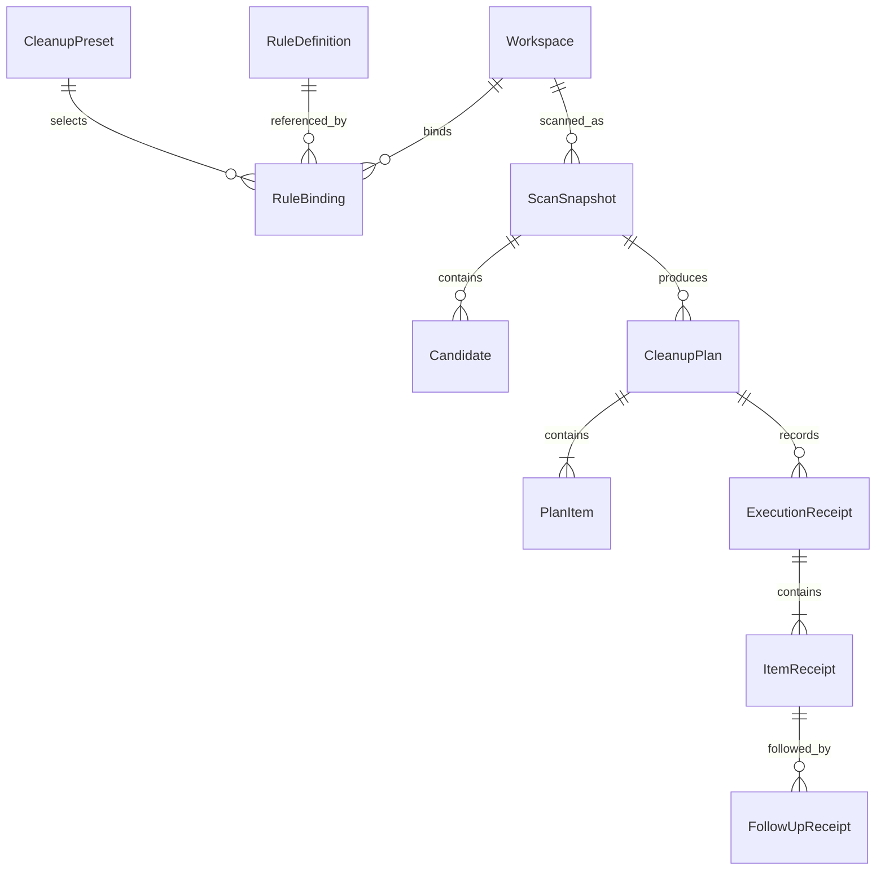
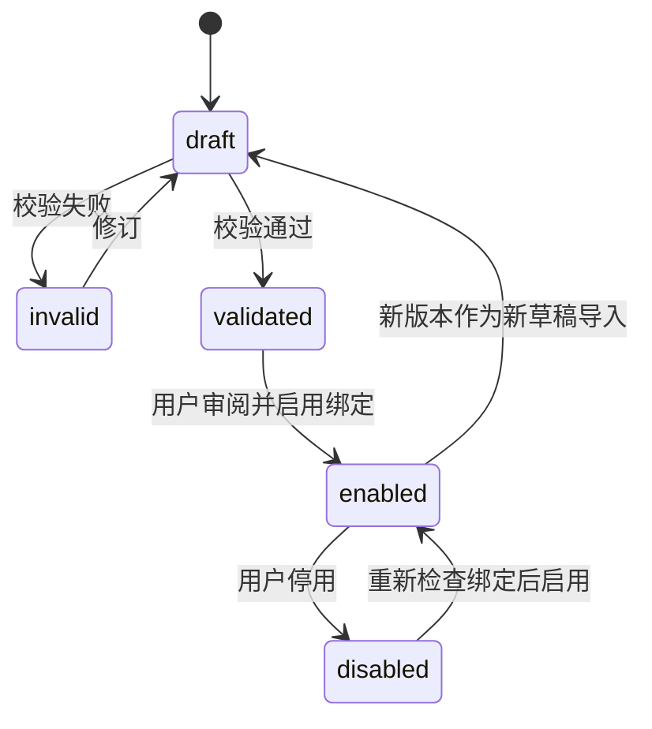
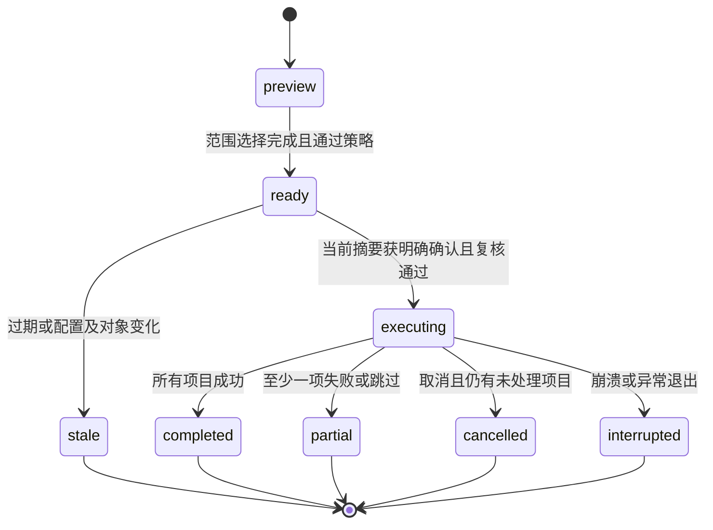
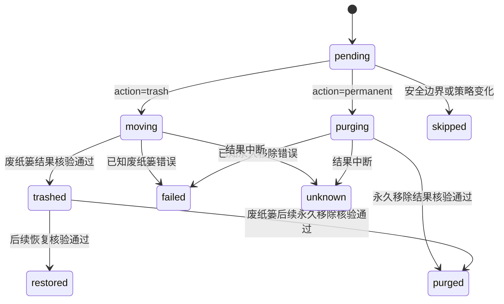

# 领域数据模型

[English](../../architecture/data-model.md) | 简体中文

状态：开发合同。[Swift 模型](../../../packages/shou-core/Sources/Models.swift)已实现当前实体；完整状态流转与中断验收仍待完成。

## 1. 实体关系

关系为概念表达；规则绑定可被多个方案引用，计划项目必须保留扫描来源和规则版本快照。

## 2. 核心实体

| 实体 | 关键字段 | 约束 |
| --- | --- | --- |
| Configuration | 存储版本、修订号、工作区、绑定、可选 `global_exclusions` | 保护配置变化使此前扫描与计划证据失效 |
| Workspace | `id`、`root_ref`、本地路径、卷与根身份、访问凭据 | 凭据与路径不进入可分享规则；每个入口验证实际访问 |
| RuleDefinition | `id`、`version`、`schema_version`、来源、正文摘要、内容 | 同版本内容不可静默变化；草稿不等于启用 |
| RuleBinding | 工作区、规则版本、启用状态、排除与本地覆盖摘要 | 根引用在本机显式绑定；变更后旧计划失效 |
| CleanupPreset | 名称、规则绑定引用、选择偏好 | 保存选择逻辑，不保存通用删除许可 |
| ScanSnapshot | ID、`scope`、`treeComplete`、`completedPaths`、配置摘要、状态、统计 | 仅独立完整且符合策略的候选可生成可执行计划项目 |
| Candidate | ID、相对路径、项目线索、身份、占用、风险、证据 | 大目录可以无规则；无规则候选不能直接执行 |
| CleanupPlan | ID、合同版本、摘要、创建/过期时间、规则与配置摘要、`action`（`trash` 或 `permanent`）、状态 | 绑定具体候选、处理方式和完整清单，不动态扩展；确认后动作不可改变 |
| PlanItem | 候选引用、原路径、文件身份、目录清单摘要 | 同一计划内不得重复或存在未解决的父子目标冲突；完整清单是永久移除边界 |
| Confirmation | 计划 ID 与摘要、入口、确认时间、范围 | 当前进程内一次性使用；不得把落盘布尔值当作授权 |
| ExecutionReceipt | 计划引用、执行 ID、入口、阶段、总体结果 | 执行意图先落盘，逐项追加结果；可表示部分成功 |
| ItemReceipt | 原路径、实际目标位置、前后身份、状态、错误 | `purging` 是持久化意图；只有平台成功结果才能进入 `purged`；恢复与永久移除必须重新核验 |
| FollowUpReceipt | 原项目引用、恢复/永久移除、时间、结果 | 独立确认；不修改原始执行事实 |

## 3. 规则状态

图中的新版本不覆盖旧版本事实；启用新版本会使引用旧配置的待执行计划失效。校验通过只表示格式与边界满足要求，不证明业务上可删除。

## 4. 扫描与计划状态

扫描状态：`running`、`complete`、`partial`、`cancelled`、`failed`。

- `partial` 表示至少存在无法读取、超出预算或无法完整判断的范围。
- `cancelled` 与 `partial` 不得伪装成 `complete`。
- 状态表示所请求扫描模式的完成情况，不能单独授权候选；某个无关子树不完整时，已完整测量的候选仍可保留执行资格，目标本身不完整则不可进入计划。

| 快照字段 | 含义 |
| --- | --- |
| `scope` | `full` 检查工作区目录树；`cleanup` 仅沿已启用规则可能命中的路径前缀发现，并完整测量命中的目标 |
| `treeComplete` | 整个工作区目录树是否已检查；清理模式的 `complete` 状态不代表该值为真 |
| `completedPaths` | 独立完整子树的相对根路径；候选须具有全树完整事实，或自身子树的正向完整覆盖证据 |

这些字段以可选形式兼容已有记录。旧记录没有 `treeComplete` 时沿用原有整树状态解释；没有 `completedPaths` 不提供任何独立覆盖证据，旧 partial 快照不能因此获得执行资格。计划保留扫描模式与预算，用于重新计算当前策略；每个选中目标仍须具有未变化的完整清单。

经过校验的时间预算也适用于扫描、计划及执行阶段的候选分析，各阶段的候选分析采用单调时钟截止时间。持久化记录中的预算超出受支持范围时，在重新计算策略前拒绝处理。

空间分析需要 `full` 扫描。清理快照是稀疏证据，未出现的目录与未访问的字节属于未知，不是零。界面和机器调用方须明确限制，不能将其根汇总或面积图当作完整磁盘占用。

首版计划有效期建议 10 分钟，由安全原型确定最终值。有效期未过也必须复核对象；改变选择范围、动作、规则或排除时生成新摘要并重新确认。`trash` 与 `permanent` 是两个正式动作，确认后不能互换。`partial`、`cancelled` 或 `interrupted` 不自动重试未完成项，需要新计划。

## 5. 项目执行状态

| 状态 | 含义 |
| --- | --- |
| `pending` | 尚未开始 |
| `moving` | 系统操作前已持久化逐项意图；若缺少结果，须核验 |
| `trashed` | 已核验并移到废纸篓，记录实际位置 |
| `purging` | 永久移除平台调用前已持久化意图；结果尚未确定 |
| `purged` | 绑定的原始目标已永久移除且结果已持久化 |
| `skipped` | 状态变化、受保护或用户取消导致未处理 |
| `failed` | 操作错误，记录错误类型与已知现场 |
| `unknown` | 中断导致无法确认结果，需要现场核对 |
| `restored` | 后续已核验并恢复 |

后续 `restored` 与 `purged` 是后续记录推导出的当前状态，不能覆盖初次清理记录；计划动作 `permanent` 的 `purged` 则表示首次执行已永久移除。`unknown` 不能自动当作失败重试，也不能据旧路径永久删除。

新记录的 `pending` 表示尚未保存逐项开始边界；旧版 `pending` 记录不能证明系统操作从未发生。每次系统清理调用前先保存 `moving`，写入失败则不调用文件操作，结果写入丢失时也不会把该项误标为跳过。

`HistoryInspection` 是独立的临时读取结果，保留原记录状态、核验时间、未完成标志及每项确切路径的观察。核验持有同一把修改锁，避免与其他 Shou 操作并发；目录检查共用条目和时间预算，比较完整清单与身份，沿用后续操作的已记录目录根 ctime 例外。此检查不对文件内容计算哈希，不把不确定项目升级为可执行项；缺少目标位置时不搜索用户废纸篓。尚未完成的恢复／永久移除仍保留 pending 并阻止重试，观察结果不能制造成功回执。

永久计划的回执 `operation=permanent_cleanup`，并单独计算 `permanentlyRemovedBytesEstimate`；该估算与卷可用容量不是同一指标。

执行进度属于临时状态：`stage`、`processedCount`、`itemCount` 和 `path` 描述实际工作，不构成新授权或持久结果。停止请求在安全的项目边界阻止新操作；正在进行的单次系统废纸篓操作可能先完成，随后须核对并记录最终回执。

后续操作共用该临时类型，不改变持久化回执或 CLI JSON。总数仅计明确选择的项目；`preflight` 表示只读核验，`restoring` 或 `purging` 在后续 pending 意图保存后开始。`processedCount` 仅在 completed 或 failed 结果保存后递增，表示已记录结果数，而非成功数。意图前取消不启动该项；恢复意图后完成并记录当前项，再在下一项边界响应取消。进度与批次勾选均不授予重试 pending 后续操作的权限。

## 6. 风险与解释

有效风险取规则声明、来源校验、保护策略与运行时证据中的较高等级：

- `review`：具有明确可重建依据，但仍需用户判断成本与当前用途。
- `high`：重建条件不足、用户自定义用途不明或存在明显代价。
- `blocked`：越界、受保护、状态不完整、已检测到活动等，不可进入执行集合。

首版没有“绝对安全”或自动执行风险等级。每个候选项记录：命中条件、规则来源、缺失证据、重建说明、保护/排除结果。

## 7. 路径与文件身份

- 规则包含相对路径；绝对路径只在本地绑定、预览与记录中出现。
- 工作区身份与文件身份使用平台提供的卷和对象标识，并记录可用的类型、大小、修改及元数据变化信息。
- 目录使用完整子项清单及其规范化摘要，不能仅检查顶层 `mtime`。
- 清单摘要不等于文件内容哈希，也不能证明内容可再生成。
- 不跨越卷、不跟随符号链接、不把 Unicode 大小写折叠的字符串比较当作文件系统身份。
- 对硬链接与 APFS 克隆的计量局限，在统计结果中保留说明。

## 8. 容量口径

| 字段 | 含义 | 限制 |
| --- | --- | --- |
| `logical_bytes` | 文件逻辑长度累计 | 稀疏文件等不等于实际占用 |
| `allocated_bytes_estimate` | 系统报告的分配大小估计 | 克隆、压缩、硬链接可能影响归因 |
| `trashed_bytes_estimate` | 本次成功移入废纸篓的原估计量 | 不代表已释放 |
| `purged_bytes_estimate` | 本次永久移除项目的原估计量 | 不保证全部转为可用空间 |
| `volume_available_before/after` | 操作前后系统报告的卷可用容量 | 受其他进程、快照与系统回收影响 |

机器合同一律使用整数 `bytes` 和 UTC 时间；UI 本地化显示，容量单位使用十进制，不混用 GB 与 GiB。

## 9. 持久化与保留

- 配置、规则和执行记录使用版本化格式，格式迁移失败不得覆盖旧数据。
- 扫描中间数据与已失效计划可按容量预算清理；执行记录单独管理。
- 首版历史默认保留策略在 M0 测量后确定，不因清理历史自动永久移除用户文件。
- 删除历史前需明确可能失去应用内恢复与归属核验入口；系统废纸篓中的文件不随之删除。
- 当前用户之外的账户无法通过默认配置访问记录；不把本地记录视为防恶意同用户进程的安全隔离。

## 10. 排除策略与配置兼容

`Configuration.global_exclusions` 是可选的相对模式数组，加载时校验每个模式。持久化 `Workspace.exclusions` 仅包含该工作区自身的排除；项目排除由确切的项目相对目录和相对模式组合而成。`ExclusionSettings` 返回全局、工作区数组及稳定去重后的有效数组，规则自身的排除独立保留。

扫描和草稿预览在匹配前合并工作区与全局保护，快照及计划的 `workspace.exclusions` 保存当时的有效策略。创建计划与执行时检查当前配置摘要、重新合并保护并复算候选资格，存储计划不能绕过后来新增的排除。受保护后代会阻止包含它的整个清理目标。

全局保护缺失或为空时，仍可读取配置版本 `1`。首次保存非空全局排除时，存储升级为版本 `2`；移除最后一条模式后仍保留版本 `2`。旧构建会拒绝版本 `2`，避免降级后静默忽略保护。包含非空全局排除的版本 `1` 配置会被拒绝。该存储版本独立于 CLI API `1.0` 和规则 Schema `1.0`。

## 11. 启动项发现

`StartupInventory` 是独立于清理存储的临时读取结果。`StartupDefinition` 保留来源／确切路径、标签、可选的绝对可执行路径、触发线索和仅来自定义的 Disabled 提示。当前用户 LaunchAgent 的配置状态与运行状态是有界、瞬时的 `launchctl` 观察；查询不可用或超时仍为 `unknown`，这些事实不产生执行权限。`StartupSourceCoverage` 区分已检查、不存在、部分完成、不可用及未检查。`launchd_definitions` 范围和明确列出的范围外来源，避免把完整读取指定目录误认为完整枚举 macOS 注册。见[启动项发现](../product/startup-items.md)。

## 应用审阅、计划与逐项原位置

`ApplicationCatalog` 按物理安装位置区分应用，即使完整标识相同也保留独立对象，并明确记录来源覆盖和问题。`ApplicationUninstallReview` 包含九类确切组件、完整清单、可处理状态、个人数据同意要求、阻止原因及不授予权限的覆盖提示。`ApplicationUninstallPlan` 绑定组件选择、应用元数据、配置、同意、预算和15分钟有效期。实际配置保存前使用稳定的 `unconfigured` 版本标识。

`ExecutionReceipt.operation` 为兼容旧回执而可选；`application_uninstall` 的每项保存 `UninstallReceiptOrigin`，包含组件类型、应用路径、完整标识与确切父目录身份。普通清理回执不能使用该原位置能力。恢复分别验证组件类型对应的路径和父目录身份，不依赖事后重新发现应用或后来安装的应用。卸载回执此阶段仅允许恢复。

`FileEntry.contentDigest` 可选，缺省时不编码，保持旧目录清单不变。独立文件目标只有一条根记录和有界 SHA-256 内容摘要。废纸篓根比较仅归一化 ctime，仍匹配内容和其他全部元数据；目录后代仍严格比较元数据。详见[应用卸载](../product/application-uninstall.md)。

## 空间分析直接删除

空间分析支持本地卷或目录发现，以及明确选中文件和目录后的直接删除，独立于清理规则工作区。桌面列表和树图共用导航与去重选择；确认及执行时核验当前完整清单和排除配置，复用既有执行日志与历史。详见[空间分析架构、流程与时序](../product/space-analysis.md)。
