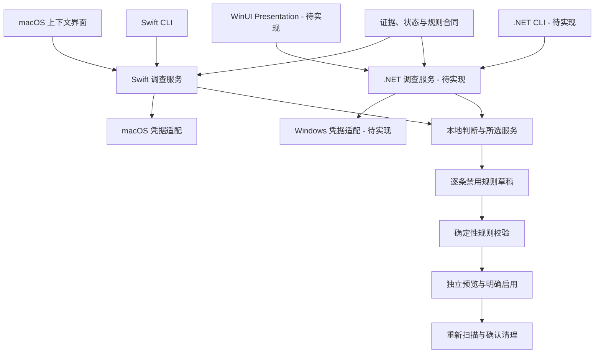
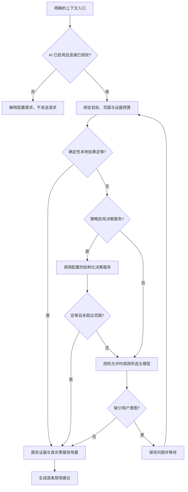
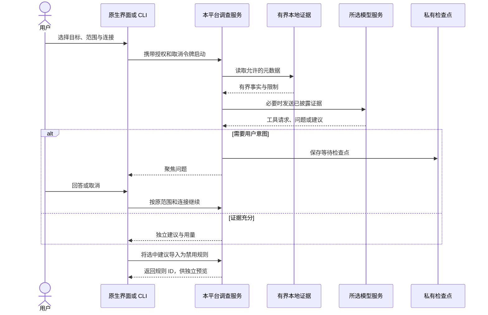

# 清理 AI 架构

[English](../../architecture/embedded-ai.md) | 简体中文

状态：macOS 已有 Swift 调查实现。Windows 遵循相同产品合同，独立采用 .NET 实现，当前待开始。

## 职责归属

调查服务负责目标、有界证据、问答、路由、预算和检查点。Core 负责规则与清理安全，Platform 负责凭据、本地记录和系统事实。SDK 类型不进入 Core，各平台桌面与 CLI 直接共用自己的调查服务。

## 路由流程

Jev 是当前可选结构化决策适配器。仅主模型策略不能调用决策服务；已关闭服务的不可用凭据不能阻断已授权主模型。不得在供应商之间静默转发证据；解释升级原因，并分别记录真实用量。

## 调查时序

## 状态与取消

领域状态为 `running`、`waiting`、`complete`、`limited`、`cancelled` 和 `failed`。UI 另外表达关闭、未配置、就绪、停止中与过期。未知或不完整证据不能变成确定的清理结论。

保存原范围、目标、连接身份、过期时间、问题、答案与实际用量。继续前重新验证。中断的运行记录不代表可恢复的等待记录。取消撤销后续通信与工具工作，保留已完成证据并记录真实终态。

## 连接与通信

协议、API 根、模型与凭据引用分别配置。macOS 使用固定适配器支持 Responses、Chat Completions 与 Messages；.NET 服务须独立建立对应证据。远程地址要求 HTTPS，本地回环 HTTP 用于生成夹具。凭据保存在私有本地或系统凭据存储，明确执行请求、响应、超时、重定向和预算限制。

保存与编辑配置不发送网络请求，独立测试动作说明目标和效果。删除连接将其移出活跃选择，但保留调查引用；恢复与凭据行为分别验证。机器输出与诊断隐藏密钥。

## 规则闭环

模型没有删除授权。保护路径、排除、活跃应用、不完整目标、过期证据与日志失败始终由确定性服务约束。导入内容与项目元数据均视为不可信输入。

## 验证

使用生成夹具检查协议、范围、凭据隔离、供应商替换、撤销、问答、预算、注入、独立草稿和离线清理。原生交互与真实模型质量分别验证。Windows 源码、纯 .NET 测试、系统 API、UI 与签名分发按[实施方案](../engineering/windows-native-plan.md)分别验收。见[产品旅程](../product/embedded-ai.md)和[验收](../engineering/embedded-ai-acceptance.md)。
