# 内置 AI：架构、状态、流程与时序

[English](../../architecture/embedded-ai.md) | 简体中文

日期：2026-10-22。[产品与交互合同](../product/embedded-ai.md)定义用户行为；本文定义如何通过共享服务实现。本轮已实现开关、路由及共享入口；桌面重启恢复和其他提供方适配器仍属后续范围。图中未标注的既有调用也不代表所有平台已通过验收，证据见[验收矩阵](../engineering/embedded-ai-acceptance.md)。

## 1. 上下文与信任边界

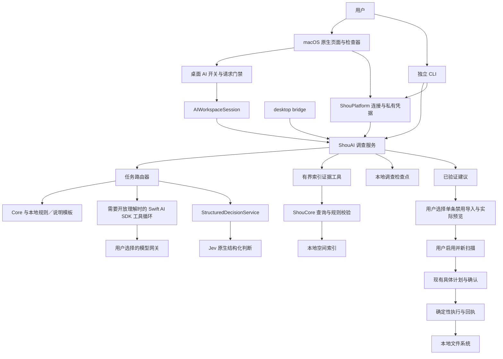

外部服务只接收有界证据和用户回答。模型输出、目录名和回答都是不可信输入；主模型和 Jev 均无删除工具。图中通向执行的连线跨越用户审阅、启用、新扫描和当前确认，不能由模型一步调用。

## 2. 结构化决策优先路由与升级流程

`InvestigationRouter` 已实现有界清理工作流，复用既有证据、规则与问答。路由依据任务需要的输出类型、已获取证据、用户选择的策略及连接可用性。规则和预算由 Swift 控制，Jev 只能从已允许的下一步中选择。

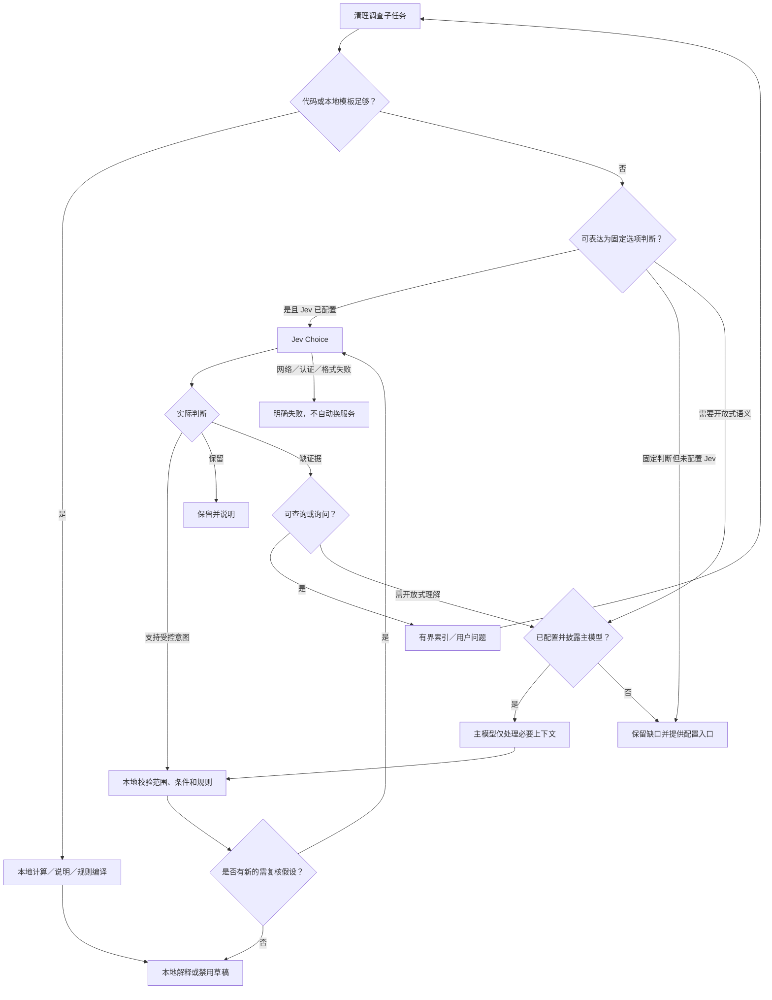

图为策略示意，循环均受总步骤、取证、问询、时间和 token 预算限制；同一证据／问题／意图指纹不重复复核，检查结果复用只在同一调查、同一连接和证据未变化时成立。新证据可以触发新判断，预算用尽则保留未完成结果。不得通过无穷「不确定 → 再问同一题」耗尽成本。

| 当前决策与本地动作合同 | 受控输出示例 | 本地后续 |
| --- | --- | --- |
| 用途分类 | 生成产物／依赖／用户数据／混合／未知 | 选择已有模板或继续取证；分类不授予删除权限 |
| 下一项证据动作（本地） | 根据分类及已有答案选择有界下钻／问询／保留／升级／结束 | 当前由代码选择，不为动作选择额外付费 |
| 模板编译（本地） | 精确生成目录的受控规则草稿 | Swift 编译、Core 校验；规则默认禁用 |
| 重建证据复核（已有） | supported／needs_information／retain | 禁用草稿／补证据／保留 |

Jev 不生成工具代码、任意路径、任意规则 JSON 或自由文本解释。用户已明确选择的保留条件由代码优先遵守。模板说明与问题通过本地化字符串展示；只有模板不足时升级主模型，不能为了措辞统一再固定调用一次 GPT。

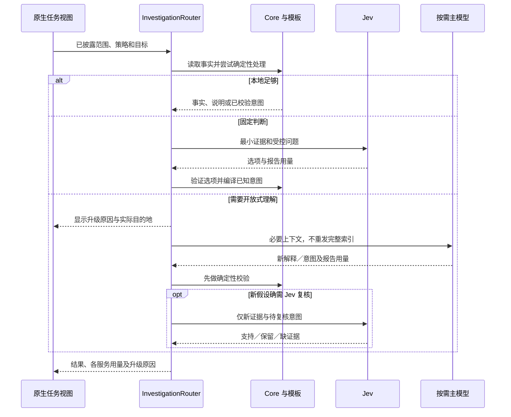

`AIConnection` 已支持独立 `DecisionConnection`、必需主模型和决策开关、`decision_first / main_only` 策略及调查目标。检查点已保存路由队列、答案、证据指纹、分服务用量和升级原因，并同步 CLI／bridge。旧记录继续可读，缺失的历史统计显示未记录，不能回填猜测值。路由／模板属于 ShouAI，Core 仍不依赖模型服务。

## 3. 模块与界面复用

| 模块 | 基础职责 | 本轮已实现变化 |
| --- | --- | --- |
| `ShouCore` | 连接／调查 DTO、证据策略、规则校验、扫描、计划、执行 | UI 开关不进入规则匹配或删除资格判断 |
| `ShouPlatform` | 连接记录、本地／系统／显式环境凭据、原生目录选择 | macOS 默认私有文件；旧钥匙串禁止交互授权 |
| `ShouAI` | SDK 适配、调查 actor、证据工具、Jev、预算及检查点 | 继续使用同一调查语义；新工具需单独合同 |
| `InvestigationRouter` | 有界工作流 | 确定性处理优先、Jev 固定判断、主模型按需升级、去重及按服务用量 |
| `AIWorkspaceSession` | 当前窗口的连接选择、调查任务、问答和预览 | 桌面开关、请求门禁、跨页目标协调与停止中状态 |
| 连接编辑器 | Form、SecureField、测试、保存 | 受总开关约束的测试、分别显示模型／Jev 状态 |
| 调查检查器 | 范围、披露、问题、证据、建议和预览 | 完整空状态、无建议／过期／失败恢复、结果用量和下一步 |
| `AILaunchView` | 原生目标审阅 | 共享目录选择、索引复用说明、现有任务冲突和显式开始流程 |
| CLI／bridge | 同一服务、发现、结果、续接、取消 | 不借桌面偏好承诺系统级禁网；平台不可用时明确返回 |

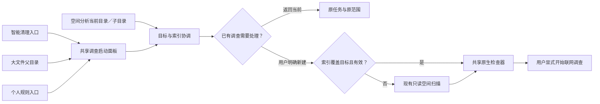

页面只提供任务意图与明确目标，不各自实现模型循环。协调器不能为多个大文件自动推断更广的祖先范围。复用的是有效 `StorageScan`／catalog 及相对目录，不是稀疏 `ScanSnapshot`；目标不在快照内就本地新扫描。页面导航、检查器开合和任务生命周期分开。

## 4. 数据及持久化

| 对象 | 关键内容 | 保持的语义 |
| --- | --- | --- |
| `AIConnection` | ID、名称、必需主模型配置、`decision`、路由策略 | 不含 API key；支持独立协议和网关前缀 |
| `DecisionConnection` | 提供方、独立地址、模型和认证引用 | Jev 使用 `/systemone`；其他适配器使用自身协议；保留 `JevConnection` 别名 |
| `AIInvestigation` | ID、scan ID、scope、连接快照、状态、时间、问题、证据、建议、用量 | 恢复使用原连接，不跟随当前默认设置 |
| `InvestigationCheckpoint` | 领域状态、SDK 续接消息、待续接工具调用、已观察目录、保留回答、路由队列和决策指纹 | 私有本地记录，不含凭据；不是通用聊天导出 |
| `AIAdvice` | 确切目录、说明、已校验 `CleanupRule` | 只支持已观察的精确目录；预览前未授予执行能力 |
| `AIDecisionReview` | 路径、实际模型、结论、概率、用量 | 决策概率不是清理安全概率 |
| 桌面偏好 | AI 是否启用 | 持久化本机布尔偏好，新安装默认 false；独立于连接、凭据、规则及调查状态 |

现有状态只有 `running / waiting / complete / limited / cancelled / failed`。就绪、关闭、未配置、停止中和过期是 UI 状态，不应为了展示而伪造领域完成状态。当前没有持久化的「已保留项／未知项」独立实体，相关信息在摘要／判断中；若后续需要结构化列表，应另改 DTO、CLI／bridge 和版本兼容测试。

## 5. 开关及任务状态机

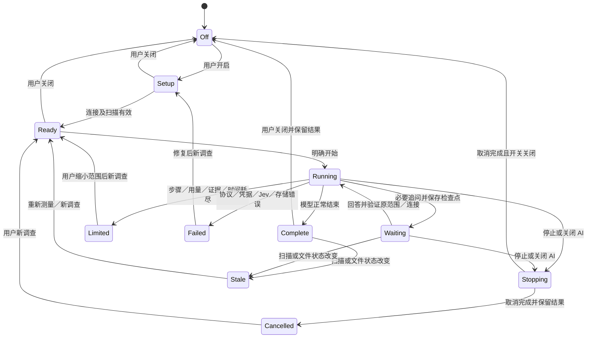

这是当前 UI 状态合同，完整交互证据仍按验收矩阵逐项记录。`Off` 仍可展示旧结果；图没有表示清除内容。`Stopping` 属于界面反馈，最终领域状态依据服务实际结果。任务收尾与设置事件存在竞争时，已经完成的事实不得改成虚假的取消；关闭后无论哪种终态都不得启动新请求。

## 6. 配置与凭据测试时序

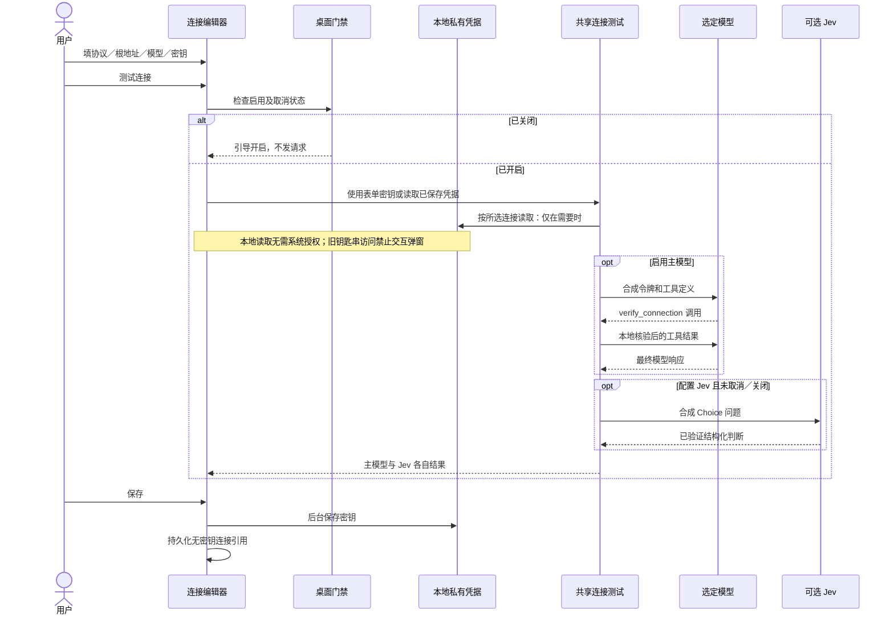

测试只证明特定配置下的合成合同往返。HTTP 200、主模型成功或 Jev 高概率都不能冒充整个测试成功。关闭时允许本地保存，但禁止测试联网；上图门禁已实现，凭据返回后再次校验许可。保存状态防止重复点击和中途表单关闭；默认流程不请求系统授权。本地文件由用户权限保护，不使用钥匙串加密。

## 7. 按需主模型循环、问答与结构化复核时序

本节仅描述升级后或明确选择仅主模型时的 SDK 分支；默认决策优先路由见第 2 节。

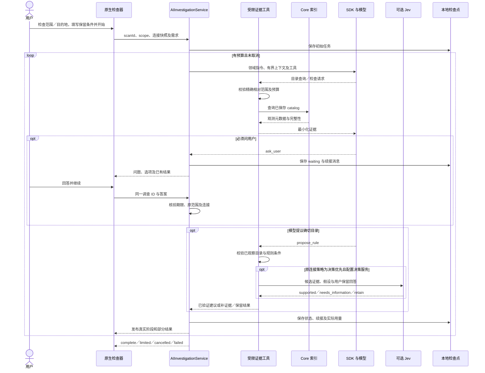

仅主模型策略不调用决策服务；决策优先策略需要复核时只有 `supported` 可生成禁用草稿。`needs_information` 不自动构造用户回答，`retain` 不生成清理建议。错误或畸形判断不能被工具错误处理吞掉后标为完成。正常完成且无规则是有效结果；Jev 判断准确性仍需场景校准。

## 8. 单条规则到清理的流程

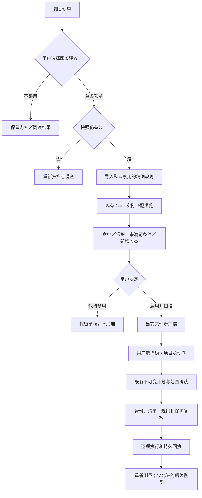

这条链复用既有规则、计划与执行服务。不开第二套清理引擎，不为 AI 增加免确认按钮。当前生成夹具已走通原生调查至废纸篓回执及恢复，文件哈希一致；真实服务新包证据仍单独记录。

## 9. 关闭与取消时序

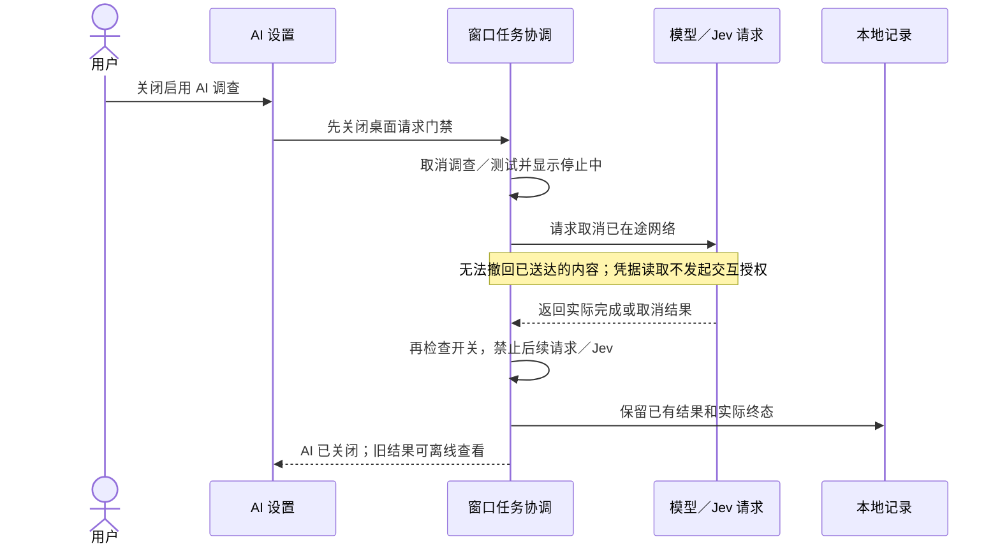

本图行为已实现；默认关闭、旧许可撤销和凭据返回后门禁有自动化，原生慢速请求关闭后计数不再增加。仅隐藏按钮不足以实现关闭：连接测试、问询继续、自动下一步及 Jev 调用都要经过协调与取消检查。设置关闭不删除凭据、规则或历史，也不重写 CLI 的独立授权语义。

## 10. 协议、数据与资源合同

主模型通过 Swift AI SDK `0.20.0` 的工具循环接入 `responses`、`chat_completions`、`anthropic`；分别追加 `/responses`、`/chat/completions`、`/messages`，保留用户 API 根前缀。Jev 独立使用 `POST /systemone`。远程只用 HTTPS，HTTP 仅允许回环；无自动重试或重定向。Apple SDK 依赖仅在 macOS 启用；Windows 使用有界、非流式三协议运行适配，复用同一证据工具和调查服务。两端运行时检查点明确区分，不静默迁移不兼容消息。

| 约束 | 当前值及含义 |
| --- | --- |
| 索引证据 | 每页 30 条；累计 300 条／64 KiB；相对路径、类型、分配容量、文件数、修改时间及完整性 |
| 主模型循环 | 最多 12 步、32 次工具、8 条建议、3 个追问；每轮 180 秒，3072 输出 token |
| 累计 token | 报告用量达 32000 停止后续步骤；单次响应可越过阈值，不是精确费用上限 |
| Jev | 最多 8 次；输入 24 KiB，响应 64 KiB；用量计入同一阈值 |
| 主模型响应／检查点 | 分别最多 1 MiB；错误正文不进入用户结果 |
| 续接 | 等待回答可跨 CLI 进程恢复，超过 24 小时拒绝；两端桌面支持本地记录与等待任务续接，中断 running 任务恢复未交付 |

默认不读取文件正文、配置片段，不运行 Shell、网页抓取、任意插件或来自目录的 Agent 指令；私密名称、链接和特殊文件过滤。相对路径和用户自己输入的回答仍可能含隐私，披露不能声称自动匿名。若未来开放配置读取、工具活动或卸载／启动／隐私解释，须独立定义最小证据、目的地、界面、预算及验收，再扩展此架构。

## 11. 实施状态与验证顺序

1. 已实现默认关闭的桌面门禁，覆盖测试、开始、续接、Jev 与关闭中的竞争。
2. 已实现结构化决策优先路由、受控问题／模板、独立连接和按服务用量；验证 Jev 可完成场景的主模型调用为零。
3. 已接入共享启动面板及四类 P0 页面入口，复用扫描和调查检查器。
4. 已提供空状态、停止中、失败／过期、无建议及预览后下一步；完整交互组合继续验收。
5. 用生成夹具验证范围和数据披露、两种语言、键盘及深浅色；再进行指定服务真实桌面验证。
6. 保留未过验收项：中断 running 任务恢复、领域解释适配、内容工具、质量校准、Windows 本轮原生 CI 与界面验收。

具体通过条件与证据位置统一见[验收矩阵](../engineering/embedded-ai-acceptance.md)，运行事实统一见[实现记录](../engineering/embedded-ai-implementation.md)。

## 12. 可替换的结构化决策适配器

路由依赖 `StructuredDecisionProvider`，通过 `StructuredDecisionService` 按连接的 `decision.provider` 选择适配器。当前只随应用提供 Jev；未来 Clef 等服务可实现同一接口，使用自己的地址、认证和原生协议。不能把非 Jev 服务转发到 `/systemone`，也不能仅换模型名假装已经接入。

统一输入 `StructuredDecisionRequest` 包含受控相对路径、最小证据和固定选项／判断条件；统一输出为已校验的选项、模型、概率及报告用量。路由、本地模板、保留条件、预算和清理权限独立于服务商。服务失败不会自动切换提供方；当前任务使用原连接快照，切换只影响新调查。

`DecisionConnection` 保存提供方标识及其非密钥配置；`JevConnection` 保留为源码兼容别名。旧记录缺少 `provider` 时解释为 Jev，旧 `jev_first` 策略兼容读取，新策略使用 `decision_first`。旧 Jev 钥匙串引用继续使用原账户；其他提供方使用独立引用，避免替换时误用凭据。未知提供方可被明确识别为未安装，禁止静默回退。适配器替换需通过相同的合同、范围、取消、预算和脱敏验收。

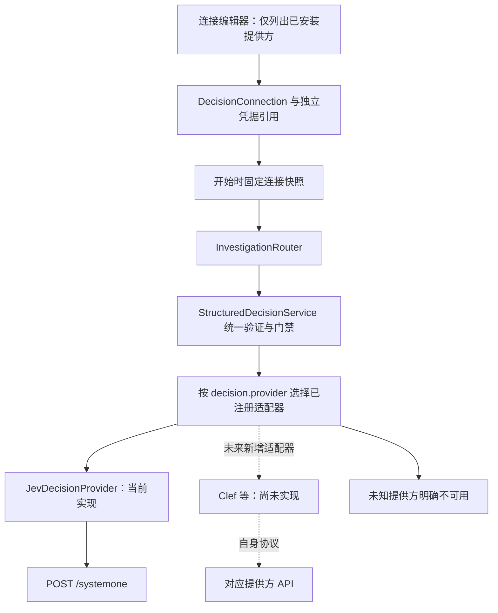

切换步骤为选择已安装提供方、填写其配置、显式测试、保存，再新建调查。旧 Jev 凭据不删除；CLI 通过 `--service decision` 写入所选提供方的独立本地或系统凭据账户，保留 `--service jev` 作为仅限 Jev 的兼容别名。协议专用后缀检查只属于相应适配器配置；主模型不可关闭；关闭决策服务只切换路由策略，保留提供方配置及凭据。新增适配器需要代码注册与合同验收，当前不能只在下拉框中选择 Clef。

## 跨平台运行时与取消

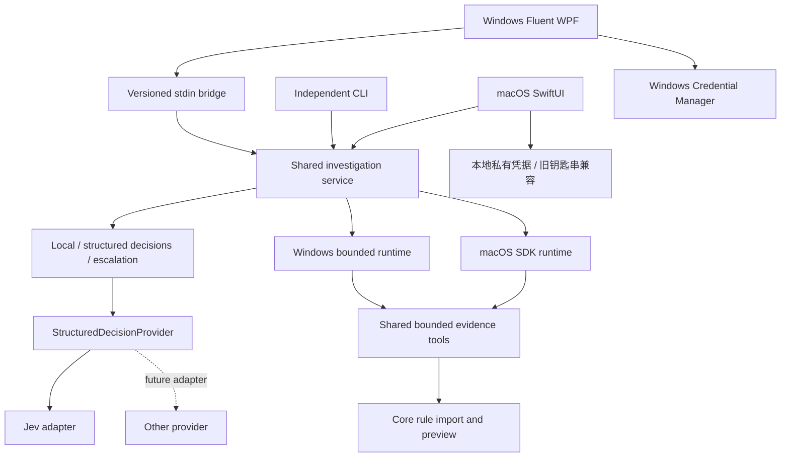

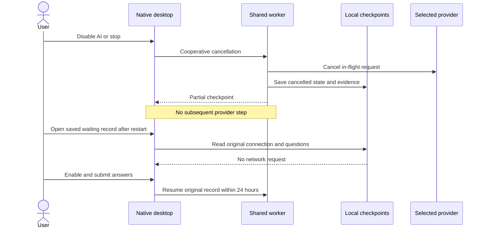

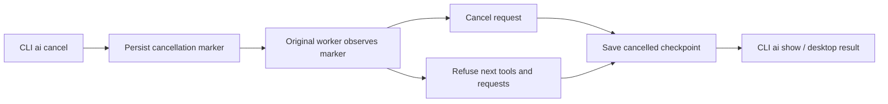

## 14. 配置生命周期与 Jev 开关

`main_model_enabled: false` 只用于识别旧记录；新保存、开始和续接均要求有效主模型。`routing_strategy: main_only` 表示决策服务关闭，即使 `decision` 对象仍存在也不读其凭据或发送请求；`decision_first` 表示开启。使用同一字段表达策略与开关，避免保存互相冲突的第二份布尔状态。

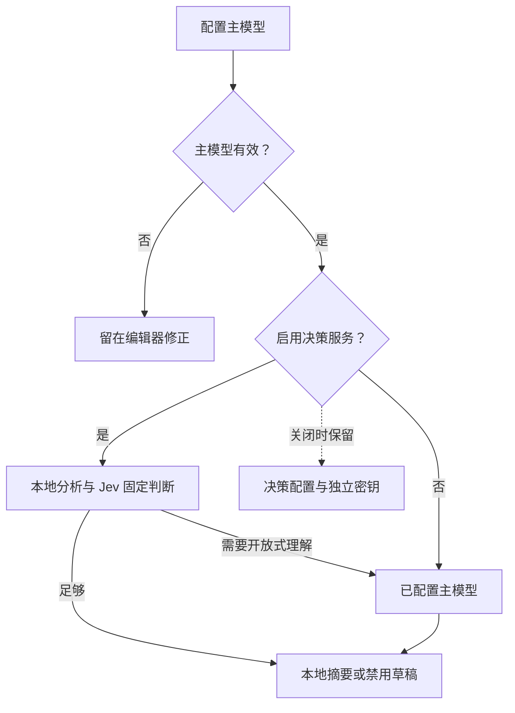

配置正文存于 `ai-connections`，可恢复删除状态单独存于 `ai-connection-states`。删除只写状态，不改调查快照及凭据。默认列表排除已删除项；显式查看仍可读取脱敏正文；已删除项保存前及写入凭据前均检查状态，恢复后才可编辑。

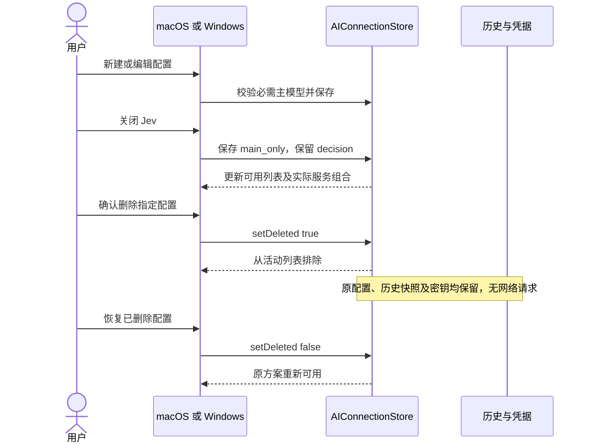
