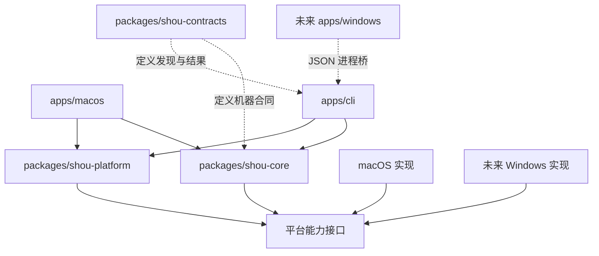

# Monorepo 与多平台边界

[English](../../architecture/monorepo-and-platforms.md) | 简体中文

状态：设计草案。macOS 优先交付，Windows 为后续正式目标。

## 1. 组织原则

仓库采用原生多平台 monorepo，按产品入口、共享业务、平台适配和公开合同划分职责：

- `apps/` 管理各平台与 CLI 产品入口。
- `packages/` 管理共享业务、平台能力和公开合同。
- `scripts/`、`docs/`、`examples/`、`assets/` 独立管理工具、设计、样例与资源。
- 原生 UI 消费共享业务，不复制业务规则；不同语言可通过结构化进程桥通信。
- 平台构建成功、原生运行成功与完整分发验收分别记录。

各目录只承载清理工具所需能力。移动端工程、模型调用与 Agent 托管不在产品范围内。

## 2. 目标目录

下列为目标布局；当前仓库包含文档、规则 Schema 和示例，应用与核心工程尚未初始化。

```text
shou/
├── apps/
│   ├── macos/                  # Swift / SwiftUI / AppKit
│   ├── cli/                    # Swift CLI，装配当前平台实现
│   └── windows/                # 后续原生 Windows UI
├── packages/
│   ├── shou-core/              # 规则、扫描编排、计划、执行状态机
│   ├── shou-platform/          # 能力接口、macOS 与未来 Windows 适配
│   └── shou-contracts/         # JSON Schema、版本与语言无关合同
├── tests/
│   └── fixtures/              # 虚构目录、符号链接及合同样例
├── scripts/                    # 校验、构建、平台打包与基准
├── examples/
│   └── rules/                 # 手写或 Agent 生成规则的参考
├── assets/
│   └── brand/                 # 品牌与图标源文件
├── docs/
├── README.md
└── LICENSE
```

使用 SwiftPM 管理 Swift 包的本地路径依赖，macOS 应用按签名与资源需求选择 Xcode 工程或工作区。Windows 工程工具链在其原型阶段锁定。monorepo 不要求统一所有语言的构建系统，不引入 pnpm、Turbo 或 Web UI。

## 3. 依赖方向



接口在源码中的放置原则：由核心声明自己需要的最小能力；平台包依赖核心并实现这些协议，核心不反向依赖平台包。Schema 是数据合同的单一事实源，不是需要运行的服务。

## 4. 核心与平台划分

| 跨平台核心负责 | 平台适配负责 |
| --- | --- |
| 规则解析、版本、来源与规范化 | 用户授权、TCC 或 ACL、目录选择 |
| 受限模式和条件语义 | 枚举目录、文件身份、链接与卷边界 |
| 风险、排除、去重与计划 | 分配大小、稀疏文件、卷可用容量 |
| 确认绑定、状态机、执行编排 | 废纸篓/回收站、恢复、永久移除 |
| JSON 结果、错误分类、历史模型 | 文件锁、原子写入、落盘与进程取消 |
| 下一步动作与能力限制 | 系统路径与凭据存储 |

共享核心可使用经 Windows 验证的 Foundation 子集；不得直接导入 AppKit、SwiftUI、Darwin 或 Win32。平台实现中的条件编译集中在适配层，避免业务代码遍布 `#if os(...)`。

## 5. Windows 路线

### 已确定

- Windows 使用原生桌面体验，CLI 产品名为 `shou.exe`。
- 规则、计划、错误和状态语义复用；平台特定规则显式声明适用平台。
- 默认通过结构化进程桥调用共享 Swift CLI，避免先建立 Swift/C# ABI 桥或复制规则引擎。
- 启动进程使用参数数组、JSON stdin/stdout 与有界输出，不拼接 Shell 命令。
- 确认与执行之间的进程桥合同在 Windows 原型阶段单独定义，不为桥接增加全局 `--yes` 绕过。

### 尚待原型锁定

- Windows UI 采用 C# WinUI 3 或 WPF 中的一种，不同时维护两套。
- Swift 工具链版本、CPU 架构、运行库交付和最低 Windows 版本。
- 原生回收站 API、身份核验、句柄语义、进程锁和安全取消的实现方式。

Swift 支持 Windows 不代表 Apple 框架可用；在 macOS 上编译部分合同也不代表 Windows 原生操作已通过。

## 6. 跨平台路径合同

- 规则中的相对模式统一使用 `/`，由平台适配映射到本地路径。
- 禁止绝对路径、`..`、驱动器语法、UNC、设备路径与替代数据流语法进入相对模式。
- Windows 的 junction、其他 reparse point 与 macOS 符号链接按“不跟随”处理；无法确定类型时阻断执行。
- 大小写敏感性遵循目标文件系统实际语义；规范化字符串不能替代文件身份判断。
- 不跨卷；Windows 卷挂载点同样属于边界。
- 云端占位文件、按需下载目录和网络卷首版不列为支持的可执行清理范围。

## 7. 能力发现

CLI 的 `capabilities` 返回当前平台、构建版本、合同版本与每项能力的实际状态。未来 Windows 未实现的回收站或恢复能力必须返回不可用及原因，不列为可执行工具，也不能静默退回永久删除。

规则文件支持声明 `windows` 只是格式能够表达，不代表当前应用已经支持 Windows。平台支持结论由该平台的构建、运行、文件安全与干净环境分发证据共同决定。

## 8. 仓库与发布边界

- 各入口与合同一起变更、一起评审；不为每个平台建独立业务仓库。
- 应用版本与规则格式版本分开。规则可独立演进，但必须符合当前引擎能力。
- 构建产物默认不提交；不得将扫描真实开发目录的结果加入夹具。
- macOS 签名、公证与 Windows 签名、运行库、安装卸载分开验收。
- 不提供自动修改全局 Codex、Claude Code、WorkBuddy 配置或安装全局插件的脚本。

## 9. 演进顺序

1. 固定语言无关合同、核心模型与平台能力接口。
2. 在 macOS 上完成 CLI 核心闭环，再接入 SwiftUI 原生展示。
3. 定期以隔离检查阻止 Apple 依赖进入共享核心。
4. 在 Windows 原型阶段验证共享核心与 CLI，再实现系统文件操作和原生 UI。
5. 以同一套虚构规则和合同夹具验证语义一致，再分别验证平台差异。

不为了未来 Windows 先实现完整通用插件框架；当前就隔离真实的平台依赖即可。
