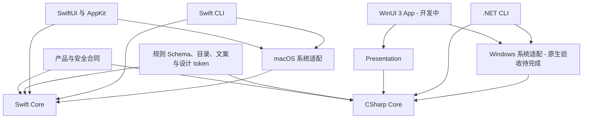

# 仓库与平台边界

[English](../../architecture/monorepo-and-platforms.md) | 简体中文

状态：macOS 已有源码实现；Windows 实现进行中，原生验收与分发待完成。

## 架构决策

各操作系统分别拥有原生界面、领域实现与系统适配。macOS 桌面和 CLI 共用 Swift 服务；Windows 桌面和 CLI 共用 C# 服务。两端通过产品合同、声明式资源和验收案例保持行为一致。

Core 声明自身需要的最小能力接口，Platform 实现这些接口，应用入口负责组装依赖。领域服务不依赖 UI 框架或具体适配器。两套原生实现分别落实同一份安全要求。

## 目录职责

| 路径 | 职责 | 状态 |
| --- | --- | --- |
| `apps/macos` | SwiftUI/AppKit 应用与 macOS 交互 | 已有源码 |
| `apps/cli` | macOS Swift 命令入口和终端确认 | 已有源码 |
| `packages/shou-core` | Swift 规则、扫描、计划与回执 | 已有源码 |
| `packages/shou-platform` | macOS 文件系统、访问、进程与持久化 | 已有源码 |
| `packages/shou-ai` | macOS 调查与模型通信 | 已有源码 |
| `packages/shou-contracts` | 语言无关的规则 Schema | 共享规范 |
| `apps/windows` | C# Core、Platform、Presentation、App 与 CLI | 源码实现进行中，原生验收待完成 |
| `tests/core` | Swift 领域与原生夹具回归 | 可执行 |
| `SYNC.md` | 跨端功能与安全验收 | 必须维护 |

Windows 目标工程树由实施方案定义。按实际能力增加接口与工程，不为未来功能预建空抽象，也不围绕 Swift 应用增加另一套构建系统。

## 共享资产

规则 Schema 的唯一来源为 `packages/shou-contracts/rule.schema.json`。内置规则与扫描位置 JSON 统一维护于 `packages/shou-core/Sources/Resources`，Windows 生成器筛选适用声明到 `apps/windows/Generated`。平台适用字段只描述数据范围，不代表对应平台已经支持运行。

文案当前唯一来源为 `packages/shou-core/Localizable.xcstrings`。Windows 生成器转换当前两种运行时语言，并校验占位符及源摘要。`assets/design/tokens.json` 维护已提取的强调色、间距、圆角、内边距、主操作尺寸与清理动效值，同一生成器输出 WinUI 的 `Design.xaml` 和 SwiftUI 的 `ShouDesign.generated.swift`，原生视图使用生成常量。共享设计值仅进入应用层，字号及其他视觉值仍待提取。生成清理动效值不代表 Windows 已实现动画。品牌资产放在 `assets/brand`。生成过程确定、可重复，支持无差异校验；新增复数或格式类型必须先增加显式支持和夹具。

共享验收案例描述输入证据、预期选择、阻断原因、确认与结果。文件身份、访问权限与竞态必须分别在原生环境验证。两个运行时不读取对方平台的本地记录。

## 变更流程

1. 阅读对应产品、安全与 Schema 合同。
2. 在 `SYNC.md` 记录 macOS 基线提交及逐项变化。
3. 在所属平台实现，从唯一来源生成共享资产。
4. 运行纯逻辑与受影响的原生检查，记录平台、架构、提交和证据。
5. 对各平台标明已实现、待实现、刻意差异或不适用，并写明理由。

即使受影响的 Windows 能力尚未实现，macOS 安全合同修复也必须登记对应对齐项。未完成验证的能力保持不可用。
