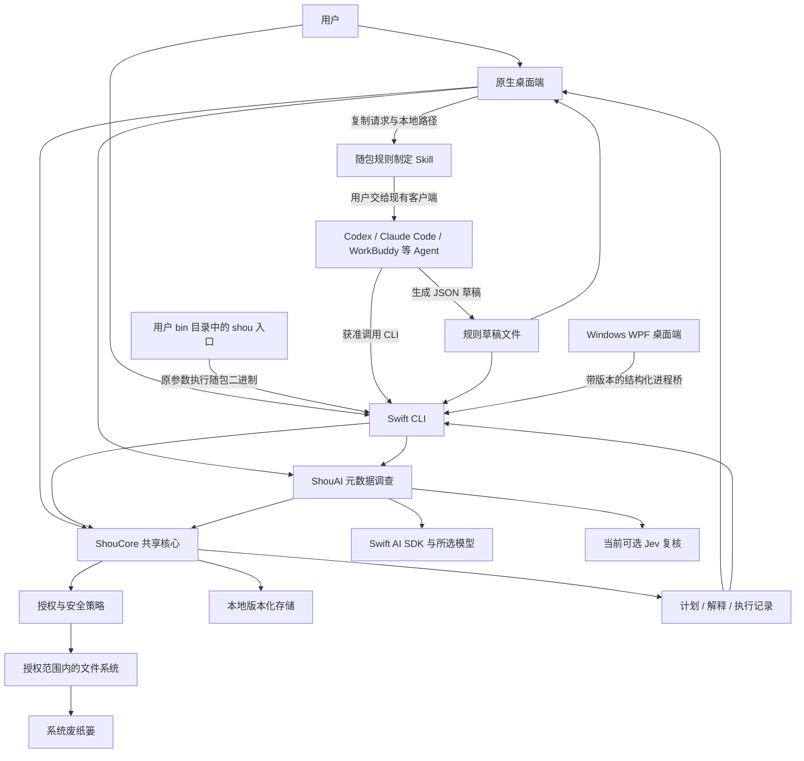
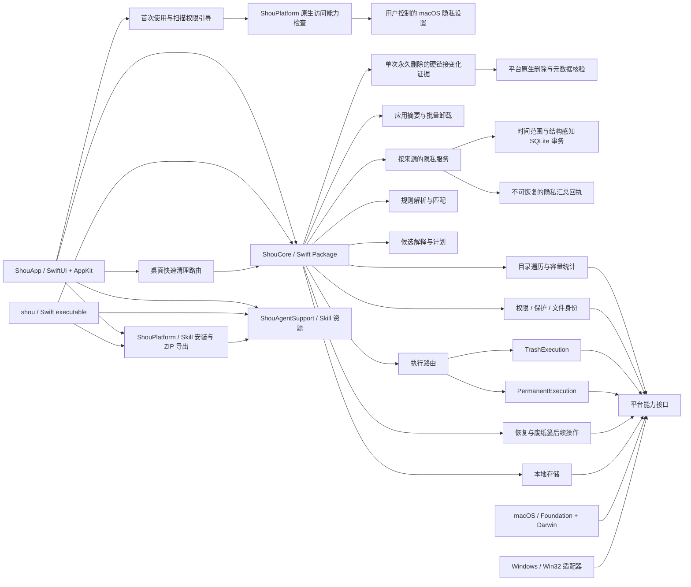
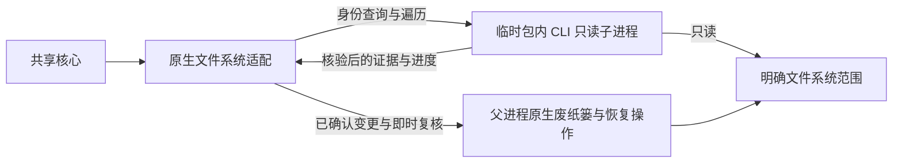
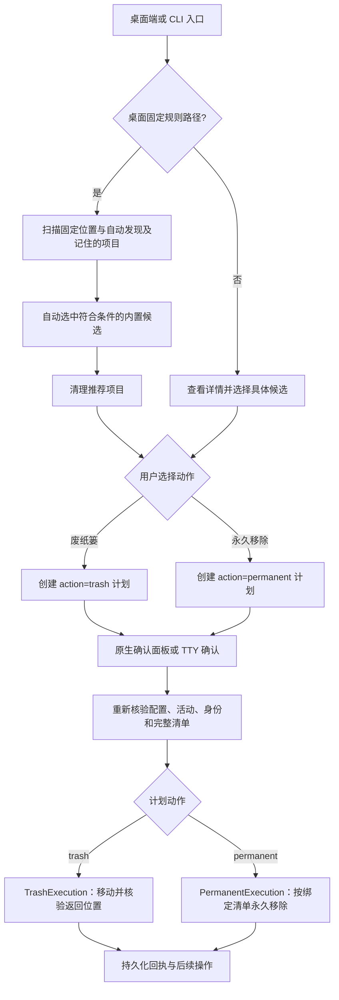
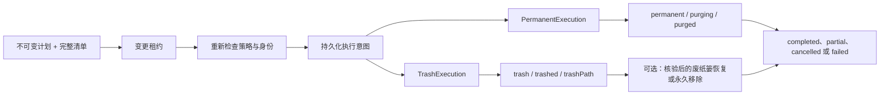
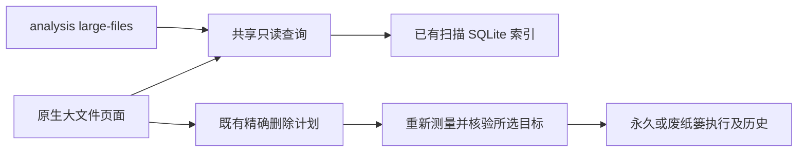
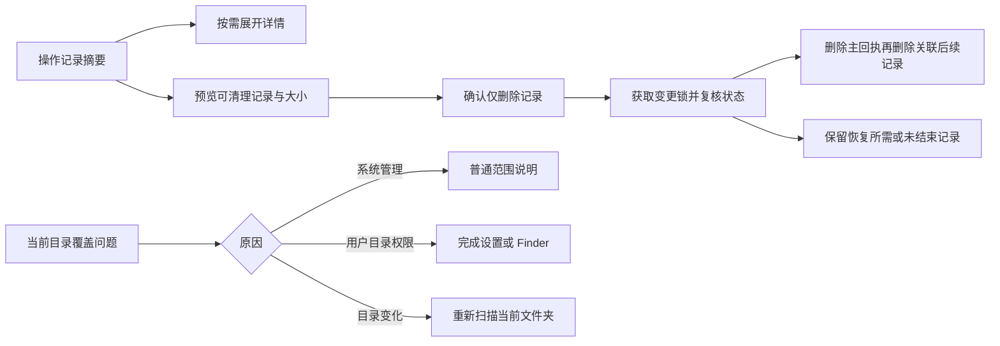
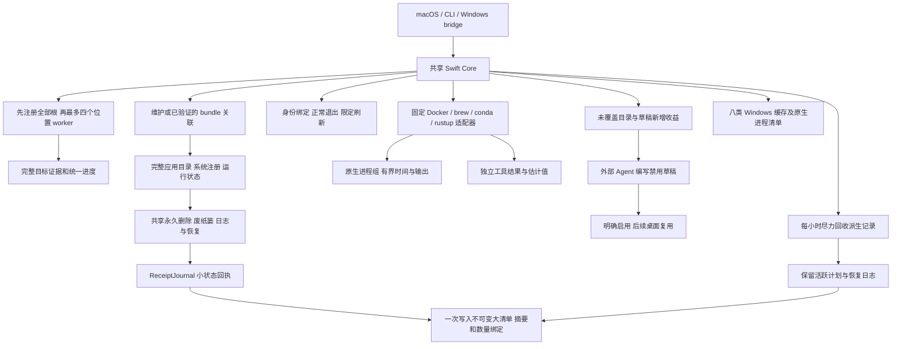
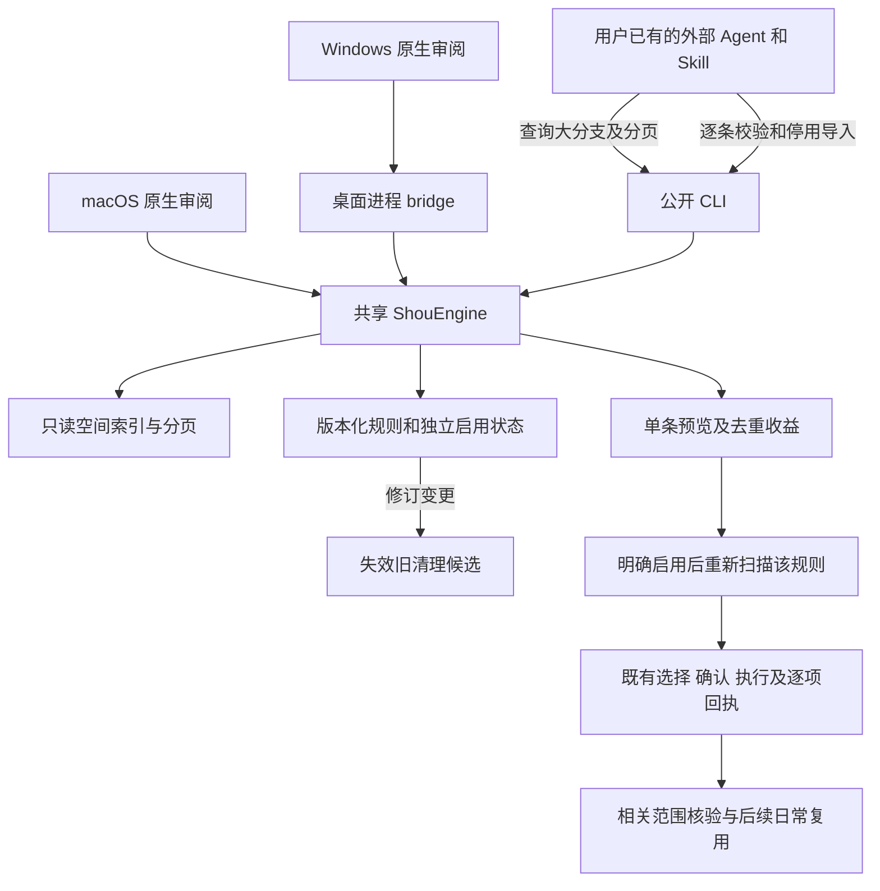

# 系统架构

扫描与执行的统一反馈、跨位置计数、停止状态及进度架构、流程与时序见[操作进度与反馈](../product/operation-progress.md)。

[English](../../architecture/system-design.md) | 简体中文

当前桌面导航、自动发现及个人规则复用以此为准：[统一日常清理](../product/unified-cleanup.md)。

状态：当前开发架构与下一阶段设计。共享扫描、计划、记录、废纸篓执行与有界永久移除已有源代码；Windows、分发与文件竞态验收尚未完成。2026-10-22 将内置清理专用 AI 纳入产品，首版共享调查服务、SDK 适配和原生连接配置已实现；具体能力与剩余验收见[实现记录](../engineering/embedded-ai-implementation.md)。

## 1. 设计约束

1. macOS SwiftUI 桌面端与 Swift CLI 共享领域核心；Windows WPF 桌面端通过带版本的进程桥复用同一引擎，其原生运行验收单独跟踪。
2. 核心任务能在任一入口独立完成，CLI 不依赖 GUI 进程。
3. 用户自定义规则与 AI 生成规则使用同一种声明式格式。
4. 内置清理专用 Agent 使用可替换 Swift 模型 SDK；调查、问询和规则意图与确定性清理执行分离。常规扫描与清理无需模型、账号或网络；首期 AI 使用用户自带凭据，不依赖产品托管后端、常驻服务或特权 helper。
5. 以少量模块形成闭环，不为尚未支持的生态引入通用插件运行时。
6. 采用原生多平台 monorepo；共享核心不依赖 AppKit、SwiftUI、Darwin 或 Win32，系统细节位于平台适配层。

## 2. 上下文架构



上图包含现有内置与外部路径。下一轮将内置流程调整为本地确定性处理、Jev 优先判断、主模型按需升级；总开关和路由仍待实现，完整[AI 架构与时序](embedded-ai.md)区分当前调用链与目标。内置与外部模型输出、项目内容和导入文件均是不可信输入。

## 3. 模块与依赖



首版建立共享核心、平台适配和两个产品入口。图中规则、扫描、计划等先作为核心包内的职责边界，不为每项能力拆一个包。

两个产品共用 Skill 资源；安装与导出不经过清理存储，也不改变规则启用状态。详见 [分发架构与时序](../ai/skill-distribution.md)。

工程布局：

```text
apps/macos/                 # SwiftUI / AppKit 原生应用与应用工程
apps/cli/                   # Swift CLI；产品命令 shou / shou.exe
apps/windows/               # Windows WPF 桌面端与进程桥
packages/shou-core/         # 可移植 Swift 领域模型、规则、扫描编排与计划
packages/shou-ai/           # 清理调查、SDK 适配、证据工具与 Jev
packages/shou-platform/     # 平台接口的具体实现，当前为 macOS
packages/shou-contracts/    # 语言无关 JSON Schema 与公开合同
tests/fixtures/            # 虚构项目、规则与跨入口合同用例
scripts/                   # 构建、校验、打包与基准工具
assets/brand/              # 品牌与图标源文件
examples/rules/            # 可审阅规则样例
docs/                      # 产品、架构、接口与验收文档
```

完整依赖规则见 [Monorepo 与平台边界](monorepo-and-platforms.md)。平台能力接口由核心声明，具体实现由入口注入，核心不依赖平台适配包。

### 隔离只读操作

完整空间分析通过有界目录读取器逐页处理 macOS 的 64 KiB 元数据，每次持有 catalog 锁写入至多 128 项。新 catalog 为分配空间至少 1 MiB 的普通文件建立部分索引，服务已保存的大文件查询；旧 catalog 仍可读取。桌面目录展示缓存和批量选择不会替代 Core 的新清单核验。详见[扫描流程、查询策略与时序](../engineering/storage-scan-performance.md)。

目录读取与已就绪的后序汇总共用最多八个执行槽的调度器。子目录完成通知才将父目录汇总加入队列，父目录不会占据 worker 等待后代。SQLite 保持串行写入，汇总不能再独立创建无界的阻塞线程。

桌面端向 `NativeFileSystem(readWorkerExecutable:)` 注入包内 `Contents/Helpers/shou`。根身份查询及完整／清理遍历由短生命周期只读子进程执行，避免停滞的文件系统调用持续占住桌面端的等待链。CLI 的隐藏 worker 入口只接受身份查询和遍历请求，在打开记录存储前分流；它属于平台实现细节，不是公开 Agent 协议、第二套清理引擎或常驻服务。独立 CLI 继续使用常规直接适配。



每个请求使用当前用户的临时通道：目录权限为 `0700`，文件为 `0600`。证据交给 Core 前，核验请求／结果版本、请求身份、父进程身份、输出大小、进度及快照结构。格式错误、缺失、超时或取消均不能转为完整快照。范围、匹配、候选资格、计划和回执仍由共享核心负责。

取消或墙钟期限到达时，只请求终止本次自有只读子进程，不等待进程退出便返回。最多保留两个存活只读子进程，包含仍等待内核退出的子进程；超过限制返回资源受限。子进程另有父进程退出／期限 watchdog。该设计限制桌面端等待和子进程累积，不承诺内核请求立即结束。移入废纸篓、恢复和永久移除仍由父进程执行，保留原生身份／清单复核及既有确认、回执门槛；不引入模型或 Agent。自动化已覆盖证据一致性、取消、超时、两个子进程上限及容量恢复；打包桌面端的扫描停止和部分结果已通过实测，具体范围见[验收记录](../engineering/acceptance-and-testing.md)。

### 常用软件扫描

`KnownLocations` 只定义固定根及规则关联，不访问磁盘；`PlatformFileSystem.locationAvailability` 提供位置状态，`ShouEngine` 编排注册与有界扫描。`BuiltinCatalog` 只在精确固定根启用对应应用规则，项目规则用于所选项目工作区；其他位置的同名目录不会自动获得应用清理规则。

`scanKnownLocations` 先盘点并注册全部可用根，再分别生成 `ScanSnapshot`，避免后续注册使前序快照的配置摘要失效。确定缺失的位置跳过，访问失败与不完整扫描单独记录。桌面标准扫描自动发现常见开发目录并复用记住的扫描位置；CLI 的 `system scan` 仅在 `--include-projects true` 时纳入，默认 `false`。两者默认使用清理扫描模式，均不隐式遍历整个主目录寻找项目、不改变系统权限、不删除目标。每个计划绑定单一根及明确选择的候选项。

`InstalledApplicationCaches` 仅扩展 macOS 当前用户精确的 `Library/Caches` 根。`ApplicationCatalogReading` 提供真实安装包身份及 Info.plist 证据，`ApplicationUninstallChecking` 提供只读归属活动事实，不调用卸载流程。有效实装 Owner、已发现范围内无重复的合法标识及无重叠发现异常才生成精确目录规则；静态范围优先，包括已禁用及后代窄规则。快照／计划的可选字段绑定已选 Owner 和 partial 覆盖标记；创建计划、执行预检及每项变更前均重新盘点、读取精确应用与运行状态，随后复用永久或废纸篓执行。安装包归属和缓存归属分别判断，管理员拥有的第三方安装包仍可对应当前用户的合格缓存；此能力不选择安装包、支持数据或容器。

盘点不可用时省略通用发现；partial 盘点保留真实状态，并按 Owner 路径局部隔离。Owner 自身、后代、祖先路径异常，来源不可用／未检查或已发现重复标识，会阻断相应缓存；其他已核验 Owner 保持可手选，覆盖提示绑定摘要且不进入自动推荐。完整证据变为 partial 时必须重新扫描并明确审阅。静态扫描继续可用，系统结果明确投影发现问题。快照的文件系统状态不隐含应用盘点完整。详见[日常清理架构、流程与时序](../product/unified-cleanup.md#已安装应用缓存)和[可选证据合同](data-model.md#4-扫描与计划状态)。

### 扫描覆盖与产物证据

`full` 检查工作区目录树，用于空间分析。`cleanup` 根据已启用规则的路径前缀决定发现分支，发现阶段剪枝 `.git`，命中目标后完整测量，才能判断其执行资格。发现剪枝不豁免命中目标内部的受保护内容检查。清理扫描完成不表示整棵目录树已经测量；快照通过 `scope`、`treeComplete` 和 `completedPaths` 记录模式、全树完整性及候选覆盖。部分扫描可以计划独立完整的目标；旧记录缺少覆盖证据时不能放宽不完整目标。界面须说明清理结果的稀疏性，目录空间浏览需要完整扫描。

`ArtifactEvidenceChecking` 是只读 Core 接口，由 `NativeArtifactEvidence` 提供事实。生成源码例外仅授予与包内定义完全一致的规则，不能凭规则 ID 前缀或用户声明获取。Rust 构建脚本 `OUT_DIR`、Swift 生成构建产品与 Cargo 解包注册表源码，均须满足已识别布局和原生归属／活动证据；Cargo 源码还须通过归档及校验和完整性检查，并具有可用的本地恢复来源。受版本控制、已修改、未知或无法核验的数据仍受阻。详见[规则语义](../rules/rule-specification.md)。

`ApplicationActivityChecking` 是独立于文件系统的核心接口，macOS 的 `NativeApplicationActivity` 通过运行应用元数据实现。已知应用运行中或无法检查状态时，关联规则禁止清理。扫描、创建计划及逐项移入废纸篓前均检查；应用在计划创建后启动时，对应项记录为跳过，其余项目继续。不会自动退出应用。此保护覆盖已关联的桌面应用，任意编译器或包管理器任务仍需用户先停止；状态检查不能原子阻止应用随后启动。

| 层次 | 具体职责 |
| --- | --- |
| `SmartScanView` / CLI | 启动扫描，呈现进度与各根证据 |
| `KnownLocations` / `BuiltinCatalog` | 固定根与声明式匹配元数据 |
| `ShouEngine` | 配置、快照、策略、计划、复核和执行记录 |
| `PlatformFileSystem` | 位置状态、有界遍历、身份与文件操作 |
| `ApplicationActivityChecking` | 只读检查应用活动，不控制进程 |
| `InstalledApplicationCaches`／应用目录及事实接口 | 绑定实装标识的精确缓存规则并复核已选归属，不授予卸载权限 |
| `ArtifactEvidenceChecking` | 只读提供受版本控制内容、构建进程和 Cargo 完整性事实；规则文档不能提供这些能力 |
| `RecordStore` | 原子记录与跨进程修改锁 |

采用包内职责与小接口，不引入插件系统或按规则拆服务。CLI 独立运行。未来 Windows 必须独立实现并验证位置、应用活动与回收站行为后再启用。

## 4. 职责边界

| 模块 | 职责 | 不承担的职责 |
| --- | --- | --- |
| WorkspaceAccess | 根目录绑定、入口实际访问能力、授权失效 | 通过规则扩大权限 |
| RuleService | 版本、来源、校验、规范化、启停与导入 | 执行脚本、自动认可模型结论 |
| Scanner | 有界遍历、项目线索、容量与修改时间证据 | 把未知目录判定为垃圾 |
| Matcher | 在授权范围内按确定性条件匹配 | 自行搜索未授权卷 |
| Planner | 去重、保护策略、选择范围、快照与摘要 | 执行删除或继承上次确认 |
| Confirmation | 桌面确认或终端确认，绑定计划摘要 | 创建长期可复用的删除授权 |
| Executor | 复核、移动到废纸篓、逐项结果、取消 | 绕过策略、按旧路径盲目继续 |
| ReceiptService | 恢复、永久移除本次项目、恢复状态 | 清空无关废纸篓内容 |
| LocalStore | 原子保存、版本、并发锁与恢复记录 | 上传用户文件内容 |

UI 与 CLI 只处理交互、确认来源和展示；安全策略由共享核心统一执行，防止一个入口漏掉保护规则。

## 5. Swift 与并发

- 使用 Swift，首版工程启用 Swift 6 并发检查；最低系统暂定 macOS 14。
- SwiftUI 视图状态由 `@MainActor` 隔离，文件遍历和统计离开主线程。
- 采用结构化并发、有界任务队列和可传播的取消信号；不为每个文件创建一个无限制 Task。
- 共享服务优先通过明确的数据值与少量协议解耦，例如文件系统适配、时钟与存储。
- 执行服务在单进程内串行化；跨进程还需文件锁，单个 Swift actor 不能保护 GUI 与 CLI 两个进程。
- UI 更新合并后投递，扫描进度在总量未知时显示已处理数量与当前阶段，不伪造百分比。

macOS 应用代理和转发原窗口代理的关窗守卫在文件变更期间拦截退出与关闭，通过 `AppModel` 请求取消并等待执行任务。Core 在每项开始及意图记录前检查取消；原生适配层在父进程完成已记录意图的废纸篓移动／恢复核验，不委派给可取消的只读 worker。失败时保留窗口供检查。后续操作按 `(executionId, itemId)` 识别对象，不因不同批次的项目 ID 相同而共享动作资格。

## 6. 存储与跨入口一致性

首版采用本地版本化 JSON：配置和规则按对象保存，扫描大清单采用可流式写入的独立文件。是否引入 SQLite 由数据量与查询需求决定，不在第一步建立数据库服务。

- 配置根目录由平台适配提供；macOS 使用用户级 Application Support，Windows 使用用户级应用数据目录，正式身份在实现阶段确定。
- 临时文件与目标记录置于同目录，完成写入后原子替换；关键执行日志还需验证落盘行为。
- 配置变更与破坏性任务使用跨进程锁；锁忙时返回结构化错误。
- 同一用户同时只允许一个破坏性任务，读取不可变计划和历史快照不要求 GUI 在运行。
- 扫描缓存可重建；规则、排除与执行记录不得视为可随意清理的缓存。
- 执行前必须成功持久化意图记录；磁盘满导致无法写入时，不开始操作。
- 来自磁盘的计划与规则仍需按格式及安全策略验证，不能因为放在本地目录就视为已授权。

## 7. 权限与分发

### 桌面端

使用系统目录选择器获取用户选择，保存可用的访问凭据；若采用 App Sandbox，需要 security-scoped bookmark 与访问生命周期管理。bookmark 过期时重新授权，不能静默退回扩大扫描范围。

### CLI

用户显式注册工作区路径；实际访问受当前进程、终端、TCC、文件权限与分发方式约束。CLI 注册工作区只是应用配置，不等于系统授权。遇到拒绝访问返回具体错误。

GUI 能访问的路径不保证 CLI 能访问，反之亦然。首版不引入权限代理服务来“借用”另一个入口的权限。

### 分发选择

首版倾向直接分发签名、公证的应用与配套 CLI；是否启用 App Sandbox、CLI 安装位置及签名关联由 M0 验证后记录。App Store 上架、特权 helper 和全盘访问不是首版默认依赖。

## 8. 文件安全与竞态

扫描时记录卷、文件身份、类型、大小、修改与元数据变化信息。目录计划需要子项清单摘要，不能仅比较顶层目录时间。

执行时要求：

1. 重新检查工作区身份、实际授权、规则版本、排除与计划有效期。
2. 通过授权根目录逐级核验路径边界与符号链接，不使用字符串前缀替代目录归属判断。
3. 复核目标身份和目录清单，发现变化则使目标失效，不自动扩大计划。
4. 对实际文件操作采用平台允许的身份约束与无符号链接路径解析。
5. 无法满足计划绑定时跳过或拒绝，不退回通用递归删除。

系统废纸篓 API、文件描述符相对操作与目录竞态之间的组合需要原型确认。预览无法消除所有运行时竞争；不把简单的“检查后按路径操作”宣传为原子安全。此项是发布前置门槛。

废纸篓后续操作核验仅容许已记录顶层目录的 `ctime` 变化，因为 macOS 可能在移动后继续更新它。对象身份与其他根字段、全部后代条目仍须与记录一致。该例外只用于已记录的废纸篓后续操作，不放宽普通扫描或移入前复核。

未授予完全磁盘访问权限时，广泛扫描跳过受保护的废纸篓位置。移入后的核验与后续操作通过 `inspectTrashTarget` 尝试读取系统返回并写入回执的精确直接子项。适配器验证当前用户的废纸篓父目录，并保留系统权限、不跟随链接与完整清单核验；不枚举无关废纸篓项目。部分完成或取消批次中未开始的 `pending` 项显示为已跳过，已开始但结果不确定的操作继续标记为需要核实。

## 9. 内置清理专用 AI 与外部 Agent

首版提供公开规则格式、命令发现、JSON 结果与可持久化计划，供 Codex、Claude Code、WorkBuddy 等在用户许可下调用 CLI。无需为每个 Agent 编写不同的清理引擎。

`ShouAgentSupport` 独立于 `ShouCore` 打包规则制定 Skill 与问询参考，桌面和 CLI 都依赖该资源模块。规则页复制带本地路径的请求；`agent skill --json` 不打开清理存储即可返回同一入口与指令。该外部 Agent 路径继续提供声明式草稿、校验、禁用导入和预览。

当前 `ShouAI` 已提供共享 Swift 调查服务和薄 SDK 适配，维护范围、保留回答、预算、问询续接及逐条建议。下一轮在此增加有界任务路由：代码／本地模板优先，固定判断使用 Jev，开放式理解才升级主模型。SDK 继续负责生成模型的工具循环；Jev 用受控问题和状态机，不另建通用 Agent 框架。门禁、路由、独立 Jev 配置及按服务用量的具体变化见[专项架构](embedded-ai.md)。

当前调查只开放已有索引的分页／检查、问询与精确规则建议；不读取配置正文或工具运行状态。配置读取和领域工具需要后续独立适配与验收。模型提出的意图通过范围策略、`PersonalRuleDraft` 和闭合解析器校验；实际启用、新扫描、确认及回执沿用 Core，调查工具集不暴露删除能力。

模型连接按协议、地址、模型和凭据引用配置，支持 Responses、Chat Completions、Messages；敏感值由平台凭据库保存。用户主动启用调查后才向所选连接发送最小证据，不静默跨服务商重发。首版元数据调查、三协议适配及原生连接配置已实现，见[实现与验收范围](../engineering/embedded-ai-implementation.md)；SDK 的 macOS 14、Windows、流式多轮、暂停／恢复及取消须先验证，具体设计见[清理调查与多协议接入](../engineering/embedded-ai-investigation.md)，实施门槛见[实施计划](../engineering/implementation-plan.md)。

本阶段不引入通用聊天、任意 Shell／插件或外部编码 Agent 托管。MCP 仍只在明确接入需求出现时评估。外部调用合同见 [Agent 操作指南](../ai/coding-agent-integration.md)。

## 启动项发现边界

`StartupInventoryService` 独立于清理存储，负责只读协调。Core 定义 `StartupInventoryReading` 和可移植的证据／覆盖模型，`NativeStartupInventory` 负责 macOS 来源目录、有界物理读取、属性列表解析及当前用户 Agent 的固定枚举只读 `launchctl` 状态查询。CLI 和 SwiftUI 共用该服务，桌面通过公开 ServiceManagement API 打开登录项设置；状态查询不改变设置，也不需要特权 helper，修改仍是单独确认的当前用户能力。见[启动项发现](../product/startup-items.md)。

## 10. 工程原则

- **KISS**：一套核心、有限的声明式匹配能力和明确的平台边界。
- **DRY**：规则校验、保护策略、计划与执行逻辑复用。
- **YAGNI**：仅增加清理调查所需的模型循环与连接；暂不引入产品托管推理后端、动态脚本、通用 Agent 平台或特权守护进程。
- **SOLID**：展示、规则、扫描、计划、执行与平台适配各自负责明确职责；仅对实际外部依赖建立可替换接口。


## 应用卸载边界

应用发现和卸载独立于可重建缓存规则。`ShouEngine` 负责完整标识关联、个人数据同意、当前排除策略及摘要绑定计划；`ApplicationCatalogReading`、`ApplicationUninstallChecking` 提供平台证据。增量 `ApplicationSummary` 与完整删除清单分离，`ApplicationUninstallBatchPlan` 绑定各应用具体选择并拒绝重叠路径。一次批量确认后复用既有 `TrashExecution` 或 `PermanentExecution` 日志边界。每个卸载项保存确切原父目录和组件类型，一份回执可覆盖多个应用及 Library 类别；历史核验和恢复前由 `ReceiptOrigins` 重现关联，永久结果不支持恢复。独立的受限应用父目录身份能力保持普通工作区根目录限制。架构、流程和时序见[应用卸载](../product/application-uninstall.md)。

## 11. 当前执行路径

产品有意提供两层交互。桌面端对内置及已启用的个人规则走统一快速路径：一次扫描自动选中符合条件的候选，一次原生确认即可开始具体计划。个人规则只需确认启用一次；受阻目标保留解释，用户可在详情调整选择。CLI 保留扫描、创建计划、查看计划、执行计划的显式检查点，因为现有编码 Agent 需要稳定 JSON 状态和可恢复边界。



`CleanupPlan.action` 是执行路由边界。`TrashExecution` 记录系统返回的废纸篓位置，并支持后续核验恢复。`PermanentExecution` 使用相同的计划绑定、互斥租约、重新核验和逐项日志，但对原始路径调用平台永久移除能力，不创建恢复位置。两个执行器都不接受任意 Shell 文本，也不会在确认后扩展计划。



永久路径是正式的一等动作，不是隐藏的删除兜底。安全边界由已审阅计划和精确清单构成：缺失、替换、扩展或无法核验的项目会被跳过或失败，绝不会枚举或清空无关废纸篓。`operation=permanent_cleanup`、`purging`、`purged` 和 `permanentlyRemovedBytesEstimate` 使不可逆结果可被机器读取。


## 空间分析直接删除

空间分析支持本地卷或目录发现，以及明确选中文件和目录后的直接删除，独立于清理规则工作区。桌面列表和树图共用导航与去重选择；确认及执行时核验当前完整清单和排除配置，复用既有执行日志与历史。详见[空间分析架构、流程与时序](../product/space-analysis.md)。

默认空间统计与删除清单分离：只读 Worker 流式生成私有 SQLite 索引，保留全部已测量文件，逐目录汇总容量与完整性；桌面和 CLI 按需查询目录，不再受删除清单 100 万条上限截断。`StorageScan` 引用索引并记录 `measured_entry_count`，节点提供 `is_complete`，部分容量为已统计下限。删除仍重新获取所选目标的完整清单并独立核验。旧 JSON 与分页记录继续可读。

macOS Worker 使用有界目录 FIFO，最多八个读取器并发执行批量元数据查询；SQLite 追加与后序总量更新保持串行。父任务取消会传递到读取器，发布结果前等待全部读取与汇总任务结束。详见[扫描架构、流程与时序](../engineering/storage-scan-performance.md)。

## 大文件查询边界



阈值、类型及分页属于已保存证据的查询，不重新遍历磁盘。普通文件按索引中已计费的占用空间排序；文件类型只按扩展名分类。扫描和查询不会赋予删除权限。

### 隐私清理边界

隐私记录按来源独立建模，不作为普通文件缓存删除。GUI 与 CLI 共用 `PrivacyService`；平台层仅发现标准 profile 和无跟随身份，Core 对时间、数据库结构、运行状态、排除与指纹预检后按来源事务执行。回执只保存汇总，永久逻辑删除不提供恢复或空间释放承诺。完整架构图、流程图、时序图与支持矩阵见[隐私清理](../engineering/privacy-cleaning.md)。

### 清理展示边界

`OperationProgressView` 统一呈现只读核验与删除进度；结果页占用同一内容区，并能返回来源页面。核心提供可选的阶段工作量和当前项目内部清单计数，客户端只在展示时缩短路径。发现、确认依据和持久化执行事实保持独立职责。Windows 通过桌面 bridge 接收增量进度字段，协议中的路径仍为完整值。

## 操作记录清理与扫描问题处理

操作记录默认只呈现项目、日期、结果与已处理大小；执行 ID、逐项路径、恢复和核验操作放在详情中。清理已结束记录会删除本地 JSON 回执及关联后续记录，保留恢复所需、结果未知和未结束记录。单独删除记录需要明确确认恢复入口丢失；正在执行或尚有后续意图的记录仍保留。只删除记录，不移动或清空实际文件和废纸篓。已执行计划保留消费状态，不能通过清空记录重放。

CLI 使用 `shou history cleanup-preview --json` 预览、`shou history clear` 在终端确认；指定 `--execution-id` 可清理单条，`--include-recoverable true` 明确允许丢弃恢复入口。Windows 通过 `history.cleanup-preview` 与带本次确认挑战的 `history.clear` 调用同一核心。记录删除顺序是主回执在前、关联后续记录在后，避免中断后让已恢复的项目再次成为可恢复项。

扫描提示只针对当前目录。其他目录的不可读状态不污染完整项目目录的浏览。系统管理位置如 `.fseventsd`、`.Spotlight-V100`、`.DocumentRevisions-V100` 使用普通范围说明，默认折叠具体路径；核心仍保留覆盖事实，不把它们伪装为已测量。用户目录的访问问题提供完成设置和 Finder 入口，变化或临时读取失败可重新扫描当前文件夹。完整磁盘访问权限不能覆盖 Unix 所有权或系统保护，软件不会为读取系统目录而修改系统权限。

`StorageCoverageNote` 在共用 Core 中对访问问题分类，资源限制和内容变化保留处理入口。桥接暴露分类及当前目录完整性，Windows 提供资源管理器与当前文件夹重扫，不复制系统路径策略。默认桥接扫描使用共用索引路径；视图状态与短路径展示仍由客户端负责。



## 0.9.0 清理服务

交付跟踪见 [0.9.0 计划](../engineering/next-version-0.9.0.md)。新增服务均为明确的 Core 能力：`RecordRetention` 保护活跃证据与恢复日志，`HistorySummaries` 分页读取可丢弃摘要，`ApplicationClosing` 验证正常退出，`ToolCleanupService` 执行固定所属工具操作，`RuleOpportunities` 提供调查证据，`ApplicationOrphans` 复验精确的缺失所属应用后复用共享删除。导入的 JSON 规则仍仅匹配路径。



位置并发上限为四，结果顺序稳定；目录内读取和空间分析读取仍为独立实现。未实现 FSEvents／USN 复用。工具空间为所属工具报告的估计值，与文件系统估计和实际可用空间分开；中断结果保留为 unknown，已消耗计划不可重放。孤儿残留排除共享容器和名称猜测，未注册的自定义安装属于明确限制。

超过 1024 项的执行清单由 `ReceiptJournal` 保存为不可变 `history-manifests` 依赖；所有依赖持久化后才发布小回执。仅状态变化不重写大清单，废纸篓移动导致清单变化时保存新版本。按需读取完整历史会校验依赖 ID、数量与 SHA-256，历史摘要只读状态。旧版内联回执继续可读。自动维护保留所有仍有主回执的清单；清理操作记录先移除主回执，再移除关联清单与后续记录。删除中断保留执行意图及清单，不能因保存优化而重放。

## 大占用调查与独立规则回流

空间分析索引和目录分页向外部 Agent 提供同一扫描证据，Skill 要求优先调查主要占用的用途、重建代价与保留条件。每个规则 ID 表示一个可独立选择的决策。应用重新激活时检查外部配置修订，使旧清理候选失效；单条预览不改变设置，启用只保存所选规则版本并进行新扫描，再复用现有选择、确认和回执服务。



以上 W09 是当前外部 Agent 与本地 Core 的已实现闭环；内置调查将复用该闭环，首版模型适配和任务服务已接入，剩余验收范围见[实现记录](../engineering/embedded-ai-implementation.md)。完整流程、时序和逐项验收见[空间分析与 Agent 协作设计 W09](../engineering/space-analysis-agent-design.md)。
