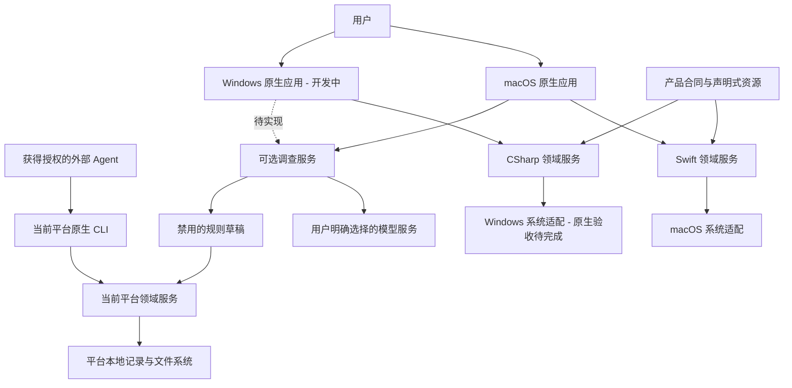
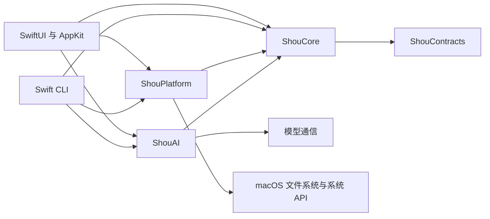
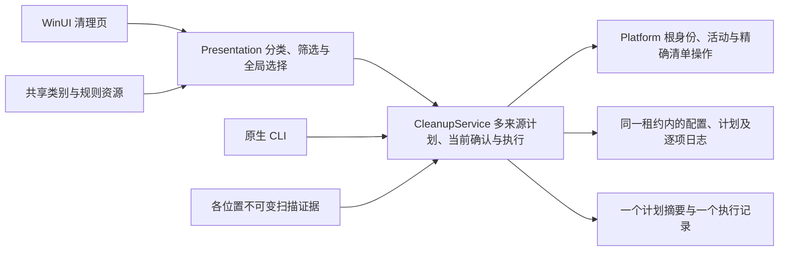
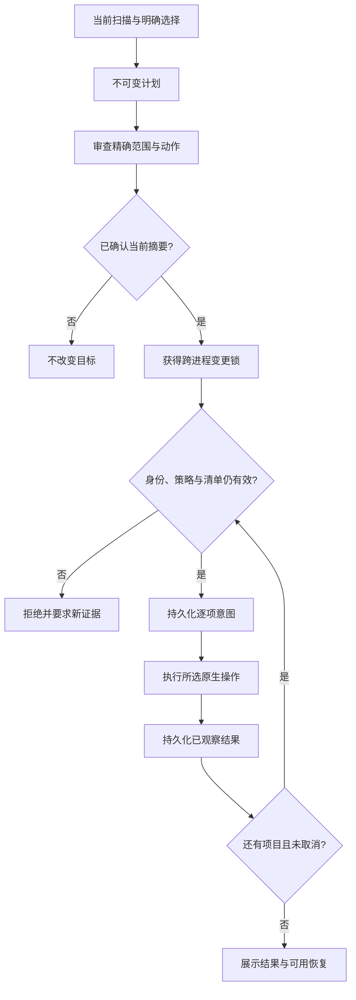

# 系统架构

[English](../../architecture/system-design.md) | 简体中文

状态：macOS 已有源码实现。Windows 按[原生实施方案](../engineering/windows-native-plan.md)开发中，已有位置发现、应用注册与启动项浏览、内置与个人规则配置、空间浏览、清理审阅与只读历史源码，原生运行与分发验收待完成。

## 系统上下文

桌面和 CLI 是各操作系统内独立的产品入口，共用本平台的领域服务。普通扫描与清理可离线完成。模型提供基于证据的规则草稿；确定性验证、明确启用、重新扫描和确认执行仍为独立步骤。

## 领域职责

| 职责 | 合同 |
| --- | --- |
| 规则 | 闭合 Schema、不可变版本、平台适用性、范围和保护数据 |
| 发现 | 明确已知根与有界项目线索，区分不存在与无权访问 |
| 扫描 | 有界工作、稳定身份、完整目标证据和准确的部分覆盖 |
| 分析 | 分配容量估算、硬链接去重、分页目录与大文件查询 |
| 计划 | 明确所选目标、动作、证据摘要、策略版本和过期时间 |
| 确认 | 与当前计划及入口绑定的单次动作审查 |
| 执行 | 变更锁、实时复核、持久化意图和逐项结果 |
| 恢复 | 按有效回执恢复且不覆盖现有文件，核实不确定操作 |
| 保留 | 配额和过期策略保护活跃计划、恢复证据和已消费授权 |
| AI | 有界授权证据、供应商隔离、取消和禁用草稿 |

Core 拥有这些决策及所需能力接口；Platform 负责原生访问、身份、进程和存储；UI 负责导航、选择、呈现与调度。Windows Presentation 保持页面状态可在 macOS 独立测试。见[仓库边界](monorepo-and-platforms.md)。

[工具管理](../product/developer-tools.md)使用独立目录、只读安装观察与软件包计划，不把发现或清理候选转换成卸载权限。Swift／C# Core 分别校验目录与当前一次性计划；Platform 分别读取管理器／文件事实并执行固定包操作，UI 组织开发者工具与 AI 工作台。AI 软件管理与可选规则调查不是同一领域；未接入来源、服务与配置功能的状态须如实保留。

## 统一遍历边界

各平台内部把目录读取、清单比较与不可变分页记录作为可复用底层能力。macOS 计量与目标检查共用 `NativeDirectoryReader`；Windows 扫描与原生核验共用基于句柄的 `NativeDirectoryReader`。Core 在一次请求内建立索引和策略上下文，供分类、选择与审阅复用，不跨操作缓存授权证据。

整批策略预检与最终变更边界分别承担职责。明确声明会完整核验清单的适配器负责最后一次现场读树，Core 省去紧邻的重复遍历；其他适配器默认保留保守核验。原生变更仍检查完整当前清单、身份、上下文和逐项移除。历史现场核对始终重新观察；Windows 安装程序卸载与 SQLite 隐私操作继续使用各自系统合同。

## macOS 实现

`apps/macos` 组装 SwiftUI/AppKit、`ShouCore`、`ShouPlatform`、`ShouAI` 与内置 Agent 指令。`apps/cli` 独立组装相同 Swift 服务和终端确认。`Package.swift` 构建 macOS 产品，不定义 Windows target。

macOS 适配使用有界原生元数据读取、SQLite 磁盘索引，并按需使用短生命周期只读子进程。只读请求只允许查询身份和检查数据；父进程拥有确认后的变更操作。超时、取消、子进程上限和部分结果必须明确表达。[扫描性能](../engineering/storage-scan-performance.md)定义调度与计量细节。

已知根与声明式规则统一维护为 JSON。`ShouEngine` 在采集配置绑定证据前登记可用根。仅目录名称相似不能扩大规则权限。应用缓存发现需要精确的已安装所有者证据和已观察到的非活跃状态；所有权或活跃状态未知时阻断对应目标。

## Windows 实现合同

WinUI App → Presentation → C# Core 为界面依赖链。Windows Platform 实现 Core 声明的文件系统、注册表、进程、凭据与记录接口。App 与 .NET CLI 直接组装这些实现。C# 领域使用显式 Windows 路径模型，真实 Win32 行为另行原生验证。模块名、目标框架与阶段退出标准见[Windows 方案](../engineering/windows-native-plan.md)。

Core 的 `BuiltinRuleCatalog` 从共享 JSON 生成当前适用定义；配置只保存内置启停偏好与个人规则的明确版本。`ScanLocationService` 有界发现并复核位置，在一次配置事务中登记整批目录后才开始扫描。界面可扫描单个位置或页面列出的全部已配置位置，CLI 可发现、登记后扫描整批位置；两端复用顺序扫描的共享预算、保护与计划服务。界面汇总多位置类别、规则与路径，筛选保留全局选择；Core 在同一租约内核对来源并保存一个多位置计划，由一次当前摘要确认、全部来源预检和逐项日志约束执行，公共门禁仍关闭。资源升级后的定义变化使旧计划失效，默认参与扫描不表示执行授权。

应用管理使用独立只读链路：应用页或 CLI → `ApplicationCatalog` → `IApplicationInventory` → 注册表与当前用户 MSIX。Core 校验注册事实并提供不可变快照查询；Platform 报告固定来源的预算和缺口。该链路不打开清理记录，不把注册身份转换为删除权限。来源、估算与后续系统卸载边界见[应用合同](../product/application-uninstall.md#windows-应用发现与卸载边界)。

卸载准备由 `ApplicationUninstallReviewer` 调用 Core 的安装身份接口，Platform 读取 MSI／MSIX 的精确事实；`ApplicationUninstallPlanner` 重新审阅并绑定原摘要、当前用户与独立数据影响同意，再使用现有私有记录租约保存计划。Presentation 持有审阅／同意／取消状态，App 与 CLI 组装同一服务。审阅不打开存储，计划不授予执行；`ApplicationActivityService` 复用扫描与文件占用接口，`WindowsApplicationProcesses` 使用只读查询权限获取匹配映像路径；活动或未知状态阻止准备计划。`ApplicationUninstallService` 已实现一次性当前确认、变更租约、身份／活动重查、先写意图及结果查询；Platform 的 `WindowsApplicationUninstallMutation` 负责固定 MSI 调用与当前用户 MSIX 部署及独立身份观察。WinUI 已组装独立确认、停止等待、只读结果与窗口生命周期源码；GUI 与 CLI 共用关闭的执行门禁。原生验收、额外残留和恢复仍待完成。

启动项发现使用独立只读链路：WinUI `StartupViewModel` 或 `startup list` → `StartupInventoryService` → `IStartupInventory` → `WindowsStartupInventory`。Core 校验有界元数据并查询不可变快照，Platform 读取六个固定注册表来源、两个本地启动文件夹及当前身份可见的开机／登录计划任务，以及当前用户已注册包的启动声明。参数不进入 Core，存在注册不代表启用、活动或删除／控制权限，该链路不打开清理存储。来源、范围外项目与原生证据要求见[启动项合同](../product/startup-items.md#windows-启动项合同)。

识别出的计划任务另有独立的任务引擎状态观察。Platform 双读公开的开关／状态并复核路径与 XML，Core 拒绝无效来源或状态。状态缺失时保留注册并报告覆盖缺口，不据此判断实际启动条件、应用活动或控制授权。

隐私扫描使用独立固定浏览器策略、整数时间边界及只读 SQLite／身份适配。`PrivacyScanViewModel` 和 CLI 共用 `PrivacyScanService`，经现有配置租约保存观察。Core 的 `PrivacyCleanupService` 已实现确切来源计划、独立 Cookie 影响同意、当前单次确认、意图先行的编排与脱敏回执；原生事务删除适配、公开入口接入和原生验收待完成。见[隐私边界](../engineering/privacy-cleaning.md#windows-平台边界)。

## 清理与并发

Windows 界面用独立的 `CleanupExecutionViewModel` 持有一次当前计划的确认与结果查询；App 直接组装同一 Core 的确认、执行和记录读取。GUI 与 CLI 共用 Platform 的关闭门禁，原生验收前不请求执行确认。源码包含默认取消的 UI 线程确认、执行中范围与导航保护，以及正常关窗请求停止并等待真实结果；该状态不提供恢复或自动重试。详见[确认与生命周期](../engineering/windows.md#文件清理确认与窗口生命周期)。

读取操作可取消且有预算限制。全树完整性与目标子树完整性分别表达；只有完整、当前的目标证据才能授权变更。稀疏清理扫描不能代替完整空间分析。

桌面默认永久删除，必须以精确范围确认不可逆后果。废纸篓或回收站是明确的可选动作，恢复能力独立验收；失败不能转为永久删除。CLI 使用交互式确认，不提供无人值守的破坏性绕过入口。

取消停止派发新变更，正在进行的原生操作记录真实结果或未知。日志与文件系统不构成跨系统原子事务。恢复必须检查当前状态，不能依据缺少输出推断成功。POSIX 描述符和 Windows 句柄的竞态保护分别由平台负责。

## 数据与资源

规则和产品合同与语言无关，本地记录由各平台拥有。使用稳定 ID、显式格式版本与结构化错误类别。Windows 卷标识、File ID、SID 与 macOS device、inode、owner 分别建模。见[数据合同](data-model.md)。

文案、设计 token、品牌与规则资源各自只有一个规范来源，使用确定性生成器，生成变更携带源摘要。在 [SYNC.md](../../../SYNC.md) 跟踪每项功能、安全变化与刻意差异。

## 工程与验证

以最小功能链路和明确能力实施，领域接口保持小而专一，仅服务于当前操作，避免通用插件系统和 UI 中重复的策略。

Mac 测试证明领域和状态语义，Windows 原生集成证明该平台系统行为。UI、可访问性、签名、安装与更新分别需要独立证据。每项已支持能力必须注明平台、架构、精确版本与实际检查，见[验收规范](../engineering/acceptance-and-testing.md)。

Windows 计划任务开关使用独立的 `StartupControlReviewer`／`StartupControlService` 与小型检查、确认、变更接口，由 Platform 实现精确 COM 读取和 Enabled 设置，Presentation 持有审阅／执行／查询状态，App 与 CLI 组装同一服务。发现不打开存储，确认后的控制链路持久化意图；两入口共用关闭的公共门禁。具体范围见[启动项合同](../product/startup-items.md#计划任务开关审阅与控制)。
