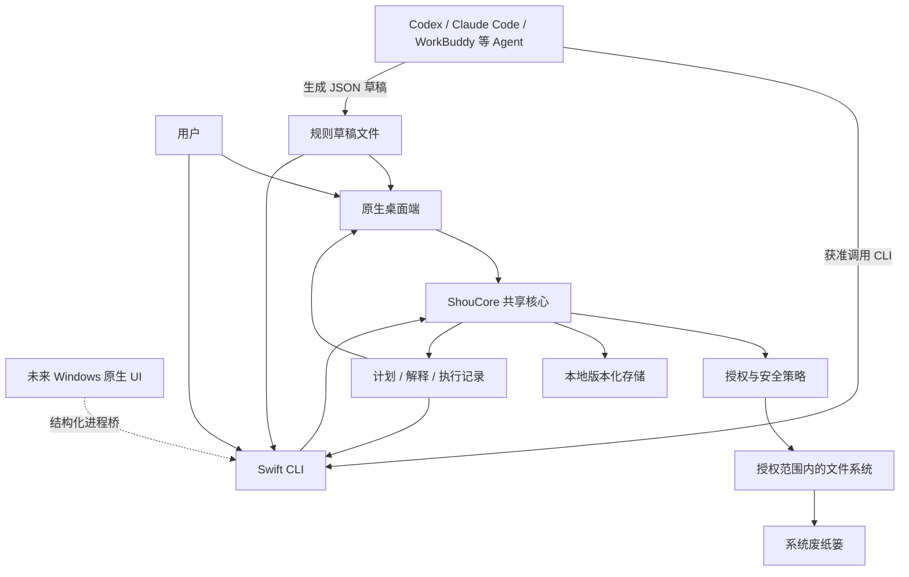
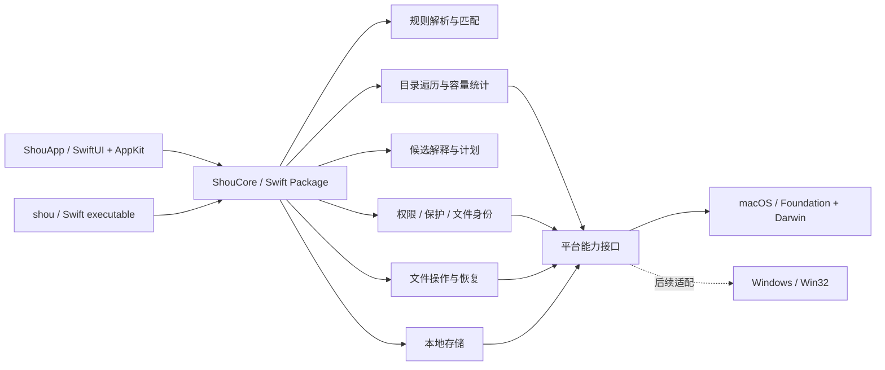

# 系统架构

[English](../../architecture/system-design.md) | 简体中文

状态：设计草案。Swift 原生开发与 CLI、桌面端双入口为确定约束；平台能力需经原型验证。

## 1. 设计约束

1. macOS SwiftUI 桌面端与 Swift CLI 共享领域核心；未来 Windows 复用同一合同和可移植核心。
2. 核心任务能在任一入口独立完成，CLI 不依赖 GUI 进程。
3. 用户自定义规则与 AI 生成规则使用同一种声明式格式。
4. 不接入任何模型，不开发 Agent，不引入模型 SDK；首版也不需要账号、网络服务、常驻服务或特权 helper。
5. 以少量模块形成闭环，不为尚未支持的生态引入通用插件运行时。
6. 采用原生多平台 monorepo；共享核心不依赖 AppKit、SwiftUI、Darwin 或 Win32，系统细节位于平台适配层。

## 2. 上下文架构



Agent 是外部调用者；模型输出、项目内容和导入文件都位于信任边界之外。原型阶段不假定不同 Agent 的命令权限与 TTY 行为相同。

## 3. 模块与依赖



首版建立共享核心、平台适配和两个产品入口。图中规则、扫描、计划等先作为核心包内的职责边界，不为每项能力拆一个包。

建议工程布局，**尚未创建**：

```text
apps/macos/                 # SwiftUI / AppKit 原生应用与应用工程
apps/cli/                   # Swift CLI；产品命令 shou / shou.exe
apps/windows/               # 后续 Windows 原生 UI，不代表已经实现
packages/shou-core/         # 可移植 Swift 领域模型、规则、扫描编排与计划
packages/shou-platform/     # 能力接口及 macOS / Windows 平台适配
packages/shou-contracts/    # 语言无关 JSON Schema 与公开合同
tests/fixtures/            # 虚构项目、规则与跨入口合同用例
scripts/                   # 构建、校验、打包与基准工具
assets/brand/              # 品牌与图标源文件
examples/rules/            # 可审阅规则样例
docs/                      # 产品、架构、接口与验收文档
```

参考与完整依赖规则见 [Monorepo 与平台边界](monorepo-and-platforms.md)。以上是目标代码布局，当前只落地文档与合同样例。

## 4. 职责边界

| 模块 | 职责 | 不承担的职责 |
| --- | --- | --- |
| WorkspaceAccess | 根目录绑定、入口实际访问能力、授权失效 | 通过规则扩大权限 |
| RuleService | 版本、来源、校验、规范化、启停与导入 | 执行脚本、自动认可模型结论 |
| Scanner | 有界遍历、项目线索、容量与修改时间证据 | 把未知目录判定为垃圾 |
| Matcher | 在授权范围内按确定性条件匹配 | 自行搜索未授权卷 |
| Planner | 去重、保护策略、选择范围、快照与摘要 | 执行删除或继承上次确认 |
| Confirmation | 桌面确认或终端确认，绑定计划摘要 | 创建长期可复用的删除授权 |
| Executor | 复核、移动到废纸篓、逐项结果、取消 | 绕过策略、按旧路径盲目继续 |
| ReceiptService | 恢复、永久移除本次项目、恢复状态 | 清空无关废纸篓内容 |
| LocalStore | 原子保存、版本、并发锁与恢复记录 | 上传用户文件内容 |

UI 与 CLI 只处理交互、确认来源和展示；安全策略由共享核心统一执行，防止一个入口漏掉保护规则。

## 5. Swift 与并发

- 使用 Swift，首版工程启用 Swift 6 并发检查；最低系统暂定 macOS 14。
- SwiftUI 视图状态由 `@MainActor` 隔离，文件遍历和统计离开主线程。
- 采用结构化并发、有界任务队列和可传播的取消信号；不为每个文件创建一个无限制 Task。
- 共享服务优先通过明确的数据值与少量协议解耦，例如文件系统适配、时钟与存储。
- 执行服务在单进程内串行化；跨进程还需文件锁，单个 Swift actor 不能保护 GUI 与 CLI 两个进程。
- UI 更新合并后投递，扫描进度在总量未知时显示已处理数量与当前阶段，不伪造百分比。

## 6. 存储与跨入口一致性

首版采用本地版本化 JSON：配置和规则按对象保存，扫描大清单采用可流式写入的独立文件。是否引入 SQLite 由数据量与查询需求决定，不在第一步建立数据库服务。

- 配置根目录由平台适配提供；macOS 使用用户级 Application Support，Windows 使用用户级应用数据目录，正式身份在实现阶段确定。
- 临时文件与目标记录置于同目录，完成写入后原子替换；关键执行日志还需验证落盘行为。
- 配置变更与破坏性任务使用跨进程锁；锁忙时返回结构化错误。
- 同一用户同时只允许一个破坏性任务，读取不可变计划和历史快照不要求 GUI 在运行。
- 扫描缓存可重建；规则、排除与执行记录不得视为可随意清理的缓存。
- 执行前必须成功持久化意图记录；磁盘满导致无法写入时，不开始操作。
- 来自磁盘的计划与规则仍需按格式及安全策略验证，不能因为放在本地目录就视为已授权。

## 7. 权限与分发

### 桌面端

使用系统目录选择器获取用户选择，保存可用的访问凭据；若采用 App Sandbox，需要 security-scoped bookmark 与访问生命周期管理。bookmark 过期时重新授权，不能静默退回扩大扫描范围。

### CLI

用户显式注册工作区路径；实际访问受当前进程、终端、TCC、文件权限与分发方式约束。CLI 注册工作区只是应用配置，不等于系统授权。遇到拒绝访问返回具体错误。

GUI 能访问的路径不保证 CLI 能访问，反之亦然。首版不引入权限代理服务来“借用”另一个入口的权限。

### 分发选择

首版倾向直接分发签名、公证的应用与配套 CLI；是否启用 App Sandbox、CLI 安装位置及签名关联由 M0 验证后记录。App Store 上架、特权 helper 和全盘访问不是首版默认依赖。

## 8. 文件安全与竞态

扫描时记录卷、文件身份、类型、大小、修改与元数据变化信息。目录计划需要子项清单摘要，不能仅比较顶层目录时间。

执行时要求：

1. 重新检查工作区身份、实际授权、规则版本、排除与计划有效期。
2. 通过授权根目录逐级核验路径边界与符号链接，不使用字符串前缀替代目录归属判断。
3. 复核目标身份和目录清单，发现变化则使目标失效，不自动扩大计划。
4. 对实际文件操作采用平台允许的身份约束与无符号链接路径解析。
5. 无法满足计划绑定时跳过或拒绝，不退回通用递归删除。

系统废纸篓 API、文件描述符相对操作与目录竞态之间的组合需要原型确认。预览无法消除所有运行时竞争；不把简单的“检查后按路径操作”宣传为原子安全。此项是发布前置门槛。

## 9. AI Agent 接入方式

首版提供公开规则格式、命令发现、JSON 结果与可持久化计划，供 Codex、Claude Code、WorkBuddy 等在用户许可下调用 CLI。无需为每个 Agent 编写不同的清理引擎。

当前通过 CLI 与本地规则文件建立操作合同，不开发 Agent、不调用模型、不提供聊天服务。MCP 不纳入当前范围；只有明确接入障碍出现时才评估额外工具协议。具体合同见 [Agent 操作指南](../ai/coding-agent-integration.md)。

## 10. 工程原则

- **KISS**：一套核心、有限的声明式匹配能力和明确的平台边界。
- **DRY**：规则校验、保护策略、计划与执行逻辑复用。
- **YAGNI**：暂不引入云服务、动态脚本、模型编排和特权守护进程。
- **SOLID**：展示、规则、扫描、计划、执行与平台适配各自负责明确职责；仅对实际外部依赖建立可替换接口。
