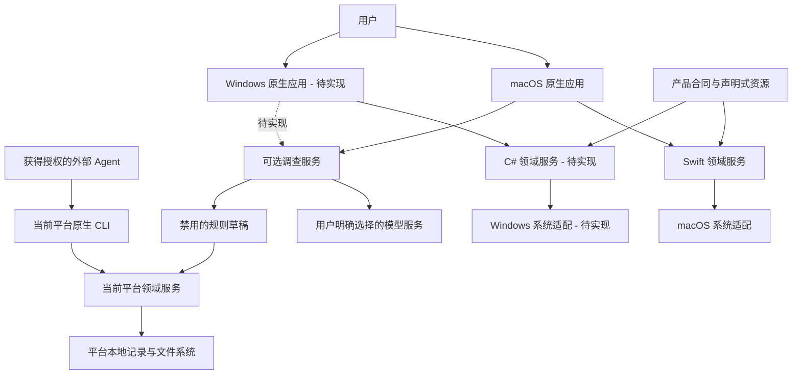
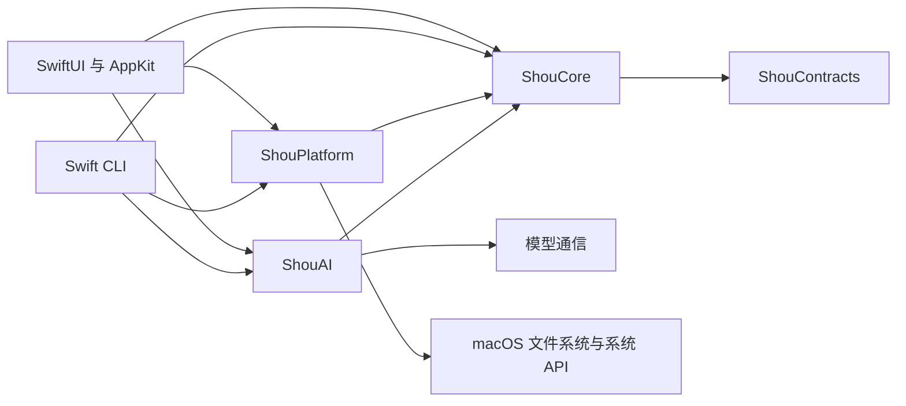
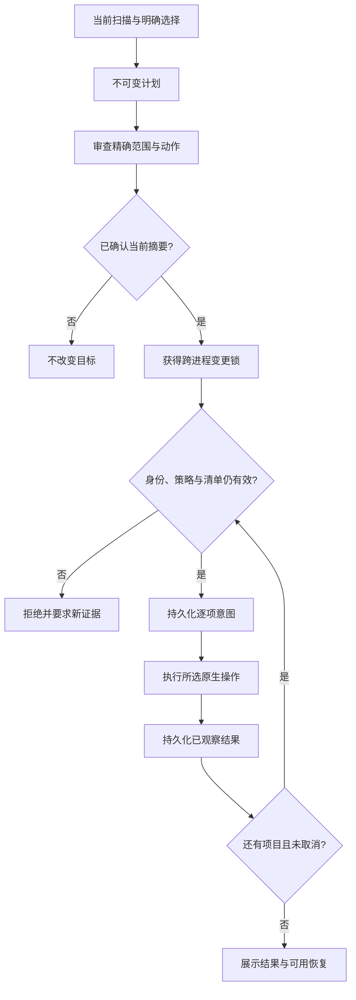

# 系统架构

[English](../../architecture/system-design.md) | 简体中文

状态：macOS 已有源码实现。Windows 按[原生实施方案](../engineering/windows-native-plan.md)推进，运行与分发均待实现和验证。

## 系统上下文

桌面和 CLI 是各操作系统内独立的产品入口，共用本平台的领域服务。普通扫描与清理可离线完成。模型提供基于证据的规则草稿；确定性验证、明确启用、重新扫描和确认执行仍为独立步骤。

## 领域职责

| 职责 | 合同 |
| --- | --- |
| 规则 | 闭合 Schema、不可变版本、平台适用性、范围和保护数据 |
| 发现 | 明确已知根与有界项目线索，区分不存在与无权访问 |
| 扫描 | 有界工作、稳定身份、完整目标证据和准确的部分覆盖 |
| 分析 | 分配容量估算、硬链接去重、分页目录与大文件查询 |
| 计划 | 明确所选目标、动作、证据摘要、策略版本和过期时间 |
| 确认 | 与当前计划及入口绑定的单次动作审查 |
| 执行 | 变更锁、实时复核、持久化意图和逐项结果 |
| 恢复 | 按有效回执恢复且不覆盖现有文件，核实不确定操作 |
| 保留 | 配额和过期策略保护活跃计划、恢复证据和已消费授权 |
| AI | 有界授权证据、供应商隔离、取消和禁用草稿 |

Core 拥有这些决策及所需能力接口；Platform 负责原生访问、身份、进程和存储；UI 负责导航、选择、呈现与调度。Windows Presentation 保持页面状态可在 macOS 独立测试。见[仓库边界](monorepo-and-platforms.md)。

## macOS 实现

`apps/macos` 组装 SwiftUI/AppKit、`ShouCore`、`ShouPlatform`、`ShouAI` 与内置 Agent 指令。`apps/cli` 独立组装相同 Swift 服务和终端确认。`Package.swift` 构建 macOS 产品，不定义 Windows target。

macOS 适配使用有界原生元数据读取、SQLite 磁盘索引，并按需使用短生命周期只读子进程。只读请求只允许查询身份和检查数据；父进程拥有确认后的变更操作。超时、取消、子进程上限和部分结果必须明确表达。[扫描性能](../engineering/storage-scan-performance.md)定义调度与计量细节。

已知根与声明式规则统一维护为 JSON。`ShouEngine` 在采集配置绑定证据前登记可用根。仅目录名称相似不能扩大规则权限。应用缓存发现需要精确的已安装所有者证据和已观察到的非活跃状态；所有权或活跃状态未知时阻断对应目标。

## Windows 实现合同

WinUI App → Presentation → C# Core 为界面依赖链。Windows Platform 实现 Core 声明的文件系统、注册表、进程、凭据与记录接口。App 与 .NET CLI 直接组装这些实现。C# 领域使用显式 Windows 路径模型，真实 Win32 行为另行原生验证。模块名、目标框架与阶段退出标准见[Windows 方案](../engineering/windows-native-plan.md)。

## 清理与并发

读取操作可取消且有预算限制。全树完整性与目标子树完整性分别表达；只有完整、当前的目标证据才能授权变更。稀疏清理扫描不能代替完整空间分析。

桌面默认永久删除，必须以精确范围确认不可逆后果。废纸篓或回收站是明确的可选动作，恢复能力独立验收；失败不能转为永久删除。CLI 使用交互式确认，不提供无人值守的破坏性绕过入口。

取消停止派发新变更，正在进行的原生操作记录真实结果或未知。日志与文件系统不构成跨系统原子事务。恢复必须检查当前状态，不能依据缺少输出推断成功。POSIX 描述符和 Windows 句柄的竞态保护分别由平台负责。

## 数据与资源

规则和产品合同与语言无关，本地记录由各平台拥有。使用稳定 ID、显式格式版本与结构化错误类别。Windows 卷标识、File ID、SID 与 macOS device、inode、owner 分别建模。见[数据合同](data-model.md)。

文案、设计 token、品牌与规则资源各自只有一个规范来源，使用确定性生成器，生成变更携带源摘要。在 [SYNC.md](../../../SYNC.md) 跟踪每项功能、安全变化与刻意差异。

## 工程与验证

以最小功能链路和明确能力实施，领域接口保持小而专一，仅服务于当前操作，避免通用插件系统和 UI 中重复的策略。

Mac 测试证明领域和状态语义，Windows 原生集成证明该平台系统行为。UI、可访问性、签名、安装与更新分别需要独立证据。每项已支持能力必须注明平台、架构、精确版本与实际检查，见[验收规范](../engineering/acceptance-and-testing.md)。
