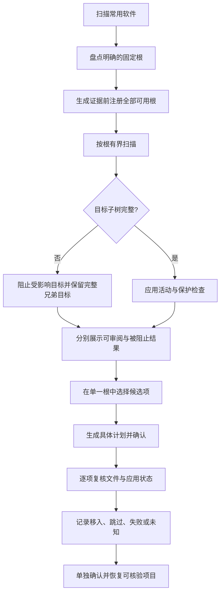
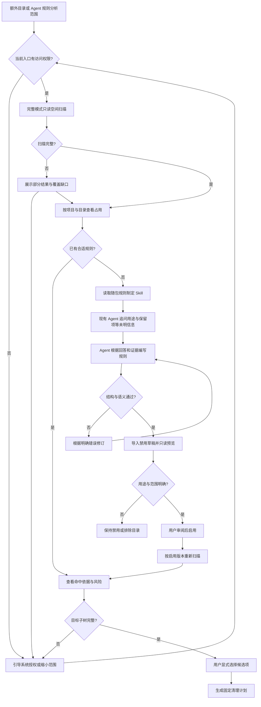
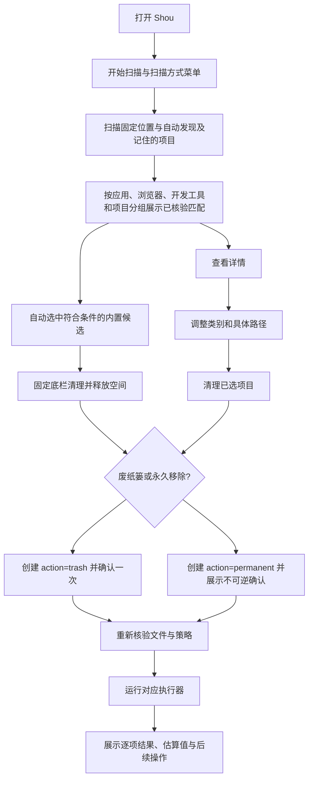
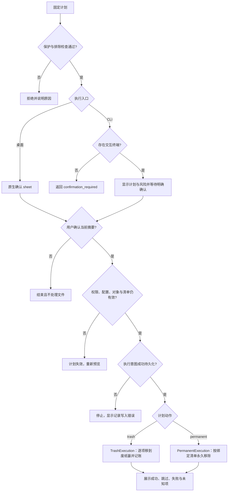
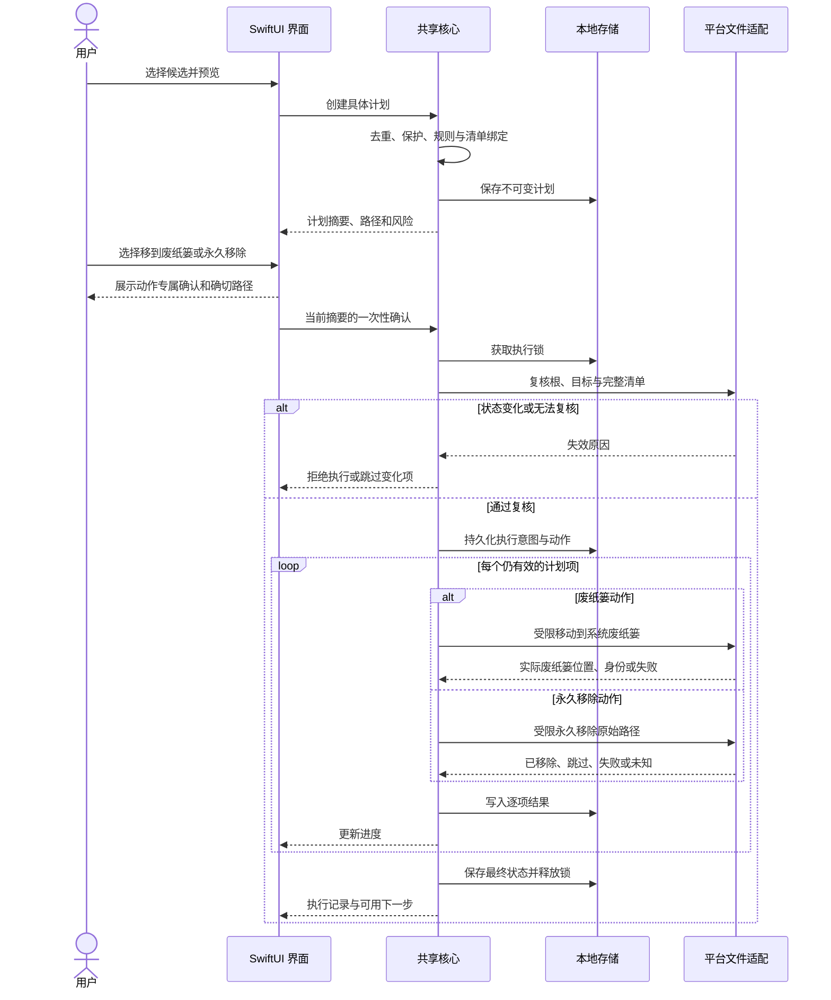
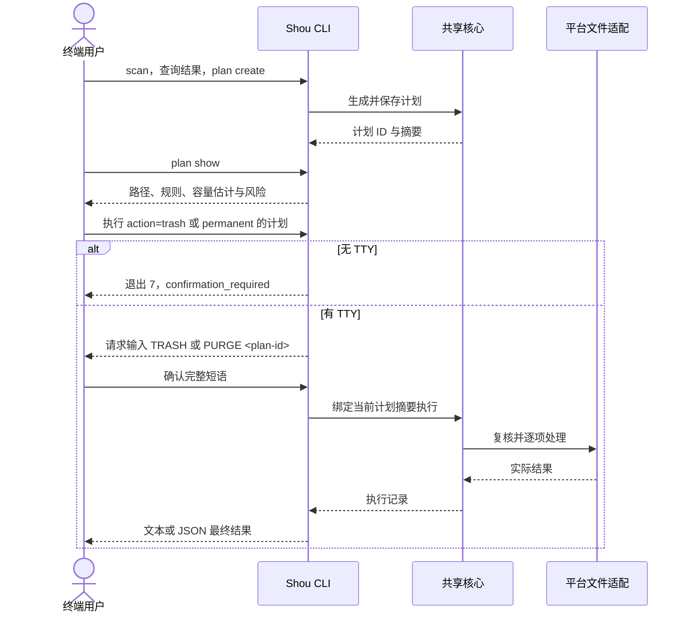
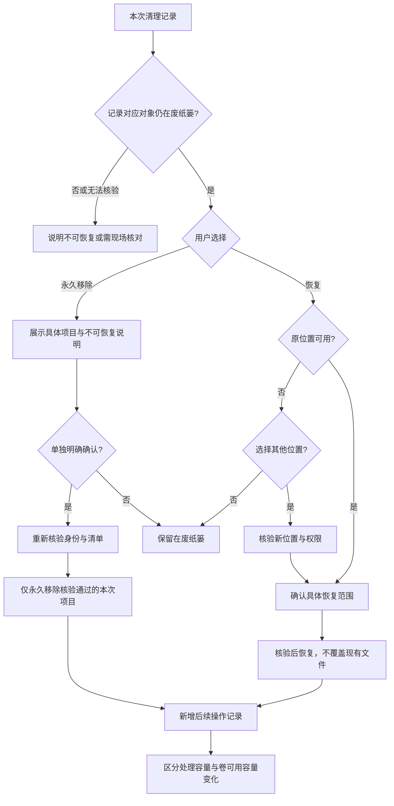
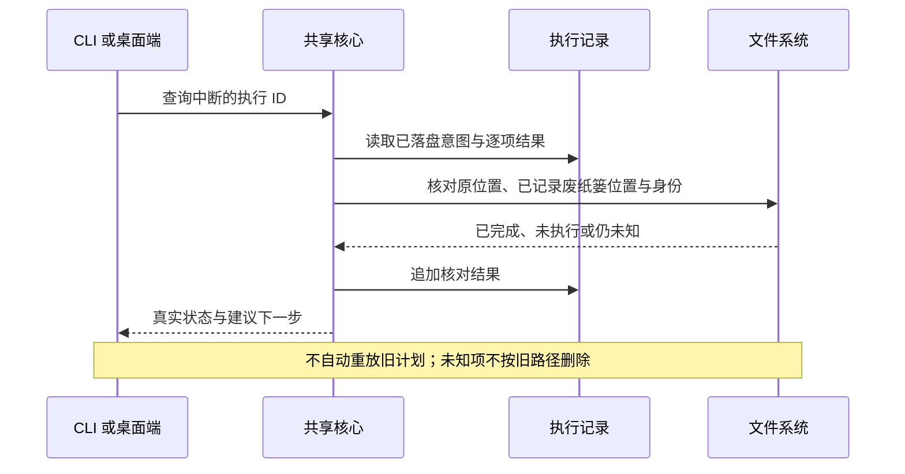

# 核心流程与时序

[English](../../architecture/workflows-and-sequences.md) | 简体中文

当前桌面导航、自动发现及个人规则复用以此为准：[统一日常清理](../product/unified-cleanup.md)。

状态：当前流程合同。以下图描述已实现的桌面快速路径、桌面详情路径、CLI/Agent 合同及仍待验收的边界。

桌面默认一次范围确认后永久清理；废纸篓为可选动作，选择废纸篓后不会静默转为永久删除。CLI 保持已有默认，显式 `--mode permanent` 可直接清理。两种动作共用根与目标核验、排除项、修改互斥和逐项日志。

## 1. 从占用发现到个人规则

桌面默认入口扫描常用应用／开发工具固定缓存位置及自动发现及记住的项目，无需选择目录。CLI 的 `system scan` 默认只扫描固定位置，`--include-projects true` 纳入自动发现及记住的项目。两者默认使用清理模式，项目发现只探测固定的常见开发目录；仍可显式扫描项目，空间浏览使用完整模式。

移入废纸篓仅报告处理量估计，不作为已释放空间。即使整体扫描为 partial，也只有独立完整目标可以进入计划；旧记录缺少覆盖证据不能授权不完整目标，清理模式完成不代表全树已测量。

完整扫描展示没有规则的大目录，但不会仅凭体积赋予执行资格；清理快照只包含规则指向的证据。目标证据不完整时须修复权限或重扫受影响范围；无关范围的缺口不使完整兄弟目标失效。

## 2. 桌面快速路径与详情审阅

初始界面以**开始扫描**为中央主操作，相邻菜单提供扫描方式，页头展示当前磁盘容量。标准扫描完成后，符合条件的内置及已启用个人规则候选会自动选中。类别三态复选框与路径详情调整同一份选择，固定底栏展示数量、容量估计和**清理并释放空间**动作。不可变计划的创建与重新核验在该动作内部完成，用户无需进入内部计划页面；扫描并清理的快捷动作仍保留在扫描菜单。

这条路径统一处理内置与已启用个人规则，同时保留具体范围审阅入口。执行动作在操作点明确显示：**移入废纸篓**可通过该批次记录恢复；**永久移除**不可逆，并始终绑定当前选中的计划。

## 3. 计划与执行决策

任一入口均调用相同策略。计划尚未过期也不能跳过复核；记录与文件操作不是跨系统事务，异常现场需要核对。

## 4. 桌面端清理时序

锁在所有出口释放；图省略了统一资源释放块。执行期间每个目标仍需紧邻操作复核，不能把批量开始时的一次检查当作全程有效。

## 5. CLI 独立清理时序

此流程不启动桌面端。外部 Agent 的规则导入与预览时序见 [Agent 操作指南](../ai/coding-agent-integration.md)。

## 6. 立即释放空间与恢复

选择其他位置后仍需重新验证目标位置与权限；取消不触发恢复。永久移除不提供恢复承诺，也不清空其他废纸篓内容。

## 7. 中断与恢复核对

## 8. 状态一致性要求

- 用户改变排除、规则或动作后，当前预览与确认不能继续沿用。
- 取消在安全项目边界停止启动新项；单次系统废纸篓调用可能先完成，已经发生的移动须核验并保留在历史中。
- 批次不是全有或全无事务，部分成功必须直说。
- 历史是操作事实；当前是否可恢复由现场核验决定。
- 成功路径与异常路径都必须在 CLI 和 GUI 中有对应表示，不能只在日志里记录。

永久执行时，项目在调用平台能力前先进入 `purging`，只有结果持久化后才进入 `purged`。取消或意外失败会将批次保留为 `cancelled` 或 `partial`；未经核验的项目绝不会显示为已永久移除，也不会仅凭旧路径自动重试。

## 空间分析直接删除

空间分析支持本地卷或目录发现，以及明确选中文件和目录后的直接删除，独立于清理规则工作区。桌面列表和树图共用导航与去重选择；确认及执行时核验当前完整清单和排除配置，复用既有执行日志与历史。详见[空间分析架构、流程与时序](../product/space-analysis.md)。

默认空间统计与删除清单分离：只读 Worker 流式生成私有 SQLite 索引，保留全部已测量文件，逐目录汇总容量与完整性；桌面和 CLI 按需查询目录，不再受删除清单 100 万条上限截断。`StorageScan` 引用索引并记录 `measured_entry_count`，节点提供 `is_complete`，部分容量为已统计下限。删除仍重新获取所选目标的完整清单并独立核验。旧 JSON 与分页记录继续可读。

安装、权限引导、可访问范围扫描与更新身份遵循[安装流程与权限时序](../product/installation-and-access.md)。
