# 核心流程与时序

[English](../../architecture/workflows-and-sequences.md) | 简体中文

当前桌面导航、自动发现及个人规则复用以此为准：[统一日常清理](../product/unified-cleanup.md)。

macOS 空间分析读取池、catalog 写入器、后序汇总及取消时序见[空间扫描性能](../engineering/storage-scan-performance.md)。

状态：当前流程合同。以下图描述已实现的桌面快速路径、桌面详情路径、CLI/Agent 合同及仍待验收的边界。

桌面默认一次范围确认后永久清理；废纸篓为可选动作，选择废纸篓后不会静默转为永久删除。CLI 保持已有默认，显式 `--mode permanent` 可直接清理。两种动作共用根与目标核验、排除项、修改互斥和逐项日志。

## 1. 从占用发现到个人规则

桌面默认入口扫描常用应用／开发工具固定缓存位置及自动发现及记住的项目，无需选择目录。CLI 的 `system scan` 默认只扫描固定位置，`--include-projects true` 纳入自动发现及记住的项目。两者默认使用清理模式，项目发现只探测固定的常见开发目录；仍可显式扫描项目，空间浏览使用完整模式。

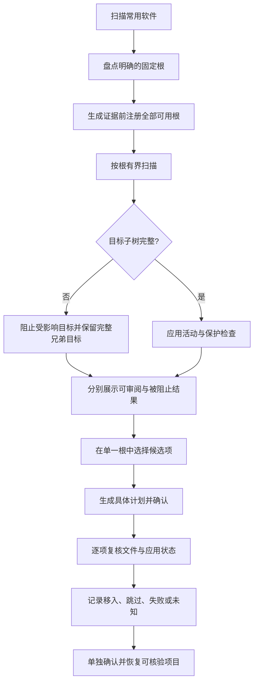

移入废纸篓仅报告处理量估计，不作为已释放空间。即使整体扫描为 partial，也只有独立完整目标可以进入计划；旧记录缺少覆盖证据不能授权不完整目标，清理模式完成不代表全树已测量。

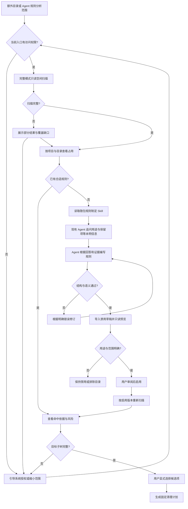

完整扫描展示没有规则的大目录，但不会仅凭体积赋予执行资格；清理快照只包含规则指向的证据。目标证据不完整时须修复权限或重扫受影响范围；无关范围的缺口不使完整兄弟目标失效。

## 2. 桌面快速路径与详情审阅

初始界面以**开始扫描**为中央主操作，相邻菜单提供扫描方式，页头展示当前磁盘容量。标准扫描完成后，符合条件的内置及已启用个人规则候选会自动选中。类别三态复选框与路径详情调整同一份选择，固定底栏展示数量、容量估计和**清理并释放空间**动作。不可变计划的创建与重新核验在该动作内部完成，用户无需进入内部计划页面；扫描并清理的快捷动作仍保留在扫描菜单。

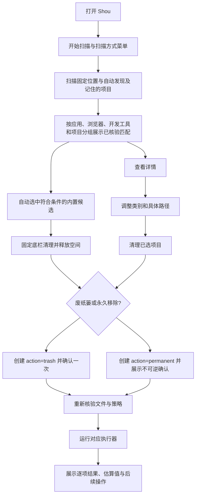

这条路径统一处理内置与已启用个人规则，同时保留具体范围审阅入口。执行动作在操作点明确显示：**移入废纸篓**可通过该批次记录恢复；**永久移除**不可逆，并始终绑定当前选中的计划。

## 3. 计划与执行决策

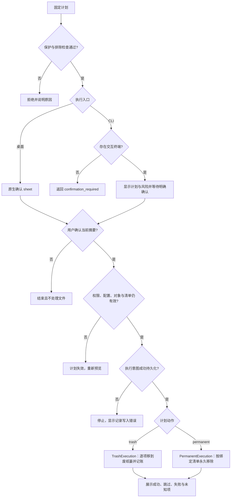

任一入口均调用相同策略。计划尚未过期也不能跳过复核；记录与文件操作不是跨系统事务，异常现场需要核对。

永久删除使用仅在一次执行中存活的 `PermanentRemovalContext`。POSIX 适配层先固定共享文件的描述符，核对完整元数据，再以 `unlinkat` 删除所选名称，并从同一描述符读取删除后的状态。只认可链接数恰好减一及伴随的 ctime 变化，其他字段必须不变。后续条目及同批选中目标仅按这些实际观测结果修正原始清单的核验。执行结束即丢弃上下文，先前清理不会授权过期计划。Windows 保持原生核验，仍拒绝不支持的硬链接目标。

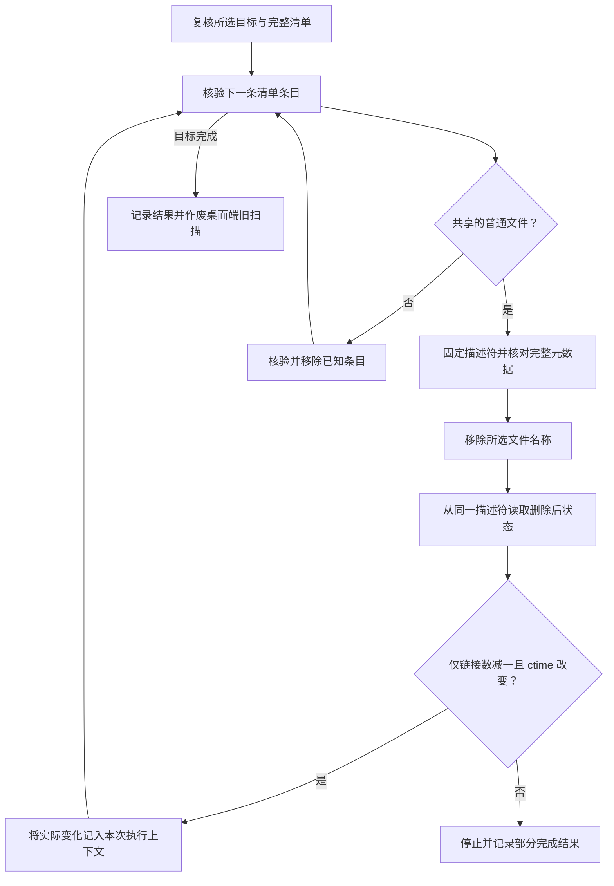

## 4. 桌面端清理时序

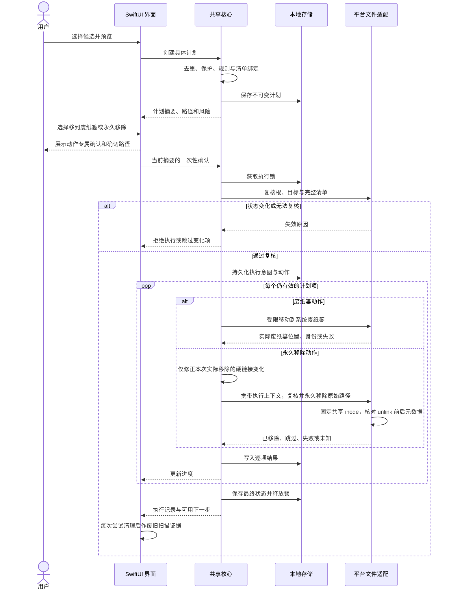

锁在所有出口释放；图省略了统一资源释放块。执行期间每个目标仍需紧邻操作复核，不能把批量开始时的一次检查当作全程有效。

## 5. CLI 独立清理时序

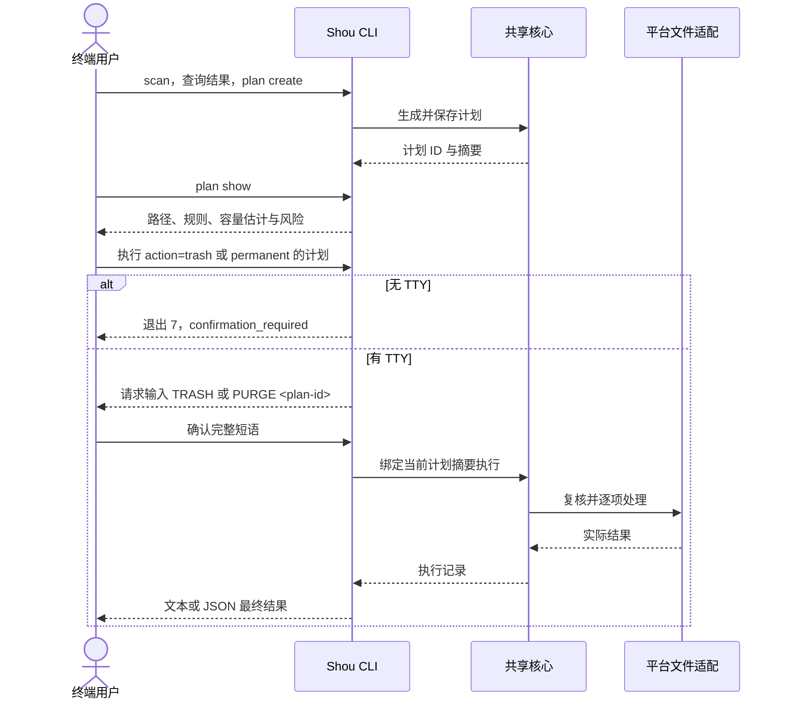

此流程不启动桌面端。外部 Agent 的规则导入与预览时序见 [Agent 操作指南](../ai/coding-agent-integration.md)。

## 6. 立即释放空间与恢复

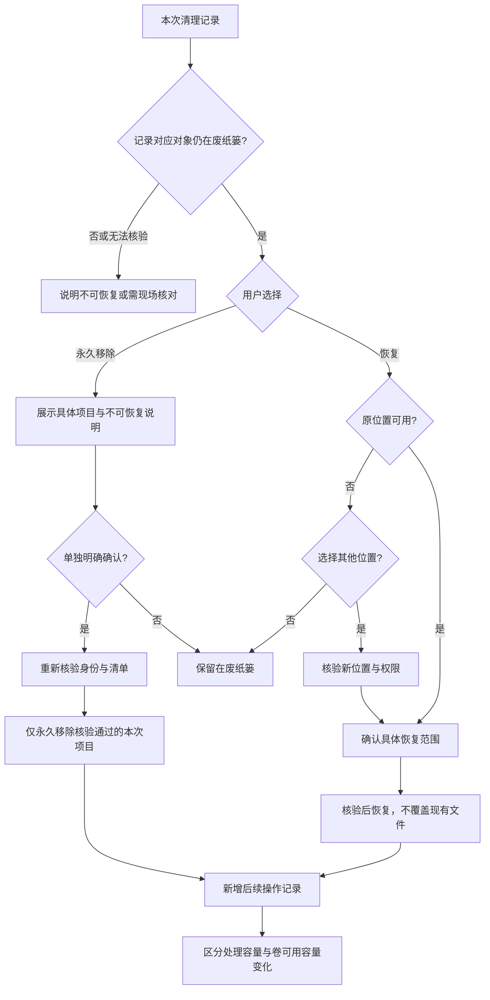

选择其他位置后仍需重新验证目标位置与权限；取消不触发恢复。永久移除不提供恢复承诺，也不清空其他废纸篓内容。

## 7. 中断与恢复核对

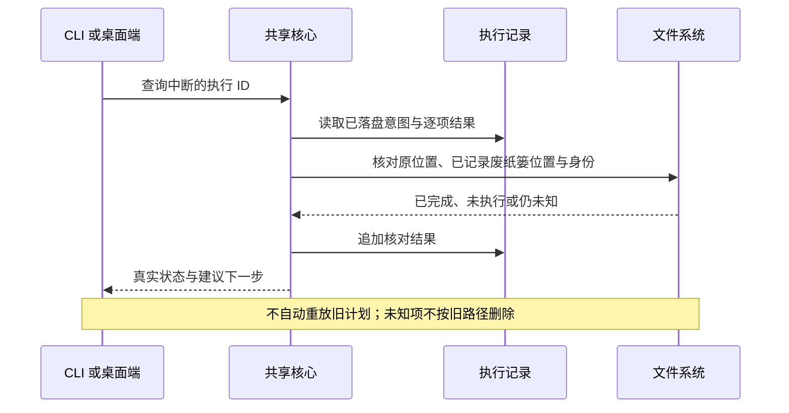

## 8. 状态一致性要求

- 用户改变排除、规则或动作后，当前预览与确认不能继续沿用。
- 取消在安全项目边界停止启动新项；单次系统废纸篓调用可能先完成，已经发生的移动须核验并保留在历史中。
- 批次不是全有或全无事务，部分成功必须直说。
- 历史是操作事实；当前是否可恢复由现场核验决定。
- 成功路径与异常路径都必须在 CLI 和 GUI 中有对应表示，不能只在日志里记录。

永久执行时，项目在调用平台能力前先进入 `purging`，只有结果持久化后才进入 `purged`。取消或意外失败会将批次保留为 `cancelled` 或 `partial`；未经核验的项目绝不会显示为已永久移除，也不会仅凭旧路径自动重试。

## 空间分析直接删除

空间分析支持本地卷或目录发现，以及明确选中文件和目录后的直接删除，独立于清理规则工作区。桌面列表和树图共用导航与去重选择；确认及执行时核验当前完整清单和排除配置，复用既有执行日志与历史。详见[空间分析架构、流程与时序](../product/space-analysis.md)。

默认空间统计与删除清单分离：只读 Worker 流式生成私有 SQLite 索引，保留全部已测量文件，逐目录汇总容量与完整性；桌面和 CLI 按需查询目录，不再受删除清单 100 万条上限截断。`StorageScan` 引用索引并记录 `measured_entry_count`，节点提供 `is_complete`，部分容量为已统计下限。删除仍重新获取所选目标的完整清单并独立核验。旧 JSON 与分页记录继续可读。

安装、权限引导、可访问范围扫描与更新身份遵循[安装流程与权限时序](../product/installation-and-access.md)。

## 应用批量与隐私领域

应用卸载以增量摘要 → 行内组件 → 多应用选择 → 一次确认 → 批量预检 → 逐组件执行 → 共享历史为主流程；筛选不清空其他应用选择。默认永久卸载，废纸篓为独立可选动作。完整流程图、时序图及个人数据边界见[应用卸载](../product/application-uninstall.md)。

隐私以来源／时间范围扫描 → 空初始选择 → Cookie 独立同意 → 精确计划 → 永久确认 → 全计划预检 → 按来源数据库事务 → 汇总回执为主流程。各来源独立提交，部分成功不回滚其他已提交来源；无恢复入口。完整架构图、流程图和时序图见[隐私清理](../engineering/privacy-cleaning.md)。

## 空间清理进度与返回

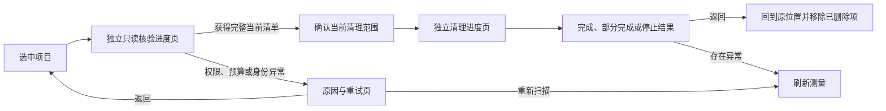

初次扫描用于导航。确认前允许目录在身份和所有者不变的前提下正常变化；核验会重新获取完整清单和大小，交由用户确认。普通文件仍核对初次扫描元数据。确认后必须严格匹配完整清单。读取不完整时保留具体覆盖原因，不发布删除计划。失败也进入有返回与重试入口的结果页。

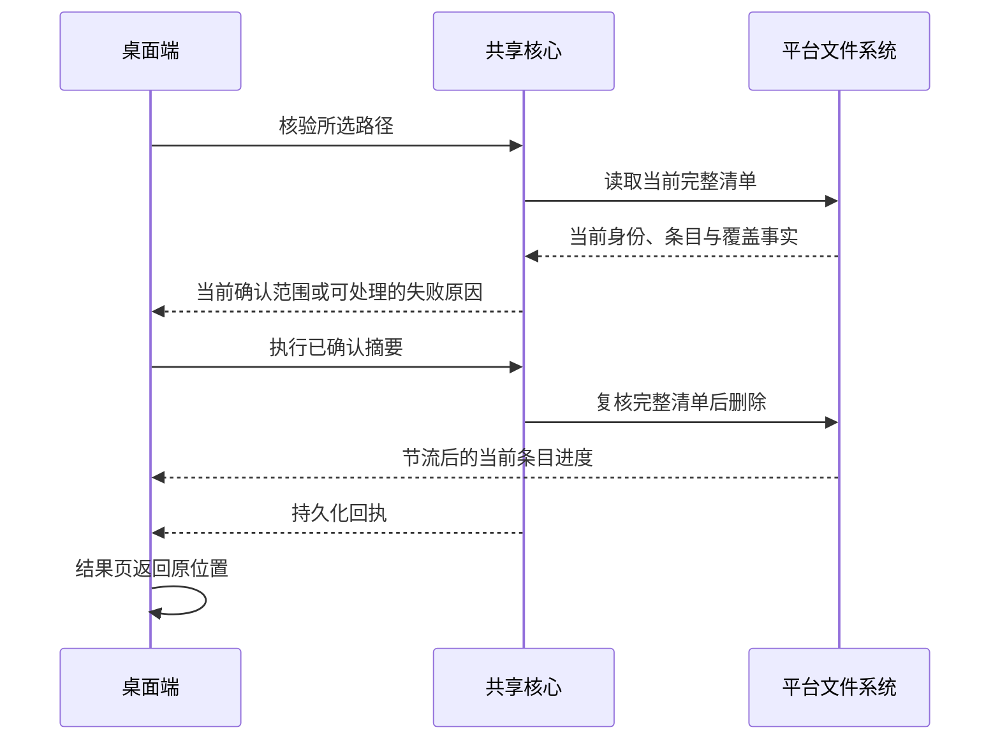

## 操作记录清理与扫描问题处理

操作记录默认只呈现项目、日期、结果与已处理大小；执行 ID、逐项路径、恢复和核验操作放在详情中。清理已结束记录会删除本地 JSON 回执及关联后续记录，保留恢复所需、结果未知和未结束记录。单独删除记录需要明确确认恢复入口丢失；正在执行或尚有后续意图的记录仍保留。只删除记录，不移动或清空实际文件和废纸篓。已执行计划保留消费状态，不能通过清空记录重放。

CLI 使用 `shou history cleanup-preview --json` 预览、`shou history clear` 在终端确认；指定 `--execution-id` 可清理单条，`--include-recoverable true` 明确允许丢弃恢复入口。Windows 通过 `history.cleanup-preview` 与带本次确认挑战的 `history.clear` 调用同一核心。记录删除顺序是主回执在前、关联后续记录在后，避免中断后让已恢复的项目再次成为可恢复项。

扫描提示只针对当前目录。其他目录的不可读状态不污染完整项目目录的浏览。系统管理位置如 `.fseventsd`、`.Spotlight-V100`、`.DocumentRevisions-V100` 使用普通范围说明，默认折叠具体路径；核心仍保留覆盖事实，不把它们伪装为已测量。用户目录的访问问题提供完成设置和 Finder 入口，变化或临时读取失败可重新扫描当前文件夹。完整磁盘访问权限不能覆盖 Unix 所有权或系统保护，软件不会为读取系统目录而修改系统权限。

只有访问／读取问题会被归为系统管理范围；资源限制和扫描期间变化始终提供处理入口，包括直接扫描系统根目录的情况。清理后返回页面提供统计刷新，不把待刷新大小误报为权限问题。Windows 使用同一覆盖分类和当前目录完整性，提供资源管理器及当前文件夹重扫入口，默认桥接扫描使用共用的磁盘索引测量路径。

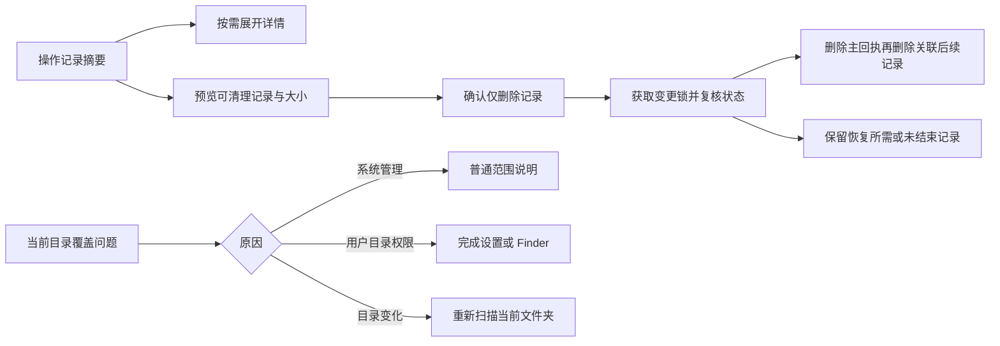

## 0.9.0 日常与定制清理

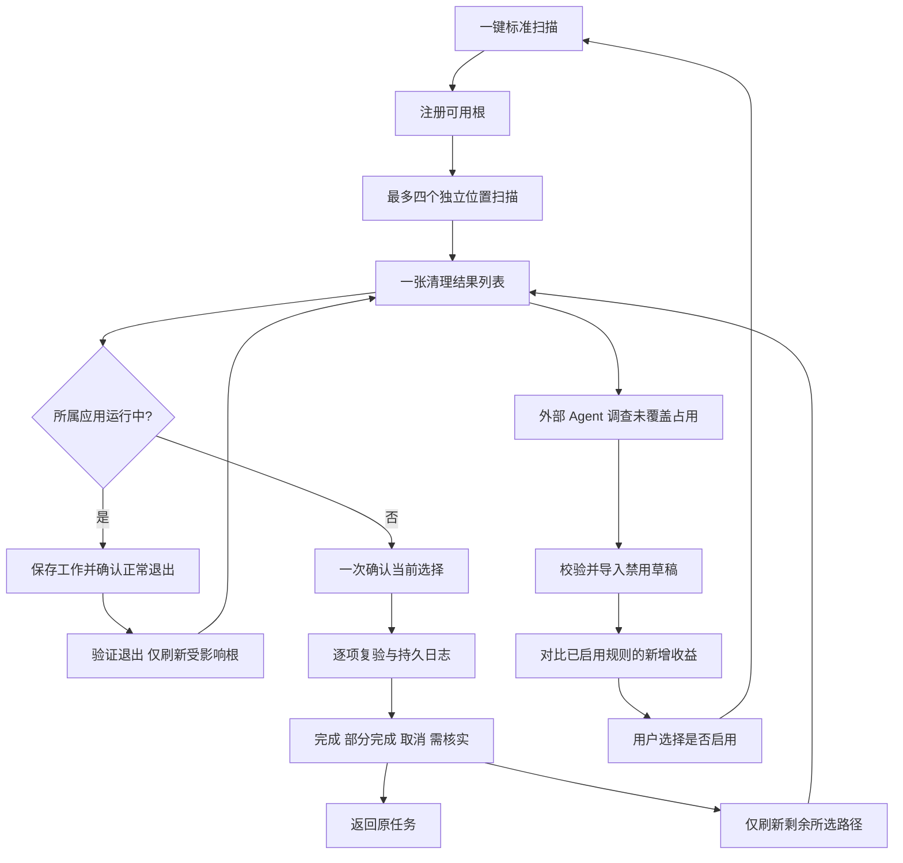

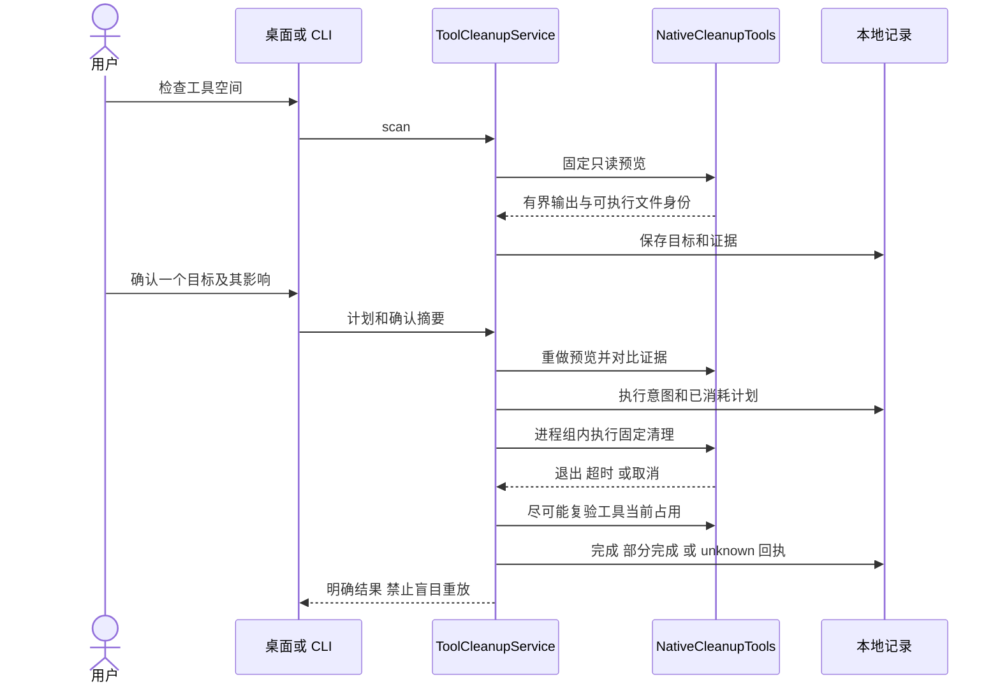

孤儿残留先验证完整的标准应用目录、系统注册与运行状态；执行前及每个删除边界再次检查缺失所属应用、所有权、排除项和完整文件清单。个人数据单独选择。永久删除与废纸篓复用逐项日志，废纸篓恢复仍需单独确认。派生记录维护不会移除这些日志或用户文件。

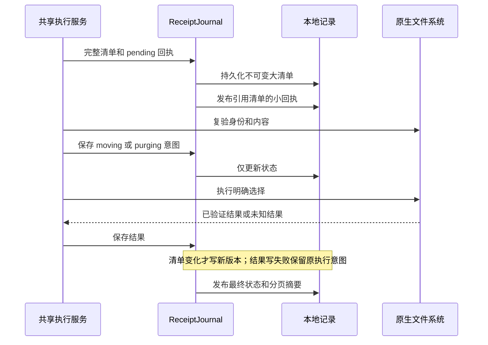

独立个人规则的“大占用下钻 → 逐条停用草稿 → 原生审阅 → 所选规则新扫描 → 确认与回执核验”流程及时序见[空间分析与 Agent 协作设计 W09](../engineering/space-analysis-agent-design.md)。外部配置变化使旧清理证据失效，不会自动启用其他规则；日常清理复用已经明确启用的选择。
