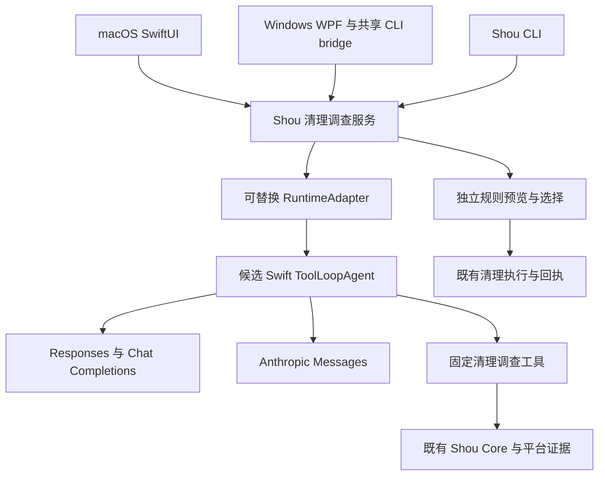

# 清理专用 Agent Core 选型调研

[English](../../engineering/agent-core-selection.md) | 简体中文

日期：2026-10-22。本文保留 SDK 选型时的调研证据；随后当前工作区采用 Swift AI SDK 0.20.0，实现并验证了 macOS 上三协议的合成服务多轮与暂停恢复。具体实现、固定提交和未验收范围见[首版实现记录](embedded-ai-implementation.md)。下文候选优先级不代表 Windows 或真实服务已通过验收。

后续任务路由已调整为确定性代码优先、Jev 固定判断优先、主模型按需升级；SDK 负责需要生成模型的工具循环，不要求每个任务都经过该循环。产品故事及当前／目标架构分别见[AI 产品合同](../product/embedded-ai.md)和[AI 架构图解](../architecture/embedded-ai.md)。

## 推荐结论

优先验证 **teunlao/swift-ai-sdk 的 `ToolLoopAgent`**，以 **Tachikoma** 为对照。清理范围、调查证据、用户保留条件、独立规则和执行回执由 Shou 掌握；模型循环、流式协议和工具调用尽量复用 SDK。此前默认全部自写协议层的建议据此调整。

这是原型优先级，不是生产依赖已经确定。两个候选都没有在本轮查到的 CI 中覆盖 Windows；跨端构建和协议合同必须验证后再锁定版本。Swift 编写、支持 Linux、提供 CLI 均不能单独证明 Windows 可用。

内置清理专用 Agent 已于 2026-10-22 纳入下一阶段产品范围，原“不接入模型、不开发 Agent”限制已撤销，执行顺序见[实施计划 AI01–AI06](implementation-plan.md)。本轮重新读取上游发布资料：Swift AI SDK 最新发布标签为 `v0.20.0`（2026-10-17），标签中已有 Responses 实现；该版本调整了 Agent／provider 等公共 API，CI 使用 `macos-26`，不能代替 macOS 14 和 Windows 运行验收。优先验证其受限工具多轮、暂停／恢复及取消，再确定生产依赖。

## 调研方法与基线

从公开仓库搜索候选，进一步读取 README、`Package.swift`、工具循环实现、协议适配和 CI。对候选发布标签单独核对，避免将主干能力等同于已发布版本。搜索摘要、项目星数和测试文件数量不作为质量结论。

Shou 当前清单为 Swift tools 6.0、macOS 14；本机编译器为 Swift 6.2.3。macOS 使用原生界面，Windows 已通过共享 Swift CLI bridge 复用业务。选型需支持 OpenAI Responses、Chat Completions、Anthropic Messages、自定义端点、清理工具、流式反馈、取消和用户问询。

## 同类软件的实际做法

| 软件 | 已核对的源码证据 | 对 Shou 的启示 |
| --- | --- | --- |
| [Peekaboo](https://github.com/openclaw/Peekaboo) | [Core 清单](https://github.com/openclaw/Peekaboo/blob/main/Core/PeekabooCore/Package.swift)将 `PeekabooAgentRuntime` 与 `Tachikoma` 连接；[子模块配置](https://github.com/openclaw/Peekaboo/blob/main/.gitmodules)明确引用 Tachikoma | 原生桌面、CLI、领域工具与模型 SDK 可以分层；有真实使用证据，但不能据此声称兼容 Windows |
| [Osaurus](https://github.com/osaurus-ai/osaurus) | 自有 [AgentToolLoop](https://github.com/osaurus-ai/osaurus/blob/main/Packages/OsaurusCore/Services/Chat/AgentToolLoop.swift)及 [RemoteProviderService](https://github.com/osaurus-ai/osaurus/blob/main/Packages/OsaurusCore/Services/Provider/RemoteProviderService.swift)；[指南](https://github.com/osaurus-ai/osaurus/blob/main/docs/AGENT_LOOP.md)说明问询、完成、预算和多入口共享循环 | 学习领域状态与模型协议分离、问询暂停、统一预算；它是完整助手，复制整体范围会扩大 Shou 产品边界 |
| [Magpie](https://github.com/hsen-hash/magpie) | [清单](https://github.com/hsen-hash/magpie/blob/main/Package.swift)无第三方包依赖；[Categorizer](https://github.com/hsen-hash/magpie/blob/main/Sources/Magpie/Categorizer.swift)抽象分类器，[协调器](https://github.com/hsen-hash/magpie/blob/main/Sources/Magpie/CategorizationCoordinator.swift)先匹配规则，再批量调用模型 | 文件整理可以使用专用工作流，规则复用可减少模型调用；这是早期分类产品，不能替代 Shou 对陌生大目录的多轮调查 |

这三类资料支持不同的实现路线，不证明存在一个已经覆盖 Shou 全部需求的现成清理内核。对未公开实现的软件，不推断其内部 Agent 框架。

## 候选比较

| 候选 | 已核对能力与要求 | 适配 Shou 的判断 |
| --- | --- | --- |
| [Swift AI SDK：teunlao](https://github.com/teunlao/swift-ai-sdk) | `v0.20.0` 清单要求 Swift 6.0、macOS 13；标签含 `ToolLoopAgent`、OpenAI Responses／Chat、兼容服务及 Anthropic 模块；工具循环提供 `stopWhen`、`prepareStep` 和流式入口 | 原型首选，所需循环与多协议抽象较完整；需验证选定标签的具体协议能力和 Windows，社区移植不等于 Vercel 官方 Swift SDK |
| [Tachikoma](https://github.com/openclaw/Tachikoma) | 主干要求 Swift 6.2、macOS 14，含三种协议及自定义兼容端点；Mac／Linux CI，Peekaboo 有实际依赖证据 | 主要对照，适合作为模型与工具底座；主干和 `v1.0.0` 清单／源码布局明显不同，不能直接套用标签；流式多轮语义需额外核验 |
| [AnyLanguageModel](https://github.com/huggingface/AnyLanguageModel) | `1.0.0` 要求 Swift 6.3、macOS 14；支持三种协议、工具执行委托和多种可选本地后端；CI 覆盖 Mac／Linux | 结构整洁的后备候选，但需要升级当前工具链；Windows 未验证，本地推理不是当前必要条件 |
| [Swift AI SDK：zaidmukaddam](https://github.com/zaidmukaddam/swift-ai-sdk) | Swift 6.0、macOS 13，清单无第三方包依赖；`Agent` 有 `maxSteps`、逐步配置与流式调用，存在独立 Responses 实现；所查 CI 为 Mac | 可作为更小实现的对照；与上一同名项目不同，仍需验证完整协议和跨端行为 |
| [AgentRunKit](https://github.com/Tom-Ryder/AgentRunKit) | Swift 6.1、macOS 15；工具类型、完成工具、预算与循环结果清晰，包含 OpenAI／Responses／Anthropic 客户端 | 循环设计值得借鉴；当前部署目标高于 Shou，Windows 未验证；无依赖核心不等于整个包没有依赖 |
| [SwiftedMind/SwiftAgent](https://github.com/SwiftedMind/SwiftAgent) | 当前清单要求 Swift 6.2、macOS 26，提供 OpenAI／Anthropic 会话并使用 FoundationModels 类型 | 不符合当前 macOS 14 基线；同名项目较多，不能只按名称选择 |
| [Vercel AI SDK](https://ai-sdk.dev/docs/agents/building-agents)／[OpenAI Agents SDK](https://developers.openai.com/api/docs/guides/agents/sdk) | 前者提供 TypeScript `ToolLoopAgent`；后者官方列出 TypeScript／Python SDK | 可参考成熟的循环、事件和工具设计；采用其运行时需要新增外部语言宿主，不作为当前 Swift 原生路线的首选 |

表中要求来自调研当日明确的清单或官方资料；除注明的标签外，能力观察以主干为准。上游 CI 配置代表其测试范围，不能代替本轮实际构建结果。

## 需要注意的真实差异

Tachikoma 主干 `Generation.swift` 中，非流式 `generateText` 有 `maxSteps` 工具循环，但接受 provider 的 `streamText` 重载将该参数声明为 `maxSteps _: Int = 1`。不能假设两个入口具有相同的自动工具多轮行为；这是源码观察，仍需对选定版本做运行验证。

Swift AI SDK 的 `ToolLoopAgent` 将生成／流式入口连接到相同的工具配置、停止条件和逐步准备合同，更贴近 Shou 的有限调查需求。不过其默认循环上限及默认网络超时不应直接成为 Shou 的产品策略；Shou 要显式配置任务预算、网络截止时间、取消和恢复方式。

自定义端点支持也不等于所有兼容服务都具有相同能力。工具参数、续接历史、结构化输出、流内错误和真实结束原因仍需按三个协议分别验收。

## 推荐架构

Shou 拥有清理任务的状态与结果；SDK 负责模型和工具之间的循环。通过一个薄的 `RuntimeAdapter` 转换工具合同与事件，SDK 类型不进入清理规则和执行层。优先复用 SDK 的循环，不再维护一套重复的通用模型循环。

工具只包括查目录、读取必要项目配置、查询适用工具状态、询问保留条件和预览规则。未知大占用可在这些工具之间反复调查；用途不足时补证据，保留要求不足时问用户。所选内容的永久清理由现有 Core 完成，固定和已启用规则继续一键清理。

Clef／Jev 作为独立、可选的判断提供方，不要求 SDK 将它们伪装成生成式工具调用模型，也不要求每轮调用多家服务。

## 原型验收与跟踪

| 项目 | 状态 | 必须回答的问题 |
| --- | --- | --- |
| 官方资料、源码和版本差异调研 | 已完成 | 候选名称、版本要求、协议范围和来源可复核 |
| Mac 构建及部署基线 | 待验证 | 锁定版本能否用现有工具链构建，并在 macOS 14 运行；不能只检查 manifest |
| Windows 构建与任务运行 | 待验证 | 同一核心能否通过现有 bridge 使用，网络流、取消及凭据适配是否可用 |
| 三个协议合同 | 待验证 | 合成请求及模拟响应覆盖端点前缀、工具 ID、续接、截断、限流及流内错误 |
| 有限调查与用户问询 | 待验证 | 两轮以上工具调用、问询暂停／恢复、步数与 token 预算结束均保留正确状态 |
| 清理闭环 | 待验证 | 使用隔离夹具从大目录调查到逐条规则选择和清理回执；SDK 失败不丢失已有结果 |
| 生产依赖锁定 | 未执行 | 验收通过后才选择精确版本，确认依赖、许可证与所需模块 |

本轮没有向模型发送目录信息，没有修改应用依赖或安装候选框架。原始资料与文件摘要保存在本地 `.build/agent-core-research-20261022/`，不随产品分发。

## 来源与鸣谢

- [Swift AI SDK v0.20.0 发布说明](https://github.com/teunlao/swift-ai-sdk/releases/tag/v0.20.0)、[标签内 Responses 实现](https://github.com/teunlao/swift-ai-sdk/blob/v0.20.0/Sources/OpenAIProvider/OpenAIResponsesModel.swift)及[标签内 CI](https://github.com/teunlao/swift-ai-sdk/blob/v0.20.0/.github/workflows/test.yml)：本轮复核的发布、API 变更和平台覆盖依据，未作候选库构建或推理测试。
- [Swift AI SDK v0.20.0 清单](https://github.com/teunlao/swift-ai-sdk/blob/v0.20.0/Package.swift)、[ToolLoopAgent](https://github.com/teunlao/swift-ai-sdk/blob/v0.20.0/Sources/SwiftAISDK/Agent/ToolLoopAgent.swift)、[循环设置](https://github.com/teunlao/swift-ai-sdk/blob/main/Sources/SwiftAISDK/Agent/ToolLoopAgentSettings.swift)及 [CI](https://github.com/teunlao/swift-ai-sdk/blob/main/.github/workflows/test.yml)。
- [Tachikoma 主干清单](https://github.com/openclaw/Tachikoma/blob/main/Package.swift)、[v1.0.0 清单](https://github.com/openclaw/Tachikoma/blob/v1.0.0/Package.swift)、[生成与流式实现](https://github.com/openclaw/Tachikoma/blob/main/Sources/Tachikoma/Core/Generation.swift)及 [CI](https://github.com/openclaw/Tachikoma/blob/main/.github/workflows/ci.yml)。
- [AnyLanguageModel 1.0.0 清单](https://github.com/huggingface/AnyLanguageModel/blob/1.0.0/Package.swift)、[工具执行委托](https://github.com/huggingface/AnyLanguageModel/blob/main/Sources/AnyLanguageModel/ToolExecution.swift)及 [CI](https://github.com/huggingface/AnyLanguageModel/blob/main/.github/workflows/ci.yml)。
- [zaidmukaddam 清单](https://github.com/zaidmukaddam/swift-ai-sdk/blob/main/Package.swift)及 [Agent](https://github.com/zaidmukaddam/swift-ai-sdk/blob/main/Sources/AI/Core/Agent.swift)；[AgentRunKit 清单](https://github.com/Tom-Ryder/AgentRunKit/blob/main/Package.swift)；[SwiftedMind 清单](https://github.com/SwiftedMind/SwiftAgent/blob/main/Package.swift)。
- [Vercel Agent 构建](https://ai-sdk.dev/docs/agents/building-agents)和[循环控制](https://ai-sdk.dev/docs/agents/loop-control)；[OpenAI 官方 Agents SDK](https://developers.openai.com/api/docs/guides/agents/sdk)。
