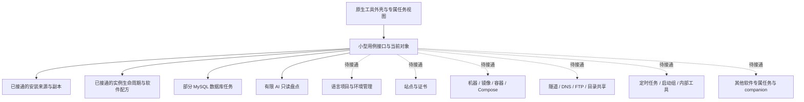

# 开发工具的逐软件适配

[English](../../engineering/developer-tool-adapters.md) | 简体中文

状态：2026-10-27 工作区实现与后续实施约束。参考源码与已安装包版本不同，逐软件事实、调用链和未知范围保存在[模块能力报告](../../../output/reviews/developer-tools-2026-10-26/flyenv-module-capabilities-detail.md)、[安装与 AI 报告](../../../output/reviews/developer-tools-2026-10-26/flyenv-install-ai-detail.md)及[服务交互报告](../../../output/reviews/developer-tools-2026-10-26/flyenv-service-ux-detail.md)。71 个根模块的目录、59 个非 AI 模块的逐能力分析不等于 Shou 已实现全部功能。

完整目标以[全量能力与领域边界](developer-tool-capability-map.md)为准，已按当前提交 `71288acf873fbade9889b14c25c78561362d9aab` 复核根注册、内部工具及增量。下文的软件目录与四种实例策略只描述已落地部分；语言项目、站点证书、容器、网络、任务和 AI 专属能力都属于当前目标，不能只围绕五种软件继续扩展通用服务编辑器。

## 对象与职责

软件、安装副本、运行实例是三个独立对象。安装来源决定版本目录与安装／卸载入口；运行实例绑定可执行文件、PID 与出生时间、配置、工作目录和数据参数。同一个安装可以供多份实例使用；终端或其他开发工具启动的实例仍属于本机盘点，不能因为安装来源相同就合并开关。

共享 Core 负责动作状态机、即时授权、变更租约、意图和结果。Platform 以软件专属策略识别和核实配方，再交给共用生命周期执行器。版本来源适配器负责来源身份、版本列表、下载／安装和安装核验；它不能决定数据库管理或服务配置。UI 根据已接通的能力组合视图，只传确切对象与动作，不生成命令。

当前 Swift 实例实现采用关闭的 `DeveloperInstanceRecipeAdapting` 策略注册表，四个小型适配器只负责各自配方；进程发现、文件身份、恢复记录、启动日志、停止与核验集中复用。新增软件时新增实际策略和生成夹具，不继续扩张软件名称条件树。不引入动态执行插件、声明式 Shell 命令或为所有软件设计一个含大量可选方法的基类。

## 已接通适配与软件差异示例

| 软件 | 必须独立处理的事实与任务 | 当前边界 |
| --- | --- | --- |
| Nginx | master／worker、prefix、配置、PID、access／error 日志、站点重载 | 已有实例配方策略；站点编辑和 reload 未接通 |
| MySQL | 安装与数据实例分开；defaults-file、datadir、port、socket；数据库、用户授权、维护态口令与备份 | 已有实例配方与[专属管理](../product/mysql-administration.md)：数据库／账号／导出、配置编辑、两类日志、独立实例创建；维护态恢复与完整来源仍待接入 |
| MariaDB | 独立客户端、认证与 dump 参数，不根据相似 UI 套用 MySQL 8 语义 | 发现与来源审阅；专属数据库动作未接通 |
| Redis | 原始 argv 可能被覆盖；恢复必须关联确切配置、pidfile 与实际工作目录；Commander 是独立 companion | 已有实例配方策略；无法核实配方时显示运行事实并阻止先停后猜；Commander 未接通 |
| PostgreSQL | 当前 DATA_DIR、postmaster 身份、日志与 pg_ctl／直接启动方式 | 已有直接 postgres 配方策略；自定义启动方式与 pgAdmin 未接通 |
| Apache、Caddy | Apache 程序路径对应配置、访问／错误日志；Caddyfile 无扩展名 | 已有配置／日志路径策略；站点、热重载及本机配方未接通 |
| Meilisearch、Consul、etcd、Numa | TOML／JSON／YAML、按版本配置与启动输出布局分别处理 | 已有配置／日志路径策略；索引、集群、解析与本机配方未接通 |
| Mailpit | Static 历史版本源、MP_* 配置、邮件数据库、SMTP／Web 地址、relay／webhook | 目录、Homebrew 来源及配置／日志路径策略；Static 下载与邮件管理未接通；参考中间 API 的服务端筛选未知 |
| 语言运行时 | PATH、软件自己的 current、管理器 default、Alias 与备注分别建模 | 已有安装盘点；环境和默认版本写入未接通 |
| AI 软件 | 供应商配置、配置层级、MCP、Skills、独立网关生命周期 | 有限只读盘点；写入和网关管理未接通 |

数据库列表查询、创建数据库／授权、维护态改密码、安装管理面板和备份是不同用例。不能让“打开管理抽屉”“保存本地口令”或进程返回 0 代替相应数据库结果。不得沿用参考中的初始化数据目录、失败时移除数据目录、备份 Promise 不结算或先切版本再核实启动等行为。

## 首屏与后台读取

页面结构和内存中的安装列表先显示，不能等待 Homebrew／mise／WinGet 或全部服务核验后再开放导航。安装盘点采用一次在途查询，先发布可执行路径与本地元数据，再逐步合并管理器登记；刷新保留已有展示，搜索和工具切换继续可用。未完成的查询不能显示为“未安装”。

服务状态按用户已选入当前工作台的工具集合批量核验，并在当前会话保留各工具结果和各自检查时间。重复进入复用结果，主动刷新重新观察；后台读取失败保留旧行和错误说明并禁用旧观察。Core 的限定查询只失效本次所选工具的观察，拒绝适配器返回其他工具，不清空其他工具的状态。安装来源盘点未完成或服务核验进行中时，变更动作暂不可用；展示缓存从不绕过执行前的身份和状态复核。

FlyEnv 源码的 `Module.installedFetched`、在途请求合并与共享响应式列表提供了参考，但其启动也会并行读取可见服务，不能宣称首次不扫描或所有机器都秒开。具体调用链见[加载分析](../../../output/reviews/developer-tools-2026-10-26/flyenv-loading-detail.md)。性能与实际界面证据单独记录；不使用读取动作把整个应用变为全局 busy。

## 生命周期与失败

动作前冻结并重新验证完整恢复配方，再核实原实例；停止后等待原进程及已绑定 worker 退出，保存停止阶段；随后复核程序与配置、启动同一配方，独立观察新实例。无法还原配方时保留运行状态和具体缺口，不先停止再猜启动参数。守护程序管理的实例必须通过已核实的守护程序操作，不能用同名进程全杀或 SIGKILL 兜底。

Homebrew KeepAlive 不能使用可能返回 0 但拒绝停止的 `services kill`。当前实现对确切已加载任务使用 launchd bootout，再 bootstrap；已加载但未运行的任务使用 kickstart。它复查加载域、定义位置和实际加载的程序／参数，保留磁盘 plist 与 disabled override，不改自动登录登记。旧 PID 不可读不能作为已经退出的证据。真实临时 launchd 专项还验证磁盘参数与已加载定义不同时拒绝停止，与模拟管理器测试分别取证，不能互相替代。

本机直接实例的恢复记录只保存闭合参数、路径与身份，不保存完整进程环境或凭据；启动使用固定受限环境，不承诺复现任意手工环境。暂不支持的参数或监督方式保留运行事实与原因。服务业务日志和 Shou 启动输出分开；界面只在本地读取最近 64 KiB／200 行，不自动导出日志正文。实例启动输出位于私有记录目录，当前尚无轮转策略。

工作目录身份与可写性检查仅遍历路径并读取元数据，不请求列举目录内容。生成夹具覆盖仅有遍历权限的工作目录，避免为了服务发现额外触发 Documents 等目录的读取权限。

## UI 与验收

MySQL 实例组的每一行就是操作上下文，直接复用服务控制器；创建表单单独选择安装版本，默认收起。登记变更由 Core 的 `MySQLInstanceRegistry` 审阅与记账，Native 只对已停止的确切独立组核验配置和更新登记，不执行初始化或数据库删除。失效配方在扫描时移出内存观察；明确重新登记后才恢复启动资格。停用的配方记录保留审计，不再作为停止实例发布；外部重新启动的真实进程仍独立发现。

共用紧凑工具栏、分类列表、来源筛选、安装版本表和任务反馈。安装来源表展示软件本体；实例区逐份显示配置、PID、状态、启停和重启，来源筛选不能隐藏另一来源启动的运行实例。胶囊操作只绑定该实例，执行中只显示一处主要进度；失败保留行、阶段、日志及刷新入口，不能清空列表或把未知画成 OFF。

专属任务使用渐进展开：MySQL 以实例为上下文显示数据库／用户／备份；Mailpit 显示版本源及配置／Web 入口；运行时显示版本与默认入口；AI 软件显示配置层级与扩展。MySQL 的数据库、配置、日志与实例组已按专属合同接通；其余目标布局尚未接通的任务不放可点击空壳。配置页的后台操作也要显示目标、阶段与结果。不同页面共享视觉和状态语义，不强求菜单与字段相同。

测试分为共用生命周期合同、每种软件的生成配方／多实例／失败夹具、平台原生守护程序专项和真实 UI。配置改变、同二进制多实例、PID 重用、worker 延迟退出、启动失败、日志不可读及应用关闭均要单独核实。真实个人服务仅作只读盘点，不能作为重启回归夹具。Windows SCM 与直接实例适配分别实现和取证；Mac 构建、资源生成与 .NET 测试不能开放 Windows 原生执行门禁。

配置文件读取／编辑已提取为 `NativeDeveloperConfigurationFiles`，MySQL 保留专属路径策略，其余十一种已接通软件通过小型 `DeveloperConfigurationAdapting` 策略组合。配置与安装盘点共用已有开发环境存储根，文件存在只提供候选；发现工作在后台，不阻塞工具切换。配置解析不扩张服务启动配方；外部实例更改后重新登记仍未实现。MySQL 停止核验可排除明确首个 `--no-defaults`、封闭完整参数及不同真实 DATA_DIR 的另一个实例；同目录、未知选项／缩写或缺失路径继续阻断，不以原 PID 退出替代全实例核验。

## 工具领域的源码组织

工具模块保持在现有 Swift／C# 工程中，按用例与软件适配边界组织，不另建插件或消息框架。

| 目录 | 职责 |
| --- | --- |
| Core DeveloperTools/Catalog | 工具身份、安装来源、当前审阅与安装结果 |
| Core DeveloperTools/Lifecycle | 实例状态、单次动作、停止／启动阶段与回执 |
| Core DeveloperTools/MySQL | 数据库、User/Host、导出、独立实例登记 |
| Core／Platform DeveloperTools/AI | AI 软件配置与扩展盘点，独立于 Shou 规则调查 |
| Platform DeveloperTools/Inventory | 安装来源与已有环境发现 |
| Platform DeveloperTools/Lifecycle | 共用进程身份、守护程序、配方登记和生命周期执行 |
| Platform DeveloperTools/Configuration | 共用确切文件读写及软件配置适配接口 |
| Platform DeveloperTools/Nginx、Redis、PostgreSQL、MongoDB、MySQL | 本软件的路径、配置线索与恢复策略；MySQL 另有数据库原生适配 |
| Platform DeveloperTools/Apache、Caddy、Meilisearch、Consul、Etcd、Numa、Mailpit | 新增的实际配置／日志路径策略；不授予本机生命周期控制 |
| macOS UI DeveloperTools/Workspace、Configuration、MySQL | 工作台组装、共享文件任务视图及 MySQL 专属视图 |
| Windows DeveloperTools 子目录 | 按当前已实现能力对应 Catalog／Lifecycle／Inventory／AI／Workspace，未实现的软件不建立空适配 |

已有软件适配分别拥有自己的目录。共用实例执行器不依赖某一个软件的数据库管理；各软件策略只回答自己需要的最小问题，不生成任意 Shell 命令。配置路径策略与生命周期配方是两个接口，不因能读取配置就授予启动能力。版本来源属于安装领域，数据库账号、站点和缓存业务操作属于相应软件领域，不能塞进安装管理器。

这些目录属于同一编译目标中的逻辑模块，尚非编译隔离的独立 package。领域服务继续只依赖小型能力接口，应用入口组装原生适配；不为目录中的 79 个名称创建空模块，也不为每个模型增加 Repository、事件总线或泛型基类。新增软件只增加实际需要的策略、用例、视图和夹具，避免复制共用身份与安全流程。
