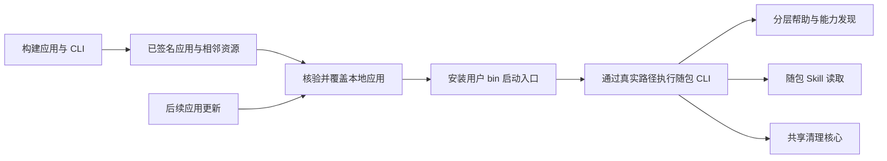

# 本地开发

[English](../../engineering/development.md) | 简体中文

本文介绍从源码构建。开发构建不代表已经签名、公证或完成全部验收。

C#/.NET 10/WPF 客户端与 Swift Windows 适配见 [Windows 实现](windows.md)和 [Windows 构建说明](../../../apps/windows/README.md)。

## 工具链与工程

使用 Swift 6.2.3 及以上版本与 macOS SDK，部署基线为 macOS 14。CI 与发布打包显式选择 Swift 6.2.3，以提供 AI SDK 所需的并发支持。根目录 Swift Package 构建原生应用、独立 CLI、可移植核心、平台适配与隔离测试程序。SwiftPM 解析 Swift AI SDK `0.20.0`，macOS 构建通过 `ShouAI` 使用它。普通离线扫描与清理不需要模型凭据或模型请求；AI 联网仅由显式 AI 操作触发。CLI 不需要 JavaScript 包管理器、Node.js 运行时或运行中的桌面应用。

```sh
swift build --jobs 4
.build/debug/shou --help
```

GUI 从包含签名资源、独立 CLI 和只读 helper 的本地应用包启动：

```sh
sh scripts/build-macos.sh debug
open dist/Shou.app
dist/Shou.app/Contents/Helpers/shou capabilities --json
```

打包脚本使用本地 ad-hoc 签名。Developer ID 签名、公证、干净系统安装、升级与分发须分别完成发布验证。

桌面构建产物使用 `ShouDesktop`，CLI 使用 `shou`，以避免大小写不敏感文件系统上的名称冲突；应用包仍为 `Shou.app`。

桌面端原生文件系统适配通过 `Contents/Helpers/shou` 执行短生命周期的根身份查询与扫描读取。验收该路径时使用应用包，单独桌面可执行文件不带包内 helper。内部 worker 入口不打开记录存储，不属于公开 CLI 命令发现；常规 CLI 仍独立于桌面端。变更操作及确认／回执门槛保留在父进程。详见[只读操作边界](../architecture/system-design.md#隔离只读操作)。

## 验证

```sh
sh scripts/test.sh
```

测试程序在临时夹具中执行规则、领域与真实文件系统检查，不依赖 XCTest 或 Swift Testing，可直接在 Command Line Tools 环境运行。多数领域用例使用独立夹具废纸篓；`scripts/test.sh` 默认使用 `--native-trash`，对全部 74 条内置规则及其匹配模式执行系统废纸篓移动 → 恢复，比对全部夹具文件的哈希与保留文件。默认原生套件不永久移除废纸篓中的项目。生成夹具的应用与构建活动设为闲置，另有独立测试覆盖活动闸门、Git 所有权和保留的 Cargo 归档。

CLI 测试覆盖非交互拒绝、取消，以及经过真实终端确认的原生清理 → 恢复，确认范围仅限生成夹具；`scripts/verify-native-cli.py` 默认也只恢复。上述检查由 `scripts/test.sh` 执行。仅显式运行 `sh "scripts/test.sh" --native-trash-purge`，才额外启用隔离的 `action=permanent` 直接计划、内置规则及 CLI 套件中对生成夹具的受限永久移除，以及废纸篓项目的后续 purge。所有原生测试均不枚举或清空用户废纸篓，永久和后续操作仅针对夹具完整清单或回执记录的确切项目。

构建后单独运行大目标回归：

```sh
".build/debug/shou-tests" --native-large-trash-only
```

该显式入口生成超过 100,000 个独立夹具文件，执行原生废纸篓移动 → 恢复，核验完整后代清单、哨兵文件哈希及保留源码，不执行永久移除或遍历整个废纸篓；默认套件不包含此项。这些命令定义验证流程，实际运行结果须与合同分开记录。

这些检查不代表系统废纸篓 API 的竞态边界、界面辅助功能、第三方 Agent 兼容性或 Windows 已通过验证。对应证据按[验收与测试](acceptance-and-testing.md)分别维护。

桌面端使用 Sparkle 2.10.0 实现在线升级。核心保持独立于模型服务，macOS CLI 链接 `ShouAI` 及其 Swift AI SDK 依赖。`Package.resolved` 固定依赖版本，打包时嵌入 Sparkle 及辅助程序。通用构建、更新签名及 GitHub Actions 发布闸门见[发布与在线升级](releasing.md)。

本机隔离夹具验证已通过安装版桌面端的项目扫描、预览取消、明确确认清理、历史与恢复；恢复后全部 1,035 个夹具文件的 SHA-256 与原始内容一致。个人规则也完成禁用草稿创建、不可执行的只读预览、原生保存面板导出、启用后重新扫描，以及明确确认的清理与 GUI 恢复，哈希结果一致。独立原生大目标回归恢复 100,103 个文件、100,204 项清单，完整后代元数据、哨兵哈希与保留源码一致，未执行永久移除。这些结果仅覆盖已测范围，GUI 与终端的隐私访问、故障场景及分发仍分别验收。

隔离应用包已通过包内只读子进程完成项目扫描。自动化检查还覆盖直接／子进程证据一致、不打开记录存储、进度、蛇形协议字段、错误／其他请求及超大响应、取消、超时、两个存活子进程上限与容量恢复。另一次包内子进程演练在扫描 20,000 个生成文件时终止父进程，子进程看门狗随即退出，没有返回证据，所有生成文件保留。安装版桌面标准扫描已到达部分结果汇总页，在阻塞的 QQ 根可停止、无错误弹窗并立即重扫。停滞扫描只能返回取消或受限，不能生成完整证据。

隔离应用还从本机 localhost feed 下载签名更新，完成安装并从 0.0.9 自动重启至 0.1.0。安装后的可执行文件与更新包一致，工作区与配置哈希保留。已实际检查设置入口、两种界面语言、亮暗主题、偏好持久化及已是最新版本的响应。这些证据验证安装机制；公开 GitHub feed 与正式下载产物仍须在发布后核验。

## 应用名称与图标

英文名称为 Shou，中文展示名为“收拾一下”，slogan 为“Tidy up. That's it. / 收好，就好。”。原生图形资源维护于 [assets/brand](../../../assets/brand/README.md)。通过 `swift "scripts/generate-app-icon.swift"` 重建全尺寸图标及矢量导出。打包会复制 `Shou.icns`、写入 `Info.plist` 声明，并核验包内资源与源文件一致。

## 数据与规则

默认数据目录为 `~/Library/Application Support/Shou`。CLI 集成夹具通过 `SHOU_DATA_DIR` 指向专用绝对路径。存储要求目录由当前用户所有、权限为 `0700`；记录文件使用 `0600`、原子替换、持久写入与跨进程修改锁。

先注册明确工作区、导入禁用草稿并预览，再启用规则、重新扫描和选择候选项 ID。详见 [CLI 合同](../ai/agent-and-cli-contract.md)。没有跳过交互确认的参数。`node_modules` 保持高风险审阅，未知数据仅用于分析。

`packages/shou-contracts/rule.schema.json` 是唯一结构合同，随程序分发，不获取远程定义。规则实现与所有显示语言共享这份合同。

## 本地化

编辑 `packages/shou-core/Localizable.xcstrings`，然后生成 SwiftPM 使用的原生 `.strings` 资源：

```sh
python3 scripts/update-localizations.py
python3 scripts/update-localizations.py --check
```

生成资源纳入仓库，以支持 Command Line Tools 源码构建。不要独立编辑生成文件。语言切换不得改变 ID、匹配、摘要或执行决策。

## 平台边界

`ShouCore` 使用可移植 Foundation 与语言无关合同。POSIX 描述符、文件身份、原生废纸篓、禁止覆盖的恢复、受限清单移除、锁与持久存储由 `ShouPlatform` 实现。macOS 界面位于独立应用 target。Windows 平台适配与原生界面仍需在真实 Windows 环境实现和验证。

内置模板位于 `packages/shou-core/Sources/Resources/builtin-rules.json`，当前目录包含 74 条模板与 35 个固定位置。内置与个人规则共用结构校验和执行门槛；生成源码例外还须匹配精确受信包内定义并具有 `NativeArtifactEvidence` 事实。Rust／Swift 定义版本为 `1.1.0`，Cargo 解包源码还须核验匹配的保留归档内容；个人规则不能申请这些例外。

空间统计与目录查询使用 `scan --scope full`，这也是 CLI 默认值。`scan --scope cleanup` 将发现限制在规则前缀，命中目标后仍完整测量。`system scan` 使用清理模式，默认 `--include-projects false`；桌面端纳入自动发现及记住的项目，项目发现只探测固定的常见开发目录，不递归枚举整个主目录。快照分别记录发现状态、全树完整性与独立完整目标。界面须说明清理证据的稀疏性，不能将其复用为完整空间分析。详见[覆盖字段](../architecture/data-model.md)及[CLI 行为](../ai/agent-and-cli-contract.md)。

空间树、分类和矩形树图计算位于共享核心。`scripts/verify-products.py` 检查桌面与 CLI 的产物身份，防止大小写不敏感文件系统上互相覆盖。桌面执行停止夹具中，24 个目标有 22 项保持未处理，已移入的 2 项经恢复后全部 12,336 个文件哈希一致。无障碍、故障场景与分发保留各自验收边界，详见[本机验证记录](acceptance-and-testing.md#11-本机验证记录--2026-10-19)。
## 本地 CLI 安装入口

安装应用后，在源码仓库中执行：

```sh
python3 "scripts/install-cli.py"
shou --version
shou skills --help
shou capabilities --command skills --json
```

辅助脚本创建 `~/.local/bin/shou`，将原始参数、输入输出和退出码交给 `/Applications/Shou.app/Contents/Helpers/shou`。更新应用时，终端入口使用的二进制和随包资源一同更新，运行 CLI 不需要桌面进程。使用启动脚本避免可执行文件符号链接导致 SwiftPM 回退到开发资源目录。不同内容的现有文件或链接会被保留；脚本不修改 `PATH` 和 Shell 设置，JSON 返回值说明目标 bin 目录是否已在 `PATH` 中。`--bin-directory` 可指定目录，`--executable` 可指定保留在固定位置、含相邻资源包的独立 CLI。此源码辅助脚本使用 Python 3，安装后的启动入口和原生 CLI 不依赖 Python。

`python3 scripts/verify-cli-install.py` 使用临时目录验证迁移后的资源、带引号路径、参数与退出码转交、重复安装和冲突保留。能力发现、帮助和 Skill 读取不打开清理记录存储。



空间索引通过 `CSQLite` 系统库适配链接 SQLite 3，macOS SDK 自带该库；Linux 构建需要 SQLite 3 开发头文件。Swift 核心不依赖 AppKit 或 Darwin，平台层负责本地元数据与只读 Worker。

## 安装经核验的本地版本

构建后运行 `python3 "scripts/install-macos.py" --check`，检查应用签名、桌面端与 CLI 版本、相邻 Skill 资源。正常退出 Shou，再运行 `python3 "scripts/install-macos.py"`。安装器先暂存并核验新应用，再移除指定的旧应用包并覆盖安装，随后核验安装文件及原有 Shou 记录。安装不保留旧版应用副本，不更改设置及 macOS 隐私权限；核验报告仍写入 `.build/local-install/`。

需要稳定的本地签名身份时，运行 `sh "scripts/build-macos.sh" release native` 前，通过 `SHOU_SIGNING_IDENTITY` 显式指定自己的 Developer ID Application 证书哈希。脚本不会自动选择钥匙串中的身份；未指定时使用临时签名，更新后隐私授权可能失效。需要网络时间戳时设置 `SHOU_SIGNING_TIMESTAMP=required`，Apple 公证仍是单独的发布要求。参见[安装与磁盘访问权限](../product/installation-and-access.md)。

针对性回归入口：`shou-tests --scan-access-only` 与 `shou-tests --storage-performance-only`。后者逐字段比较批量元数据与原 stat 路径的证据，包含稀疏文件、硬链接和 Unicode 名称，并输出有界目录读取器基准。macOS 在字段完整时批量读取元数据，必要时回退逐文件 stat，并直接将已知父目录 ID 传入 SQLite。详见[空间扫描性能](storage-scan-performance.md)，其中记录读取器模型、进度节流和基准协议。优化影响空间计量吞吐，不改变清理授权。

## 应用批量、隐私与规则定向验证

在已有构建完成后顺序执行；不要并发运行 Swift 构建。所有破坏性测试仅使用生成夹具。

```sh
swift build --product shou-tests
".build/debug/shou-tests" --applications-only
".build/debug/shou-tests" --privacy-only
".build/debug/shou-tests" --mole-rules-only
python3 "scripts/verify-mole-coverage.py" --self-test
python3 "scripts/verify-application-batch-cli.py" "dist/Shou.app/Contents/Helpers/shou"
```

批量 CLI 验证在唯一命名的生成应用和隔离记录中完成摘要、确认取消、废纸篓／恢复及永久删除，并核对个人偏好保留。隐私数据库测试使用注入的夹具主目录，不更改真实浏览记录。规则来源校验只证明声明与映射一致；应用版本兼容性须独立验收。
