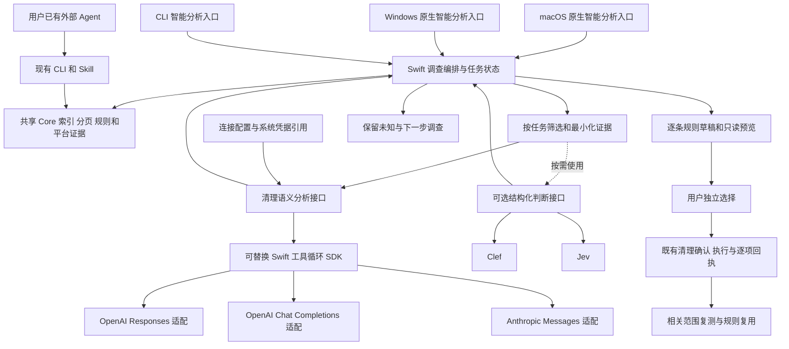
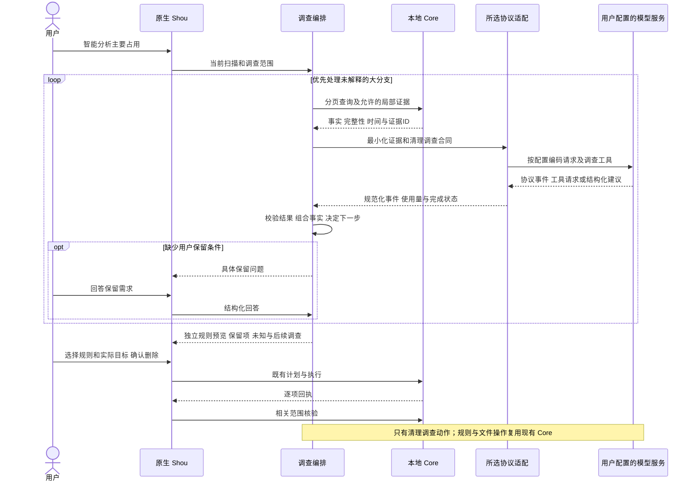

# 清理专用 AI 调查：Swift 与多协议模型接入

[English](../../engineering/embedded-ai-investigation.md) | 简体中文

日期：2026-10-22。当前工作区已采用 Swift AI SDK 0.20.0，三协议合成多轮、问询恢复及规则预览通过；指定 Responses 网关与 Jev 已有生成夹具真实证据，macOS 14、Windows 及完整发布仍待验收。具体状态见[实现记录](embedded-ai-implementation.md)。真实调用仅使用生成夹具的相对元数据，不发送个人目录或正文。原“不接入模型、不开发 Agent”限制已撤销。

本文保留接入调研；后续产品以[AI 用户故事与交互](../product/embedded-ai.md)、[Jev 优先路由与架构图解](../architecture/embedded-ai.md)、[验收矩阵](embedded-ai-acceptance.md)为准。能由代码／Jev 完成的任务不先调用主模型；旧候选图不代表当前目标路由。

## 结论

下一步建设内置清理专用 Agent：用户在 Shou 内完成主要占用归因、必要问询、独立规则预览和清理，减少在外部 Agent 与桌面之间交接。原型需与现有外部流程对比人工步骤、耗时和调查质量，验证实际收益。已有外部 Agent 的 CLI／Skill 路径继续适用于习惯终端的用户。

当前选型以 Swift 原生清理调查服务为业务核心，优先验证可替换的 Swift 工具循环 SDK，不引入 Pi／Node 运行时。Shou 只负责分析空间、调查用途、制定独立规则和完成既有清理闭环。OpenAI Responses、OpenAI Chat Completions 和 Anthropic Messages 是必须支持的三个协议适配，允许用户配置官方或兼容服务。Clef／Jev 保留为可选的结构化判断提供方，不作为使用内置分析的前提，也不要求每次调用多个服务。

[Agent Core 专项调研](agent-core-selection.md)将 Swift AI SDK 的 `ToolLoopAgent` 列为原型首选、Tachikoma 列为主要对照。协议和通用工具循环优先复用 SDK；Shou 保留自己的清理领域状态。以下为候选设计，生产依赖需要在 Mac／Windows 和协议验收后锁定。

规则有明确的现有 schema，模型提出用途、条件和规则意图，Swift 根据已观察路径与用户保留条件构造并验证个人规则。未知大目录继续下钻、检查必要配置或追问，不能因缺少现成模板而被忽略。陌生构建脚本的理解通过所选兼容模型执行清理专用语义分析，仍只开放清理调查动作。

## 产品范围

内置 AI 以用户的一次清理需求开始，以所选内容的清理回执或明确的保留决定结束。所有调查动作服务于具体清理对象，能力范围包括：

| 能力 | 应交付的结果 |
| --- | --- |
| 找出空间大头 | 按实际占用定位主要分支，标明扫描完整性和待调查项 |
| 判断如何清理 | 调查目录用途、是否可重建、工具占用和保留要求；必要时向用户提问 |
| 制定个人规则 | 给出可独立选择的规则、适用条件、排除项和实际匹配预览 |
| 完成清理闭环 | 通过现有 Core 清理所选内容，核验实际结果，并让已启用规则用于后续一键清理 |

例如，面对一个占用很大的开发项目，Shou 应继续区分构建产物、依赖缓存、发布产物和源文件，根据用户是否需要保留发布版本分别形成建议。用途未知的大目录仍属于核心调查范围，不能退化为只识别固定缓存。任务不扩展到修改业务代码、运行开发任务或处理与清理无关的请求；理解必要的项目配置用于判断清理条件。

## Swift 实现选型

| 方案 | 已核对能力 | 当前判断 |
| --- | --- | --- |
| Swift AI SDK（teunlao）的 ToolLoopAgent | Swift 6.0、macOS 13；原生工具循环、停止条件、逐步准备和协议模块 | 原型首选；验证三个协议与 Windows 后锁定依赖 |
| Tachikoma | 主干 Swift 6.2、macOS 14；多协议及兼容端点，Peekaboo 有实际依赖证据 | 主要对照；核验具体版本与流式多轮语义，Windows 未验证 |
| Foundation、Swift Concurrency 与现有 Core | `URLSession`、`Codable`、`actor` 任务状态、取消与原生事件反馈 | 保留清理编排和平台适配，协议／循环优先复用 SDK，复用目录索引、规则预览和执行 |
| SwiftedMind/SwiftAgent | 原生 Swift 循环和模型适配；当前清单要求 Swift 6.2、macOS 26 | 不符合现有 macOS 14 基线 |
| AnyLanguageModel | 多模型会话、工具调用与结构化生成；当前 README 要求 Swift 6.3+，列出 macOS 14+ 与 Linux 等平台 | 以后确有统一生成模型接口需求时再评估；当前未确认 Windows 支持或 Clef／Jev System One 现成适配 |

第一步只新增清理调查编排和 SDK／模型适配两个职责。编排维护当前证据、允许动作、调查预算、缺失信息和逐条建议；适配层将 SDK 的协议请求、工具调用和流式结果转换为业务合同。规则构造继续复用 `PersonalRuleDraft`，不再创建第二套规则引擎。UI、CLI 与 Windows bridge 使用同一业务服务；系统凭据和网络实现放在平台适配边界。

生成式模型可以流式返回说明和清理调查请求；Clef／Jev 返回结构化判断。两者均通过任务事件显示当前调查位置、已解释的占用、待回答问题和下一步，不能用生成的字数推算扫描或清理百分比。`Task` 取消须同时停止网络请求和后续调查调度，并复用既有扫描取消能力。

## 协议兼容合同

协议、服务商和模型分开配置。相同协议可用于官方服务、第三方网关或本地兼容服务；名称不决定能力。下表基础适配已有实现，逐字流式和全部真实服务兼容仍是验收目标。

| 协议标识 | 官方服务示例 | 相对 API 根地址的请求路径 | 关键适配 |
| --- | --- | --- | --- |
| `openai-responses` | `https://api.openai.com/v1` | `POST /responses` | typed input／output items、`function_call`／`function_call_output`、`call_id` 和 Responses SSE 事件 |
| `openai-chat-completions` | `https://api.openai.com/v1` | `POST /chat/completions` | `messages`、`tool_calls`／tool 消息、`tool_call_id` 和 `delta` 流 |
| `anthropic-messages` | `https://api.anthropic.com/v1` | `POST /messages` | 顶层 `system`、content blocks、`tool_use`／`tool_result`、`tool_use_id` 和 Messages SSE 事件 |

OpenAI 官方建议新项目优先使用 Responses；Chat Completions 作为兼容服务的重要入口独立支持。不能假设声明兼容 Chat Completions 的服务也支持 Responses，或假设所有模型都支持工具调用、图片及严格结构化输出。Anthropic 使用独立的消息编码与完成状态，不能只更换 URL 和请求头。

### 配置与原生体验

每个连接包含名称、协议、`base_url`、`model`、凭据引用和必要的协议选项。`base_url` 定义为 API 根地址，保留用户网关的路径前缀，适配层只追加一次资源路径，避免重复 `/v1`；模型 ID 允许手动输入，模型列表接口不可用不阻止配置。

OpenAI 默认使用 Bearer 认证；Anthropic 默认使用 `x-api-key` 和 `anthropic-version: 2023-06-01`。兼容网关可显式选择其支持的认证方式及附加头；本地无认证服务可选择不发送凭据。API key 和敏感请求头存入系统凭据库，普通配置仅保存引用；CLI 与两个桌面端共享配置合同，CLI 自动化可按显式配置从进程环境读取凭据，避免把密钥写入命令行和日志。

设置页按“协议 → 服务地址 → API key → 模型 → 测试连接”完成配置；官方地址提供预设，自定义地址可编辑。连接测试只发送合成的最小请求，分别报告连接／认证、模型响应和调查所需能力；不发送本机目录，也不把 HTTP 200 视为功能验证通过。切换连接只影响后续请求；进行中的调查可继续使用原连接或由用户取消后重启，不能向另一服务静默重发上下文。

### 统一业务语义与协议差异

业务层只处理清理证据、允许动作、用户问题、独立规则建议、使用量和任务状态。各协议维护自己的 wire DTO、工具调用 ID 和必要的续接内容，规范化为共同的调查事件；不将 provider-specific reasoning／thinking 或工具调用历史压成普通文本后回传。

工具集固定为清理调查需要的目录查询、必要配置读取、适用工具状态、用户问询和规则预览。模型的工具请求需完整接收并通过参数及范围校验后执行；同一任务内重复的工具调用 ID 复用结果。真正清理由用户选择后调用既有 Core，模型协议适配不持有删除能力。

流式解析覆盖跨网络分块的 UTF-8、SSE 多行 data、工具参数增量、正常结束、截断、流内错误和取消。收到部分规则或断开的连接不能标为调查完成。超时／限流重试有次数和时间预算；已有工具结果保留，不能因重连重复执行动作。各协议适配保留 usage 和真实完成状态，界面进度继续依据本地任务事件。

兼容服务的工具调用与严格 JSON Schema 支持按连接及模型验证。首期要求调查所需的原生工具调用；不支持时明确报告连接能力不足，不另建文本动作降级循环。所有响应都经本地 schema 和语义校验；格式修复重试有上限，仍不满足合同则保留未完成状态并说明可恢复方式，不能自动启用规则。有界结构化“下一步动作”降级留待核心闭环验收后，按实际需求和独立测试评估。

## 组件职责

| 组件 | 实际提供 | 在 Shou 中的职责与限制 |
| --- | --- | --- |
| Pi | Agent 状态、工具执行循环、流式事件、模型接入；另有会话、资源与 RPC 层 | 协调调查与问询。它不是模型，也不会因为引入就提高判断准确率 |
| OpenAI／Anthropic 兼容生成式模型 | 文本理解、结构化建议，以及模型和端点支持的工具调用 | 解释陌生项目的清理条件、提出调查动作与规则意图；适配层不改变清理执行合同 |
| Clef／Jev | 对给定 `state` 回答预设的 `choice`、`score`、`noul` 问题，返回概率等结构化结果 | 判断用途类别、证据是否支持某种解释、下一项受控调查；无法凭空补全未读取的证据 |
| Shou Core 与平台适配 | 空间索引、分页、实际规则匹配、保护条件、计划、执行和回执 | 提供事实、验证精确路径、执行用户的选择。容量、日期、身份与匹配逻辑继续由代码计算 |

Pi 加 Clef／Jev 并不自然组成通用调查 Agent。决策模型没有常规聊天生成／工具调用响应；要以它驱动循环，必须由 Shou 明确列出下一步动作、解释返回值并实施状态转换。这种有限动作调查器可以直接用 Swift 实现。自由文本解释和新规则构造需要模板编译或额外的生成式模型。

## 官方能力对照

以下为调研当日官方公布的能力和价格，不是本机性能或准确率测试。

| 项目 | Clef | Jev |
| --- | --- | --- |
| 服务入口 | Cloudflare Workers AI `@cf/cloudflare/clef` | TypeSafe `POST /v1/systemone` |
| 模型形态 | 27B，多模态决策模型 | System One 决策模型 |
| 主要输出 | Choice、Score、Noul；每题概率，Choice／Score 有 confidence | 相同三类基础问题和概率；Choice／Score 有 confidence |
| 常规上下文 | 65,536 tokens；超出剩余预算的文本 state 会被截断 | 每请求 64k、每问题 32k；额外 262k 长上下文为单独开关，官方说明更慢且准确率更低 |
| 图像 | Workers AI 文档支持图像；当前入口最多 4 张，格式／体积另有限制 | 1.13／1.14 有需要显式请求头开启的实验图像能力，官方尚未标为生产就绪 |
| 基础输入价格 | USD 0.24／百万 input tokens | USD 0.042／百万 input tokens |
| 输出计费 | 不收 output token 费用 | 不收 output token 费用 |
| 开放部署 | 公布 Apache-2.0 权重；官方部署示例为 GPU 服务器，未验证 macOS 本地运行 | 本次查阅资料确认托管 API，未确认可随应用分发的本地权重 |
| 本场景注意点 | 多模态能力不是识别可删除数据的证明；Workers API 有独立的上下文和问题数量上限 | 官方明确英文表现最好，CJK 需实测；1.13 已知问题包括数字、日期、多跳判断、无关上下文与对抗内容 |

Clef 当前 Workers API 限制每请求 1–64 个问题；Jev 根据其两类上下文预算控制问题数量。共同接口应只抽象实际使用的基础问题，分别保留提供方限制、超时、截断处理与错误映射，不能认为更换 URL 就完全兼容。

TypeSafe 当前模型文档列出 `jev-1.13.0` 与 `jev-1.14.0`；调研时 `jev-latest` 指向 1.13，`jev-preview` 指向 1.14。生产评估应记录实际响应版本并尽可能锁定版本，不能把浮动别名当作固定行为。Clef 应记录提供方报告的模型标识、问题版本和评估日期。

按累计 100,000 个输入 tokens 计算，基础推理费约为 Clef USD 0.024、Jev USD 0.0042。实际还包括提问文本、重试、调查轮次，以及可能的通用模型、Worker／网关费用。低单价不能代替有效调查。Clef-Flash 为另一个可测候选，官方列出 9B、24,576 上下文及 USD 0.038／百万输入；不作为当前默认选择。

## 对大占用的调查设计

每个主要分支形成一个调查项，绑定扫描 ID、相对路径、计量时间、完整性和证据 ID。主目录、子目录和硬链接必须按已有索引规则去重；模型不计算可释放容量，也不将父子容量相加。

调查器优先处理最大的尚未解释分支；独立已解释分支可以并发取证。预算耗尽、权限不足或用途未知的大项仍保留在主要结果中，显示已知事实、缺少什么及下一步，不能用一批小缓存的完成数量掩盖它们。

可用调查动作建议限定为：查询子目录、读取必要项目标记／构建配置、查询适用的进程与所属工具证据、复用已有规则、询问保留条件、提出规则草稿、记录保留或待调查。既有能力可以复用，新工具需要独立实现并验证，不能因为列入候选工具表就宣称已具备。

模型问题应分解成原子判断，例如：

| 问题 | 可选结果 | 后续处理 |
| --- | --- | --- |
| 当前证据支持哪种用途？ | 构建产物、下载缓存、依赖、用户内容、工具管理数据、混合、未知 | 对未知／混合继续下钻，不生成大父目录规则 |
| 证据是否支持所述重建方式？ | 支持、矛盾、证据不足 | 缺少依据时查询必要配置或询问用户 |
| 下一项调查动作是什么？ | 子目录、项目配置、工具状态、问询、规则预览、保留、待调查 | Swift 校验动作和目标必须在允许范围内 |
| 需要怎样的重建代价分类？ | 本地快速重建、耗时重建、需下载、依赖外部状态、未知 | 用户分别选择，不能混成一条清理规则 |

“是否有进程使用”“是否超过保留天数”“有多少字节”优先由确定性工具提供观察结果；进程未发现也不等于绝对闲置。保留期限、离线需求、发布回滚需要来自用户或已有配置，不由模型发明。

对标准用途，可由模板将已验证的精确路径、条件和排除项编译为规则。陌生生成逻辑通过所选 OpenAI／Anthropic 兼容模型补充语义分析，再由 Swift 校验规则意图和实际匹配；决策模型不负责生成任意 JSON 或 shell 命令。每条规则对应一个独立选择，并走现有只读预览与新增收益核算。

`confidence` 是概率分布的统计摘要，不是“删除无损”的概率。模型高度自信仍可能缺少项目私有知识，或被目录内容误导。生产阈值应通过场景集选择；高置信度可以减少重复调查，不能解除 Core 的保护条件或代替实际删除确认。

## 候选架构

这是接入调研时的候选图。当前实现及「本地 → Jev → 按需主模型」目标路由、开关、原生入口和全部时序见[专项架构](../architecture/embedded-ai.md)，不将此历史图作为固定双模型调用要求。

模型请求优先由候选 SDK 的协议模块处理，通过独立适配层提供可取消的业务事件流；必要时注入 Swift 网络实现。macOS UI 与领域执行仍保持原生 Swift。共享合同也供 Windows 和 CLI 使用，避免两个桌面端各自实现一套判断与规则逻辑。Clef／Jev 使用单独的判断合同，不伪装成聊天协议。

### Pi 调研结论：当前不采用

以下保留前期集成成本对照，不属于当前选型或实施阶段。

优先评估 `pi-agent-core` 与 `pi-ai` 的较小组合；需要完整会话、Skill／资源管理时再评估 `pi-coding-agent`。本次读取的 coding-agent 主干包版本为 1.4.0，要求 Node.js 22.19+，许可证 MIT。Swift 不能直接导入 TypeScript SDK；需要自有子进程宿主及协议，或使用 coding-agent 已提供的 JSONL RPC。自有 agent-core 宿主不自动具备 coding-agent RPC。

图形界面仍可使用 SwiftUI／AppKit，Windows 仍可使用 WPF；引入 Pi 不要求改为 Electron。分发需新增 Node 运行时／侧进程、依赖锁定、macOS 签名和双架构、Windows 打包、取消回收与升级验证，准确的包体和启动开销要测量。

只暴露查询、定向读取、提问和停用草稿预览工具。宿主和 Core 校验具体能力；不将任意 bash、全盘 read/write/edit、用户目录扩展自动发现或外部 MCP 加载作为默认能力。模型选择的目标需用扫描身份和允许范围复验，不能只依靠 Pi 的提示或 hook 构成权限边界。

完整 coding-agent SDK 默认包含资源发现、配置、会话和工具。若采用它，应显式控制工具、ResourceLoader 和会话目录；不把每个被调查项目的 AGENTS、Skills 或扩展自动当成应用配置。自有 agent-core 宿主应从空工具集构建。

RPC 需同时处理请求关联、流式背压、进程退出、取消和最终状态。coding-agent 的 prompt 接收成功不代表调查完成，界面应根据最终事件判断结束，不能将工具请求成功误报为清理成功。

## 原生体验与执行边界

空间分析增加可选“智能分析”入口。结果延续现有表格或检查器：显示主要占用的用途、证据、预计新增收益、重建代价，以及独立选择。只有证据无法回答时询问用户，避免变成通用聊天窗口或要求用户填写规则表单。

已启用规则继续参与日常一键清理；固定规则和重复清理不要求每次联网或重新调用模型。AI 研究阶段结束后，用户可一次确认所选目标的永久删除；不强制全部移到废纸篓，也不为每个调查工具调用增加一次弹窗。没有启用 AI 或模型不可用时，既有扫描与清理仍可使用。

AI 调查服务只有调查／草稿能力；真正删除仍由原生宿主调用既有执行服务，并绑定当前确认与实际目标。既有 CLI 的终端确认合同不因增加模型接入而放宽；桌面继续通过自己的原生确认路径清理。模型不能根据一次清理的授权自动启用其他规则或删除未选目标。

## 托管推理的产品成本

目录名、项目名、配置片段也可能含有私人信息。接入云推理需要明确告知实际提供方与发送范围，优先使用相对路径、必要元数据和针对任务筛选的字段。单纯本地去掉用户名并不等于已匿名化；完整目录索引、个人内容与凭据不进入默认请求。

Cloudflare 当前声明标准无状态 Workers AI 推理不保留输入输出，存在所述安全／法律例外；自选存储、Gateway 日志／缓存和应用日志会改变留存。TypeSafe 声明不使用客户请求／响应训练，企业 ZDR 另有条件。两者不能被合并成“数据绝不保存”的产品承诺。

首期采用用户自带凭据并存入系统凭据库，用户可配置官方、兼容网关或本地服务。产品托管推理后端留待实际需求验证后另行评估，不把发行方服务 API key 写进桌面包。后端代理涉及认证、限额、费用与运维，不是本阶段前置依赖。此调研未创建账号、配置密钥或调用计费推理。

## 验证与实施顺序

1. 用真实问题的脱敏版本和生成案例建立对照集，覆盖大构建副本、自定义输出、修改过的依赖、活跃项目、离线依赖、发布回滚、工具管理磁盘、混合目录、中文目录名和不完整扫描。标注精确可处理范围、应保留项和需要追问的信息。
2. 先以一个协议验证 SDK 的多轮调查、问询暂停／恢复、取消和预算，同时尽早验证 macOS 14 与真实 Windows 最小构建／网络流。为三个必选协议建立脱敏请求／响应夹具和本地模拟服务，覆盖认证头、网关前缀、工具 ID、流式分块、错误、取消和预算。通过后，以显式配置的服务进行真实协议验收；每个协议至少覆盖官方端点及一个已声明范围的兼容端点，不能因单个网关通过就宣称全部兼容。
3. 同时考察主要占用归因覆盖、错误清理建议、无依据断言、独立规则预览成功率、追问负担和闭环完成率。按非重叠字节评估大项处理，不能只按目录数量或“全部未知所以没误删”评价质量。
4. 交付可选原生分析入口、三个协议适配和共享连接配置；只读建议期通过后，接入已有的停用草稿与逐条预览。原生桌面、CLI 和 Windows bridge 使用同一模型与规则合同，现有外部 Agent 路径继续保留。
5. 对同一份有界证据评估所选生成式模型，以及按需加入的 Clef／Jev；记录真实协议和模型版本、问题版本、请求／token 数、端到端 p50／p95 与取消行为。保持固定清理工具和现有执行边界，供应商通用榜单不能作为 Shou 场景结论。

### 实施跟踪

| 工作项 | 当前状态 | 验收条件 |
| --- | --- | --- |
| 清理范围与多协议合同、架构和时序 | 产品方向已确认；文档已同步 | 中英文 PRD／架构／实施计划采用新边界，明确设计与已发布能力的区别 |
| Swift 工具循环 SDK 对照原型 | 已采用 Swift AI SDK；完整对照／平台待验收 | 固定版本与许可证已有；Tachikoma、macOS 14、Windows 和逐字流式不冒充通过 |
| 共享连接配置、凭据适配和连接测试 | macOS／CLI 已实现，桌面指定服务连接通过 | 新开关／独立决策已实现；Windows 已接入，原生 CI 与界面验收待完成 |
| OpenAI Responses 适配 | 合成及指定网关通过 | 官方及其他网关／逐字流式单独验收 |
| OpenAI Chat Completions 适配 | 合成通过 | 真实服务与逐字流式待验收 |
| Anthropic Messages 适配 | 合成通过 | 真实服务与逐字流式待验收 |
| 大占用调查与独立规则闭环 | 生成夹具禁用导入及预览通过 | 完整真实桌面流程与质量待验收 |
| Jev 判断适配与优先路由 | 可替换提供方接口及 Jev 优先路由已实现 | 零不必要主模型请求、去重、独立配置与按服务统计；Clef 另评估 |

AI 不会修复当前目录读取阻塞，也不会让磁盘遍历自动更快。W08 扫描隔离、取消和不完整范围需要独立修复；模型使用已有索引以免每轮重复全盘扫描。当前未测 Clef／Jev 的清理判断准确率、费用总量、中文可靠性或 Shou 端到端延迟。

## 资料与鸣谢

- [OpenAI Responses 迁移指南](https://developers.openai.com/api/docs/guides/migrate-to-responses)与[工具调用](https://developers.openai.com/api/docs/guides/function-calling)：Responses／Chat Completions 的协议差异、官方推荐和工具续接合同。
- [Anthropic Messages API](https://platform.claude.com/docs/en/api/messages)：认证与版本请求头、顶层 system、content blocks 和工具请求／回传合同。
- [Pi](https://pi.dev/) 与 [Pi Agent Core](https://github.com/earendil-works/pi/tree/main/packages/agent)：运行时职责和工具循环。
- [Pi SDK](https://github.com/earendil-works/pi/blob/main/packages/coding-agent/docs/sdk.md)、[RPC](https://github.com/earendil-works/pi/blob/main/packages/coding-agent/docs/rpc.md)、[package.json](https://github.com/earendil-works/pi/blob/main/packages/coding-agent/package.json) 与 [MIT 许可证](https://github.com/earendil-works/pi/blob/main/LICENSE)：接入边界与分发依据。
- [Cloudflare Clef](https://developers.cloudflare.com/workers-ai/models/clef/)、[输入合同](https://developers.cloudflare.com/workers-ai/models/clef/schema-input.json)、[输出合同](https://developers.cloudflare.com/workers-ai/models/clef/schema-output.json) 与 [模型卡](https://huggingface.co/Cloudflare/clef)：能力、计费和开放部署资料。
- [Clef-Flash](https://developers.cloudflare.com/workers-ai/models/clef-flash/) 与 [Workers AI 数据使用](https://developers.cloudflare.com/workers-ai/platform/data-usage/)：替代候选及数据处理边界。
- [TypeSafe 简介](https://docs.typesafe.ai/introduction)、[模型](https://docs.typesafe.ai/models)、[Confidence](https://docs.typesafe.ai/confidence)、[Jev 1.13 已知局限](https://docs.typesafe.ai/model-jaggedness/jev-1.13)、[实验图像](https://docs.typesafe.ai/images) 与 [API](https://docs.typesafe.ai/api/system-one)：结构化判断、版本和局限。
- [SwiftAgent](https://github.com/SwiftedMind/SwiftAgent) 与 [AnyLanguageModel](https://github.com/huggingface/AnyLanguageModel)：原生 Swift SDK 能力与当前取舍。

本地官方资料存档位于 `.build/agent-options-research/`，不随公开文档分发。
