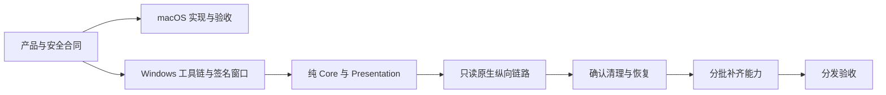

# 实施计划

[English](../../engineering/implementation-plan.md) | 简体中文

状态：macOS 源码持续开发；Windows 只读链路开发中，原生验收待完成。[验收规范](acceptance-and-testing.md)定义验证要求，[SYNC.md](../../../SYNC.md)跟踪跨端对齐。

## 产品决策

| 决策 | 合同 |
| --- | --- |
| DEC01 | Shou / 收拾一下，统一产品身份 |
| DEC02 | macOS 使用原生 SwiftUI/AppKit 与 Swift 领域服务 |
| DEC03 | 桌面和 CLI 独立调用本平台共用的领域服务 |
| DEC04 | 可选清理 AI 生成草稿；确定性校验与确认执行拥有变更权限 |
| DEC05 | 外部 Agent 使用可发现的公开 CLI 命令 |
| DEC06 | Windows 使用 C# / .NET 10 LTS / WinUI 3 与独立 C# Core |
| DEC07 | 优先空间证据、可复用规则和安全的日常清理 |
| DEC08 | 英文与简体中文工程文档，中英运行时资源与 11 种 README 语言 |

## 交付顺序

macOS 优先保证扫描正确性、证据时效、不可变计划、持久化逐项回执、恢复、有界性能与原生交互。产品改进拆成可独立验证的小链路。Windows 阶段和退出标准由[原生方案](windows-native-plan.md)定义；纯逻辑与只读源码已开始实现，各阶段所需原生验收尚未完成。

## AI 工作包

| 工作项 | 范围 |
| --- | --- |
| AI01 | 标注的生成案例与调查质量基线 |
| AI02 | macOS 模型 SDK、通信、取消和预算行为 |
| AI03 | 有界证据工具、调查状态与禁用草稿 |
| AI04 | 协议、地址、模型和独立凭据配置 |
| AI05 | 原生入口、问答、真实状态与规则预览 |
| AI06 | 质量、隐私、安全、离线清理和真实服务验收 |
| AI07 | 默认关闭与请求撤销 |
| AI08 | 本地判断、结构化决策路由与必要升级 |
| AI09 | 清理、空间、大文件和个人规则的上下文入口 |
| AI10 | 状态、可访问性与用户旅程验收 |
| AI11 | 公开 CLI 合同与 Windows 独立实现的行为对齐 |

macOS 已有调查源码，测试与原生交互仅证明实际覆盖范围。Windows AI 仍为计划，按 .NET 边界独立实现。见[AI 实现](embedded-ai-implementation.md)与[AI 验收](embedded-ai-acceptance.md)。

## 完成定义

- 所属产品、安全、数据和 CLI 合同一致。
- 实现当前最小能力，不引入推测性的通用框架。
- 相关领域、CLI、原生与 UI 检查有明确结果。
- 共享资源可重复生成，中英文文档一致。
- 对齐表准确标明可用能力、平台差异和待办。
- 签名、安装与更新声明有独立原生证据。
