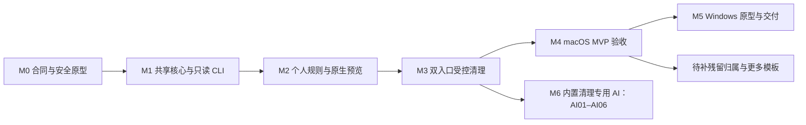

# 实施计划与决策记录

[English](../../engineering/implementation-plan.md) | 简体中文

状态：开发阶段。已提供原生 macOS、独立 CLI、共享核心、平台适配和隔离验证源码；完整平台安全与发布验收仍待完成。构建方式见[本地开发](development.md)。

2026-10-22 调整产品方向：下一阶段主线为内置清理专用 AI，按下文 AI01–AI06 推进，首版 SDK 接入和验收边界见[实现记录](embedded-ai-implementation.md)。既有交付及剩余发布门槛继续见 [0.9.0 交付计划与进度](next-version-0.9.0.md)，历史验收不代表 AI 已实现。

空间分析后续改动按 [Agent 协作设计的实施清单与 W01–W06 跟踪](space-analysis-agent-design.md)推进：共享查询与分页 → 原生简洁／详细视图切换 → 同一扫描的 Agent 交接 → Windows 同步及完整验收。首次默认简洁，记住偏好，切换不重扫且保留浏览与选择状态。共享查询、视图切换和一键复制已实现，验收证据及剩余平台检查在该文档逐项跟踪。

## 1. 已确认约束

| 决策 | 内容 | 设计目的 |
| --- | --- | --- |
| DEC01 | 品牌为 Shou · 收拾一下，slogan 为“收好，就好。” | 保持统一品牌识别 |
| DEC02 | macOS 原生 Swift，SwiftUI 为主、AppKit 补充 | 遵循平台交互与系统集成规范 |
| DEC03 | CLI 与桌面端独立完成核心闭环，共享核心 | 支持桌面与终端工作流，统一业务语义 |
| DEC04（2026-10-22 修订） | 内置清理专用 Agent，接入用户选择的模型；确定性 Core 负责校验、确认和执行 | 在应用内完成大占用调查与规则闭环，保留外部 Agent 接口与离线清理 |
| DEC05 | 对 Codex、Claude Code、WorkBuddy 等现有 Agent 友好，支持通过 CLI 添加规则 | 提供可发现、可验证的自动化接口 |
| DEC06 | 原生多平台 monorepo；Windows 使用 C#/.NET 10/WPF | 共享业务合同，隔离平台实现 |
| DEC07 | 优先解决个人项目产物、Node.js 依赖/缓存与闲置项目空间问题 | 降低开发工作区反复清理的成本 |
| DEC08 | 英文为公开文档默认语言，提供多语言入口并规范产品本地化 | 面向全球开发者与贡献者 |

## 2. 首版设计基线

以下为待原型验证的工程基线：

- 共享核心采用可移植 Swift；平台文件操作独立适配。
- 最低 macOS 暂定 14，启用 Swift 6 并发检查。
- 规则使用受限 JSON，不支持任意脚本。
- 本地版本化文件持久化；是否引入 SQLite 以规模证据决定。
- 首版倾向签名、公证后直接分发；Sandbox 与 CLI 交付经原型确认。
- macOS 桌面默认直接永久清理，通过一次范围与不可恢复确认；移入废纸篓为可选方式，不计作释放空间。
- 首版不支持无人值守破坏性操作，CLI 无 TTY 时拒绝执行。
- Windows 确定使用 C#/.NET 10 LTS/WPF Fluent/MVVM，通过结构化进程桥复用 Swift 核心；回收站与恢复默认关闭，清单绑定的永久删除默认开放，见 [Windows 实现](windows.md)。

## 3. 阶段路线

不按未经估算的日期承诺交付。M0 的平台风险验证影响后续范围，未满足发布门槛不得跳过。

### M0：合同与关键原型

- [x] 编写 README、PRD、用户故事、架构、流程、时序与安全草案。
- [x] 建立 monorepo 目标布局与跨平台边界。
- [x] 提供规则 JSON Schema 和虚构 Rust、Node.js 规则样例。
- [x] 建立英文与简体中文技术文档、多语言 README 及国际化规范。
- [ ] 锁定 Swift/Xcode 基线与原生应用工程方式。
- [ ] 验证 GUI 与 CLI 的目录访问、TCC、书签和签名关系。
- [ ] 验证同卷移入废纸篓、实际返回位置、身份记录与恢复冲突。
- [ ] 原型验证目录替换、符号链接、子项变化与永久移除的竞态边界。
- [ ] 验证跨进程锁、关键记录落盘与磁盘满时行为。
- [ ] 明确目录身份、完整清单与容量测量的可实现成本。
- [ ] 在可用 Windows 环境验证纯 Swift 合同/核心最小构建路径，记录限制；不阻塞先写 macOS 业务，但不得把失败隐藏到最后。

**退出标准**：支持范围和不可实现边界明确；未通过文件安全原型时后续只提供只读功能。

### M1：可移植核心与只读 CLI

- 建立 `packages/shou-core`、`packages/shou-platform`、`apps/cli`。
- 完成规则结构与语义校验、工作区、排除、扫描与候选解释。
- 提供 `capabilities`、Schema、`scan`、结果分页、计划创建与查询。
- 支持未分类大目录、嵌套项目、取消、部分扫描与资源预算。
- 建立规则、目录、链接、Unicode 和容量统计的虚构夹具。

**退出标准**：不依赖 GUI 的只读任务闭环；JSON、退出码和状态可验证；无目标文件变更。

### M2：个人规则与原生桌面预览

- 建立 `apps/macos` 原生应用、侧边栏、表格、检查器和系统目录授权。
- 完成规则向导、导入、导出、启停、预览及清理方案。
- CLI 同步开放对应持久业务操作，尤其是 Agent 导入草稿与预览。
- 实现开发者分类；先可靠列表与项目汇总，矩形树图在同阶段按性能与可访问性验证后接入。
- 验证 Rust 构建目录、特定 Node.js 项目缓存、需高风险审阅的 npm 依赖草稿与个人构建输出。

**退出标准**：既有阶段通过随包 Skill 将请求交给外部 Agent，由其经 CLI 编写、导入并预览禁用草稿，两个入口数据一致；手工向导作为高级备选。下一阶段内置调查复用这些合同，另按 AI01–AI06 验收。

### M3：双入口受控执行

- 实现不可变计划、具体摘要、原生/TTY 确认和过期处理。
- 执行前验证根、目标、完整清单、规则与排除。
- 实现逐项移到废纸篓、记录、取消、部分失败与中断核对。
- 实现明确记录对应项目的恢复与永久移除，分别确认。
- 验证重复执行拒绝、路径变化阻断及记录写入故障。

**退出标准**：满足安全验收；GUI 与 CLI 独立完成清理；没有跳过确认的执行入口。

当前源码状态：桌面快速路径会把已核验内置候选在内部路由到不可变计划；`CleanupPlan.action` 支持 `trash` 与 `permanent`；`TrashExecution` 和 `PermanentExecution` 共用租约、重新核验、完整清单与逐项持久日志。隔离原生套件已覆盖直接永久计划、废纸篓后续 purge 和 CLI `PURGE` 确认。平台竞态、强制中断及发布验收仍属于 M4 门槛。

### M4：macOS MVP 验收与发布准备

- 真实客户端验证 Codex、Claude Code，具备条件时验证 WorkBuddy；逐项记录版本和限制。
- 原生交互、辅助功能、深浅色、中文/英文、性能与低磁盘空间测试。
- 在用户明确同意且有恢复条件的范围进行真实项目试用；夹具通过不等于真实环境已验收。
- 签名、公证、运行库与 CLI 交付、卸载、升级及干净系统验证。
- 更新 README，只宣传有实际证据的能力。

**退出标准**：首版 P0 全部满足；风险、已知限制、语言覆盖与验证报告齐全，具备独立发布审查条件。

### M5：Windows 独立交付

- 已有 WPF 工程、请求内 JSON 确认桥、完整 Windows 身份、私有 ACL 存储、锁、遍历和回收站适配源码。
- 首版 UI 连接目录选择、分页扫描、规则、排除、目录空间分析、历史和恢复。
- 提供 Windows 原生夹具、构建/打包脚本和独立 CI；已配置 CI 不代表已经执行。
- 回收站与恢复默认关闭；清单绑定的永久删除默认开放；应用卸载、启动项、隐私与其他 macOS 专用能力不可用。
- Windows 文件系统、UI、完整运行库交付和干净安装仍须独立实测。

**退出标准**：Windows 自有证据完整，不能用 macOS 测试或交叉编译替代。

### M6：内置清理专用 AI（下一阶段主线）

2026-10-22 补充：先完备[用户故事、用例和 UI 合同](../product/embedded-ai.md)、[Jev 优先架构／流程／时序](../architecture/embedded-ai.md)及[验收矩阵](embedded-ai-acceptance.md)，再推进 AI07–AI10。本轮已实现代码优先、可替换结构化决策服务及按需主模型升级，当前提供方为 Jev。完整证据仍逐项验收。

范围见 [PRD F21](../product/prd.md)；协议设计与 SDK 对照分别见[接入设计](embedded-ai-investigation.md)和[Agent Core 选型](agent-core-selection.md)。首期使用用户自带凭据，暂不引入托管推理后端、Pi／Node 运行时或 Clef／Jev 必选依赖。

| 工作项 | 当前状态 | 实施与退出条件 |
| --- | --- | --- |
| AI01：场景集与现有流程基线 | 生成夹具已验证，质量基线待验收 | 脱敏／生成案例覆盖陌生构建输出、修改过的依赖、离线需求、发布保留、混合／中文目录与不完整扫描；标注精确范围、应保留项和必要追问。记录现有外部 Agent 路径的人工步骤、耗时及结果供对照 |
| AI02：Swift SDK 最小对照原型 | SDK 已固定，Mac 14／Windows 待验证 | 首选验证 Swift AI SDK `v0.20.0`，Tachikoma 为对照；记录精确版本／提交。先完成一个协议的两轮以上工具调用、问询暂停／恢复、取消和预算耗尽；早期验证 macOS 14 与真实 Windows 最小构建／网络流，采用前确认许可证和实际依赖 |
| AI03：共享调查服务与受限证据工具 | 索引元数据／恢复已实现，配置正文待开放 | 服务维护证据、允许范围、保留回答与任务状态，薄适配复用 SDK 循环；复用索引分页、`PersonalRuleDraft`、禁用导入和独立预览。配置定向读取与工具状态需要独立实现，覆盖身份变化、路径越界、提示注入、敏感内容过滤及内容预算 |
| AI04：连接配置与三协议验收 | 三协议合成、指定 Responses／Jev 及桌面连接通过；其他服务／流式待验收 | 独立协议／根地址／模型／凭据引用，测试只发合成数据；逐个端点验收，单个网关通过不泛化为官方服务或所有协议通过 |
| AI05：原生调查入口与共享任务合同 | macOS／WPF／CLI／bridge 已接入；开关与跨页已实现，Windows 本轮原生 CI／UI 待验收 | 共享服务展示证据、问题和建议；完整状态及原生入口按专项合同实施，离线规则可用，不静默转发上下文 |
| AI06：规则清理闭环与质量验收 | 逐条草稿／预览通过，质量与完整发布验收待完成 | 在可丢弃生成夹具上验证独立预览、用户选择、启用、新扫描、现有确认、逐项回执与剩余核验。用同案例对比归因字节覆盖、错误建议、无依据断言、追问负担、闭环完成率、p50／p95 与成本；构建或模拟协议通过不能替代真实模型及平台验收 |
| AI07：总开关与请求门禁 | 已实现；自动化与原生慢速取消通过，组合走查继续 | 新安装默认关闭；运行、等待、测试和凭据等待期间切换后无新增桌面请求；不删除凭据或停用规则 |
| AI08：结构化决策优先与费用可观测 | 已实现；87 项合同含零主模型及必要升级；真实质量待校准 | 代码／模板优先；Jev 固定分类、取证及重建判断；主模型按需升级；独立 Jev 配置、证据去重、分服务用量及原因；可解决案例主模型零调用 |
| AI09：共享启动与跨页面 UI | 已实现；原生夹具闭环通过，各上下文／辅助功能继续验收 | 智能清理、空间、大文件父目录和规则入口；范围／索引复用／任务冲突；完整关闭、无配置、无扫描、失败、无建议、过期及预览下一步 |
| AI10：原生全状态与成本／质量对照 | 待验收 | 专项矩阵绑定生成及真实证据；中英、外观、窄窗口、长路径、键盘／VoiceOver；实际用量和质量对照，未知单价不编造费用 |
| AI11：CLI／Windows 完整对齐 | 已接入；本轮原生 CI 待运行 | 十二个命令、跨进程取消、本地记录、Windows Credential Manager、WPF 四入口／问答／逐条预览；复用现有 Windows CI，核对包含本轮改动的提交与运行证据 |

W08 的阻塞读取、取消回收与不完整范围继续独立跟踪和验收；AI 使用已有快照，不把模型接入当作扫描问题的修复。三个生成协议继续保留；Jev 已通过通用接口接入优先路由，不将它伪装成生成协议或文本动作降级。Clef 等未来适配器复用 `StructuredDecisionProvider`，当前尚未实现。

## 4. 后续候选

更多可信模板、无主／共享数据归属与外部注册处理、启动项的完整注册覆盖、规则分享、项目归档与 Git worktree 管理。只有真实需求证明 CLI 不足时，才评估 MCP 等额外工具协议。

内置清理专用 Agent 已提升为 M6 主线；通用聊天、代码修改、任意 Shell／插件与外部编码 Agent 托管不在本阶段范围。

## 5. 未决事项

| 问题 | 决定前需要的证据 |
| --- | --- |
| 原生废纸篓 API 与防替换约束如何兼容 | 平台原型、竞态测试、允许支持的目录条件 |
| 最低 macOS 与 CPU 架构 | 实际 API、可用设备、工具链与安装验证 |
| App Sandbox 与直接分发权限 | GUI/CLI 工作区、TCC、书签与签名实测 |
| 大扫描清单与历史存储 | 十万/百万级节点的内存、磁盘和查询成本 |
| 计划有效期与扫描预算 | 重复清理场景、目录变化与性能基准 |
| Node.js 重装与工作区依赖的边界 | npm/pnpm/Yarn、链接、私有包和本地修改夹具 |
| Windows UI 与发布方式 | 原生表格、可访问性、进程桥和干净安装原型 |
| 更多运行时语言 | 翻译审阅、原生交互与辅助功能验证 |

## 6. 变更完成定义

新增持久业务能力时，同步维护核心服务、CLI 发现与输入/结果、GUI、规则/合同版本、错误及下一步、测试与文档。某平台尚未实现时显式报告不可用。

遵循 KISS/DRY：一套业务核心，模型循环复用 SDK；遵循 SOLID：调查、模型适配、执行、平台与展示职责明确；遵循 YAGNI：仅实现清理专用 AI，不预建通用模型平台、脚本插件或无使用方的服务。

## 启动项首阶段

F15 已实现共用发现与受限控制服务、独立 CLI `startup list`／`startup control`、原生可搜索表格、明确来源覆盖及公开 macOS 登录项设置入口。控制仅限当前用户 LaunchAgents，执行前重新核验并要求交互确认；完整注册枚举、系统级 daemon 和运行态控制仍不在范围内。证据单独记录于[验收](acceptance-and-testing.md)，能力边界见[启动项发现](../product/startup-items.md)。

## 应用卸载首阶段

F14 已提供有界应用发现、完整标识组件审阅、个人数据单独同意、摘要绑定计划、共用原生废纸篓日志、逐组件历史核验和不覆盖恢复的源码实现，并接入 CLI 与原生 SwiftUI。核心 127/127、CLI 合同 89 项及生成夹具的 5 组件原生 CLI／GUI Trash → restore 通过，验收构建已安装本机。[应用卸载](../product/application-uninstall.md)记录实际范围及待完成的独立残留、共享组和外部注册工作；自动化、桌面和安装证据的确切边界记录于[验收](acceptance-and-testing.md)，更广泛的完整实现目标保持进行中。

## 个人规则向导首阶段

F03 已提供原生三步创建流程：受限范围选择、条件与保留、实际只读预览。流程复用闭合规则解析器和扫描引擎，解释容量、年龄、项目标记与保护决策的具体原因；草稿在显式启用并重新扫描前保持禁用，并与 CLI 使用同一规则格式。独立桌面闭环仅将符合条件的生成目标移入废纸篓并完成哈希一致的恢复。发布门槛、第三方客户端覆盖和 Windows 证据仍待完成。

详细视图修正由[空间分析设计](space-analysis-agent-design.md) W07 跟踪：补足磁盘根范围深层文件，统一类型配色，压紧联动表格，默认上下 60:40 且可拖动。Core 234/234、CLI 与生成夹具专项通过；Windows 交叉构建及 11 项进程检查通过，真实 Windows 交互待验收。首轮批量卸载测试失败及独立重跑结果均保留。

W08 跟踪本机全盘目录读取阻塞：已有真实工作进程线程采样，开发目录返回的部分索引不能替代完整扫描验收。需完善阻塞定位、读取隔离、超时不完整范围与取消回收，再复测；配色排版交付不代表该扫描问题已解决。

W09 已实现大占用调查到独立规则清理闭环：逐条预览、启用并扫描、可调整的实际选择与既有确认、回执及剩余核验。Core 235/235、CLI 158、bridge 集成及 Windows 交叉构建与 11 项进程检查通过；macOS 所列原生交互通过，0.10.0 已覆盖安装。真实大目录只读下钻证据、原生确认取消及生成夹具实际删除的边界见[空间分析设计 W09](space-analysis-agent-design.md)。外部 Agent 判断质量、Windows 实机与 W08 仍待验收。
