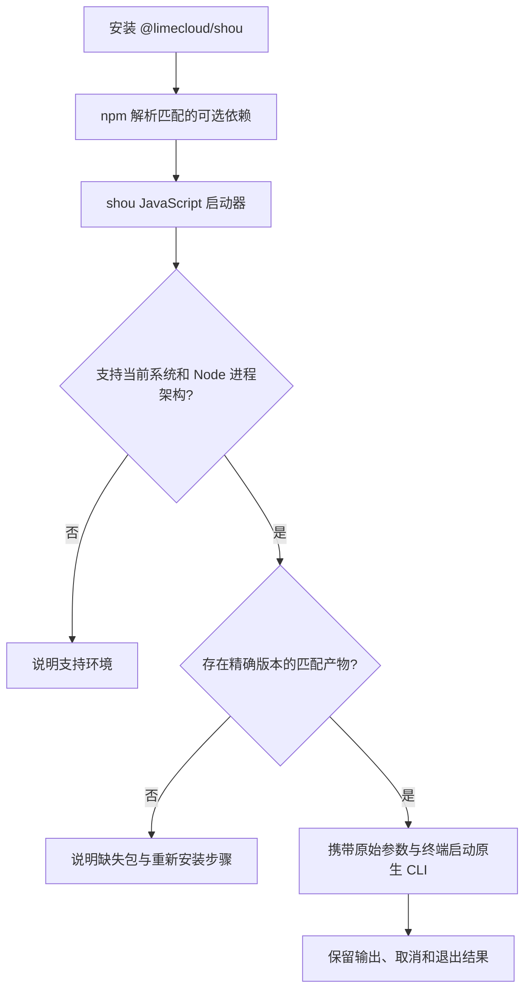

# npm CLI 分发

[English](../../engineering/npm-distribution.md) | 简体中文

状态：`@limecloud/shou@0.11.0` 当前仅支持 macOS。本文规定跨平台统一入口的分发设计；Windows 产物与分平台包自动化均未实现。

## 公开入口

保留一个公开包 [`@limecloud/shou`](https://www.npmjs.com/package/@limecloud/shou) 和一个命令 `shou`。用户无需手动选择语言实现或平台包。

```sh
npm install --global @limecloud/shou
shou --help
shou capabilities --json
```

Windows 支持完成后，包地址与命令均可保持一致，但需要发布新版本。已经发布的 npm 版本不可覆盖；`0.11.0` 仍是仅支持 macOS 的版本。

Node.js 只负责运行 npm 启动器。通过独立原生压缩包安装 CLI 时不需要 Node.js。npm 安装不包含桌面应用，也不授予系统权限。

## 包职责

目标方案采用轻量 JavaScript 启动器和分平台 `optionalDependencies`。原生子包声明对应的 npm `os`、`cpu`。所有依赖精确匹配公开包版本，不在运行时选择其他版本或下载 `latest`。

| 包名 | `os` / `cpu` | 内容 | 状态 |
| --- | --- | --- | --- |
| `@limecloud/shou` | 已支持的系统与架构组合 | 启动器、文档、精确依赖版本 | 当前包内包含 macOS universal 产物；平台路由待实现 |
| `@limecloud/shou-darwin-arm64` | `darwin` / `arm64` | Swift CLI 与必要资源 | 规划中 |
| `@limecloud/shou-darwin-x64` | `darwin` / `x64` | Swift CLI 与必要资源 | 规划中 |
| `@limecloud/shou-win32-arm64` | `win32` / `arm64` | 自包含 .NET CLI 与必要资源 | 规划中 |
| `@limecloud/shou-win32-x64` | `win32` / `x64` | 自包含 .NET CLI 与必要资源 | 规划中 |

上述子包名称属于规划，不是当前安装指引。平台产物通过验收并在 registry 可用后，才能将该平台加入公开包声明；此前保留当前仅支持 macOS 的声明。



## 启动器合同

- 通过明确的 `process.platform` / `process.arch` 白名单选择平台。架构指 Node 进程架构；原生 ARM64 执行需要 ARM64 Node，不静默替换成其他架构。
- 通过平台包约定的导出入口解析产物，启动前核对版本和目录结构。可选依赖缺失时提供可操作的错误说明，覆盖使用 `--omit=optional` 安装的情形。
- 使用参数数组直接启动原生程序并继承终端流，不拼接 Shell 命令或重新解释引号。保留工作目录、空格、Unicode 路径、stdout/stderr 分离、退出状态和取消行为。
- JSON stdout 保持可供机器解析；启动器错误写入 stderr 并返回非零退出码。启动器不执行扫描、确认清理或删除策略。
- 安装预编译产物，不在用户电脑编译，不通过 `postinstall` 二次下载程序，也不依赖另行安装桌面应用。

命令语义、错误、能力发现与交互安全遵循 [CLI 合同](../ai/agent-and-cli-contract.md)。每端原生 CLI 调用本平台的领域和系统服务，刻意差异记录于 [SYNC.md](../../../SYNC.md)。

## 产物与更新边界

macOS 子包包含可执行文件、Swift 资源 bundle、规则、Schema、文案及必要许可证。Windows 子包包含 `win-x64` 或 `win-arm64` 自包含 .NET CLI、运行时依赖、规则、Schema、文案及必要许可证。打包与安装后保持资源相对路径有效。

Windows CLI 不引用 WinUI 或 Presentation。尽可能使其依赖图无需 Windows App SDK，并在干净系统独立验证。GUI 的 Windows App SDK 部署要求另见 [Windows 原生方案](windows-native-plan.md)。

npm 管理 CLI 的安装、升级与移除；Sparkle、Velopack 分别管理对应桌面渠道。桌面更新器不修改 `node_modules`，npm CLI 不调用桌面更新器。GUI 与 npm CLI 可以独立安装，因此机器合同须返回实际原生版本及能力。

## 发布与验收

1. 从明确的发布源码构建各支持平台产物，在构建元数据记录源提交、系统、架构、工具链版本和产物哈希。先对可执行产物签名并核验，再打包；哈希基于最终签名字节计算。
2. 打包各平台包与公开启动器，在对应原生系统和架构上通过隔离 npm 环境安装 tarball。验证持久安装与 `npx`，环境中不预装 Swift 编译器、.NET 或桌面应用。
3. 验证最低系统要求、带空格与 Unicode 的路径、资源迁移、JSON 输出、交互确认、取消、退出码及可选依赖缺失。安装后断网验证原生启动与只读夹具扫描。涉及变更的检查只使用生成的临时夹具。
4. 先发布并核验本次版本引用的所有平台子包，再发布公开包。全部支持组合可解析到精确版本后才发布公开包，发布回执记录 registry 完整性和原生源提交。
5. 在各支持组合从 registry 安装公开包并验证命令，将结果登记到平台对齐表。macOS 安装成功不能作为 Windows 支持证据。

以上规定后续发布流程，不代表当前执行发布。当前 macOS 打包见 [packages/shou-npm](../../../packages/shou-npm/README.md)，桌面发布见[发布规范](releasing.md)。
