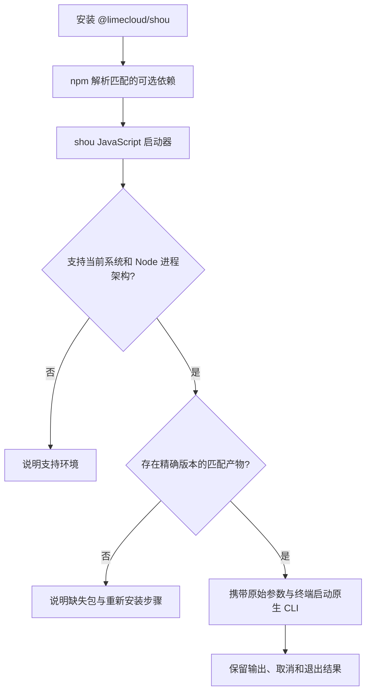

# npm CLI 分发

[English](../../engineering/npm-distribution.md) | 简体中文

发布范围：`@limecloud/shou@0.16.0` 通过精确版本的 ARM64 与 x64 平台包支持 macOS。当前源码已实现平台启动器、分平台打包及离线安装验证入口，源码模板为私有的 `0.16.0`。Windows 自包含 CLI 开发产物已可构建；Windows 原生 npm 验收、签名与 registry 发布仍待完成。

## 公开入口

保留一个公开包 [`@limecloud/shou`](https://www.npmjs.com/package/@limecloud/shou) 和一个命令 `shou`。用户无需手动选择语言实现或平台包。

```sh
npm install --global @limecloud/shou
shou --help
shou capabilities --json
```

Windows 支持完成后，包地址与命令均可保持一致，但需要发布新版本。已经发布的 npm 版本不可覆盖；`0.11.0` 仍是仅支持 macOS 的版本。

Node.js 只负责运行 npm 启动器。通过独立原生压缩包安装 CLI 时不需要 Node.js。npm 安装不包含桌面应用，也不授予系统权限。

统一安装入口不要求共享原生代码。macOS 使用 Swift CLI，Windows 使用独立的 C# CLI；各自调用本平台桌面应用使用的领域服务。启动器不承载业务逻辑，也不把两套运行时打包到每台电脑上。

公开包与本次引用的平台子包使用同一发布版本。双端功能可以按各自进度交付，实际可用命令以 `capabilities --json` 为准；统一版本不表示功能已经全部对齐。桌面应用独立发布，不要求与 npm CLI 同时升级。

## 包职责

采用轻量 JavaScript 启动器和分平台 `optionalDependencies`。原生子包声明对应的 npm `os`、`cpu`。所有依赖精确匹配公开包版本，不在运行时选择其他版本或下载 `latest`。

| 包名 | `os` / `cpu` | 内容 | 状态 |
| --- | --- | --- | --- |
| `@limecloud/shou` | 本次产物包含的系统与架构组合 | 启动器、文档、精确依赖版本 | v0.16.0 macOS 发布范围 |
| `@limecloud/shou-darwin-arm64` | `darwin` / `arm64` | Swift CLI 与必要资源 | v0.16.0；发布 CI 分架构验证原生安装 |
| `@limecloud/shou-darwin-x64` | `darwin` / `x64` | Swift CLI 与必要资源 | v0.16.0；发布 CI 分架构验证原生安装 |
| `@limecloud/shou-win32-arm64` | `win32` / `arm64` | 自包含 .NET CLI 与必要资源 | 开发打包已实现，原生 npm 验收待完成 |
| `@limecloud/shou-win32-x64` | `win32` / `x64` | 自包含 .NET CLI 与必要资源 | 开发打包已实现，原生 npm 验收待完成 |

v0.16.0 仅包含上述两个 macOS 平台包，Windows 子包仍为开发产物。源码模板设置 `private=true`，不直接发布。打包脚本只按实际输入的平台包生成主包依赖；开发模式始终私有。正式产物须通过验收并确认平台子包在 registry 可用，才能发布相应主包。源码中的路由能力不代表已发布平台支持。



## 启动器合同

- 通过明确的 `process.platform` / `process.arch` 白名单选择平台。架构指 Node 进程架构；原生 ARM64 执行需要 ARM64 Node，不静默替换成其他架构。
- 通过平台包约定的导出入口解析产物，启动前核对版本和目录结构。可选依赖缺失时提供可操作的错误说明，覆盖使用 `--omit=optional` 安装的情形。
- 使用参数数组直接启动原生程序并继承终端流，不拼接 Shell 命令或重新解释引号。保留工作目录、空格、Unicode 路径、stdout/stderr 分离、退出状态和取消行为。
- JSON stdout 保持可供机器解析；启动器错误写入 stderr 并返回非零退出码。启动器不执行扫描、确认清理或删除策略。
- 安装预编译产物，不在用户电脑编译，不通过 `postinstall` 二次下载程序，也不依赖另行安装桌面应用。

命令语义、错误、能力发现与交互安全遵循 [CLI 合同](../ai/agent-and-cli-contract.md)。每端原生 CLI 调用本平台的领域和系统服务，刻意差异记录于 [SYNC.md](../../../SYNC.md)。

平台包以 `exports` 暴露 `payload.json` 和 `package.json`。描述符版本为 1，包含精确版本、`platform`、`arch` 及固定的 `vendor/shou` 或 `vendor/shou.exe`。启动器验证元数据、资源目录和关键依赖，拒绝目录外的链接目标。macOS 最低 Darwin 23，Windows 最低 `10.0.22000`。Windows 控制台自身向父子进程传递 Ctrl+C；启动器等待原生退出，避免调用 `child.kill(SIGINT)` 强制终止。Windows 控制台实际行为仍需原生验证。

## 本地打包与验证

`scripts/package-npm.py` 提供 `platform` 与 `launcher` 两个子命令，不执行发布。Windows 示例使用已有自包含开发产物：

```sh
python3 "scripts/package-npm.py" platform --development --version 0.16.0 \
  --platform win32-x64 --payload ".build/windows/publish/win-x64/cli" \
  --licenses ".build/windows/publish/win-x64/cli/notices" --output ".build/npm/win32-x64"
python3 "scripts/package-npm.py" launcher --development --version 0.16.0 \
  --platform-package ".build/npm/win32-x64" --output ".build/npm/launcher"
node --test "tests/npm/launcher.test.cjs"
python3 "tests/npm/test-packaging.py"
```

ARM64 使用对应平台名与产物目录。macOS 输入为单架构 Swift CLI 和相邻三个资源 bundle，依赖声明目录须包含 `SwiftAISDK-LICENSE.txt`。Windows 构建入口从实际还原包生成 .NET 许可证、第三方声明和 Windows SDK 来源及许可链接到 `notices`，打包完整复制。两端原生版本必须与本次 npm 版本一致；macOS 应用、CLI 与 npm 本次使用 `0.16.0`，Windows 原生版本同步为 `0.16.0`，GitHub 提供便携预览包；Windows npm 产物仍使用私有开发模式，原生签名与 npm 分发验收完成后再纳入公开启动器。

每个产物记录源提交、提交树、工作区内容摘要、是否有未提交变更、原生检查及签名检查结果和最终文件哈希。主包拒绝不同版本、不同源码状态或验后变化的平台包。正式模式要求干净的源码 checkout，在匹配原生系统与架构查询版本和资源并验证签名；开发模式允许跨平台静态检查，但不会记录为原生验收通过。打包不修改、重签名或压缩原生可执行文件。

在匹配平台准备主包和原生包后，执行：

```sh
python3 "scripts/verify-npm-distribution.py" --launcher "/path/to/launcher" \
  --platform-package "/path/to/native-package" --output "/path/to/new-evidence-directory"
```

验证器离线打包与安装本地 tarball，使用隔离缓存、配置和安装前缀，验证本地安装、临时全局命令、等价于 `npx` 的 `npm exec`、版本和规则资源，以及 `--omit=optional` 的错误。它不读取 registry，不安装到日常全局目录；输出 `verification.json`。这些检查不替代干净系统、交互终端或 registry 发布验收。Windows CI 已配置同一私有打包与安装入口，实际 CI 结果须单独登记。

本次 Mac 验证通过 14 项启动器测试、10 项打包测试，以及实际 ARM64 Swift CLI 的离线安装、全局入口、`npm exec`、资源查询、生成夹具只读扫描和可选依赖缺失检查。Windows 平台包已做开发打包与最终字节核对；未运行 Windows 原生 npm、签名或控制台验收。完整证据范围见 [SYNC.md](../../../SYNC.md)。

## 产物与更新边界

macOS 子包包含可执行文件、Swift 资源 bundle、规则、Schema、文案及必要许可证。Windows 子包包含 `win-x64` 或 `win-arm64` 自包含 .NET CLI、运行时依赖、规则、Schema、文案及必要许可证。打包与安装后保持资源相对路径有效。

Windows CLI 不引用 WinUI 或 Presentation。尽可能使其依赖图无需 Windows App SDK，并在干净系统独立验证。GUI 的 Windows App SDK 部署要求另见 [Windows 原生方案](windows-native-plan.md)。

npm 管理 CLI 的安装、升级与移除；Sparkle、Velopack 分别管理对应桌面渠道。桌面更新器不修改 `node_modules`，npm CLI 不调用桌面更新器。GUI 与 npm CLI 可以独立安装，因此机器合同须返回实际原生版本及能力。

## 发布与验收

1. 从明确的发布源码构建各支持平台产物，在构建元数据记录源提交、系统、架构、工具链版本和产物哈希。先对可执行产物签名并核验，再打包；哈希基于最终签名字节计算。
2. 打包各平台包与公开启动器，在对应原生系统和架构上通过隔离 npm 环境安装 tarball。验证持久安装与 `npx`，环境中不预装 Swift 编译器、.NET 或桌面应用。
3. 验证最低系统要求、带空格与 Unicode 的路径、资源迁移、JSON 输出、交互确认、取消、退出码及可选依赖缺失。安装后断网验证原生启动与只读夹具扫描。涉及变更的检查只使用生成的临时夹具。
4. 先发布并核验本次版本引用的所有平台子包，再发布公开包。全部支持组合可解析到精确版本后才发布公开包，发布回执记录 registry 完整性和原生源提交。
5. 在各支持组合从 registry 安装公开包并验证命令，将结果登记到平台对齐表。macOS 安装成功不能作为 Windows 支持证据。

发布需有用户明确的发布指令。当前 macOS 打包见 [packages/shou-npm](../../../packages/shou-npm/README.md)，桌面发布见[发布规范](releasing.md)。
