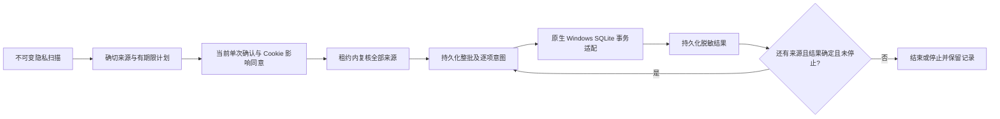
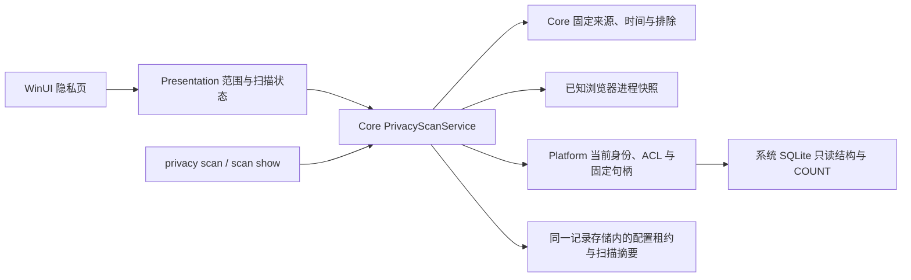
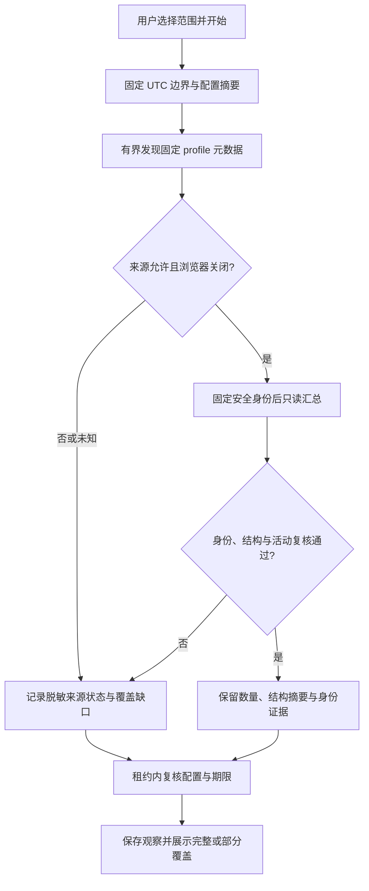
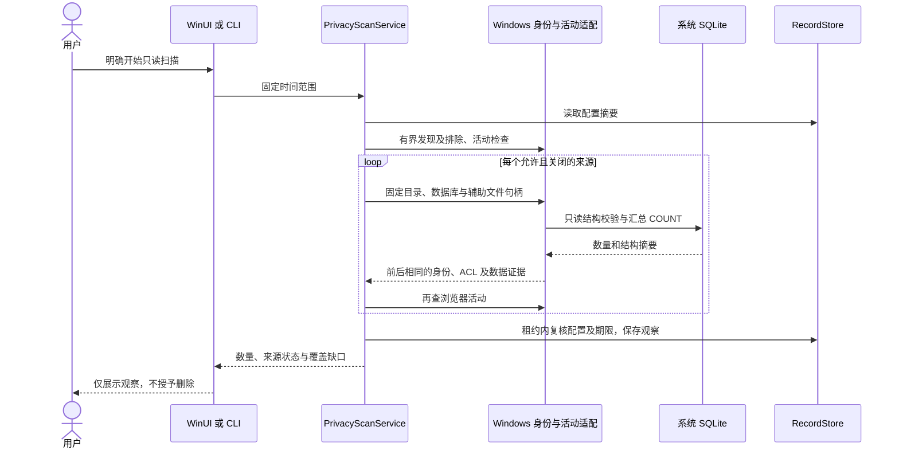
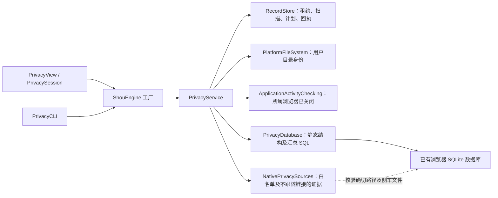
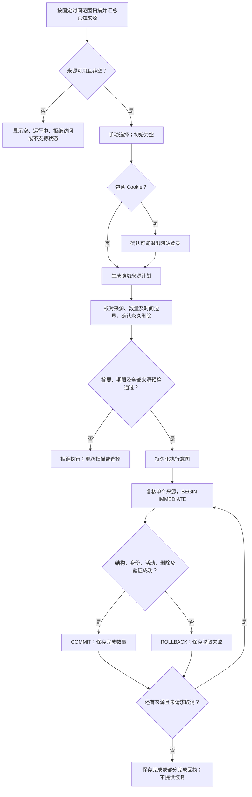
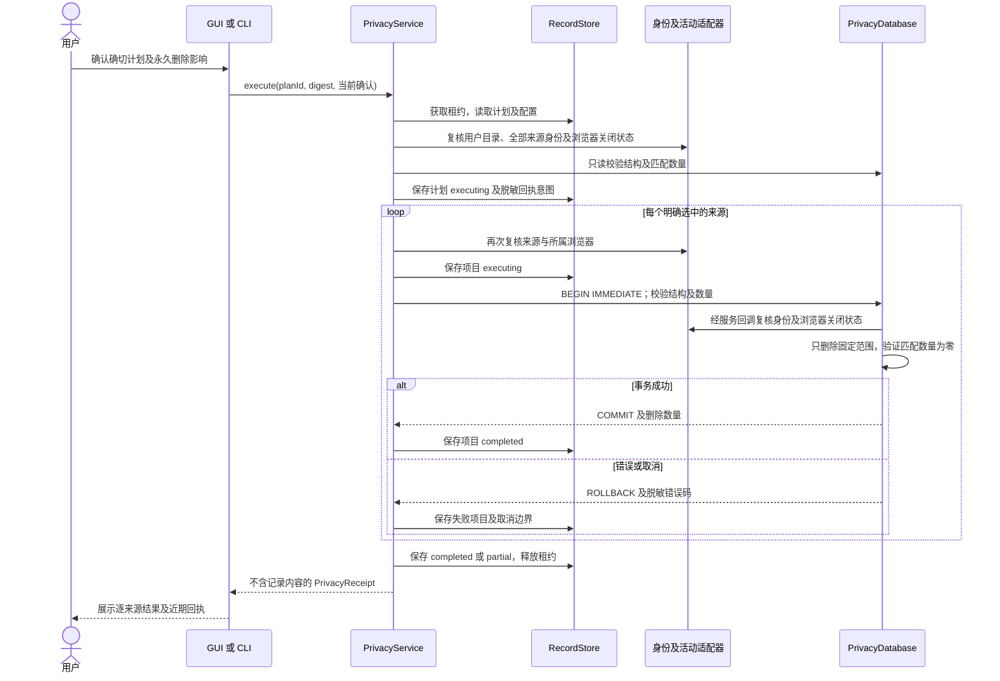

# 有限范围的浏览器隐私清理

[English](../../engineering/privacy-cleaning.md) | 简体中文

隐私清理是独立的手动操作领域：查询汇总数量与时间字段，生成有期限的计划，明确确认后永久删除选中的记录。它不进入普通缓存推荐。实现不承诺兼容所有浏览器版本。

## 来源支持

| 来源 | macOS 已实现范围 | 边界 |
| --- | --- | --- |
| Chrome、Chromium、Edge、Brave 历史 | 标准 `Default`、`Profile N` 配置；访问记录及已知关联表；校准剩余 URL 数量与时间 | 按结构校验数据库，拒绝浏览器专用触发器；保留下载历史 |
| Chromium Cookie | 精确的旧版 `Cookies` 或新版 `Network/Cookies` 数据库 | 时间依据最后访问时间，非创建或过期时间；必须另外确认退出登录影响 |
| Firefox Cookie | `Firefox/Profiles` 下的标准目录；`moz_cookies` | 最后访问时间；必须确认退出登录影响 |
| Firefox 历史 | 无触发器、具备基础访问/地点/书签列的结构；保留书签及下载访问，校准简单汇总列 | 不支持 Firefox 专有 frecency 评分列及触发器。因此常见现代 Firefox 历史数据库会显示为不可清理 |
| Safari 历史 | 无触发器的基础历史项/访问结构，支持简单访问计数 | 不支持按日/周派生计数及自动完成汇总。因此部分当前 Safari 数据库会显示为不可清理 |
| Safari Cookie、站点存储、保存的密码、自动填充 | 明确显示暂不支持 | 不以删除整个配置或容器作为替代 |

本次不支持自定义配置位置、Firefox 外部配置、标识符不同的测试版或渠道版、站点存储、权限、扩展、会话恢复、密码管理器、应用活动、剪贴板、最近项目和云端副本。关闭的浏览器以后可能通过同步恢复历史；Shou 不修改云端服务。运行中的浏览器来源不可选，Shou 不会自动终止浏览器。

### Windows 平台边界

Windows 已有独立 C# 只读扫描、CLI 和 WinUI 页面源码。支持固定位置的 Chrome、Chromium、Edge、Brave 历史及 Cookie，以及 Firefox 基础历史结构与 Cookie；不包含 Safari。页面初始不扫描，由用户选择时间范围并明确开始。Core 已实现独立隐私计划、当前确认、执行编排与脱敏回执；未发布 v0.14.0 工作区已加入 `WindowsPrivacyMutation` 原生事务适配并接入 WinUI 的计划／确认／回执；CLI 保留只读扫描入口，只读数量不能作为删除授权。原生运行、ACL、SQLite sidecar 和界面验收待完成。见[原生方案](windows-native-plan.md)。

`PrivacyCleanupService` 复用现有记录租约，绑定同一扫描中的确切来源、时间窗口、配置及身份／结构／数量证据。计划最长五分钟，且不超过扫描期限；Cookie 退出登录影响同意独立于当前进程的一分钟单次执行确认。全部来源预检先于整批意图，逐项意图先于原生派发。停止会等待已派发操作的真实结果，日志失败禁止启动后续操作，未知结果停止后续来源。任何已有整批意图都阻止计划重放；脱敏回执仅供查询，不能恢复执行资格。

未发布的 Windows 页面初始不选择任何来源，Cookie 需先允许审阅才可选择；撤销许可只移除 Cookie 选择。重新扫描、时间范围和配置变化清空旧选择，横向底栏显示当前来源与记录数。审阅先生成精确且有期限的计划，再展示该计划的来源与固定时间边界。最终对话框默认取消，永久删除同意和 Cookie 退出登录同意均从未勾选状态开始，预审阅许可不能代替本次执行确认。独立回执卡片展示脱敏来源编号、实际计数与状态，不把未知数量当成零。可移植选择回归已执行；历史折叠区默认显示最近 20 份回执，按执行开始时间降序；只读查询在同一租约中复核回执、计划、扫描和摘要，不能恢复执行权限。目录最多 4,096 项，累计读取包括计划与扫描不超过 32 MiB，时限十秒；缺失、损坏、超限或读取失败明确报错，不伪装为空历史。新增页面交互、Cookie 删除和重启后历史 E2E 仍需原生验收。



内存测试验证上述编排合同。Windows 11 x64 原生生成夹具 7 项通过，覆盖精确 Cookie 时间窗、无关表／旧记录保留、Chromium／Firefox 关联结构、取消回滚和失效授权拒绝；现有非空 rollback journal 在读检查和写入前均拒绝，避免 SQLite 隐式恢复改变来源。本次事务创建的 journal 只在该事务的核验及收尾内处理。WinUI 删除旅程尚未执行到，不代表正式发布或任意浏览器兼容性通过；回执见 [SYNC.md](../../../SYNC.md)。

`WindowsPrivacySourcePolicy` 使用系统实际返回的 Local/Roaming AppData，允许受支持的重定向本地目录。Chromium 只识别 `Default` 或 `Profile N`；Firefox 只识别固定 `Mozilla/Firefox/Profiles` 下的合法单组件目录，不读取外部 profile 配置。发现仅枚举元数据，最多 2,048 次条目工作、256 个 profile 和 768 个来源，十秒截止；发现缺口保持部分覆盖。完整扫描共享两分钟预算，保存十五分钟有效的版本 1 观察记录。

`PrivacyScanService` 应用全局与相关工作区的祖先排除，保护自身数据及数据库、WAL、SHM、journal 的确切路径。每次查询前后检查已知浏览器进程名；运行中或观察未知时不发布可用数量。进程快照不证明数据库独占。`WindowsPrivacyDatabaseInspection` 固定从 AppData anchor 到数据库父级的普通目录和文件句柄，拒绝 reparse、外部所有者、数据库硬链接、跨卷和可由非信任身份写入的 ACL。数据库及 sidecar 句柄允许共享写入以兼容 SQLite，但始终不共享删除；目录、ACL、主数据库和非空 WAL 的前后证据必须一致。

数据库适配使用 Windows 系统 `winsqlite3.dll` 的只读、无 CREATE、NOFOLLOW 连接和静态结构校验，只返回汇总数量与结构摘要，不读取网址、域名或 Cookie 值。拒绝触发器、视图、虚拟表、未知跨界外键、非整数时间和不支持的派生结构。单查询连接使用一秒繁忙等待、十五秒／五千万 VM 指令预算；取消后等待原生工作释放句柄。缺少必要 WAL 辅助文件时保持不可用，不使用写连接修复。只读扫描不修改浏览器记录，也不备份配置；清理是另一个需要具体计划、Cookie 影响同意和本次确认的显式操作。







## 范围与执行

时间范围包括最近一小时、滚动24小时、滚动七天和所有时间。有限范围包含扫描时固定的起止边界。Chromium 使用自1601年以来的整数微秒，Firefox 使用 Unix 整数微秒，Safari 使用自2001年以来的秒。整数时间下界向上取整、上界向下取整，Chromium 纪元差值以整数相加，避免损失微秒精度。Cookie 依据最后访问，历史依据访问时间。未知或为零的 Cookie 时间不会被猜测为近期记录；所有时间则包括这些未定年 Cookie。Firefox 的访问类型7表示下载历史，予以保留。

扫描15分钟后过期；计划最长有效五分钟，且不超过扫描期限。初始选择为空。选择 Cookie 前先确认可能退出登录；执行时再确认永久删除和必要的退出登录影响。CLI 要求交互终端及精确输入 `DELETE-PRIVACY`，不提供无人确认的绕过参数。

服务共享现有引擎的记录存储及跨进程租约，应用已有全局/工作区排除规则并保护自身存储。来源限制在注入的用户目录内的固定浏览器位置，拒绝符号链接、数据库硬链接、不安全所有者及可被其他用户写入的来源目录。记录目录、数据库和 WAL 身份证据。持久化执行意图前先检查整个计划，每个来源开始事务前再次检查活动状态、配置、身份、结构及匹配数量。SQLite 仅打开已有文件且不跟随末端链接，繁忙等待一秒，查询进度预算15秒。原生文件系统元数据调用不构成严格的实时取消保证。

只读连接可能自行创建不含记录帧的空 WAL 文件；这类文件仍检查安全身份，但不纳入数据指纹。非空 WAL 仍属于指纹。不支持触发器，也拒绝跨越已知来源表范围的外键关系，防止未知级联表被隐含加入删除范围。

部分系统 SQLite 版本无法以只读方式打开缺少必要辅助文件的 WAL 数据库。此类来源保持不可用；扫描不会通过写入连接初始化或修复这些文件。

每个数据库独立使用立即事务。语句或验证失败会回滚当前事务；后续来源失败时，先前成功的来源仍已提交，结果显示部分完成。中断意图保留，不会自动重试。页面可查看近期的脱敏回执，`privacy history` 返回持久回执。回执仅含来源 ID、时间范围、数量、状态和脱敏错误码，不含配置路径、网址、域名、记录值或 SQL 错误。扫描和计划元数据包含来源说明与文件系统证据，不含逐条浏览记录。不会复制或备份整个浏览器配置。

这是逻辑删除记录，不是法证擦除。SQLite 空闲页、WAL/回滚日志、备份及浏览器同步仍可能保留痕迹。Shou 不执行 `VACUUM`，不承诺释放空间，不将隐私记录移入废纸篓，也不提供恢复。文件身份检查降低替换风险，但不能对抗恶意进程持续替换祖先目录形成操作系统级事务；请关闭其他会写入同一浏览器数据库的工具。

## 架构

以下结构描述 macOS 实现；Windows 只读链路见上文平台边界。



引擎提供共享依赖，不另建清理引擎。发现和身份检查属于平台能力；`PrivacyDatabase` 负责来源专用 SQL，服务负责范围、确认、计划完整性及持久结果。[隐私数据合同](../architecture/data-model.md#隐私扫描计划与回执合同)列出实际存储字段和状态边界。

## 审阅与执行流程



来源失败不会扩大选择范围，也不会撤销先前已提交的来源。取消在当前事务可中断时回滚，并将余下来源标为取消。异常中断可能留下无法推断结果的执行意图，不会自动重放。

## 执行时序



## 入口与验证


```text
shou privacy scan --range last-hour --json
shou privacy scan show --scan-id <scan-id> --json
shou privacy plan --scan-id <scan-id> --source <source-id> --json
shou privacy plan --scan-id <scan-id> --source <cookie-source-id> --acknowledge-sign-out true --json
shou privacy plan show --plan-id <plan-id> --json
shou privacy execute --plan-id <plan-id>
shou privacy history --json
```

`tests/core/PrivacyTests.swift` 在生成的夹具用户目录下创建一次性数据库，覆盖时间纪元与有限范围、选中关联与无关孤立行、Cookie 确认、书签/下载保留、浏览器运行、证据过期、排除规则、事务回滚、不支持触发器及脱敏回执。这些测试验证受支持的结构合同，不证明所有已安装浏览器版本或私人配置的访问权限。执行结果见[验收与测试](acceptance-and-testing.md)。


来源模型及策略参考了 [MangoDisk](https://github.com/harry0703/MangoDisk)，主要源码为 `src-tauri/crates/mangodisk-core/src/privacy/browser_database.rs`、`privacy/browser_database/schema.rs`、`privacy/service/policy.rs` 及 macOS 隐私适配器。Shou 实现的范围更小，并保留明确的不支持状态。
