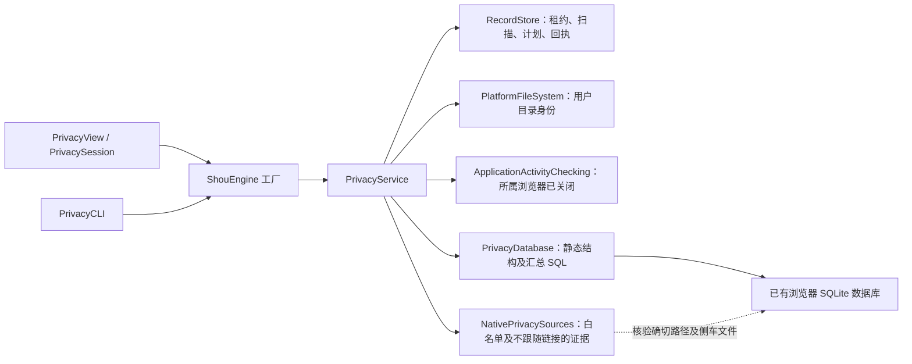
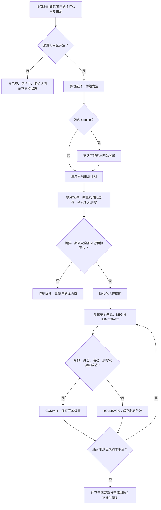
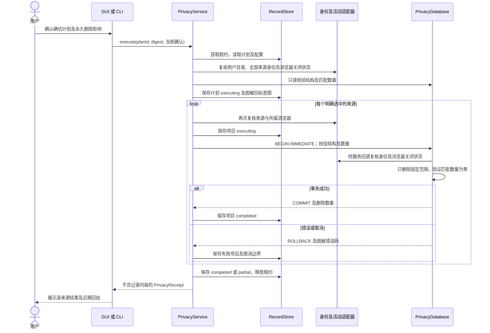

# 有限范围的浏览器隐私清理

[English](../../engineering/privacy-cleaning.md) | 简体中文

隐私清理是独立的手动操作领域：查询汇总数量与时间字段，生成有期限的计划，明确确认后永久删除选中的记录。它不进入普通缓存推荐。实现不承诺兼容所有浏览器版本。

## 来源支持

| 来源 | 已实现范围 | 边界 |
| --- | --- | --- |
| Chrome、Chromium、Edge、Brave 历史 | 标准 `Default`、`Profile N` 配置；访问记录及已知关联表；校准剩余 URL 数量与时间 | 按结构校验数据库，拒绝浏览器专用触发器；保留下载历史 |
| Chromium Cookie | 精确的旧版 `Cookies` 或新版 `Network/Cookies` 数据库 | 时间依据最后访问时间，非创建或过期时间；必须另外确认退出登录影响 |
| Firefox Cookie | `Firefox/Profiles` 下的标准目录；`moz_cookies` | 最后访问时间；必须确认退出登录影响 |
| Firefox 历史 | 无触发器、具备基础访问/地点/书签列的结构；保留书签及下载访问，校准简单汇总列 | 不支持 Firefox 专有 frecency 评分列及触发器。因此常见现代 Firefox 历史数据库会显示为不可清理 |
| Safari 历史 | 无触发器的基础历史项/访问结构，支持简单访问计数 | 不支持按日/周派生计数及自动完成汇总。因此部分当前 Safari 数据库会显示为不可清理 |
| Safari Cookie、站点存储、保存的密码、自动填充 | 明确显示暂不支持 | 不以删除整个配置或容器作为替代 |

本次不支持自定义配置位置、Firefox 外部配置、标识符不同的测试版或渠道版、站点存储、权限、扩展、会话恢复、密码管理器、应用活动、剪贴板、最近项目和云端副本。关闭的浏览器以后可能通过同步恢复历史；Shou 不修改云端服务。运行中的浏览器来源不可选，Shou 不会自动终止浏览器。

### Windows 来源适配

Windows 在以下用户目录内的标准位置发现配置，并应用上表相同的数据库结构限制；Safari 仅适用 macOS。

| 浏览器 | 相对当前用户目录的根路径 |
| --- | --- |
| Chrome | `AppData/Local/Google/Chrome/User Data` |
| Chromium | `AppData/Local/Chromium/User Data` |
| Edge | `AppData/Local/Microsoft/Edge/User Data` |
| Brave | `AppData/Local/BraveSoftware/Brave-Browser/User Data` |
| Firefox | `AppData/Roaming/Mozilla/Firefox/Profiles` |

Chromium 来源仅限 `Default` 或 `Profile N` 中确切的历史及 Cookie 数据库；Firefox 为发现的配置目录中的 `places.sqlite` 与 `cookies.sqlite`。来源新增可选 `platform` 字段，保留旧 macOS 扫描／计划元数据兼容性；Windows 要求 `windows` 及自身的闭合路径策略。发现入口不接受调用方自选根目录。

Windows 原生访问在每次 SQLite 操作期间持有数据库、祖先目录及现有辅助文件的句柄，禁止共享删除。证据保留完整 File ID 与所有者 SID，拒绝重解析点、占位文件、硬链接、非预期所有者及不安全写入 ACL。允许继承的读取权限，写入／删除／修改 ACL 的权限仅允许当前用户、SYSTEM 或 Administrators。只检查现有 ACL，不改写权限。这项独立隐私授权不扩大普通缓存规则的 AppData 范围。Windows SDK／原生运行及 WPF 交互仍待验收。

目录所有者可为当前用户、SYSTEM 或 Administrators，仍检查写入 ACL 并固定身份；数据库与辅助文件的所有者必须精确匹配当前用户。提升权限的生成夹具覆盖管理员所有的目录，并验证管理员所有的数据库被拒绝，不修改任何既有用户目录的所有者。

## 范围与执行

时间范围包括最近一小时、滚动24小时、滚动七天和所有时间。有限范围包含扫描时固定的起止边界。Chromium 使用自1601年以来的整数微秒，Firefox 使用 Unix 整数微秒，Safari 使用自2001年以来的秒。整数时间下界向上取整、上界向下取整，Chromium 纪元差值以整数相加，避免损失微秒精度。Cookie 依据最后访问，历史依据访问时间。未知或为零的 Cookie 时间不会被猜测为近期记录；所有时间则包括这些未定年 Cookie。Firefox 的访问类型7表示下载历史，予以保留。

扫描15分钟后过期；计划最长有效五分钟，且不超过扫描期限。初始选择为空。选择 Cookie 前先确认可能退出登录；执行时再确认永久删除和必要的退出登录影响。CLI 要求交互终端及精确输入 `DELETE-PRIVACY`，不提供无人确认的绕过参数。

服务共享现有引擎的记录存储及跨进程租约，应用已有全局/工作区排除规则并保护自身存储。来源限制在注入的用户目录内的固定浏览器位置，拒绝符号链接、数据库硬链接、不安全所有者及可被其他用户写入的来源目录。记录目录、数据库和 WAL 身份证据。持久化执行意图前先检查整个计划，每个来源开始事务前再次检查活动状态、配置、身份、结构及匹配数量。SQLite 仅打开已有文件且不跟随末端链接，繁忙等待一秒，查询进度预算15秒。原生文件系统元数据调用不构成严格的实时取消保证。

只读连接可能自行创建不含记录帧的空 WAL 文件；这类文件仍检查安全身份，但不纳入数据指纹。非空 WAL 仍属于指纹。不支持触发器，也拒绝跨越已知来源表范围的外键关系，防止未知级联表被隐含加入删除范围。

部分系统 SQLite 版本无法以只读方式打开缺少必要辅助文件的 WAL 数据库。此类来源保持不可用；扫描不会通过写入连接初始化或修复这些文件。

每个数据库独立使用立即事务。语句或验证失败会回滚当前事务；后续来源失败时，先前成功的来源仍已提交，结果显示部分完成。中断意图保留，不会自动重试。页面可查看近期的脱敏回执，`privacy history` 返回持久回执。回执仅含来源 ID、时间范围、数量、状态和脱敏错误码，不含配置路径、网址、域名、记录值或 SQL 错误。扫描和计划元数据包含来源说明与文件系统证据，不含逐条浏览记录。不会复制或备份整个浏览器配置。

这是逻辑删除记录，不是法证擦除。SQLite 空闲页、WAL/回滚日志、备份及浏览器同步仍可能保留痕迹。Shou 不执行 `VACUUM`，不承诺释放空间，不将隐私记录移入废纸篓，也不提供恢复。文件身份检查降低替换风险，但不能对抗恶意进程持续替换祖先目录形成操作系统级事务；请关闭其他会写入同一浏览器数据库的工具。

## 架构



引擎提供共享依赖，不另建清理引擎。发现和身份检查属于平台能力；`PrivacyDatabase` 负责来源专用 SQL，服务负责范围、确认、计划完整性及持久结果。[隐私数据合同](../architecture/data-model.md#隐私扫描计划与回执合同)列出实际存储字段和状态边界。

## 审阅与执行流程



来源失败不会扩大选择范围，也不会撤销先前已提交的来源。取消在当前事务可中断时回滚，并将余下来源标为取消。异常中断可能留下无法推断结果的执行意图，不会自动重放。

## 执行时序



## 入口与验证

Core 由 `PrivacyModels.swift`、`PrivacyService.swift`、`PrivacyDatabase.swift` 负责。macOS 原生发现使用 `NativePrivacySources.swift`；Windows 使用 `WindowsPrivacySources.swift` 和 `shou_win_privacy_acquire`。macOS GUI 由 `PrivacySession.swift`、`PrivacyView.swift` 负责；WPF 使用 `MainViewModel.Privacy.cs`、`PrivacyView.xaml`；`PrivacyCLI.swift` 和桌面桥使用同一个服务。

桌面桥提供只读 `privacy.scan`、`privacy.history`，以及严格要求 `scan_id`、`source_ids` 和布尔 `sign_out` 的 `privacy.clean`。清理在同一进程生成新计划，并将确认绑定到计划摘要和一次性挑战。WPF 默认不选来源，撤回退出登录同意会清空 Cookie 选择；最终审阅还要求独立勾选永久删除及适用的退出登录确认。完成、失败或取消一次操作后清空扫描，下一次操作需要重新扫描。近期回执展示脱敏的逐来源结果。

```text
shou privacy scan --range last-hour --json
shou privacy scan show --scan-id <scan-id> --json
shou privacy plan --scan-id <scan-id> --source <source-id> --json
shou privacy plan --scan-id <scan-id> --source <cookie-source-id> --acknowledge-sign-out true --json
shou privacy plan show --plan-id <plan-id> --json
shou privacy execute --plan-id <plan-id>
shou privacy history --json
```

`tests/core/PrivacyTests.swift` 在生成的夹具用户目录下创建一次性数据库，覆盖时间纪元与有限范围、选中关联与无关孤立行、Cookie 确认、书签/下载保留、浏览器运行、证据过期、排除规则、事务回滚、不支持触发器及脱敏回执。这些测试验证受支持的结构合同，不证明所有已安装浏览器版本或私人配置的访问权限。执行结果见[验收与测试](acceptance-and-testing.md)。

`WindowsPrivacyTests.swift` 使用生成证据补充 Windows 闭合来源策略、旧数据编码兼容、访问租约生命周期及大小写不敏感的保护检查。`scripts/verify-privacy-bridge.py --native-fixtures` 独占创建一个一次性配置，仅选择其两个生成来源，验证严格输入、拒绝／取消确认、Cookie 同意、近期记录删除时保留旧记录和下载、过期重放拒绝及脱敏回执；同时检查生成数据库硬链接，Windows 分支再检查不安全写入 ACL。原生租约／重命名检查位于 `tests/windows/PrivacySourceTests.swift`，但专项 target 因已记录的 Swift SIL 编译崩溃被跳过，不能计为已执行。在 macOS 主机上，隐私聚焦测试 8/8、完整核心 294/294、进程合同 24 项、CLI 合同 159 项通过；WPF 和原生 C++ 交叉编译属于补充证据，不代表 Windows 运行通过。

来源模型及策略参考了 [MangoDisk](https://github.com/harry0703/MangoDisk)，主要源码为 `src-tauri/crates/mangodisk-core/src/privacy/browser_database.rs`、`privacy/browser_database/schema.rs`、`privacy/service/policy.rs` 及 macOS 隐私适配器。Shou 实现的范围更小，并保留明确的不支持状态。
