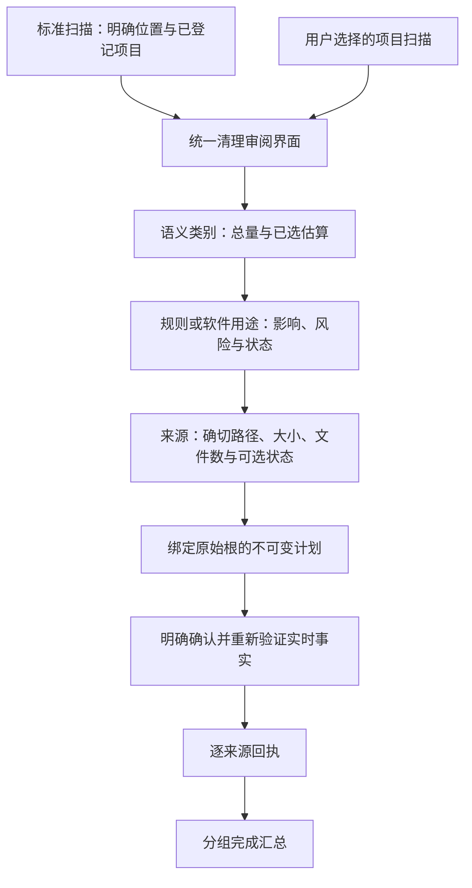

# 清理交互与架构决策

[English](../../engineering/reference-design.md) | 简体中文

状态：设计要求与实现映射。源码实现或界面参考不能替代交互验收、文件系统安全验证或发布检查。当前产品合同见[原生 macOS 体验](../product/macos-experience.md)与[系统架构](../architecture/system-design.md)。

## 证据与结论

本设计区分四类依据：

| 依据 | 能够支持的结论 | 不能证明的事项 |
| --- | --- | --- |
| 已提供的界面参考 | 信息层级、可见控件、密度、确认与结果内容 | 转场、时长、键盘行为、文件系统语义 |
| 可读取的完整源码 | 类别投影、选择计算、扫描编排、进程保护与结果模型 | 另一已安装版本或 Shou 的实际行为 |
| 已保留的 REA 原生包清单与属性列表 | 应用身份、包内资源、声明的语言 | 执行行为、反编译源码、规则匹配或删除正确性 |
| 已安装参考应用的直接交互观察 | 类别 → 规则 → 路径层级、部分选择、固定底部选择与操作区 | 清理、恢复、删除语义或 Shou 的实现；未触发该应用的清理操作 |

现有原生包证据已经满足下述交互决策的需要，无须重复进行二进制分析，也无须复制专有规则或恢复实现。动效需要在 Shou 中明确设计并实测；静态界面参考无法证明动效行为。

## 需要解决的产品差异

| 现有实现边界 | 目标体验 | 架构影响 |
| --- | --- | --- |
| 常用软件结果主要展示已知目录清单 | 直接开始标准扫描，按软件或用途审阅 | 目录发现留在 Core，将结果投影为用户理解的清理项 |
| 每个已知目录分别打开工作区结果 | 在统一审阅界面汇总标准扫描 | 聚合多个快照的展示，同时保留每个来源的快照与根身份 |
| 工作区列表由类别直接展开路径 | 类别 → 规则或软件用途 → 确切来源路径 | 在导航与候选间增加明确规则投影；不从显示文案推断软件身份 |
| 确认主要列出路径 | 确认前解释所选项目、估算、影响与阻止原因 | 从不可变计划事实生成确认内容，本地化描述不能扩大授权 |
| 结果逐个展示文件系统操作 | 简洁汇总，同时可查看逐规则与逐来源结果 | 从回执生成汇总，保留部分完成、跳过、失败与未知状态 |

这些差异属于交互要求，不代表已经授权新的跨根执行协议或更广泛的文件访问。

## 信息层级

- **窗口导航**表达已实现任务：常用软件清理、项目清理、空间分析、规则与历史；侧栏仅列出用户添加的项目工作区。保存的规则选择收在“规则”菜单内，每次使用仍需重新扫描。不为尚未实现的工具增加空白入口。
- **类别导航**表达数据用途：在有匹配事实时展示应用缓存、浏览器缓存、开发工具、项目产物、依赖与个人规则。风险属于规则或来源属性，不单独作为导航体系。
- **规则行**用用户语言说明清理对象，展示影响、已选／总量估算、可展开来源数与可选状态。同一软件可能包含多个用途不同的规则，仅展示软件名不够明确。
- **来源行**保留绑定根的确切路径、文件数、估算与原因。展开和行焦点不得暗中改变选择；在 Finder 中显示、复制路径与排除应可直接检查。

主内容区使用紧凑任务标题与扫描范围、一个容量摘要，以及占满剩余高度的结果区域。结果区采用类别导航与原生规则／来源详情；窗口变窄时，将类别列收起为原生选择器。只保留一个明确的审阅入口，扫描中只保留一个停止入口。技术性的根目录清单放入详情，不占据首次使用的主体。

## 选择与容量

候选身份集合是选择的唯一事实源。类别、规则、来源复选框的未选、部分选中、全选状态，由其可选子项确定。分组、排序、语言切换与展开操作不改变所选身份。

| 模式 | 行为 |
| --- | --- |
| 不选择 | 初始状态，不产生破坏性操作范围 |
| 需审阅项目 | 用户明确触发的便捷选择，只包含当前可选来源，排除高风险依赖；不代表安全推荐 |
| 手动选择 | 由逐项修改推导；不作为另一个会改变选择的预设 |
| 规则便捷选择 | 选择当前规则内符合条件的子项；展示高风险状态并保留计划确认 |
| 全部可清理项目 | 明确标注包含高风险项目；不包含受阻来源或测量不完整的目标 |

初始选择为空。任何便捷操作都不选择受阻或不完整来源；包含高风险的操作必须明确标注。界面不按大小或颜色自创安全推荐。保存的规则选择仍需重新预览与确认。

明确区分已测量数据、可审阅候选、所选估算、移入废纸篓估算与卷可用空间。类别或规则部分选中时展示已选／总量。每个物理候选只计算一次，保留父子冲突限制，并遵循既定硬链接口径。无法读取或尚未测量的路径属于未知，不能显示为零。

结果滚动时，所选估算与主审阅操作固定在底部区域。该区域展示同一份权威选择，不维护另一套选择总量或授权状态。

## 生命周期与动效

桌面端负责显示状态，Core 负责操作事实与授权。区分空闲、发现、扫描、分析、审阅、预检、执行、取消与结果状态。稳定操作 ID 防止迟到的进度覆盖已完成结果；取消或不完整扫描必须继续明确标记为不完整。

| 状态 | 可见内容 | 操作 |
| --- | --- | --- |
| 首次使用 | 已知软件覆盖范围的简短说明与主扫描按钮 | 标准扫描；选择项目放在次级入口 |
| 扫描中 | 当前阶段、条目数与长度受控的当前路径 | 停止 |
| 审阅 | 类别、规则、来源、所选容量与限制 | 审阅当前选择 |
| 确认 | 所选项目、确切范围、影响、估算与运行中应用限制 | 返回调整或明确确认 |
| 执行中 | 已处理条目、当前来源与实际操作状态 | 安全停止，保留已完成结果 |
| 结果 | 已移动、跳过、失败、待核验数量及逐项原因 | 关闭、查看历史或另行恢复 |

点阵是辅助空间概览，不承担清理领域模型。数值与状态转场应绑定真实测量或选择变化；总量未知时，可以用克制的扫光表示活动，但不能暗示完成百分比。遵循“减少动态效果”，任务结束后停止循环动画，并提供文字替代。时长与原生控件要求见 [macOS 体验规范](../product/macos-experience.md)。

## 职责与实现映射

| 归属 | 负责 | 不负责 |
| --- | --- | --- |
| `KnownLocations`、`BuiltinCatalog` | 明确的平台位置、稳定规则身份与匹配元数据 | 界面布局、可执行脚本规则、隐式遍历整个 Home |
| `ShouEngine` | 有预算的扫描、快照、根所有权、保护、计划校验与执行编排 | 本地化展示分组或关闭应用 |
| 清理审阅投影 | 纯粹计算类别／规则／来源行、选择状态与回执汇总 | 文件读取、配置修改或另一套安全策略 |
| `AppModel` | 调用用例、保留操作身份、保存焦点与选择、呈现面板 | 重写匹配、保护或计划授权 |
| 原生视图 | 布局、键盘交互、展开、焦点与无障碍进度 | 根据行文案授权候选路径 |
| `PlatformFileSystem`、`ApplicationActivityChecking` | 物理身份、访问、文件操作与应用活动事实 | 产品选择策略或进程控制 |
| CLI | 相同扫描、计划与回执的结构化适配器 | 独立清理引擎或免交互确认绕过 |

审阅投影应携带稳定类别 ID、规则 ID／版本、来源候选 ID、快照 ID 与工作区／根身份。显示名称、路径与语言属于展示字段，不能作为身份键。初期可以使用包内 Swift 类型，不新增包或通用插件体系。

聚合标准扫描视图可以包含多个快照。桌面端构建临时、不可变的审阅范围，列出各子计划 ID、摘要、工作区和明确选中的路径。一次显式确认覆盖这份可见列表；AppModel 将每个原始摘要交给现有的逐根 Core 接口。引擎分别复核有效期、配置、身份、清单和应用运行状态；失败与成功回执分别保留，结果不暗示原子事务或自动回滚。这是桌面端对既有计划合同的编排，不是新增 CLI 批次协议。未来若持久化批次接口，需要另行定义版本、恢复与取消语义。

## 完整清理业务链

发现覆盖范围和候选测量完整性是两种事实。已实现的 `cleanup` 模式沿已启用规则前缀发现，发现时剪枝 `.git`，命中目标后完整测量并检查受保护内容；项目标识仍是匹配证据。某个兄弟目录不可读，不能使已经完整验证的目标失效；发现不完整仍须明确展示，不能授权未发现的路径。`scope`、`treeComplete` 和 `completedPaths` 区分稀疏发现完成与全树测量。每个候选都需要其完整子树已测量的正向证据，旧记录缺少覆盖字段不能提供这种证据。选中目标保留完整清单，在变更前重新核验。空间分析需要 `full` 模式，并须说明清理结果的稀疏性。

| 阶段 | Core 负责的事实 | 必要验收 |
| --- | --- | --- |
| 解析规则 | 经验证的规则 ID／版本、适用性与声明边界 | 区分软件不存在与清单能力不可用 |
| 发现 | 明确位置、已登记项目根、规则前缀、项目标识及覆盖范围 | 不隐式遍历主目录；规则剪枝扫描保留覆盖限制 |
| 测量 | 每个目标的完整性、物理身份、数量与清单 | 单个目标受限不影响独立完整的兄弟目标 |
| 分配归属 | 每个物理目标唯一归属、明确父子冲突 | 重叠规则不重复计量、不扩大选择 |
| 计划与预检 | 候选 ID、配置、摘要、有效期与应用活动事实 | 路径替换、受版本控制的创作内容与清单变化均拒绝执行 |
| 执行与核对 | 每项变更及核验后的结果身份 | 取消后停止新操作，继续记录已经发生的变更 |
| 记录与后续操作 | 持久回执、部分／未知状态及明确的后续范围 | 次要刷新失败不覆盖已完成结果；恢复不覆盖现有内容 |

经过验证的构建产物中，生成源码与用户创作源码具有不同语义。保留凭据和仓库保护，识别可丢弃产物时使用明确的项目来源与创作内容归属检查。不能只按扩展名允许删除，也不能只按扩展名把整棵生成目录判为创作内容。个人规则不能继承受信内置产物规则的权限。

Rust／Swift 内置定义版本为 `1.1.0`。仅与受信定义完全一致的规则可以通过原生证据接口识别 Rust `OUT_DIR`、Swift 生成产品及核验 Cargo 解包源码；活动、归属或完整性事实缺失，以及受版本控制内容、源码修改均导致拒绝执行。当前目录包含 74 条模板与 35 个固定位置；桌面标准扫描纳入已登记项目，CLI 的 `system scan --include-projects` 默认 `false`。

Rust／Swift 活动检查使用固定的原生 `ps`、`lsof` 调用，限定当前 UID。匹配构建进程的已核实工作目录与项目根互相包含时，阻止该项目清理；证据不可用或含糊时阻止候选。Cargo registry 属于共享资源，进程门禁仍为全局。进程结果仅在单次只读分析中缓存，执行前逐项重新获取事实。分析在启动后续查询前检查 12 秒证据查询窗口。

原生 Cargo 核验每个 crate 限时 10 秒，最多 256 个文件，单文件最多 16 MiB，保留归档及解压文件正文总量分别最多 64 MiB。两次固定 `tar` 调用分别提供严格成员元数据与一次拼接正文流；按真实归档成员大小切分正文，不使用 checksum 声明决定边界。不支持的转义／Unicode 成员名与预算耗尽均使候选保留受阻状态及原因。

当前文件系统清理合同基于目录清单。单文件清理和原生工具操作在开放前需要独立的类型化能力。受控工具能力须定义可执行文件身份、固定参数构造、输出／时间预算、范围、试运行、取消与前后核验。规则文档不能提供任意 Shell 命令。大型模型库、虚拟磁盘、工具链和模拟器运行时不能仅因占用较大就被视为普通缓存。仅为实际实现的用例增加能力，避免引入通用插件框架。

大目标在扫描、核验、移入废纸篓及恢复时应保持一致的预算。预算不足须返回类型化限制，不能报告成功。验收包含超过默认条目预算的目录、生成内容保护边界、独立完整的兄弟候选，以及首次变更后的取消。分别展示逻辑／分配空间估计与实际卷可用容量，不能互相替代。

## 安全与完成语义

固定软件规则只定位经过验证的可丢弃末级目录，不覆盖整个应用支持目录。项目规则需要项目证据，保护源码、凭据、数据库与用户创作内容。个人或外部 Agent 生成的规则，在验证和明确启用前仍是不可信草稿。Shou 不接入模型，不开发或托管 Agent。

权限受限、测量不完整、身份变化和活动检查不可用，都应保留类型化限制。在文件变更前重新检查已识别应用的运行状态，带原因跳过相关候选，并保留其他独立结果。当前应用不关闭软件；将来若提供关闭能力，需单独授权的原生能力与明确交互。

可恢复清理的完成指标是“移入废纸篓”，不能据此宣称卷空间已释放。永久移除批次仍是独立操作、确认与回执。部分子项成功不能使整个批次被展示为全部成功；操作后无法确认的状态，在核验前必须保持未知。

执行进度报告实际阶段、路径和已处理／总项目数。停止请求在安全项目边界阻止新操作；已开始的单次系统废纸篓调用可能先完成，随后须核对。完成页将位置级失败与失败项目回执分开统计。项目夹具的进度及成功结果已实际验证，停止、部分失败与待核验状态交互仍须验收。

## 仍需验收

已通过安装版桌面端验证中文 → 英文 → 中文切换、隔离项目夹具清理 → 原生废纸篓 → 历史 → 恢复，以及个人规则禁用草稿 → 只读预览 → 导出 → 启用 → 重新扫描 → 清理 → GUI 恢复；每次恢复后全部 1,035 个夹具文件的 SHA-256 与原始内容一致。使用新只读子进程的标准扫描与停止、执行停止及下列其他场景仍待验收，项目夹具成功不代表全部清理流程通过。

验证实际层级、部分选择、父子冲突、长路径、大结果列表、键盘焦点、VoiceOver、支持语言、“减少动态效果”与窄窗口。用生成的隔离数据走通完整流程：标准发现 → 审阅 → 确认 → 执行 → 回执 → 恢复，并覆盖应用运行、权限、过期计划、取消和部分结果。模拟数据不能证明原生废纸篓竞态、真实软件缓存安全或 Windows 行为。

## 鸣谢

- [MangoDisk](https://github.com/harry0703/MangoDisk)：可读取源码为语义类别导航、规则／来源选择、明确确认与逐项结果提供启发。直接观察已安装版深度清理页，确认类别／规则／路径层级、部分选择和固定底部选择与操作区；未触发其清理操作。已检查的职责包括 `cleanup-result-categories.ts`、`md-cleanup-rule-groups.vue`、`cleanup-rule-selection.ts`、`md-cleanup-plan-dialog.vue`、`md-cleanup-result-dialog.vue` 与 Core 清理扫描／执行模块。
- [MangoDisk](https://github.com/harry0703/MangoDisk) 启动项源码为配置证据、配置状态、运行状态和控制能力的分离提供启发。已检查 Core `startup/models.rs` 及平台 `macos/startup/mod.rs`、`launchd.rs`。Shou 独立实现原生只读发现及公开 macOS 设置入口，不引入参考实现的 helper 或状态修改操作。
- [Pulse](https://pulse.egoist.dev/)：紧凑的原生容量摘要与空间分布展示。
- [BuhoCleaner](https://www.drbuho.com/buhocleaner)：磁盘浏览与清理分组展示。

以上为设计鸣谢，不代表依赖或关联。Shou 独立实现原生视图、规则与安全边界。保留的 REA 观察仅支持包内事实，未复制专有规则或反编译实现。
