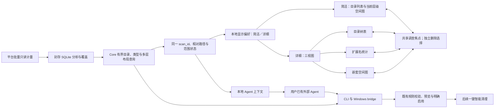
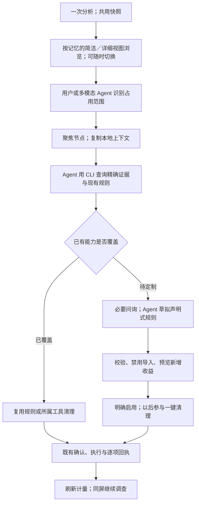
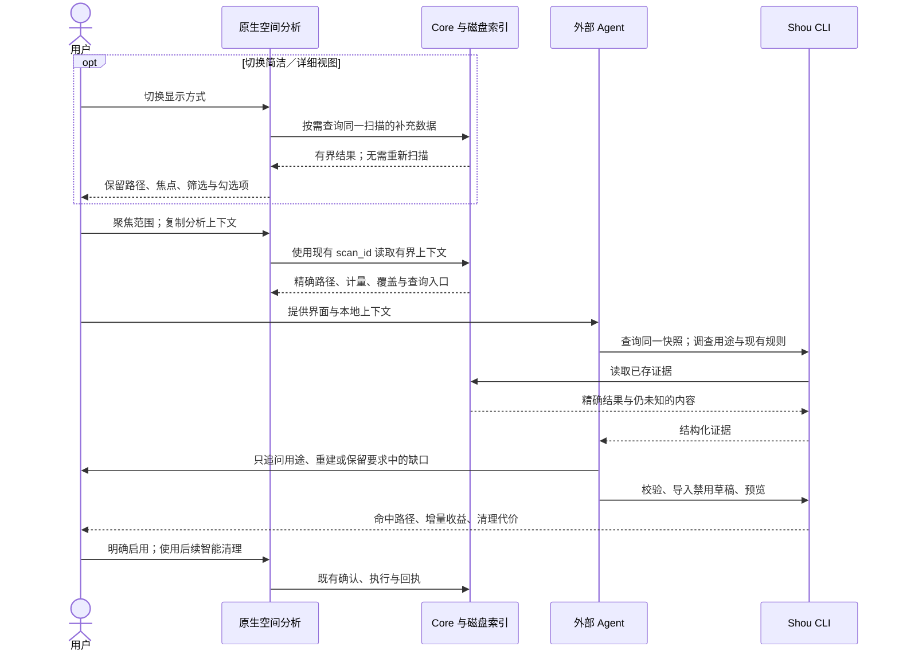
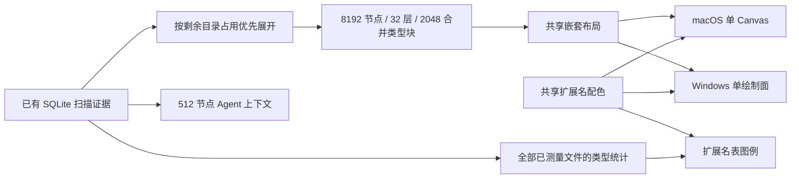
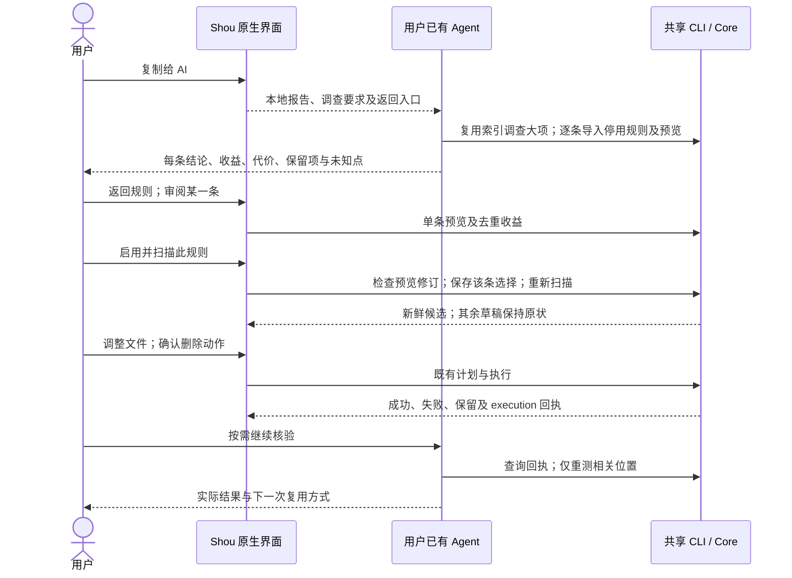

# 空间分析与 Agent 协作设计

[English](../../engineering/space-analysis-agent-design.md) | 简体中文

日期：2026-10-21。状态：共享查询、macOS 简洁／详细视图、Windows 对应界面及一键复制 Agent 分析结果已实现；逐项验收记录见文末。调研证据保留原始边界，未清理个人数据。

## 结论与用户价值

空间分析提供“简洁／详细”两种可切换视图，首次默认简洁，后续记住用户选择。简洁视图用于日常浏览与清理；详细视图通过目录树、文件类型统计与嵌套空间图回答“在哪里”“由什么构成”“哪些占用突出”。用户和外部多模态 Agent 可按需调查，再将发现转换为个人规则，参与后续一键清理。用户无需手写规则。

本机核验中，点击一个大空间块后，目录树自动展开到 Colima 的 `datadisk` 文件，显示逻辑大小约 **107.4 GB**、分配空间约 **52.8 GB**；“放大树图”将范围缩至其父目录。图能快速指出占用来源，随后由 Agent 查询所属工具及可清理内容，制定适用规则。数值来自参考应用当时显示，未独立核验其计量。

视觉发现与同一扫描的结构化证据应配合使用。当前“复制给 AI”仅写入本机剪贴板；下一阶段内置清理专用 Agent 复用同一扫描、规则预览与确认执行，见[接入设计](embedded-ai-investigation.md)。日常智能清理维持扫描、清理推荐项目和一次适当确认；空间分析是可选发现入口，不让用户逐个目录处理日常垃圾。

## 证据与研究边界

研究对象为本机已安装的原生磁盘分析应用，包版本 `1.0.0 (1)`，最低 macOS 12.0。可执行文件 SHA-256：`51a1a448a97566e10c3c1f9657c4313de7cd68793bcef5be53ce353eb4665ddb`。具体产物身份保留在本地原始证据中，该身份不代表签名或来源验证。

| 编号 | 来源 | 已确认 | 局限 |
| --- | --- | --- | --- |
| E1 | REA `inspect_macho`，`ev_f52cdc473c1948335289eaa14c76131c1c3c892f3a18e98ebdac35c241395226` | arm64／x86_64 通用二进制，链接 AppKit／SwiftUI，导入 `getattrlistbulk`，导出扫描／聚合／布局入口 | 符号存在不证明当前调用路径、默认线程数或性能 |
| E2 | REA `inspect_native_dispatch_metadata`，`ev_843e3a90d33deca94a8d7d9ccb746e257b4cfbc4e943a3972c9dc3d8d8b5392d` | 目录树是 `NSOutlineView` 子类、扩展名表是 `NSTableView` 子类、空间图是 `NSView` 子类；有绘制、输入、排序、菜单方法 | Objective-C 字段／Swift 一致性解码部分覆盖，泛型／resilient 等元数据不支持；未恢复源码 |
| U1 | Computer Use 观察既有结果页 | 顶部容量／耗时，左上树表、右上扩展名、底部嵌套空间图及层级标签 | 没有重新执行同条件全盘扫描 |
| U2 | 展开 Users、选择 `.js`、点击空间图大块 | 父子上下文保留，图命中后展开并定位精确文件，底部显示选择统计 | `.js` 行可选，但未明确观察到所有匹配块高亮，完整类型联动未知 |
| U3 | 空间图菜单与“放大树图” | 有复制路径、Quick Look、CSV、放大／缩小、名称／大小显示选项；放大后的范围可核验 | 未执行导出、删除或显示选项切换，菜单存在不等于完整验收 |
| S1 | Shou 源码阅读 | 下方现状与缺口 | 不替代运行验收 |

完整本地 Evidence 位于 `.build/space-analysis-reference-20261021/`：`macho.json`、`dispatch.json`、`overview.json`、`providers.json` 及派生符号清单。`runtime-observations.json` 单独记录 Computer Use 观察，不能称为 REA 运行时捕获。

可读 Swift 名称由 `xcrun swift-demangle --compact` 从 E1 导出符号派生，保留在 `exports-demangled.json`；这一步是普通工具处理，不是反编译结果。

原生概览返回 `provider_unavailable`，当前无可用 Hopper、已配置 Ghidra 或 IDA；独立 Mach-O／元数据分析成功。本次未取得反编译伪代码，未核验实际扫描调用链、布局实现或线程调度。CLI 调用已结束，没有遗留原生分析会话。

E1 的解码导出名可作为进一步追踪入口：`ScanEngine.parallelBulkScan(root:workerCount:)`、`pipelinedBulkScan(root:syscallWorkers:parseWorkers:maxInFlightDirectories:)`、`parallelScanToTree(roots:…workerCount:…progressCallback:…isCancelled:…)`、`FileNode.aggregateSizes()`、`groupedChildren(minGroupSize:)`、`subtractContributionFromAncestors()`、`squarify(_:metric:in:maxItems:)` 和 `computeExtensionStats(roots:colorBySize:extensionLists:)`。类型统计字段包含扩展名、逻辑大小、分配空间与文件数。

结合批量元数据导入，可以确认产物具备这些命名入口；是否用于当前卷、如何配置 worker、硬链接归属和索引复用均未验证。界面显示既有扫描 **337.36 秒**、约 640 万条目，不能据此宣称比 Shou 快。同根目录、权限、文件状态、缓存和负载的计时对照尚未建立。Shou 已有批量元数据和有界调度，应分别测读取、汇总、封存和首屏渲染。

卷已用量、树表分配总量、逻辑总量在参考应用中不同，原因未核验。Shou 必须区分实时卷容量、分析范围计量、规则命中估计及实际可用空间变化，并标明时间与完整性。

## 调研时的 Shou 基线与缺口

| 维度 | 已有 | 待补充 |
| --- | --- | --- |
| 目录 | 按需载入封存分析目录、排序／过滤／面包屑、列表与图选择联动 | 保留祖先的可展开多列表；数据库真分页。当前 `children(of:)` 先读取全目录，CLI 在数组上分页 |
| 空间图 | 当前直接子项的平衡分割；超过 160 块聚合余项 | 多层嵌套、范围放大、稳定图例、可读标签、有界多层查询 |
| 类型 | `analysis large-files` 按预设扩展名类型过滤已存证据 | 任意扩展名、无扩展名的全量及当前范围统计；大文件过滤不能代替全量类型汇总 |
| 身份 | `StorageScan.id`、根／相对路径、SQLite 父关系、逻辑／分配字节、完整性 | 三视图与交接共用同一快照与口径，无需另建全局节点 UUID |
| Agent | 目录菜单可打开 `AgentRuleSetupView`，含绝对路径与本地 Skill／CLI 入口 | 当前交接缺少 `scan_id`、范围计量与完整性，容易触发重复调查 |
| 规则 | Skill、机会发现、校验、禁用导入、预览、明确启用及桌面复用 | 接入空间分析证据，工具专属目标分流到已有工具清理能力 |
| Windows | WPF 目录表、`storage.scan`／`storage.directory` bridge | 同步三视图与 Agent 上下文，当前尚无等价空间图 |

源码职责：`apps/macos/Sources/StorageViews.swift`、`StorageSession.swift`、`AgentRuleSetupView.swift`；`packages/shou-core/Sources/StorageCatalog.swift`、`StorageOperations.swift`、`Treemap.swift`；`apps/cli/Sources/ShouCLI.swift`、`DesktopBridge.swift`；`apps/windows/Shou.Windows/MainWindow.xaml`、`MainViewModel.cs`。

## 实施改动清单

按 W02 → W03 → W04 的顺序接入，每一步均同步共享合同与 Windows bridge，W05 完成 Windows 原生界面，W06 验收完整流程。界面与 Agent 不各自实现目录统计。

| 顺序 | 修改职责 | 具体改动 | 完成标准 |
| --- | --- | --- | --- |
| 1 | `StorageCatalog.swift`、`StorageOperations.swift` | 目录查询下推排序和分页；增加精确节点查询、全量／范围类型汇总、有界多层节点查询。复用既有快照与硬链接计量，旧分析仍可读取 | Core 与 CLI 对同一夹具的路径、字节、完整性一致；大目录不先载入全量数组 |
| 2 | `Treemap.swift` 与共享合同 | 布局扩展为有父子关系的可见多层节点，返回聚合／省略信息；同面积预算内保持确定布局。查询与布局都支持取消 | 面积与计量一致；父子不重复累计；同输入布局稳定，零大小／极端长名称不破坏显示 |
| 3 | `StorageSession.swift`、`StorageViews.swift` 及拆出的原生控件 | 增加“简洁／详细”原生分段切换并记住显示偏好；共用范围、焦点、筛选及删除选择。详细视图使用 AppKit 树表／类型表和有界绘图，按需加载并联动 | 切换不重扫、不重置路径／焦点／选择；首次默认简洁、重开保留偏好；快速切范围无过期结果；完整清理流程可用 |
| 4 | `AgentRuleSetupView.swift`、CLI、Skill | 将当前分析 ID、范围与精确选中路径加入交接；导出结构化上下文。用共享服务查询已有规则覆盖，Agent 复用已有 Skill 校验／预览／明确启用 | 从界面选中一个构建目录，可用 CLI 查询同一结果并形成规则；启用后新进程及日常清理复用，无须重扫整盘 |
| 5 | `DesktopBridge.swift`、WPF `MainViewModel.cs`／`MainWindow.xaml` | 暴露相同只读查询与上下文能力；WPF 使用原生虚拟化树表、类型表和空间图，保持相同焦点／选择语义 | 共享合同检查通过；真实 Windows 验证原生交互及永久清理完整流程 |

实施时优先扩展现有 `analysis children`，新增操作只覆盖精确节点、类型汇总、多层图数据及上下文四项实际需求。具体命令名与输入由 W02 固定，现已同步 `capabilities`、输入 Schema、分页、错误和 bridge；当前已交付合同见文末。视觉短标签和路径都解析至既有 `(scan_id, relative_path)`。

详细视图初始建议采用可调节的上下分栏：上部约 60% 高度，目录树与类型表约 2:1 宽度，下部约 40% 为全宽空间图；比例是待实测的初始值，适配小窗口时类型表可收起。扫描完成按记忆的显示方式进入结果页，清理后回到原范围与视图，刷新更新计量。Agent 操作复用现有交接面板；新查询、控件与状态仅按实际职责拆分。

## 界面与用户故事

在现有空间分析页内完成，不增加顶层任务页面；复用紧凑导航和底部删除操作。

- 原生工具栏提供“简洁／详细”分段控件。简洁视图保留清楚的目录列表、占用大小和当前层级空间图；详细视图按需展开以下三块内容。两种视图都可直接清理和交接 Agent，不把详细视图绑定为 AI 专用模式。
- 详细视图上部左侧：原生可展开目录树表，默认名称、占父项比例、分配空间、文件数；逻辑大小／目录数／修改时间按需展示。比例分母明确。
- 详细视图上部右侧：当前范围的扩展名统计，含图例、占比、分配空间和文件数；无扩展名单列。
- 详细视图下部：全宽嵌套空间图，保留目录边界与层级名称；大块显示名称／大小，小块聚合且可继续展开。图命中定位树项，双击目录聚焦，面包屑返回。
- 顶部仅保留磁盘／目录、扫描／刷新、测量时间、范围计量及覆盖状态；实时卷容量另有标签。
- 颜色用于类型或目录分类，文字／图标表示清理资格；不能用同一颜色同时暗示“类型”和“可删”。名称中间省略，保留末尾名称／扩展名，详情提供精确路径。
- 点击改变调查焦点，勾选改变删除选择。类型选择先高亮／筛选，不自动勾选全部文件；既有全选与永久清理可继续使用。
- “复制给 AI 分析”复用现有 Skill 引导，将当前范围的本地上下文交给已有 Agent。

切换仅改变展示，不触发新扫描或文件修改。当前路径、焦点、搜索／类型筛选和勾选项共用同一状态；详细视图存在的活动类型筛选，在简洁视图中显示为可清除的筛选标签，避免隐藏条件影响结果。简洁视图可见项若是已选深层文件的祖先，显示部分选择状态；底部持续显示全部已选数量／容量。

显示偏好保存在本机，恢复视图时仍需当前有效扫描，不把上次已选删除目标持久恢复。详细视图首次展开时异步加载类型汇总与多层图数据；数据按扫描和范围缓存，切回简洁可取消不再需要的请求。模式本身不改变共享 Core 的计量／清理语义或 CLI 输入。

开发者故事：用户发现多个工程的构建产物占用突出，聚焦其中一处交给 Agent。Agent 查询路径、现有规则与构建配置，只询问尚不明确的重建代价和保留要求，生成可复用模式。一次启用后，后续智能清理覆盖同类项目，无需逐个处理。

扩展名只提供线索：`.js` 可能是源码、依赖或应用资源，`.sqlite` 可能保存用户数据。图用于发现值得调查的范围，规则预览用于说明确切命中与新增收益。虚拟磁盘等工具管理目标需查询其内部资源，面积大不代表应删除整个文件。

## 建议架构

以下记录设计依据；已经实现的查询、CLI 与 bridge 合同及验收状态见文末。复用 `ShouEngine` 与同一磁盘索引，避免新增平行扫描器。



Core 负责查询、聚合与布局数据。macOS 密集表格优先使用 AppKit；空间图先验证单个绘制视图及缓存布局／图像，避免为每个磁盘文件创建 SwiftUI View。Windows 使用原生 WPF 消费同一合同。最终渲染方案由实际交互采样决定，不从第三方类名推断全部策略。

全局类型统计复用已测量文件；范围统计异步、可取消、有缓存，不因 hover 重扫。多层查询限制深度、节点数和绘制面积，说明省略数量与聚合项。父目录已含子项，不重复相加为收益。硬链接归属、逻辑／分配空间和 partial 下界沿用同一快照。

## 流程与 Agent 合同



建议交接字段：合同版本、`scan_id`、根路径、分析时间、当前相对范围、精确选中路径、逻辑／分配字节、文件数、完整性、计量口径及可直接运行的只读命令。视觉短标签映射到 `(scan_id, relative_path)`，视图变化后过期标签不得指向另一文件。可用 `view_revision` 区分删除后尚未刷新等显示状态。

目前可复用的命令：

```sh
shou analysis summary --scan-id "storage_…" --json
shou analysis children --scan-id "storage_…" --path "projects/demo" --limit 50 --json
shou analysis large-files --scan-id "storage_…" --minimum-bytes 52428800 --limit 100 --json
shou rules validate --file "/absolute/path/rule.json" --json
shou rules preview --file "/absolute/path/rule.json" --workspace "workspace_…" --json
```

路径／ID 为示例，实际使用返回值。空间分析无需 workspace，规则预览使用已登记 workspace。`rules opportunities` 当前读取规则工作区的完整扫描，不能输入 `storage_…`；应通过共享 Core 增加空间节点规则覆盖查询，避免为衔接功能重扫整盘或要求用户管理 workspace。`analysis children` 尚不含完整文件身份，`analysis large-files` 的 `entry` 才含身份字段。本轮新增 analysis map（范围节点及扩展名汇总）和 analysis context（同一扫描证据及可直接粘贴的请求），现有 analysis children 已改为数据库分页。树图有界数据不是完整删除清单。



## 分阶段跟踪与验收

| 阶段 | 内容 | 状态 | 验收条件 |
| --- | --- | --- | --- |
| W01 | 产物身份、元数据、交互及源码对照 | 完成所列范围 | E1／E2、U1–U3 与未决问题明确；未取得反编译结果 |
| W02 | 树表、类型汇总、多层查询合同 | 已实现；共享合同测试通过 | 同一扫描、任意／无扩展名、硬链接、partial、真分页、取消与旧分析兼容 |
| W03 | macOS 简洁／详细切换与聚焦 | 已实现；本机关键交互通过 | 默认与记忆、无重扫切换、状态／筛选／部分选择保留；排序、键盘、缩放、返回、中间省略、辅助功能；1024×768 与宽窗口可读 |
| W04 | 当前扫描的 Agent 上下文与 Skill 闭环 | 已实现；CLI 与 Skill 校验通过 | 视觉引用可精确解析，同名目录无混淆，覆盖复用快照；规则启用后新进程与日常清理复用 |
| W05 | Windows 原生同步 | 已实现；交叉构建通过，真实 Windows 交互待验收 | 同合同与计量；简洁／详细切换、状态保留、选择、交接在真实 Windows 验收 |
| W07 | 密集配色与排版修正 | 已实现；macOS 原生关键显示与拖动通过 | 磁盘根范围深层文件、类型与图例同色、紧凑表格及原生界面核验 |
| W06 | 性能、失败与完整清理回归 | 生成夹具回归与百万条查询通过；完整性能指标待测 | 大目录／百万条目、快速切范围与取消、内存有界；生成夹具删除、失败重试、完成返回、刷新一致 |
| W09 | 大占用调查与逐条规则清理闭环 | 已实现；确定性回归与 macOS 所列交互通过，外部 Agent 判断质量待验收 | 主要占用深入调查；独立规则预览、启用、扫描、确认、回执与剩余核验 |
| W08 | 全盘目录读取阻塞 | 待修复；已保留线程采样 | 定位阻塞目录；隔离超时读取；取消及时回收工作进程；不能将未读范围报为完整 |

性能验收目标：已有快照的焦点／高亮 p95 ≤100 ms；范围查询在后台运行且可取消，100 ms 内显示加载反馈；每帧绘制工作有界。需记录环境、目录规模与冷／热缓存，分别测首屏、查询、扫描。这些是目标，不是当前性能结论。破坏性测试使用生成数据。

外部多模态验收使用虚构目录名的生成树：识别最大分配空间，沿层级找到构建产物，区分源码与依赖，识别工具管理的虚拟磁盘，通过上下文取得精确路径。分别记录视觉识别与 CLI 核验；未选择并评估真实外部模型前不承诺成功率。

## 鸣谢

第三方原生磁盘分析工具的目录树、扩展名统计及嵌套空间图交互为本次设计提供参考。Shou 将独立实现原生视图与共享查询，不分发第三方二进制、资源或恢复代码。既有[设计鸣谢](reference-design.md)继续适用。

## 本轮落地合同

- 简洁／详细使用同一 StorageSession，首次简洁，本机仅保存视图偏好。详细页是 AppKit 虚拟目录树、原生扩展名表与单个 Canvas 绘图；点击空间图定位树项，双击目录调整范围；勾选用于删除，焦点用于调查。
- 多层查询按占用优先展开大目录，最多 8,192 节点、32 层、每个目录前 256 个子项；小于当前范围 0.001% 的分支留待进入目录查看。剪贴板上下文使用独立的 512 节点预算，避免报告挤占 Agent 上下文；未绘出空间形成“其他项目”。目录树展开按 200 条分页继续读取。类型表统计范围内全部已测量文件，保留前 100 个扩展名并报告剩余汇总。目录自身空间不混入文件扩展名统计。
- 扩展名选择用于高亮；切回简洁仍显示可清除的活动扩展名标签。名称过滤和排序、浏览路径、调查焦点、删除选择不会因切换重置。局部选择显示 mixed。
- 两种视图的“复制给 AI”直接写入本机剪贴板，含版本、计量口径、扫描时间／状态、范围、目录节点、逻辑／分配大小、文件数、类型统计、完整路径、选中／已移除路径及 CLI／Skill 入口。没有模型调用、自动上传或自动清理。
- CLI 新增 analysis map、analysis context；context 返回结构化 context 与可粘贴 text。字段使用 snake_case。analysis children 保持游标格式，排序／LIMIT／OFFSET 下推 SQLite；旧版分析仍可读取。目录排序索引仅随新扫描封存创建，不原地迁移旧快照。
- Windows bridge 同步 storage.map、storage.page、storage.context；storage.remove 将显式路径送入既有 fresh-manifest 计划、一次确认、执行及回执流程。Windows 只读请求沿用可取消进程通道。当前 Mac 环境可交叉构建与协议测试，不能替代真实 Windows UI 验收。
- 一键复制不证明规则覆盖。Agent 先查询现有规则；内置 Skill 已说明 storage 扫描不能传给 workspace 专属的 rules opportunities。规则仍需禁用导入与预览。
- 清理后的图与树会移除成功项；扩展名表提示刷新，复制数据记录 removed_paths。刷新前的原始汇总不能作为当前可回收容量。

~~~mermaid
flowchart LR
    Snapshot[已有 StorageScan 与 SQLite] --> Query[目录分页／有界多层／范围扩展名与合并类型块]
    Query --> Simple[简洁列表与空间图]
    Query --> Detailed[目录树／类型表／嵌套空间图]
    Simple --> Copy[一键复制给 AI]
    Detailed --> Copy
    Copy --> Clipboard[本机剪贴板：JSON 事实与分析请求]
    Clipboard --> External[用户已有 AI Agent]
    External --> Read[CLI 复用同一扫描并查询规则]
    Read --> Draft[校验／禁用导入／预览]
    Detailed --> Selection[独立勾选清理范围]
    Simple --> Selection
    Selection --> Review[新鲜清单与一次确认]
    Review --> Receipt[删除／逐项回执／返回]
~~~

~~~mermaid
sequenceDiagram
    actor User as 用户
    participant UI as 两种原生视图
    participant Core as 共享 Core
    participant Index as 已发布索引
    participant Clipboard as 本机剪贴板
    User->>UI: 点击复制给 AI
    UI->>Core: scan_id、scope、焦点、选择、已移除路径
    Core->>Index: 查询有界节点与范围类型汇总
    Index-->>Core: 同一扫描证据
    Core-->>UI: 本地化请求与结构化事实
    UI->>Clipboard: 写入文本
    UI-->>User: 已复制
    Note over User,Clipboard: 用户自行粘贴给已有 Agent；Shou 不调用模型
~~~

## 2026-10-22 验收记录

环境：Apple M1、8 个物理核心、arm64、macOS 15.7.3。以下性能值来自 Debug 构建、生成索引、封存后的本地首次查询；不能代表冷缓存全盘扫描或 UI p95。

| 检查 | 结果与边界 |
| --- | --- |
| Core 全套 | 234/234；新增范围／类型／分页／上下文、硬链接与旧格式一致性、取消及面积检查 |
| 定向回归 | 3/3 呈现与选择、4/4 空间删除；7 万行选择及过滤取消选择约 0.24 秒 |
| 百万条查询 | 1,000,005 个生成文件行；多层数据及全量扩展名汇总约 0.895 秒，返回 64 节点；末尾页约 0.083 秒 |
| CLI | 158 项合同检查、23 项空间分析、34 项大文件检查通过 |
| 桌面协议 | 同一扫描图／类型／上下文／分页，以及取消、确认永久删除、保留兄弟文件、历史与回放拒绝通过；只变更生成数据 |
| macOS 实际界面 | 首次简洁；重启记住详细且不恢复删除勾选；勾选后切详细；展开目录；扩展名高亮；返回简洁保留选择与活动类型；图块点击展开树并定位 package.js；永久删除审阅与取消返回；取消父项覆盖的子项正确收敛 |
| 真实剪贴板 | 在原生文本编辑器粘贴核验扫描 ID、完整范围、选中路径、类型状态、计量口径、CLI 与 Skill 入口；证据存于构建目录 |
| Windows | WPF 交叉构建 0 警告／0 错误；11 项进程通信检查通过。真实 Windows 布局、键盘、完整选择语义及清理后的原生交互仍待专机验收 |
| 文档与语言 | 84 份 Markdown、643 个本地链接；11 种 README；1388 个中英文原生文案键；Skill 校验通过 |

证据位于 .build/presentation-*.log、.build/presentation-million.log、.build/presentation-final-install.json 与 .build/analysis-copy-verification.rtf。安装工具核验包签名及文件内容，并比对安装前后的本地记录，覆盖安装不保留旧应用。

仍未声明完成：真实 Windows Computer Use 验收、所有窗口尺寸／辅助技术组合、UI p95 和冷／热全盘扫描对照、外部多模态模型识别效果、Claude Code 与 WorkBuddy 独立客户端运行。本轮没有引入模型调用来代替这些验证。


## 密集分析视图修正，2026-10-22

原先三层／512 节点查询在磁盘根范围尚未到达文件，目录又统一为中性色，导致整个图几乎全灰。新查询按分配空间优先沿深层目录展开，保留节点、深度和每目录预算，不重扫文件系统。省略文件按最近显示的祖先目录及真实扩展名汇总，最多增加 2,048 个合并色块；名称显示类型和文件数，点击定位所属目录，合成标识不作为删除路径。未绘出部分及目录元数据仍保留中性面积，可通过目录分页或进入目录继续查看。扩展名汇总仍覆盖范围内全部已测量文件，不受绘图抽样预算影响。

上部约 60% 为联动的 AppKit 紧凑表格，行高 19 pt；目录包含名称／图标、父级占比、分配／逻辑大小、文件数及修改时间，扩展名包含共享图例、范围占比和大小。窄窗口支持横向滚动。下部约 40% 为深色嵌套空间图，目录标题高 13 pt，细边界保留层级，较大文件显示名称／大小。真实文件按扩展名使用共享颜色和双向渐变，目录和省略项使用中性色。活动类型红色描边，调查焦点白色描边，明确勾选的删除项目青色描边；任何高亮都不自动选择文件。压缩表头、说明和操作栏空白，分栏仍可拖动。

Windows 使用 Core 的布局、深度和 `storage.map` 返回的同一 `colors` 映射，图例与文件同色，目录保持中性；同步紧凑列和渐变。macOS 只有一个 Canvas，Windows 只有一个绘制面。剪贴板上下文保持独立的小预算，不接入模型，不分发第三方资产。



本次修正由 W07 跟踪。原生界面已核验首次布局 60:40、分隔线拖动、类型高亮与无重扫切换，并已覆盖安装；回归证据见下文。真实 Windows 交互仍待对应设备验收。

扩展名表与合并色块复用同一次只读索引聚合：递归目录归属将文件分配给最近显示的目录，再输出合并块及全量类型汇总，避免重复遍历索引。未修改 SQLite 持久内容或新增文件扫描。剪贴板报告保留独立的小预算。

### W07 回归证据

- Core 234/234、CLI 合同 158、空间分析 23、大文件 34 及桌面协议检查通过。百万行生成索引返回 256 个真实节点和精确类型合并组，多层数据／完整类型查询约 1.335 秒，末尾页约 0.101 秒；这是 Debug 索引查询，不能代表冷盘扫描性能。
- `scripts/test.sh` 首跑在应用批量卸载专项因生成选择缺少组件而退出；该专项独立重跑 19/19 通过。后续隐私 16、缓存 13 和原生 TTY 清理／恢复专项分别补跑通过。保留首跑失败记录，不将其描述为一次全绿的整套执行。
- Windows 交叉构建零警告、零错误；11 项进程通信检查通过。真实 Windows 交互仍待验收。
- 真实开发目录范围已完成分析，已统计分配空间 122.44 GB；类型高亮联动已验证，未自动加入删除选择。后续比例修正采用首次布局 60:40，保留原生拖动调整。

证据：`.build/space-colors-final-tests.log`、`.build/space-colors-app-batch-retry.log`、`.build/space-colors-privacy-final.log`、`.build/space-colors-cache-final.log`、`.build/space-colors-native-cli-final.log`、`.build/space-colors-million.log`、`.build/space-colors-windows.log`、`.build/space-colors-windows-checks.log`。

### W08 已知阻塞与后续验收

全盘原生验收期间，扫描计数停在 3,066,212。真实读取工作进程的多次线程采样显示，多个并行目录读取线程停在 `openDirectory → _fcntl_overlay_open → __open`；不能据最后进度路径断定实际阻塞目录，也未证实是权限、文件系统或特定应用导致。现有工作进程只有整体期限，尚缺逐目录阻塞隔离。

已停止该次扫描并保留 `.build/space-colors-scan-worker.sample` 和 `.build/space-colors-sample.log`。停止界面可响应；另一次真实开发目录分析返回可查询的部分索引，约 146.62 GB 为已测下限。这些结果不能证明完整开发目录或全盘扫描已通过。W08 需补充精确读取诊断、有界阻塞隔离、超时后的不完整范围标识、取消与工作进程回收，再进行同条件冷／热扫描和阻塞注入验收。本次配色排版修正没有改变扫描器或系统权限。


## W09：大占用调查与独立规则闭环

复制交接要求外部 Agent 优先调查主要占用，沿大目录查询到所属工具、具体用途、是否活跃、重建方式、代价与保留条件。未能判断的大项继续列出未知点及下一项诊断；不能用容易清理的小缓存替代这项调查，也不能按大小、扩展名或目录名判定可删除。Shou 提供同一扫描的证据、分页与类型工具查询；外部 Agent 的判断质量仍需真实客户端验收，不因增强提示就宣称自动识别准确。

每个规则 ID 对应一个独立清理决策。用途、重建代价、活跃限制、保留条件或用户选择不同，就拆成不同规则；同一软件的构建缓存、离线依赖与个人数据不能捆绑。相同策略的同类项目可以共用模式。每条分别列出命中、保护／不满足条件、增量收益与重建说明，默认导入为停用草稿。多个预览的重叠收益不能相加。

macOS 复制后显示“审阅 AI 规则…”返回入口；重新激活应用时读取外部配置修订，更新规则并使旧清理扫描失效。规则变化提供全局返回提示。“规则 → 个人规则 → 审阅并清理…”打开单条原生审阅，复用 Core 的预览、条件说明和收益去重。用户可保留当前选择，或“启用并扫描此规则”；后者只启用该 ID／版本，重新扫描其可清理范围并准备可调整的文件选择，随后进入既有永久删除／废纸篓确认。其他草稿不受影响；预览配置已变更时要求重新预览。

Windows 同步逐条预览与启用扫描、外部配置刷新和返回规则入口。`rules.preview` bridge 返回行、条件、收益及配置修订；带 `rule_ids` 的 `scan` 使用同一 Core 的清理扫描。跨平台共享规则和执行服务，不新增模型、Agent 或平行删除器。




完成标准：至少两条不同保留策略的规则分别预览，只启用其中一条；新进程复用该选择，生成夹具实际删除后回执、目标不存在、另一条文件哈希／内容保留以及后续扫描一致。原生界面核验审阅、关闭、启用扫描、调整选择与确认取消。无需调用外部模型验证确定性执行；Agent 分析准确度另行评估。

### W09 验收记录

- 最终 Core 235/235 通过。新增用例分别预览两条规则，仅启用可重建产物规则；新引擎的日常扫描复用该条选择，永久删除生成目标后验证 `purged` 回执、目标不存在、离线依赖内容保留及后续扫描一致。
- CLI 合同 158 项、桌面协议集成、Windows 11 项进程通信检查通过；WPF 交叉构建零警告、零错误。单条预览不启用规则，显式 `rule_ids` 扫描范围经过 bridge 检查。
- macOS Computer Use 验证单条命中与新增收益、展开范围、关闭保持停用、仅启用此规则、重新扫描、取消／重新勾选、进入永久删除确认及取消。其他草稿保持停用；测试规则已恢复原状态，生成文件及保留项内容核验后归档到构建证据。
- 最终安装版验证“复制给 AI”成功后出现“审阅 AI 规则…”，返回时直接显示个人规则。目录选择使用原生面板。此次原生删除确认被取消；真实删除由隔离夹具测试覆盖，没有删除个人文件。
- 本会话 Codex 通过已安装 CLI 复用真实开发目录索引逐层调查，定位一个隐藏工作目录约 89.25 GB 的已测占用，并继续区分候选工作副本、发布副本中的 Rust `target` 和独立 `debug` 构建目录。该树整体为 `partial`，数字是扫描时估计，不能相加为可释放空间；活跃状态、可重建性与保留期限尚需进一步核验，因此没有导入真实清理规则。
- 本地 Release 应用包及签名校验通过，0.10.0 已覆盖安装到 `/Applications/Shou.app`：138 个文件校验，132 条既有记录保留，`backup: null`。本地临时签名的发布限制不变。

证据：`.build/agent-cleanup-loop-final-core-tests.log`、`.build/agent-cleanup-loop-cli.log`、`.build/agent-cleanup-loop-bridge.log`、`.build/agent-cleanup-loop-windows-final.log`、`.build/agent-cleanup-loop-windows-checks.log`、`.build/agent-cleanup-loop-final-release.log`、`.build/agent-cleanup-loop-final-install.json` 和 `.build/agent-cleanup-loop-*.json` 的只读下钻记录。文档、1404 项双语资源和 Skill 校验通过。真实 Windows 界面、外部 Agent 的调查质量与完整全盘性能仍待对应验收。
