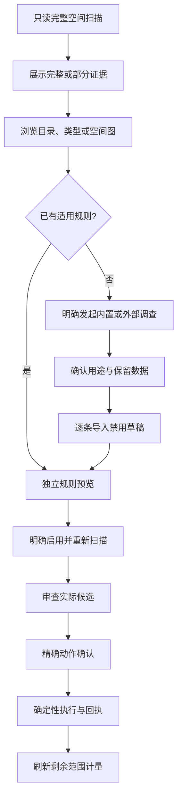

# 空间分析与规则调查

[English](../../engineering/space-analysis-agent-design.md) | 简体中文

## 用户流程

空间分析提供同一扫描的简洁和详细视图，切换时保持目录、选择与焦点，不重新扫描。详细视图组合目录表、文件类型汇总和有界多层空间图。当前目录面包屑、覆盖状态与重新计量动作清晰可见，不重复展示标题。

初始上下分区为 60:40，允许调整。类型高亮与图表选择采用稳定身份和一致配色，辅助功能与悬停可读完整路径。使用有界几何和虚拟化表格，避免为每个磁盘文件创建 UI 控件。

## 领域与界面职责

Core 负责保存结果查询、计量、父子选择规范化、阻断原因和有界空间图几何。UI 负责视口、密度、焦点、类型高亮与显示路径缩短。外部 Agent 上下文单独限制预算，不扩大清理权限。

macOS 使用 Swift Core 与原生绘图、表格视图。Windows 规划为 C# Core、Presentation 和 WinUI 界面，通过本平台服务实现相同产品行为。见[Windows 方案](windows-native-plan.md)。

## 实施清单

| 项目 | 必需行为 |
| --- | --- |
| W01 | 目录、类型和空间图共用同一扫描查询合同 |
| W02 | 简洁、详细切换不重扫、不丢选择 |
| W03 | 有界上下文导出，包含精确 CLI 与规则 Schema 引用 |
| W04 | 独立规则草稿与只读收益预览 |
| W05 | 各平台原生绘制、键盘和可访问性 |
| W06 | 计量、分页、取消与当前证据校验 |
| W07 | 深层文件展示、一致类型配色与可调分区 |
| W08 | 有界目录读取、部分覆盖和取消后复用 |
| W09 | 逐条启用、重新扫描、明确执行与剩余范围核验 |

## 验收

使用生成的深层、宽目录、Unicode、硬链接、排除和过期夹具，对照列表、空间图计量、实际所选范围、分页与取消。部分全盘索引不能证明完整覆盖，绘制检查不能证明扫描性能。外部 Agent 质量、原生 UI、破坏性执行和分发分别取证。
