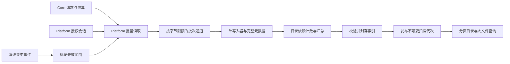
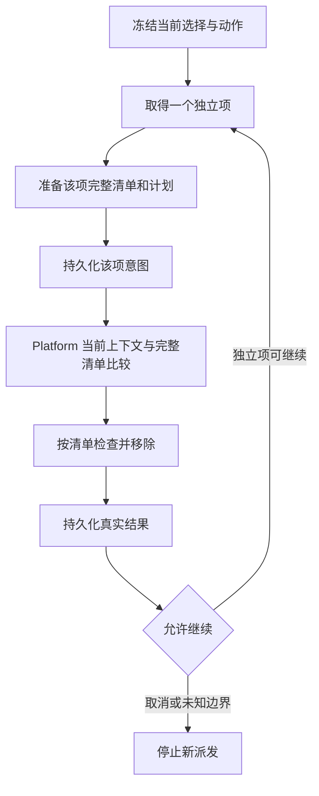

# 扫描与删除性能架构方案

[English](../../engineering/storage-performance-architecture.md) | 简体中文

日期：2026-10-29。状态：架构方案与首批实施记录。首批减少重复证据处理，后续流水线、并发、增量索引及 NTFS 方案仍待实验；没有 Windows 性能验收结果。事实依据、固定提交源码及官方资料见[调研报告](storage-performance-research.md)和[共享证据清单](../../engineering/storage-performance-evidence.json)。

## 决策与范围

保留 Swift Core／macOS Platform 和 C# Core／Windows Platform，统一产品与安全合同，各自实现系统能力。采用“完整证据只保存一次，浏览投影按需查询，读取与写入有界衔接，重复分析通过可失效增量减少工作”的路线。

不先重写语言，不先更换 SQLite，不恢复整批现场预检。优先完成可单独衡量的小改动；只有观测证明流水线或并发值得投入，才增加相应复杂度。所有收益数值先作为实验门槛，验收后才成为产品声明。

范围覆盖空间分析、大文件、规则清理、应用组件与卸载残留、开发项目／工具的文件发现和清单处理。浏览器数据库删除、包管理器、MSI／MSIX、启动项等系统操作使用各自合同，只复用授权、诊断和日志基础能力，不能换成通用递归删除。

## 首批实施边界

- 有 catalog 的 macOS 空间扫描停止重复内联明细，保留完整 catalog 和准确计数；已审计浏览、审阅、比较、CLI 与 AI 消费者，旧内联记录继续可读。
- 新 catalog 不再维护当前遍历未使用的扫描期目录索引，减少中间写入和最终文件中的空闲页；最终查询索引及格式不变。实测只支持目录密集 catalog 缩小，未证明扫描耗时改善。
- 空间删除首次写历史时复制本次操作已验证的计划页，复制前重查摘要；历史仍拥有独立存储与保留周期，省去再次 JSON 编码。没有引入共享物理页、引用 GC 或新格式。
- 共用清单分页编码使用固定字段名和数组切片，省去逐条 snake-case 转换与分页数组复制；要求输出与旧编码逐字节相同，详情见[数据模型](../architecture/data-model.md)。
- 共享 macOS 原生永久删除对普通单链接文件合并相邻重复 `fstatat`，保留紧邻 `unlinkat` 的完整比较；硬链接、目录、链接和祖先检查保持原合同。
- Windows 清理进度总数只计算一次，累计已移除条目，避免每个回调重新遍历全部计划目标；不是 Windows 原生删除算法提速实测。
- Windows 完整扫描在 Core 内限制进度发送：首条即时、其后每 128 条检查 250 ms 间隔、返回前补齐准确计数。取消仍逐项检查，观察者普通异常不丢弃扫描证据；没有改变定向规则扫描的累计语义。
- 删除收尾事件不再携带分析根路径；两端展示层只显示冻结目标及后代，避免把卷根误显示为删除目标。

这些改动沿用现有 Core／Platform 接口和分页机制，详细数据合同见[数据模型](../architecture/data-model.md)，实测和验证状态见[性能记录](storage-scan-performance.md)。没有将候选流水线或增量能力预建为空壳。

## 必须保持的合同

- 默认永久删除及精确选择审阅不变；选中、推荐、缓存命中和系统管理员会话都不等于长期删除许可。
- 确认后按独立项准备／核验／执行并报告结果。取消整批前置现场校验不等于取消每项变更前完整清单比较。CLI 的严格计划边界保持原合同。
- 完整列表、历史比较需要完整明细；浏览时的部分结果、增量派生索引和事件记录不能直接授权执行。
- 当前根、祖先挂接、所有者、排除、策略、对象身份与清单仍须按合同核验；不跟随链接，不移除清单外新增内容。
- 每项变更前持久化意图。未知结果、日志失败、根范围失效或授权取消停止新派发，不能自动重放。独立已知失败按现有平台合同处理，不扩大失败后的执行资格。
- 统一 Platform 授权会话复用现有认证，不让枚举、每个文件或每个 worker 重复请求密码；会话丢失只报告真实边界，不重放已派发的变更。完整磁盘访问、管理员访问和业务确认仍分别核验。
- Windows 公开变更门禁保持关闭，直到对应原生验收通过；不能把 Mac-host .NET 测试算成 Windows 原生性能证据。

## 扫描数据流

一次把 catalog schema、封存索引和收尾合并为单事务的 Release 实验未测出收益，已撤回。两种生成负载的五组交替对照保留全部字段与汇总一致性；文件密集扫描中位数为 0.382／0.396 s，目录密集为 0.299／0.302 s。不能依据少一次提交推断实际提速。完整实验与限制见[性能实测](storage-scan-performance.md)。

状态／写入分锁的确认组出现文件密集约 7% 退化，目录密集改善约 16% 且范围重叠，也已撤回。检查点原本已按 128 条批量执行；没有为相同工作添加第二套机制。是否增加独立 writer 通道仍需实际工作负载证据，不因理论上可并行就视为准入通过。

这是目标数据流，不表示当前代码已有独立批次通道。第一阶段保留现有调度器，测清锁等待和分配成本再决定是否拆分。

### 完整元数据与浏览投影

继续保存每个观察条目的稳定身份、容量、必要时间、权限／所有者、条目类型和覆盖。使用父 ID＋basename 表示路径，路径仅在查询或边界操作时构造；macOS catalog 已部分实现，先复用现有格式。目录汇总是投影，不必为 UI 再构造全文件对象树。

首批已对有 catalog 的新扫描只发布根、catalog 引用、精确计数和覆盖摘要，停止不超过 10,000 条时的第二份内联明细。已审计 `StorageScan.tree.entries` 消费者：目录浏览、选择、历史比较、CLI 和 AI 使用已有 catalog 查询，相关测试改为从 catalog 取明细；无 catalog 或旧 inline 记录仍走现有读取路径。

不在本阶段引入“快速概览”模式。若后续另行提供目录汇总／top 文件模式，必须有独立能力标识，不能替换现有完整文件浏览或历史比较，不能静默降级。

### 批次所有权、背压与完成依赖

候选改动：Platform reader 把一页或一个紧凑批次交给单 writer，writer 独占 catalog，不再占用调度／错误状态锁执行逐条 SQL。批次携带父 ID、必要完整字段及目录发现事件，不复制完整路径树。

队列同时限制条目数和实际字节，目录待办也有独立配额；不能只限制八个活跃 worker，却积压无上限 closure、路径和数组。单宽目录只分批消费，不先收集所有孩子。队列满时需要让生产者暂停；writer 失败、磁盘满或取消必须唤醒阻塞生产者并 join 工作，不能死锁或发布截断为完整。

父目录以 pending 子任务计数跟踪完成，只在自身枚举、所需子结果与身份收尾均结束后汇总。关闭队列和封存由一个生命周期拥有者负责，不能让所有 reader 阻塞等待只有 reader 才能派发的汇总／写入工作。调度参数先测试，不把跨项目的 100 条容量或固定线程倍数照搬为默认值。

writer 在批次确认中返回新目录 ID，再由调度所有者派发子目录；不持有读取器槽等待后代结束。目录待办达到资源限额时，按现有预算语义产生明确部分覆盖或中止，不能让全部 worker 阻塞在子任务入队。队列限额不代表整个扫描恒定内存：名称去重、身份关联和完整证据仍需要单独计量与预算。

SQLite 保持单 writer、预编译语句、事务和封存后发布。先测消除临时绑定数组、批量目录更新和合适批次大小；不默认加入多 writer 或 WAL。派生索引任何损坏均可丢弃重扫；执行日志持久性不随索引调优改变。

### Windows 同步实现

C# Core 保留 Windows 路径和覆盖决策；Platform 负责句柄元数据、批量枚举、记录存储及统一授权。先建立可流式写入／查询的扫描存储小接口，让 `StorageScanner` 不必同时持有所有观测和多个全量路径集合。应用和 CLI 通过同一服务查询。

复用 `WindowsFileSystem` 已有的容量 128 目录 Channel 和授权传递，不再为相同边界新增一层队列。需要增加的是跨目录预算协调和存储消费，线程池、原生 scheduler 与新 writer 的等待关系需一起验收。

具体存储先以 Windows 独立 SQLite 原型评估写入、索引、私有 ACL 和部署成本；共享字段语义与夹具，不要求直接打开 Swift 的 SQLite 或使用相同 File ID 二进制布局。现有 `NativeDirectoryReader` 只暴露名称，新增批量元数据字段必须验证信息类、长度和句柄事实；owner、link、reparse／placeholder 等必要补读不能因“已批量枚举”而删除。

## 不可变清单的保存与生命周期

首批保留计划页和历史页分属 collection，首次历史保存复制经校验的原始页字节，省去重复编码，**不让回执依赖可能过期删除的计划文件**。加载与复制期间均校验页面，全部历史页写入后才发布日志；变更过的清单回退到编码。以下共享物理页与 GC 仅为后续候选，没有实施。

优先评估复用当前分页编码的共享清单存储，不先自定义压缩二进制协议。若最小引用方案不能消除足够成本，则保留原状，避免为小收益增加迁移工程。

| 时点 | 要求 |
| --- | --- |
| 准备 | 流式编码／hash 页面，保存精确数量、顺序和必要身份；页面完整落盘后再发布计划引用 |
| 加载 | 校验父记录绑定、页序、计数、摘要和路径顺序；单次操作内复用已验证的不可变页，禁止跨操作缓存“授权有效” |
| 执行意图 | 同一变更租约内将清单依赖登记给回执并持久化 `purging`／对应意图；确认依赖存在后才允许变更 |
| 结果更新 | 只更新小状态记录，保留实际结果；日志失败留未知边界并停止新派发 |
| 保留／GC | 从活跃计划、全部保留回执、恢复依赖和未完成意图标记可达页，再清理不可达页；活动租约保护引用发布窗口 |
| 崩溃 | 悬空未发布页可回收；引用缺页按损坏拒绝；已持久化意图不能因计划过期而丢证据或重新执行 |

摘要相同不是授权相同：父记录仍绑定 scan、plan、item、动作、策略和期限。页面复用不能把一份合法清单嫁接到另一个未经确认的目标。Windows 按相同语义实现自己的版本化引用。

新记录使用显式版本，旧 inline／分页记录继续读；不进行全量后台迁移，不重写旧确认摘要。旧程序遇到新格式应明确拒绝，不能把未知 envelope 当成空清单。格式回滚只影响新生成记录，保留已开始操作的证据。

## 永久删除路径

图示是领域生命周期，具体入口沿用现有确认绑定顺序。不能把未准备的范围当成已授权，也不能把计划创建的成功显示成删除完成。

### 先合并重复处理

首批改动只针对普通单链接文件：将 `purge` 外层与 `unlinkFile` 内相邻重复的元数据比较收敛到执行函数，保留距离 `unlinkat` 最近的完整比较和祖先检查。目录、符号链接及硬链接继续各自合同；硬链接保留 pin、删除后 link／ctime 调整和跨目标记账。没有仅传入旧 `stat` 就省掉最后一次检查。

用 profile 和计数确认构造 `FileEntry`、路径拼接、摘要解码和系统调用各占多少成本。现有 FD 栈应继续复用；删除祖先检查虽可能随深度放大，减少检查频率会改变“祖先被移走／替换后是否继续操作”的行为，列为单独研究，不能作为普通性能重构顺手删除。

POSIX 路径检查与 `unlinkat` 之间仍有竞态窗口；不宣称用户态批次或 FD 缓存可以完全消除。任何新的原生机制都要证明其平台语义及失败边界，做不到则保留现检查。

### 并发删除的准入条件

先测独立已选目标并发 1／2／4；跨卷、不同设备单独分组。只有规模足够且不共享可变上下文的目标可并发，同目录小文件并发未必更快。单个大目标的子树并发另行评估，不能把整批选择扩展成递归 `RemoveAll`。

需要解决的依赖包括：父目录等子任务结束后才移除、清单内共享 inode 的串行身份记账、根／context 复核、目录 FD 上限，以及单 writer 的日志状态转换。Windows 当前文件清理拒绝多链接文件，保持该边界，不因并发方案扩大支持。

每个任务必须先有自己的持久化意图才派发；取消／日志失败／未知结果后不启动新任务，等待已经派发任务返回并记录真实边界。并发会改变“停止时最多已有几项在途”，必须在合同与 UI 中准确表达并验收。证明这些条件之前，生产保持串行。

进度应聚合到有界节流，完整保存真实结果而非每条刷新 UI 或每次回调传整份清单。Windows 逐项报告链、授权 IPC 和日志分别测量，不能只优化普通用户的单进程探针。

“同卷 rename 到后台目录”不作为本合同的提速捷径：移动不等于永久删除，崩溃后还会增加隐藏数据、恢复与审计生命周期。结果必须区分已移除目录项、估计容量和卷可用容量，不承诺 APFS 快照／克隆／打开文件立即释放。

## 增量索引

增量只服务重复分析、历史比较和发现加速。执行准备／现场核验继续针对当前所选目标，不使用事件记录证明目标没变。

### 基线与代次

1. 校验根身份、卷标识、路径语义、策略版本和权限覆盖；在基线扫描前建立事件观察及起始游标，避免扫描完成后才监听的缺口。
2. 执行现有完整扫描，把扫描期间的事件标成脏范围，重扫并协调这些范围，直到可以发布一个具有明确覆盖与事件水位的代次。不能把变化中的目录树宣称为原子时间点快照。
3. 脏目录去重并合并已覆盖的后代范围；文件／目录重命名同时使旧父、新父及受影响路径失效。用稳定目录 ID 限制路径重写成本，不能只比较目录 mtime。
4. 新代次写入临时索引或事务中的变更集，更新受影响目录及祖先汇总，校验后原子发布；读者固定旧代次直到结束。索引代次和事件游标必须共同提交。
5. 发生连续变化、预算耗尽或无法确认的事件，保留明确 partial／stale 状态，允许重新全扫，不强行标为完整。

硬链接必须按身份处理：一次链接数／容量变化可能影响多个路径与目录的计费，不能仅更新事件路径。需要反向身份索引，无法确定关联范围时扩大重扫或使基线失效。权限扩大后原 partial 子树需要重新扫描，权限缩小不能继续呈现旧数据为当前完整覆盖。

### macOS

Platform 使用 FSEvents；Core 只接收变化范围、游标和连续性状态。按 Apple 文档处理 `MustScanSubDirs`、`KernelDropped`、`UserDropped`、`RootChanged` 和 `EventIdsWrapped`。掉事件／根变化等导致不能证明连续性时重建受影响监控基线；应用重启也必须验证持久化游标、卷和根身份。

不依赖“没有收到事件”证明删除安全，也不把几秒前的扫描结果显示为文件系统原子快照。是否需要全盘级观察由当前根范围决定，不能为了加速扩大用户授权。

### Windows

优先评估 NTFS USN 日志维护索引，保存卷身份、`UsnJournalID` 和提交游标，验证读取范围连续。日志重建、游标早于有效范围、卷变化或不支持版本时重新全扫。处理记录版本、大小写目录、重命名配对、硬链接、多名称和删除记录缺失的关联路径；无法还原时重扫有关父目录。

NTFS 初次快速发现可原型验证 `FSCTL_ENUM_USN_DATA`，但 FRN／父 FRN／名称只形成发现索引。完整列表和执行需要的容量、owner SID、link count、reparse／placeholder、实际路径上下文必须通过受限句柄补齐。结果标注字段和子树覆盖，不能把 FRN 总量当作已完整计量条目数。

卷访问通过现有 UAC 会话，普通用户无需为每项再授权；无权限、非 NTFS、目录级请求不划算、云占位或不支持卷使用现有句柄目录遍历。不能为了扫描修改 ACL、取得所有权或启用／重建系统日志。先比较“发现＋补齐＋索引＋发布”的总成本；若补齐抵消收益，保留日志用于重复增量，不上线首次快扫。

原始 MFT 解析暂不实施。WinDirStat 说明其可行性，也显示对齐读取、数据段、扩展记录与一致性处理的复杂度；不能复制其 GPL 实现或假设能直接生成 Shou 的安全证据。

## 跨功能与模块改动

| 工作包 | macOS 主要位置 | Windows 对应位置 | 退出条件 |
| --- | --- | --- | --- |
| 测量 | `NativeStorageMeasurement`、`StorageCatalog`、`StorageOperations`、`NativeFileSystem`、`ReceiptJournal` | `StorageScanner`、`WindowsFileSystem`、`NativeDirectoryReader`、`WindowsCleanupMutation`、记录层 | 分阶段墙钟／CPU／分配／I/O 和安全摘要可复现 |
| 消除重复 | `StorageScanRecords` 消费审计、小 catalog 发布、`FileManifestRecords`／计划／历史 | 现有分页清单与计划／历史读写方审计 | 无全量第二份明细；引用和旧格式回归通过 |
| 扫描流水线 | `StorageParallelState`／目录调度及 catalog 批写 | Core 扫描小接口、Platform 流式存储与有界调度 | 队列和 FD 峰值有界，取消／存储失败可终止 |
| 删除局部优化 | `purge`／`unlinkFile`；祖先策略单独研究 | `Scope.VerifyTree`／`VerifyContext`／句柄移除与报告 | 只删清单内对象，竞态及 unknown 边界不退化 |
| 复用到其他入口 | 规则、应用组件、项目／工具文件观察调用方 | 对应 Core 服务和 Platform 文件能力 | 各入口共享底层，不增加第二套遍历／授权策略 |
| 增量与卷发现 | Platform FSEvents，Core 代次／失效 | Platform USN，Core 代次／失效；可选 NTFS 发现原型 | 掉事件与游标断裂强制回退，完整结果与全扫相等 |

只为正在实施的工作包新增小接口，不预建通用任务框架或跨端 FFI。UI 只呈现阶段、覆盖、选择与真实结果，颜色／文案等继续使用既有共享资源，不新增冗余解释面板。相关 UI 变更实施时再使用仓库原生设计技能。

应用 MSI／MSIX 卸载、隐私数据库事务和包管理器耗时单独统计，不能把等待外部安装器算成文件遍历瓶颈。所有功能共用 Platform 授权生命周期；授权失败、重检状态和缓存失效也需验收，但不通过降低权限保护来提速。

## 基准与故障验收

### 测量协议

两端都使用 Release，记录源码／工作区摘要、二进制 SHA-256、系统、架构、文件系统、设备、CPU／内存、权限会话和工具链。保存夹具生成器、布局参数、内容摘要、范围内外哨兵和每次原始值。只用自行生成数据验证删除。

每个候选先用至少五组基线／候选交替测量筛选，报告全部样本、median 和范围，不从五次样本推出 p95。需要尾延迟结论时另行增加样本。缓存热测与真实冷启动／冷元数据测量分开；没有控制缓存就写明，不能称冷测。profiler 运行独立于计时运行。

记录首个有效结果、完整扫描发布、取消返回、计划准备、清单加载／比较、意图持久化、移除调用和最终回执完成时间；流水线阶段可能重叠，不能直接加总 CPU／墙钟。另测 CPU、阶段 RSS／全进程树峰值、分配、读写字节、SQL 次数、系统调用计数、锁等待、通道／目录队列和 FD 峰值。需要实际空间观测时记录卷可用容量前后，独立于文件估算。

macOS 使用 Instruments Time Profiler／Allocations／File Activity 或可用的 `sample` 与明确范围的跟踪；Windows 使用 WPR／WPA、ETW 和 .NET trace。工具无法使用时如实记录缺项，不能猜测调用次数或占比。管理员 worker、IPC 和 GUI 作为额外端到端组测量，不与普通用户 Core 时间混合。

### 负载矩阵

| 场景 | 必须核对的结果 |
| --- | --- |
| 单宽目录、很多兄弟目录、深树、目录密集、百万条合成索引 | 精确明细与目录汇总一致；索引构造与真实遍历分开报数 |
| 微小文件、大文件、稀疏／压缩／克隆文件、硬链接 | 逻辑／分配容量语义不变；身份去重与估算限制保留 |
| Unicode、长路径、大小写敏感目录 | 路径和稳定排序不丢失／合并对象 |
| 无权限、管理员会话复用／失效、FDA 变化 | 明确覆盖与失败，兄弟完整项按合同继续，不重放变更 |
| 链接、junction／reparse、挂载、占位文件 | 不跟随／不水合／不越界；不支持状态不授予删除资格 |
| 根／祖先／后代替换，删除途中新增文件 | 生成范围外哨兵身份与内容不变，新条目保留；既有竞态测试全部保持 |
| 取消、日志失败、磁盘满、进程崩溃 | 无悬挂队列，未发布扫描不可用；持久化意图保留，unknown 不重放 |
| 增量：无变化、少量变化、重命名、硬链接、事件丢失／日志重建 | 与重新全扫比较；缺口必须回退，不伪造完整覆盖 |
| 规则／应用组件／开发项目／空间分析各入口 | 相同底层合同与结果；安装器／数据库等外部路径单列 |

macOS 既有 `PermanentRemovalTests` 中链接替换、外部哨兵、新增文件、共享硬链接和深树删除是准入回归，不能为了新方案改弱断言。新增引用机制须额外覆盖 plan 过期、history 保留、GC、页缺失、摘要篡改和各发布窗口崩溃。

Windows 按 x64／ARM64 分别验证纯 .NET、原生系统、UI 与发布包。云机仅在候选和脚本准备齐全后集中验收；本轮不购置或启动云机。后续使用仓库 Windows 云测试技能，不能把以前释放的机器当作当前可用资源。

### 实验门槛与实施次序

以下是**建议的工程验收目标，不是测得收益或承诺**：有针对性的候选在目标负载至少降低中位耗时 20%，任何主要基准组超过 5% 的退化需增加样本查明；未归因的波动不判定通过。正确性必须全部满足，队列／FD／内存限额不突破；增量单列相对完整重扫的收益，不混入首次扫描结果。

1. **测量基线。**分离枚举、写入／锁、封存、小扫描发布、清单编码、现场核验和移除。若耗时不在目标阶段，调整排序。
2. **减少重复。**先审计小 catalog 明细消费者；再处理不可变清单引用与普通文件相邻重复比较，各自独立测量和回滚。
3. **降低逐条成本。**只有锁／分配／目录 UPDATE 被证实时，实施单 writer 批次流水线及 Windows 流式存储；选择实测批次／worker 上限。
4. **评估删除并发。**通过竞态、日志与在途停止合同后，再测 1／2／4；没有稳定收益则保持串行。
5. **重复扫描增量。**先实现断裂回退，再实现常态更新；用全扫作为对照，量化不同变化比例。
6. **Windows NTFS 快速发现。**独立评估完整补齐后的收益，原始 MFT 继续后置；不以此阻塞跨端基础优化。

停止条件包括：收益仅来自删掉安全检查／明细、只改善未计入真实完成的首屏时间、依赖无法保留的授权、存在未知结果误报成功，或尾部资源失控。每个工作包交付应包含源码差异、真实原始数据和未验收范围，再更新中英文合同与 `SYNC.md`；本方案本身不建立实现完成或发布支持。
