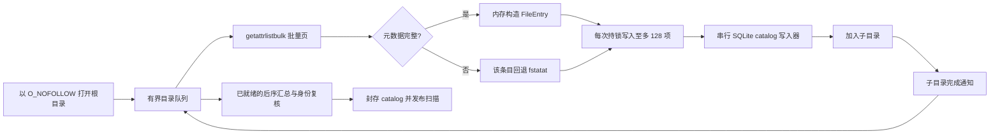
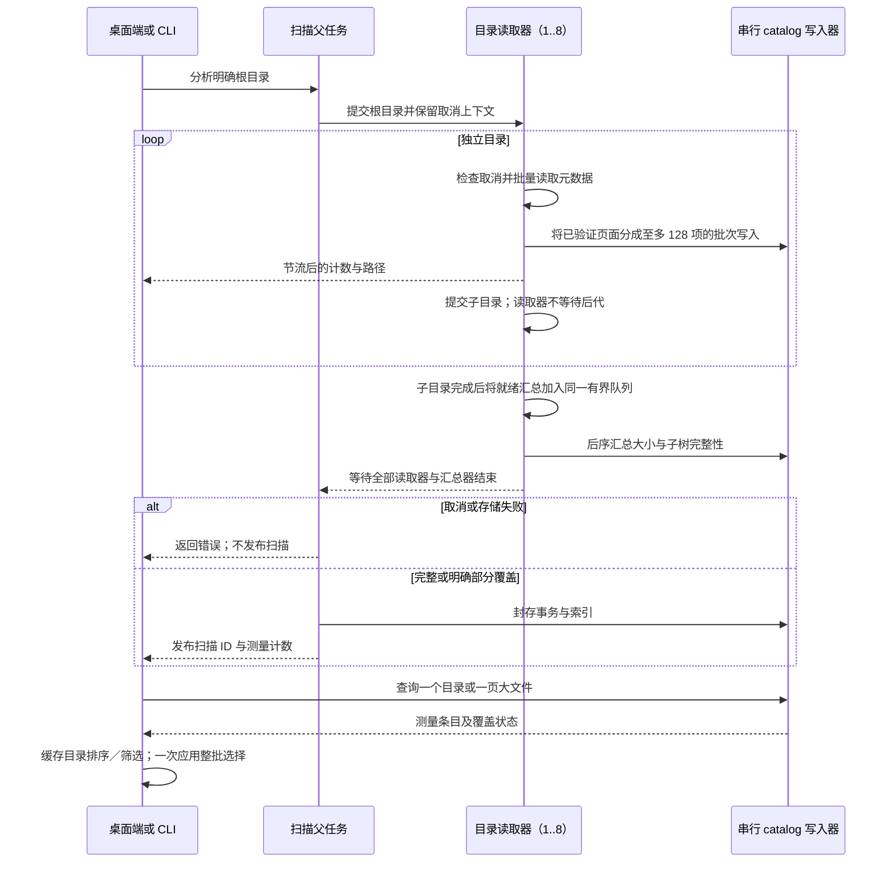

# 空间扫描性能

[English](../../engineering/storage-scan-performance.md) | 简体中文

Shou 的完整空间分析是只读清单。主要成本包括文件系统元数据 I/O、目录复核和逐条索引写入。要缩短耗时，需要让互不相关的目录读取重叠，并减少重复工作。无限增加线程会让 APFS、云占位文件、网络卷和桌面前台争抢资源，因此 Shou 使用有界目录读取池。

2026-10-29 的[调研报告](storage-performance-research.md)核查同类源码与官方资料，[架构方案](storage-performance-architecture.md)区分首批减少重复处理的实现与后续流水线、并发、增量索引候选。下文实测只证明明确验收的范围。

## 跨操作复用

目录读取器同时服务完整计量和有界目标／规则／历史检查。macOS 复用 `getattrlistbulk` 页面，缺少元数据时使用不跟随链接的回退。Windows 观察与原生清单核验共用有界 64 KiB 句柄目录读取器，子项元数据从防替换的相对句柄读取。只有枚举合同已经提供完整证据的适配器才能声明条目已核验，其他适配器保留第二次元数据检查。

Windows `FileTreeIndex` 对一次观察只建立一次父子、身份及完整性索引，在规则分类、计划和上下文核验间复用。执行已取消整批现场预检，策略和观察按当前项目核验，原生适配器在每个变更边界完整核验确切目标。当前活动、不可变范围及逐项移除核验继续保留。macOS 将同一能力边界用于规则清理、直接删除、卸载组件及孤立残留；浏览与选择复用请求内策略和目录索引上下文。历史列表摘要避免加载完整清单，明确现场检查仍读取当前文件。

大清单使用计划与历史共用的不可变摘要分页机制；macOS 将已验证计划页的原始字节复制到独立历史页，省去再次编码，后续状态／结果写入更新精简元数据。没有分页来源或清单变化时沿用原编码。进度属于限频的提示信息；删除仅显示所选目标及后代，保存结果时不显示路径，准备总量未知时保持不确定进度。性能比较使用 Release 构建。MangoDisk 分析删除快速路径采用不同的取消／清单合同，不将其复制为递归删除回退。

## 当前流程



macOS 的 `getattrlistbulk` 一次返回一页名称、对象类型、设备／inode 身份、时间戳、分配大小和逻辑大小。普通文件保持批量路径。目录只额外执行一次 `fstatat`，补齐目录链接数并保持既有清理和硬链接证据兼容。符号链接、特殊文件、字段不完整的记录和不支持批量属性的条目都使用不跟随链接的 stat 回退路径。

默认读取器数量是 `min(activeProcessorCount, 8)`，最低为 1。这里并行的是目录，而不是为每个文件创建线程：读取器完成一个目录的元数据页后写入直接子项，再提交子目录。所有后代完成后，后序汇总器更新父目录大小，复核目录身份；只有自身覆盖和所有子目录覆盖都完整时，才把目录标为完整。

读取与已就绪的汇总任务共用同一个有界调度器。串行通知队列只在子目录完成后提交汇总，父目录不会占据 worker 槽等待后代，避免独立无界汇总队列制造大量争抢 catalog 写锁的线程。上限约束执行中的扫描任务，不等于整个进程或运行时的线程总数。

SQLite 始终只有一个写入器。catalog 使用 `SQLITE_OPEN_NOMUTEX` 打开，`StorageParallelState` 用一把锁保护追加行和更新总量。这样不会让 SQLite 被多个线程不安全地调用，同时允许元数据读取重叠。等待目录留在 FIFO 中，只有实际读取的任务才提交给调度器，不为排队目录占用阻塞线程。最后一个事务封存成功后才发布扫描。

批量读取器逐页验证并消费 64 KiB 的内核结果，不再设置 65,536 项上限，也不再对整个目录的元数据排序，因此超宽目录始终保留批量 I/O 路径。每个读取器一次持锁写入至多 128 项，元数据读取和进度回调均在锁外进行。后续批量页失败时，重新通过不跟随链接的名称／stat 路径读取，并用目录内名称集合避免重复写入。这仍需保留名称和待处理子目录，不能称为恒定内存遍历；对象、覆盖和取消检查保持有效。



## 结果查询与桌面交互

新 catalog 为实际分配空间至少 1 MiB 的普通文件维护 `large_files` 部分索引，索引包含分配大小、名称和父目录。阈值不低于 1 MiB 的查询显式包含部分索引谓词，让 SQLite 在统计和分页时跳过大量微小缓存／构建文件。更小阈值和旧 catalog 保持兼容查询路径，不原地重写用户既有索引；重新扫描产生带索引的结果。容量口径、硬链接只计费一次、扩展名分类和容量相同时按二进制路径排序均保持一致。

macOS 缓存当前目录的容量排序、筛选／排序结果及本地可选择性投影。替换索引、切换目录、修改筛选或排序时更新相应结果；悬停和选择变化复用已有数组。缓存只用于展示，删除仍由 Core 准备并核验新的完整清单。

`StorageSelection` 使用所选路径集合查询祖先归属，整目录选择只规范化一次整批路径；筛选后取消部分选择时，只展开受影响的所选祖先并保留其他同级项目。复选框和 Command-A 共用批量操作。可移植实现同样用于 CLI 的计划去重，不改变确认和删除权限。

内置规则 schema 和经过完整验证的内置模板在进程内作为不可变值复用。绑定工作区时复制已验证的规则，并使用内置 schema 校验发生变化的根引用；动态工作区与位置匹配仍逐次计算。公开的模板构造和外部规则导入继续完整校验，不根据调用方提供的标识缓存任意模板或规则。这同时减少两个平台在常规清理和计划复核中重复解析 JSON／schema 的开销。

## 与 MangoDisk 快速路径的对应关系

MangoDisk 的 macOS 实现采用相同的关键思路：`getattrlistbulk`、最多八个读取器的有界目录池、内存聚合和最终索引投影。速度提升主要来自减少元数据往返并重叠独立目录的 I/O 延迟，并不意味着软件在执行大量 CPU 计算。Shou 保留持久化 SQLite catalog，因为 CLI 和桌面端需要在扫描发布后按页读取目录；读取侧仍遵循批量读取和目录级并发。以下对照基线已经具备批量元数据读取和目录读取池；本轮移除宽目录的批量读取上限与排序，逐页消费结果、批量写入 catalog，并保留精确的目录 stat 证据。

BuhoCleaner 本轮通过 REA 完成了安装包身份、Mach-O 架构和运行边界核验。由于当前 Hopper、Ghidra、IDA provider 不可用，无法把其原生扫描内部实现完整反编译出来，因此这里只把它作为产品参考，不能据此声称其线程数或具体系统调用策略。

参考与鸣谢：MangoDisk 的 `mangodisk-platform/src/macos/analysis.rs`、`bulk_directory.rs` 和 `mangodisk-core/src/storage/traversal/parallel_analysis.rs`。保留的 REA 安装包证据：BuhoCleaner `ev_37ae786bf04f8b9651880aac0dea30eeb49f9adb951623d142a2d4dbfcebd8e8`；MangoDisk `ev_dda64636549bef4a0cac435f101123abb7549f224943246e65c29359c154df2e`。安装包证据用于确认调研对象，上述算法结论来自源码检查。

### 2026-10-29 参考复核与构建模式对照

再次检查 MangoDisk 的 `mangodisk-platform/src/macos/analysis.rs`、`bulk_directory.rs` 和 `mangodisk-core/src/storage/analysis/index_projection.rs`：批量元数据与八路目录池已在 Shou 实现。当前主要差别是结果保留方式：MangoDisk 在内存中汇总目录，只保留有界的大文件明细，后续导航必要时重新枚举；Shou 将每个文件写入不可变 SQLite catalog，支持完整文件列表、分页和跨扫描比较。轻量汇总值得作为后续独立设计评估，不能直接丢弃明细却继续宣称完整快照，也不能复用为删除清单。

基准开始时，本机安装的 `0.21.0` 候选为 Debug。与本地 Release CLI 交替执行三轮只读生成夹具，均使用八个读取器；逐行比较所有身份、时间戳、权限、容量与完整性字段，目录汇总完全一致，生成文件内容未变：

| 工作负载 | 条目数 | Debug 中位耗时 | Release 中位耗时 | 比值 |
| --- | ---: | ---: | ---: | ---: |
| 32 个目录中的微小文件 | 131,105 | 1.128 秒 | 0.469 秒 | 2.41 倍 |
| 10,241 个目录和 8,192 个文件 | 18,433 | 0.582 秒 | 0.410 秒 | 1.42 倍 |

这是安装候选与 Release 的构建模式对照，不是新扫描算法的前后对照，也不是完整磁盘或 Windows 性能结论。主机为 Apple Silicon／macOS 15.8.1／APFS，未清空缓存，保留其他前台任务及已有 Shou 扫描。Release 另外包含尚未提交的弃用 API 修复；扫描器源码未修改。原始三轮耗时、两份二进制摘要、源码状态和逐行摘要保存在本地 `.build/v021-scan-performance/result.json`，脚本为同目录 `compare.py`。

本地正常安装使用 Release；仅在用户明确需要调试时安装 Debug，并明确记录构建模式。`v0.21.0` 按用户要求继续发布原候选，不将后续 warning 修复或扫描算法优化纳入已冻结的发布源码。

### 2026-10-29 Shou 与 MangoDisk 原生流程实测

在上述 Apple M1／macOS 15.8.1／APFS 主机上，使用两款实际 Core API 的优化 Release 探针，按 Shou／MangoDisk、MangoDisk／Shou、Shou／MangoDisk 交替执行三轮。MangoDisk 源码为 `4285d46644f2b9e53dee4ddfa3b3b5374dd64e3b`；Shou 基于冻结的 `6f24e7796af1263823e77518ffb584f2c4867cb5`，另含上述未提交 warning 修复，扫描与删除算法未改。MangoDisk 工作区保持干净且内容未变。两端使用新建的隔离状态、普通用户权限、强制刷新扫描及相同内容／布局的独立生成夹具；计时不含创建夹具和进程启动。

| 工作负载 | Shou 扫描中位数 | MangoDisk 扫描中位数 | Shou 准备＋永久删除中位数 | MangoDisk 准备＋永久删除中位数 |
| --- | ---: | ---: | ---: | ---: |
| 16 个目录、32,768 个微小文件 | 0.152 秒 | 0.109 秒 | 4.907 秒 | 2.740 秒 |
| 4,608 个内部目录、4,096 个文件 | 0.470 秒 | 0.110 秒 | 2.426 秒 | 0.995 秒 |

两种夹具下，Shou／MangoDisk 的扫描耗时比分别为 1.39／4.29，准备与删除耗时比分别为 1.79／2.44。Shou 准备中位数分别为 0.583／0.567 秒，执行中位数为 4.323／1.813 秒；分阶段中位数不要求相加等于总量中位数。整个探针进程的峰值 RSS 中位数分别为 Shou 55.0／52.3 MiB、MangoDisk 18.6／14.3 MiB，不是单独扫描阶段内存。全部十二次运行核验文件数、配对分配容量、目标确实移除，以及同级和范围外哨兵的内容与 inode 均保留。

这不是相同数据保留和删除合同的算法竞速，也不是 GUI、全盘或 Windows 实测。MangoDisk 的内存汇总和有界文件索引省去 Shou 的完整持久化明细；其删除在准备时固定当前目标身份，扫描计数用于回执计量。Shou 另保存不可变完整清单，执行时核对当前清单并持久化意图和逐项结果。源码说明了额外工作，但本次端到端计时没有分别归因 SQLite、序列化和系统调用的成本。

后续优化优先度为：复核已有 catalog 的小扫描重复明细保存，减少目录汇总的串行数据库往返，并在保持精确范围／身份／取消／回执合同下减少清单重复构造和校验。轻量浏览快照应独立设计；不能把缺失明细当作完整证据。两端已经采用批量元数据和有界并发，继续增加线程须另行基准验证。

系统缓存未清空，其他桌面活动未控制。目录密集夹具的 Shou 扫描原始范围为 0.263–1.000 秒，波动明显；这些中位数只描述本机样本。完整原始值、配对内容摘要、二进制 SHA-256、工具链和工作区状态保存在本地 `.build/v021-mangodisk-comparison/result.json`，同目录保留 `compare.py` 和两款探针源码。

### 2026-10-29 首批优化前后实测

首批实现停止有 catalog 小扫描的重复内联明细；空间删除首次历史保存复制重新核对摘要的计划页字节，保留独立历史存储；共享原生永久删除对普通单链接文件省去相邻一次重复元数据读取，紧邻 `unlinkat` 的完整比较及祖先／硬链接合同仍在。Windows 另将进度总数预计算、移除数量累计，不把纯 .NET 回归称为原生性能实测。完整数据合同见[数据模型](../architecture/data-model.md)。

优化前独立探针的一次执行开始后两秒 `sample` 采样观察到 `ReceiptJournal.save → FileManifestRecords.pages → JSONEncoder` 路径。这只定位该窗口中的重复编码，没有得出全流程耗时百分比；采样运行与下面计时分开。

首批最终候选 Release 与保留的优化前 Release 使用同一探针源码、八个读取器，在上述 Apple M1／macOS 15.8.1／APFS 上进行每种负载五组交替对照。普通用户、每次独立的新状态和相同内容的生成夹具，暖元数据、不清缓存，其他桌面活动未控制；计时不含夹具生成和启动，没有 profiler。以下为中位数，“耗时比”为优化前除以优化后。

| 生成负载 | 扫描前 / 后 | 扫描耗时比 | 准备＋删除前 / 后 | 准备＋删除耗时比 |
| --- | ---: | ---: | ---: | ---: |
| 32,768 个文件，16 个内部目录 | 0.259 / 0.263 s | 0.98 | 5.954 / 4.935 s | 1.21 |
| 4,096 个文件，4,608 个内部目录 | 0.556 / 0.488 s | 1.14 | 3.821 / 2.751 s | 1.39 |

全部二十次执行核对精确文件数、配对分配容量、目标移除及范围内外哨兵的内容和 inode。早期候选的另二十次结果也保留：目录密集扫描为 0.290 → 0.194 s、准备＋删除为 1.657 → 1.315 s。最终候选只额外保留权限读取失败的原生错误识别，仍须将两套构建分开，不合并挑选最优样本。

桌面负载波动明显：首组目录扫描减少约 33%，最终组约 12%；最终目录准备阶段中位数 0.818 → 1.034 s，与首组改善方向不同，尚未归因为实现变化。文件密集扫描没有小扫描内联分支的算法变化，样本差值不作为扫描提速证据。最终组准备＋删除减少约 17%／28%，是本次样本结果，不是稳定倍数承诺。组合改动尚未做单项消融；不能把差值分摊给 JSON、SQLite 或系统调用，也未形成数倍、十倍、全盘、GUI、管理员 worker 或 Windows 收益结论。建议验收门槛仍需更受控的测量确认。

完整原始值、各阶段中位数／范围、全探针 RSS、两套候选与基线二进制摘要、最终源码摘要见共享[证据清单](../../engineering/storage-performance-evidence.json)；本地 `result.json`、`initial-result.json`、`compare.py`、构建参数和签名／安装回执位于 `.build/performance-20261029-optimization/`，二进制均保留。不把既有 MangoDisk 对照与本轮不同时间的计时拼成新的同场竞速。

常规 Mac 脚本的 352 项核心／生成夹具检查通过，包含清单复制篡改、历史保留、旧格式与进度路径回归；最终权限错误分支调整后另跑 11/11 原生永久删除专项通过。完整脚本末项 Node 夹具仍被真实 `build_process_running` 保护拒绝，未停止个人进程，完整脚本不记为通过。Mac-host Windows 检查为 805 Core、288 Presentation、220 Platform（98 个原生跳过）、34 CLI 和 192 CLI 合同通过；最后路径展示断言另跑 Presentation 288 项通过。没有本轮 Windows 原生、WinUI 删除或性能验收，公开门禁不变。

本轮修复还移除保存结果事件的分析根路径，两端展示只允许冻结目标及后代。安装更新使用本地 Release，签名与 156 个包文件校验通过，3,772 项既有记录哈希保持不变；正式 `v0.21.0` 标签和公开产物没有更新。安装后实际启动已验证；当前系统设置中的完全磁盘访问为关闭，权限恢复需独立确认，不能记为受保护目录访问已通过。

### 2026-10-29 后续扫描实验与清单编码

只读探针分别扫描 65,570 条文件密集记录和 8,706 条目录密集记录。独立 `sample` 观察到 reader 等待共用锁，以及封存中的 SQLite 提交和索引排序；采样不用于推算全流程占比。随后把 schema、行、封存索引与临时表收尾合并为一个事务，使用每负载五组交替 Release 对照、同一保留夹具、新状态、八个读取器，并逐行核对所有字段和汇总：

| 生成负载 | 原事务中位数 | 单事务中位数 |
| --- | ---: | ---: |
| 文件密集 | 0.382 s | 0.396 s |
| 目录密集 | 0.299 s | 0.302 s |

桌面负载未控制、元数据暖缓存且样本范围重叠。未测出收益，因此已撤回该事务改动；不把减少 SQL 提交次数直接当作加速。源码、二进制、全部原始值与逐字段摘要保存在 `.build/performance-20261029-scan/` 和共享证据清单。

共用清单分页另采用固定字段名与数组切片，省去逐条 snake-case 转换和分页数组复制，保持 Foundation JSON 编码、排序、可选字段省略及旧解码。独立 Release 探针对实际生产分页源码仅补充模块 import，先验证 Unicode／转义、整数极值、可选摘要及 0／1／2／4095／4096／4097／8192／8193 条边界的逐字节相等与旧解码，再交替测量 12 对、每次 10 页（每页 4,096 条），两侧均包含 SHA-256：中位数 **0.458 → 0.242 s**。这是编码与摘要的重复测量，不能当作删除或扫描整体约两倍加速。原始值、探针源码与构建参数在 `.build/performance-20261029-manifest/`。

完整流程随后使用同一探针和首批修复后的基线，只改变 `FileManifestRecords.swift`，源码摘要确认没有混入 SQL 或系统调用改动。每负载五组交替、共 20 次 Release 运行，分别重新生成相同内容的夹具与状态；全部核对文件数、容量、实际移除和范围内外哨兵内容／inode。主机负载未控制，计时无 profiler、不含夹具生成和进程启动：

| 生成负载 | 准备前 / 后 | 执行前 / 后 | 准备＋执行前 / 后 |
| --- | ---: | ---: | ---: |
| 32,768 文件、16 内部目录 | 0.581 / 0.388 s | 3.588 / 3.276 s | 4.169 / 3.664 s |
| 4,096 文件、4,608 内部目录 | 0.370 / 0.313 s | 1.191 / 1.198 s | 1.543 / 1.512 s |

文件密集准备阶段减少约 33%，准备＋执行约 12%；目录密集准备约 15%，执行没有测出改善，整体约 2% 的差异不足以宣称稳定提速。扫描没有改动，两组扫描中位数分别为 0.169／0.175 s 和 0.253／0.240 s，不作扫描提速结论。完整范围、RSS、全部样本及双方源码／二进制摘要见共享证据。上述结果不与首批或旧 MangoDisk 测量拼接，不外推全盘、界面、管理员会话或 Windows。

这轮常规脚本 **353/353 Core** 检查通过，包括目录分页和带内容摘要单文件的新旧字节相等；最后原生 CLI Node 夹具仍因 `build_process_running` 拒绝，完整脚本退出 1，未停止个人进程。Windows Mac-host 全套为 **808 Core、288 Presentation、220 Platform（98 原生跳过）、34 CLI、192 CLI 合同**通过，仍无本轮 Windows 原生或 WinUI 验收。

最终后续候选已构建并覆盖安装为 Release／ARM64，156 个包文件与 3,772 项既有记录哈希校验通过，真实启动已观察。完全磁盘访问仍受限，既有权限恢复确认未获回复，本轮没有更改权限或执行安装后界面删除；相关逻辑由生成夹具的 Core／Presentation 测试覆盖。正式 `v0.21.0` 公开产物未替换。

### 2026-10-29 分锁实验与复测

将扫描状态锁和 catalog 写锁分开，保留单写入器。初筛每负载五组交替，目录密集中位数为 0.176／0.122 s，文件密集为 0.229／0.234 s。随后相同二进制再做每负载十组交替确认：

| 负载 | 原共享锁中位数 | 分锁中位数 | 原范围 | 分锁范围 |
| --- | ---: | ---: | ---: | ---: |
| 文件密集 | 0.296 s | 0.317 s | 0.232–0.490 s | 0.240–0.593 s |
| 目录密集 | 0.147 s | 0.123 s | 0.137–0.253 s | 0.120–0.189 s |

全部 60 次只读扫描逐字段及汇总一致。确认组目录密集约减少 16%，文件密集反而增加约 7%；范围重叠、桌面负载未控制，不据首组的较大改善认定通过。已撤回分锁，保留原共享锁；原生元数据与父任务取消的 4 项专项通过。复核发现检查点原本已按 128 条批量执行，没有再次添加同类改动。源码、二进制、脚本、全部样本与摘要在 `.build/performance-20261029-scan-lock/` 及共享证据。

### 2026-10-29 移除未使用的扫描期索引

实验开始时，仓库内 `forEachChildDirectory` 仅有定义，没有调用方；当前原生遍历在内存中保留待处理目录，不使用扫描期 `measurement_directories` 索引。新 catalog 省去该索引的创建、逐目录维护及封存时删除；方法仍可查询，最终发布的表／索引和格式版本不变。

额外的目录 API 验证发现已有的列索引错误：查询追加的目录 ID 位于第 16 列，接口却读取第 19 列，返回 0。已修复，并增加 600 个目录、三个游标页及回调中插入子文件的回归。该方法当前无生产调用，不影响上面的扫描计时；元数据、目录游标与取消专项 5/5 通过。

每负载十组交替 Release 对照，共 40 次只读扫描，全部字段和汇总一致。文件密集中位数为 0.265／0.261 s、目录密集为 0.160／0.160 s，范围重叠，**没有证据证明扫描加速**。目录密集 catalog 文件中位大小从 **1,415,168 降到 1,320,960 字节**，约减少 6.7%；文件密集少一页 4 KiB。保留改动用于移除未使用的索引与减少存储写入，不计入速度收益。原始样本、源码及二进制在 `.build/performance-20261029-scan-index/` 和共享证据。

### 本轮最终验证与本地安装

目录游标修复后，完整 Core **354/354** 通过；专项 **5/5** 通过。此前本轮常规脚本已通过当时的 353 项 Core 及后续 CLI 组，但最后原生 CLI 的 Node 夹具因 `artifact_evidence_unavailable` 拒绝，单独复跑同样退出 1；不能沿用上一轮 `build_process_running` 的原因，也不能将完整脚本标记全绿。没有停止个人进程或弱化删除保护。

包含索引清理与游标修复的 **Release／ARM64** 已正常退出后覆盖安装到 `/Applications/Shou.app`，包签名、全部 156 个包文件及 3,772 项既有记录哈希核对通过，安装后启动已观察。删除进度的磁盘根路径修复在此安装中：保存结果不携带路径，macOS 与 Windows 展示限制为冻结目标及后代；生成夹具覆盖了永久删除、废纸篓与范围外文件保留。本轮未执行安装后界面删除或 Windows 原生验收。

当前安装与候选均为 ad-hoc。同团队 Developer ID 的隔离签名探针在 30 秒后超时，不能据此断言出现了钥匙串密码框；未完成稳定签名验证，没有修改钥匙串授权。应用仍报告受保护访问受限，完全磁盘访问确认尚未回复；没有修改该权限，也不把安装成功描述为权限恢复。仓库设计技能已补充保持既有 Developer ID Team、显式签名身份及签名与隐私权限独立核验的规则。正式 `v0.21.0` 公开产物未替换，云电脑未启动。最终证据在共享清单的 `scan_index_final_validation`。

## 进度与取消

Windows 完整 `StorageScanner` 在 Core 端限频，避免先逐条分配进度对象再交给 UI 节流：首个实际条目立即通知，后续每 128 条检查 250 ms，返回前补齐最终实际计数且不重复计数。无进度订阅时不创建进度对象；取消仍逐项检查。普通观察者异常不会使已观察的扫描证据丢失。定向 `CleanupScanner` 的跨目标累计是独立流程，本次未重构其语义。

进度按条目数聚合，每 128 个条目且至少经过 250 ms 才发送一次更新。界面不会为每条文件记录刷新。取消会在批量页、打开子目录和封存 SQLite 前后检查；取消或存储损坏的扫描会被丢弃，不会发布。达到时间预算时记录 `resource_limit`，封存真实的部分 catalog 并设置 `limitReached`，不会把部分结果标成完整。

遍历结束后的 SQLite 索引排序仍可能耗尽存储。`StorageCatalog` 保留 SQLite 结果码，将 `SQLITE_FULL` 映射为 `storage_full`；原生遍历必须传递该致命存储错误，不能把它当成不可读目录或时间预算造成的部分结果。生成的 64 KiB catalog 夹具分别覆盖条目写入与封存耗尽，核验未发布新扫描，并对比之前索引的字节和查询结果。生产上限仍为 4 GiB；构造器的较小预算支持有界、可重复的检查。

以下边界始终可见：

- 永不跟随符号链接；
- 跨文件系统条目和云占位文件记录为不透明且不完整的行；
- 硬链接由 catalog 的身份表只计费一次；
- 目录被替换或元数据变化会成为覆盖问题；
- 权限失败只标记受影响的子树，兄弟目录继续扫描。

## 可重复基准

`--storage-performance-only` 使用生成夹具创建 8 个目录、每个目录 1,000 个文件，并包含多级目录、Unicode 名称、稀疏文件、硬链接和符号链接。测试逐字段对比 stat 参考结果，同时输出耗时。可用环境变量临时比较读取器数量，但不会暴露无限并发：

```text
SHOU_STORAGE_SCAN_WORKERS=1 .build/debug/shou-tests --storage-performance-only
SHOU_STORAGE_SCAN_WORKERS=8 .build/debug/shou-tests --storage-performance-only
```

该变量只用于本地诊断；发布默认值仍是有界且与设备无关的策略。报告应记录设备、macOS 版本、文件系统、冷热缓存状态、条目数、耗时和覆盖问题。生成夹具的结果不能作为所有磁盘或云目录的性能承诺。

## Release 实测（2026-10-21）

本机为 Apple M1 MacBookPro17,1、8 核 CPU、16 GB 内存、macOS 15.7.3、APFS。两个 Release 可执行文件交替运行，每个工作负载和读取器数量各做三组配对；重复读取使用暖缓存，不清空系统缓存。每轮核对完整覆盖、精确条目数和相同的逻辑／分配空间总量。耗时包含 CLI 扫描、读取子进程与持久化发布；RSS 为 `/usr/bin/time -l` 报告的单进程最大值，不是进程树内存总和。

| 工作负载 | 条目数 | 读取器 | 优化前中位耗时 | 优化后中位耗时 | 优化前／后最大进程 RSS |
| --- | ---: | ---: | ---: | ---: | ---: |
| 64 个生成目录 | 65,601 | 1 | 0.4718 秒 | 0.4419 秒 | 22.2 / 19.3 MiB |
| 64 个生成目录 | 65,601 | 8 | 0.3813 秒 | 0.2496 秒 | 26.2 / 22.5 MiB |
| 单个宽目录 | 70,001 | 1 | 0.5668 秒 | 0.3673 秒 | 48.8 / 23.2 MiB |
| 单个宽目录 | 70,001 | 8 | 0.5273 秒 | 0.3842 秒 | 47.2 / 23.2 MiB |
| 合并生成目录树 | 135,604 | 1 | 1.0681 秒 | 0.8637 秒 | 54.1 / 26.7 MiB |
| 合并生成目录树 | 135,604 | 8 | 0.8868 秒 | 0.7993 秒 | 56.8 / 30.1 MiB |
| 只读 Rust 文档 | 50,625 | 8 | 0.3601 秒 | 0.3260 秒 | 33.4 / 23.5 MiB |
| 只读 Cargo registry | 85,371 | 8 | 0.9255 秒 | 0.8895 秒 | 35.7 / 35.4 MiB |

八个读取器主要有利于独立目录；优化后的单个宽目录并未比一个读取器更快。主机存在其他任务造成的显著 CPU／内存竞争，这些本机中位数不能证明所有工作负载都会提速。此前 Debug 配对中，八个读取器的 Rust 文档扫描曾从 1.715 秒退化到 1.969 秒，保留该结果与 Release 对照，不将所有工作负载描述为变快。65,601 项和 70,001 项的生成 catalog 另做了逐行元数据及汇总相等检查。独立的 1,000,005 行生成 catalog 测试在负载下用时 70.48 秒、单进程 RSS 最大 89.4 MiB；该测试测量 catalog 构造，不是文件系统遍历。

证据：`.build/performance-20261021/paired-release-final/results.json`、`paired-debug/results.json`、`catalog-parity.json`、`million-catalog.log`、`after-release-binary.json`；同目录保留基准脚本和可执行文件。这些本地证据不作为分发资产。

验证完成后移除生成扫描目录和隔离 catalog 副本，保留报告、完整性摘要、日志和对照可执行文件。`generated-data-cleanup.json` 记录确切范围；重新执行基准需重新生成输入数据。

大文件查询使用包含 7,083,140 行的 catalog 隔离副本，对首／次页交替执行五组对照。全部 60 个响应完整相等，包括候选、总数、游标、删除限制原因和部分覆盖状态；原用户 catalog 始终只读。两页合计样本的 CLI 耗时中位数：

| 筛选条件 | 原索引 | 部分索引 |
| --- | ---: | ---: |
| 至少 50 MiB，全部类型 | 7.7807 秒 | 0.1326 秒 |
| 至少 1 MiB，全部类型 | 3.9136 秒 | 0.2201 秒 |
| 至少 1 MiB，视频 | 5.5245 秒 | 0.2588 秒 |

这里对照兼容的已保存格式；已有 catalog 需重新扫描才产生新索引。源扫描仍为部分覆盖，基准不能证明全盘完整覆盖。首次测试脚本误将部分结果要求为退出码 0，修正为接受文档约定的退出码 6，并继续逐项比较完整返回数据。证据：`paired-large-files.json`、`paired-large-files-final.log`；首次失败的脚本日志独立保留。

## 清理流水线 Release 实测（2026-10-24）

本机为 MacBookPro17,1、8 核、16 GB 内存、macOS 15.8.1 ARM64、APFS、Swift 6.2.3。优化前后均使用 Release，按旧／新、新／旧、旧／新的顺序交替三组；每次重新生成两个目标，每个目标含 12 层目录和 10,000 个文件，合计 20,026 条删除清单。计时覆盖扫描、准备永久删除计划和精确确认后的执行；每轮核验无关源文件保留。夹具生成不计入表中耗时，系统缓存未清空。

| 指标 | 优化前中位数 | 优化后中位数 | 降低 |
| --- | ---: | ---: | ---: |
| 扫描 | 0.429 秒 | 0.402 秒 | 6.4% |
| 准备 | 4.918 秒 | 1.833 秒 | 62.7% |
| 执行 | 12.832 秒 | 7.295 秒 | 43.2% |
| 全流程 | 17.064 秒 | 9.173 秒 | 46.2% |
| 计划元数据 | 6,405,554 字节 | 2,080 字节 | 99.97% |
| 最大单条记录 | 6,405,558 字节 | 1,310,267 字节 | 79.5% |

优化后的计划元数据另引用不可变清单分页，2,080 字节不是整个计划的磁盘占用。主机存在明显 CPU 竞争，首组基线还与一次小型缓存 CLI 复验重叠；旧版总耗时范围为 17.056–29.126 秒，新版为 8.367–15.520 秒。这里报告三轮原始值及中位数，不据此推断所有磁盘或 Windows 原生性能。该夹具主要验证准备／删除和记录写入；扫描阶段的较小差异不足以证明全盘扫描提速。

证据位于 `.build/cleanup-performance/paired-release.json`、`paired-release-*.log`、`baseline-source.json`、`source-before-release-package.json` 和构建日志。同目录的 `paired-release.py` 复现相同生成夹具，报告保留两个 Release 二进制摘要。原安装版的 Debug 耗时不参与这组比较。完整验收与安装事实见 [SYNC.md](../../../SYNC.md)。

## 平台范围

macOS 原生适配负责分页读取、目录调度与索引写入。Windows `CleanupScanner` 为规则清理提供独立定向扫描：优先探测规则的固定路径分量和项目标记，按目录预算有界枚举通配前缀，先发现目标，再将剩余条目与时间预算分给各目标的完整计量。宽源码目录和首个大目标不应挤占全部后续目标预算；未发现或未完整计量的范围仍报告缺口。

准备计划和执行预检只重新读取当前所选目标、其祖先与项目标记；规则、配置、身份、清单、活动和单次确认继续逐项校验。非专用扫描适配器保留全树复核。普通空间分析继续使用 `StorageScanner`，不复用稀疏清理观察。

规则扫描记录 `scope=rule_targets`，其 `state=complete` 只表示本次规则发现与目标计量无缺口，`tree_complete=false`；仅 `completed_directories` 中的目标具有完整子树证据。它不能写入空间比较目录或证明工作区整树完整。旧记录省略 scope 时按 `full_tree` 读取。实际平台、生成夹具及原生检查以 [SYNC.md](../../../SYNC.md) 为准，不以源码或 macOS 结果替代 Windows 原生证据。

### 进度展示

界面分别呈现扫描、准备、复核和执行进度；计数仅来自当前实际工作，不把尚未观察的目录计为已完成。

永久删除还会报告当前所选目录内部的清单条目进度。这些即时更新不替代持久化回执，也不把失败项目计为删除成功。

## 0.9.0 汇总线程拥堵复验

安装版全盘扫描采样发现：读取已限制并发，但独立并发汇总队列仍触达 GCD 的 64 线程软限制。现将就绪汇总纳入读取调度器。18,449 条目／8,192 文件的生成夹具中，计数／容量及全部文件哈希一致；前后两次进程采样线程峰值分别为 10／46 和 11／11。热缓存交替扫描中位数为 1.021 秒／0.992 秒，包含 ps 采样开销，不足以外推产品整体提速。初次诊断对照与其他回归并行，未用于此结论。最终独立证据：`.build/next-version-finalizer-benchmark-isolated/result.json`；真实采样：`.build/next-version-current-scan-worker-sample.txt` 和 `.build/next-version-current-scan-gui-sample.txt`。

复现时明确指定保留的两个 Release 二进制及尚不存在的证据目录；脚本只扫描自行生成的目录，保留全部夹具文件：

```sh
python3 "scripts/benchmark-storage-finalizers.py" \
  --baseline "/path/to/baseline/shou" \
  --candidate ".build/release/shou" \
  --evidence ".build/storage-finalizer-comparison/new-run"
```

大量文件删除与不可变日志的独立对照见 [0.9.0 计划](cleanup-delivery.md)，其结果不能用于声明扫描提速。
