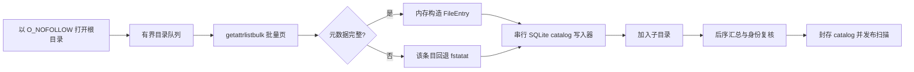
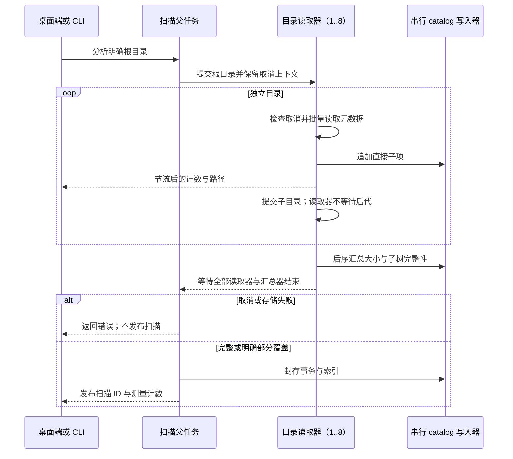

# 空间扫描性能

[English](../../engineering/storage-scan-performance.md) | 简体中文

Shou 的完整空间分析是只读清单。热点在文件系统元数据 I/O，而不是 CPU 计算。要缩短耗时，需要让互不相关的目录读取重叠，并减少每个目录的系统调用次数。无限增加线程会让 APFS、云占位文件、网络卷和桌面前台争抢资源，因此 Shou 使用有界目录读取池。

## 当前流程



macOS 的 `getattrlistbulk` 一次返回一页名称、对象类型、设备／inode 身份、时间戳、分配大小和逻辑大小。普通文件保持批量路径。目录只额外执行一次 `fstatat`，补齐目录链接数并保持既有清理和硬链接证据兼容。符号链接、特殊文件、字段不完整的记录和不支持批量属性的条目都使用不跟随链接的 stat 回退路径。

默认读取器数量是 `min(activeProcessorCount, 8)`，最低为 1。这里并行的是目录，而不是为每个文件创建线程：读取器完成一个目录的元数据页后写入直接子项，再提交子目录。所有后代完成后，后序汇总器更新父目录大小，复核目录身份；只有自身覆盖和所有子目录覆盖都完整时，才把目录标为完整。

SQLite 始终只有一个写入器。catalog 使用 `SQLITE_OPEN_NOMUTEX` 打开，`StorageParallelState` 用一把锁保护追加行和更新总量。这样不会让 SQLite 被多个线程不安全地调用，同时允许元数据读取重叠。等待目录留在 FIFO 中，只有实际读取的任务才提交给调度器，不为排队目录占用阻塞线程。最后一个事务封存成功后才发布扫描。



## 与 MangoDisk 快速路径的对应关系

MangoDisk 的 macOS 实现采用相同的关键思路：`getattrlistbulk`、最多八个读取器的有界目录池、内存聚合和最终索引投影。速度提升主要来自减少元数据往返并重叠独立目录的 I/O 延迟，并不意味着软件在执行大量 CPU 计算。Shou 保留持久化 SQLite catalog，因为 CLI 和桌面端需要在扫描发布后按页读取目录；读取侧仍遵循批量读取和目录级并发。原 Shou 已对普通文件批量读取；本轮新增目录读取并发，并保留精确的目录 stat 证据。

BuhoCleaner 本轮通过 REA 完成了安装包身份、Mach-O 架构和运行边界核验。由于当前 Hopper、Ghidra、IDA provider 不可用，无法把其原生扫描内部实现完整反编译出来，因此这里只把它作为产品参考，不能据此声称其线程数或具体系统调用策略。

参考与鸣谢：MangoDisk 的 `mangodisk-platform/src/macos/analysis.rs`、`bulk_directory.rs` 和 `mangodisk-core/src/storage/traversal/parallel_analysis.rs`。保留的 REA 安装包证据：BuhoCleaner `ev_37ae786bf04f8b9651880aac0dea30eeb49f9adb951623d142a2d4dbfcebd8e8`；MangoDisk `ev_dda64636549bef4a0cac435f101123abb7549f224943246e65c29359c154df2e`。安装包证据用于确认调研对象，上述算法结论来自源码检查。

## 进度与取消

进度按条目数聚合，每 128 个条目且至少经过 250 ms 才发送一次更新。界面不会为每条文件记录刷新。取消会在批量页、打开子目录和封存 SQLite 前后检查；取消或存储损坏的扫描会被丢弃，不会发布。达到时间预算时记录 `resource_limit`，封存真实的部分 catalog 并设置 `limitReached`，不会把部分结果标成完整。

以下边界始终可见：

- 永不跟随符号链接；
- 跨文件系统条目和云占位文件记录为不透明且不完整的行；
- 硬链接由 catalog 的身份表只计费一次；
- 目录被替换或元数据变化会成为覆盖问题；
- 权限失败只标记受影响的子树，兄弟目录继续扫描。

## 可重复基准

`--storage-performance-only` 使用生成夹具创建 8 个目录、每个目录 1,000 个文件，并包含多级目录、Unicode 名称、稀疏文件、硬链接和符号链接。测试逐字段对比 stat 参考结果，同时输出耗时。可用环境变量临时比较读取器数量，但不会暴露无限并发：

```text
SHOU_STORAGE_SCAN_WORKERS=1 .build/debug/shou-tests --storage-performance-only
SHOU_STORAGE_SCAN_WORKERS=8 .build/debug/shou-tests --storage-performance-only
```

该变量只用于本地诊断；发布默认值仍是有界且与设备无关的策略。报告应记录设备、macOS 版本、文件系统、冷热缓存状态、条目数、耗时和覆盖问题。生成夹具的结果不能作为所有磁盘或云目录的性能承诺。

## 平台范围

本轮优化落在 macOS 原生适配器。Windows 继续使用独立的平台遍历实现；后续演进应保持相同的可观察合同：并发有界、不跟随链接、部分覆盖明确、可取消、只发布持久化完成结果。本机未对 Windows 做编译或基准验证。
