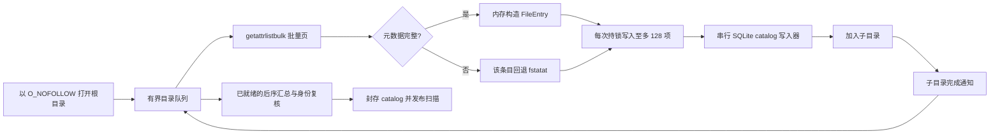
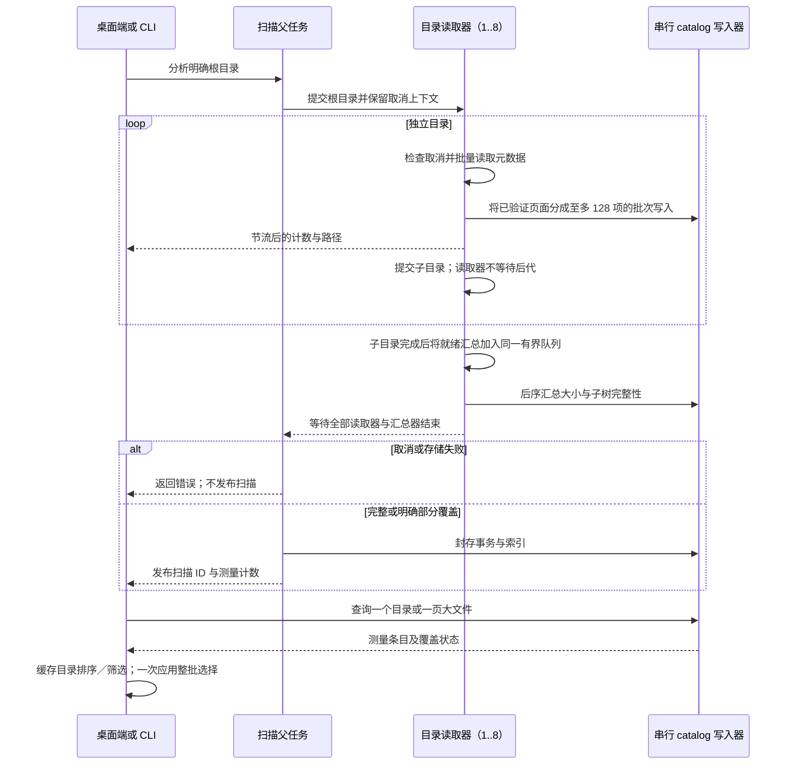

# 空间扫描性能

[English](../../engineering/storage-scan-performance.md) | 简体中文

Shou 的完整空间分析是只读清单。热点在文件系统元数据 I/O，而不是 CPU 计算。要缩短耗时，需要让互不相关的目录读取重叠，并减少每个目录的系统调用次数。无限增加线程会让 APFS、云占位文件、网络卷和桌面前台争抢资源，因此 Shou 使用有界目录读取池。

## 跨操作复用

目录读取器同时服务完整计量和有界目标／规则／历史检查。macOS 复用 `getattrlistbulk` 页面，缺少元数据时使用不跟随链接的回退。Windows 观察与原生清单核验共用有界 64 KiB 句柄目录读取器，子项元数据从防替换的相对句柄读取。只有枚举合同已经提供完整证据的适配器才能声明条目已核验，其他适配器保留第二次元数据检查。

Windows `FileTreeIndex` 对一次观察只建立一次父子、身份及完整性索引，在规则分类、计划和上下文核验间复用。原生执行先整批策略扫描，再在每个变更边界完整核验确切目标，避免每处理一个目标就重扫整个工作区。当前活动、不可变范围及逐项移除核验继续保留。macOS 将同一能力边界用于规则清理、直接删除、卸载组件及孤立残留；浏览与选择复用请求内策略和目录索引上下文。历史列表摘要避免加载完整清单，明确现场检查仍读取当前文件。

大清单使用计划与历史共用的不可变摘要分页，状态／结果写入只更新精简元数据，不反复重写整棵清单。进度属于限频的提示信息；核验期间显示当前路径，准备总量未知时保持不确定进度。性能比较使用 Release 构建。MangoDisk 分析删除快速路径采用不同的取消／清单合同，不将其复制为递归删除回退。

## 当前流程



macOS 的 `getattrlistbulk` 一次返回一页名称、对象类型、设备／inode 身份、时间戳、分配大小和逻辑大小。普通文件保持批量路径。目录只额外执行一次 `fstatat`，补齐目录链接数并保持既有清理和硬链接证据兼容。符号链接、特殊文件、字段不完整的记录和不支持批量属性的条目都使用不跟随链接的 stat 回退路径。

默认读取器数量是 `min(activeProcessorCount, 8)`，最低为 1。这里并行的是目录，而不是为每个文件创建线程：读取器完成一个目录的元数据页后写入直接子项，再提交子目录。所有后代完成后，后序汇总器更新父目录大小，复核目录身份；只有自身覆盖和所有子目录覆盖都完整时，才把目录标为完整。

读取与已就绪的汇总任务共用同一个有界调度器。串行通知队列只在子目录完成后提交汇总，父目录不会占据 worker 槽等待后代，避免独立无界汇总队列制造大量争抢 catalog 写锁的线程。上限约束执行中的扫描任务，不等于整个进程或运行时的线程总数。

SQLite 始终只有一个写入器。catalog 使用 `SQLITE_OPEN_NOMUTEX` 打开，`StorageParallelState` 用一把锁保护追加行和更新总量。这样不会让 SQLite 被多个线程不安全地调用，同时允许元数据读取重叠。等待目录留在 FIFO 中，只有实际读取的任务才提交给调度器，不为排队目录占用阻塞线程。最后一个事务封存成功后才发布扫描。

批量读取器逐页验证并消费 64 KiB 的内核结果，不再设置 65,536 项上限，也不再对整个目录的元数据排序，因此超宽目录始终保留批量 I/O 路径。每个读取器一次持锁写入至多 128 项，元数据读取和进度回调均在锁外进行。后续批量页失败时，重新通过不跟随链接的名称／stat 路径读取，并用目录内名称集合避免重复写入。这仍需保留名称和待处理子目录，不能称为恒定内存遍历；对象、覆盖和取消检查保持有效。



## 结果查询与桌面交互

新 catalog 为实际分配空间至少 1 MiB 的普通文件维护 `large_files` 部分索引，索引包含分配大小、名称和父目录。阈值不低于 1 MiB 的查询显式包含部分索引谓词，让 SQLite 在统计和分页时跳过大量微小缓存／构建文件。更小阈值和旧 catalog 保持兼容查询路径，不原地重写用户既有索引；重新扫描产生带索引的结果。容量口径、硬链接只计费一次、扩展名分类和容量相同时按二进制路径排序均保持一致。

macOS 缓存当前目录的容量排序、筛选／排序结果及本地可选择性投影。替换索引、切换目录、修改筛选或排序时更新相应结果；悬停和选择变化复用已有数组。缓存只用于展示，删除仍由 Core 准备并核验新的完整清单。

`StorageSelection` 使用所选路径集合查询祖先归属，整目录选择只规范化一次整批路径；筛选后取消部分选择时，只展开受影响的所选祖先并保留其他同级项目。复选框和 Command-A 共用批量操作。可移植实现同样用于 CLI 的计划去重，不改变确认和删除权限。

内置规则 schema 和经过完整验证的内置模板在进程内作为不可变值复用。绑定工作区时复制已验证的规则，并使用内置 schema 校验发生变化的根引用；动态工作区与位置匹配仍逐次计算。公开的模板构造和外部规则导入继续完整校验，不根据调用方提供的标识缓存任意模板或规则。这同时减少两个平台在常规清理和计划复核中重复解析 JSON／schema 的开销。

## 与 MangoDisk 快速路径的对应关系

MangoDisk 的 macOS 实现采用相同的关键思路：`getattrlistbulk`、最多八个读取器的有界目录池、内存聚合和最终索引投影。速度提升主要来自减少元数据往返并重叠独立目录的 I/O 延迟，并不意味着软件在执行大量 CPU 计算。Shou 保留持久化 SQLite catalog，因为 CLI 和桌面端需要在扫描发布后按页读取目录；读取侧仍遵循批量读取和目录级并发。以下对照基线已经具备批量元数据读取和目录读取池；本轮移除宽目录的批量读取上限与排序，逐页消费结果、批量写入 catalog，并保留精确的目录 stat 证据。

BuhoCleaner 本轮通过 REA 完成了安装包身份、Mach-O 架构和运行边界核验。由于当前 Hopper、Ghidra、IDA provider 不可用，无法把其原生扫描内部实现完整反编译出来，因此这里只把它作为产品参考，不能据此声称其线程数或具体系统调用策略。

参考与鸣谢：MangoDisk 的 `mangodisk-platform/src/macos/analysis.rs`、`bulk_directory.rs` 和 `mangodisk-core/src/storage/traversal/parallel_analysis.rs`。保留的 REA 安装包证据：BuhoCleaner `ev_37ae786bf04f8b9651880aac0dea30eeb49f9adb951623d142a2d4dbfcebd8e8`；MangoDisk `ev_dda64636549bef4a0cac435f101123abb7549f224943246e65c29359c154df2e`。安装包证据用于确认调研对象，上述算法结论来自源码检查。

## 进度与取消

进度按条目数聚合，每 128 个条目且至少经过 250 ms 才发送一次更新。界面不会为每条文件记录刷新。取消会在批量页、打开子目录和封存 SQLite 前后检查；取消或存储损坏的扫描会被丢弃，不会发布。达到时间预算时记录 `resource_limit`，封存真实的部分 catalog 并设置 `limitReached`，不会把部分结果标成完整。

遍历结束后的 SQLite 索引排序仍可能耗尽存储。`StorageCatalog` 保留 SQLite 结果码，将 `SQLITE_FULL` 映射为 `storage_full`；原生遍历必须传递该致命存储错误，不能把它当成不可读目录或时间预算造成的部分结果。生成的 64 KiB catalog 夹具分别覆盖条目写入与封存耗尽，核验未发布新扫描，并对比之前索引的字节和查询结果。生产上限仍为 4 GiB；构造器的较小预算支持有界、可重复的检查。

以下边界始终可见：

- 永不跟随符号链接；
- 跨文件系统条目和云占位文件记录为不透明且不完整的行；
- 硬链接由 catalog 的身份表只计费一次；
- 目录被替换或元数据变化会成为覆盖问题；
- 权限失败只标记受影响的子树，兄弟目录继续扫描。

## 可重复基准

`--storage-performance-only` 使用生成夹具创建 8 个目录、每个目录 1,000 个文件，并包含多级目录、Unicode 名称、稀疏文件、硬链接和符号链接。测试逐字段对比 stat 参考结果，同时输出耗时。可用环境变量临时比较读取器数量，但不会暴露无限并发：

```text
SHOU_STORAGE_SCAN_WORKERS=1 .build/debug/shou-tests --storage-performance-only
SHOU_STORAGE_SCAN_WORKERS=8 .build/debug/shou-tests --storage-performance-only
```

该变量只用于本地诊断；发布默认值仍是有界且与设备无关的策略。报告应记录设备、macOS 版本、文件系统、冷热缓存状态、条目数、耗时和覆盖问题。生成夹具的结果不能作为所有磁盘或云目录的性能承诺。

## Release 实测（2026-10-21）

本机为 Apple M1 MacBookPro17,1、8 核 CPU、16 GB 内存、macOS 15.7.3、APFS。两个 Release 可执行文件交替运行，每个工作负载和读取器数量各做三组配对；重复读取使用暖缓存，不清空系统缓存。每轮核对完整覆盖、精确条目数和相同的逻辑／分配空间总量。耗时包含 CLI 扫描、读取子进程与持久化发布；RSS 为 `/usr/bin/time -l` 报告的单进程最大值，不是进程树内存总和。

| 工作负载 | 条目数 | 读取器 | 优化前中位耗时 | 优化后中位耗时 | 优化前／后最大进程 RSS |
| --- | ---: | ---: | ---: | ---: | ---: |
| 64 个生成目录 | 65,601 | 1 | 0.4718 秒 | 0.4419 秒 | 22.2 / 19.3 MiB |
| 64 个生成目录 | 65,601 | 8 | 0.3813 秒 | 0.2496 秒 | 26.2 / 22.5 MiB |
| 单个宽目录 | 70,001 | 1 | 0.5668 秒 | 0.3673 秒 | 48.8 / 23.2 MiB |
| 单个宽目录 | 70,001 | 8 | 0.5273 秒 | 0.3842 秒 | 47.2 / 23.2 MiB |
| 合并生成目录树 | 135,604 | 1 | 1.0681 秒 | 0.8637 秒 | 54.1 / 26.7 MiB |
| 合并生成目录树 | 135,604 | 8 | 0.8868 秒 | 0.7993 秒 | 56.8 / 30.1 MiB |
| 只读 Rust 文档 | 50,625 | 8 | 0.3601 秒 | 0.3260 秒 | 33.4 / 23.5 MiB |
| 只读 Cargo registry | 85,371 | 8 | 0.9255 秒 | 0.8895 秒 | 35.7 / 35.4 MiB |

八个读取器主要有利于独立目录；优化后的单个宽目录并未比一个读取器更快。主机存在其他任务造成的显著 CPU／内存竞争，这些本机中位数不能证明所有工作负载都会提速。此前 Debug 配对中，八个读取器的 Rust 文档扫描曾从 1.715 秒退化到 1.969 秒，保留该结果与 Release 对照，不将所有工作负载描述为变快。65,601 项和 70,001 项的生成 catalog 另做了逐行元数据及汇总相等检查。独立的 1,000,005 行生成 catalog 测试在负载下用时 70.48 秒、单进程 RSS 最大 89.4 MiB；该测试测量 catalog 构造，不是文件系统遍历。

证据：`.build/performance-20261021/paired-release-final/results.json`、`paired-debug/results.json`、`catalog-parity.json`、`million-catalog.log`、`after-release-binary.json`；同目录保留基准脚本和可执行文件。这些本地证据不作为分发资产。

验证完成后移除生成扫描目录和隔离 catalog 副本，保留报告、完整性摘要、日志和对照可执行文件。`generated-data-cleanup.json` 记录确切范围；重新执行基准需重新生成输入数据。

大文件查询使用包含 7,083,140 行的 catalog 隔离副本，对首／次页交替执行五组对照。全部 60 个响应完整相等，包括候选、总数、游标、删除限制原因和部分覆盖状态；原用户 catalog 始终只读。两页合计样本的 CLI 耗时中位数：

| 筛选条件 | 原索引 | 部分索引 |
| --- | ---: | ---: |
| 至少 50 MiB，全部类型 | 7.7807 秒 | 0.1326 秒 |
| 至少 1 MiB，全部类型 | 3.9136 秒 | 0.2201 秒 |
| 至少 1 MiB，视频 | 5.5245 秒 | 0.2588 秒 |

这里对照兼容的已保存格式；已有 catalog 需重新扫描才产生新索引。源扫描仍为部分覆盖，基准不能证明全盘完整覆盖。首次测试脚本误将部分结果要求为退出码 0，修正为接受文档约定的退出码 6，并继续逐项比较完整返回数据。证据：`paired-large-files.json`、`paired-large-files-final.log`；首次失败的脚本日志独立保留。

## 清理流水线 Release 实测（2026-10-24）

本机为 MacBookPro17,1、8 核、16 GB 内存、macOS 15.8.1 ARM64、APFS、Swift 6.2.3。优化前后均使用 Release，按旧／新、新／旧、旧／新的顺序交替三组；每次重新生成两个目标，每个目标含 12 层目录和 10,000 个文件，合计 20,026 条删除清单。计时覆盖扫描、准备永久删除计划和精确确认后的执行；每轮核验无关源文件保留。夹具生成不计入表中耗时，系统缓存未清空。

| 指标 | 优化前中位数 | 优化后中位数 | 降低 |
| --- | ---: | ---: | ---: |
| 扫描 | 0.429 秒 | 0.402 秒 | 6.4% |
| 准备 | 4.918 秒 | 1.833 秒 | 62.7% |
| 执行 | 12.832 秒 | 7.295 秒 | 43.2% |
| 全流程 | 17.064 秒 | 9.173 秒 | 46.2% |
| 计划元数据 | 6,405,554 字节 | 2,080 字节 | 99.97% |
| 最大单条记录 | 6,405,558 字节 | 1,310,267 字节 | 79.5% |

优化后的计划元数据另引用不可变清单分页，2,080 字节不是整个计划的磁盘占用。主机存在明显 CPU 竞争，首组基线还与一次小型缓存 CLI 复验重叠；旧版总耗时范围为 17.056–29.126 秒，新版为 8.367–15.520 秒。这里报告三轮原始值及中位数，不据此推断所有磁盘或 Windows 原生性能。该夹具主要验证准备／删除和记录写入；扫描阶段的较小差异不足以证明全盘扫描提速。

证据位于 `.build/cleanup-performance/paired-release.json`、`paired-release-*.log`、`baseline-source.json`、`source-before-release-package.json` 和构建日志。同目录的 `paired-release.py` 复现相同生成夹具，报告保留两个 Release 二进制摘要。原安装版的 Debug 耗时不参与这组比较。完整验收与安装事实见 [SYNC.md](../../../SYNC.md)。

## 平台范围

macOS 原生适配负责分页读取、目录调度与索引写入。Windows 按原生方案独立实现与验证遍历、计量、取消和性能；不以 macOS 结果代替。

### 进度展示

macOS 原生适配负责分页读取、目录调度与索引写入。Windows 按原生方案独立实现与验证遍历、计量、取消和性能；不以 macOS 结果代替。

永久删除还会报告当前所选目录内部的清单条目进度。这些即时更新不替代持久化回执，也不把失败项目计为删除成功。

## 0.9.0 汇总线程拥堵复验

安装版全盘扫描采样发现：读取已限制并发，但独立并发汇总队列仍触达 GCD 的 64 线程软限制。现将就绪汇总纳入读取调度器。18,449 条目／8,192 文件的生成夹具中，计数／容量及全部文件哈希一致；前后两次进程采样线程峰值分别为 10／46 和 11／11。热缓存交替扫描中位数为 1.021 秒／0.992 秒，包含 ps 采样开销，不足以外推产品整体提速。初次诊断对照与其他回归并行，未用于此结论。最终独立证据：`.build/next-version-finalizer-benchmark-isolated/result.json`；真实采样：`.build/next-version-current-scan-worker-sample.txt` 和 `.build/next-version-current-scan-gui-sample.txt`。

复现时明确指定保留的两个 Release 二进制及尚不存在的证据目录；脚本只扫描自行生成的目录，保留全部夹具文件：

```sh
python3 "scripts/benchmark-storage-finalizers.py" \
  --baseline "/path/to/baseline/shou" \
  --candidate ".build/release/shou" \
  --evidence ".build/storage-finalizer-comparison/new-run"
```

大量文件删除与不可变日志的独立对照见 [0.9.0 计划](cleanup-delivery.md)，其结果不能用于声明扫描提速。
