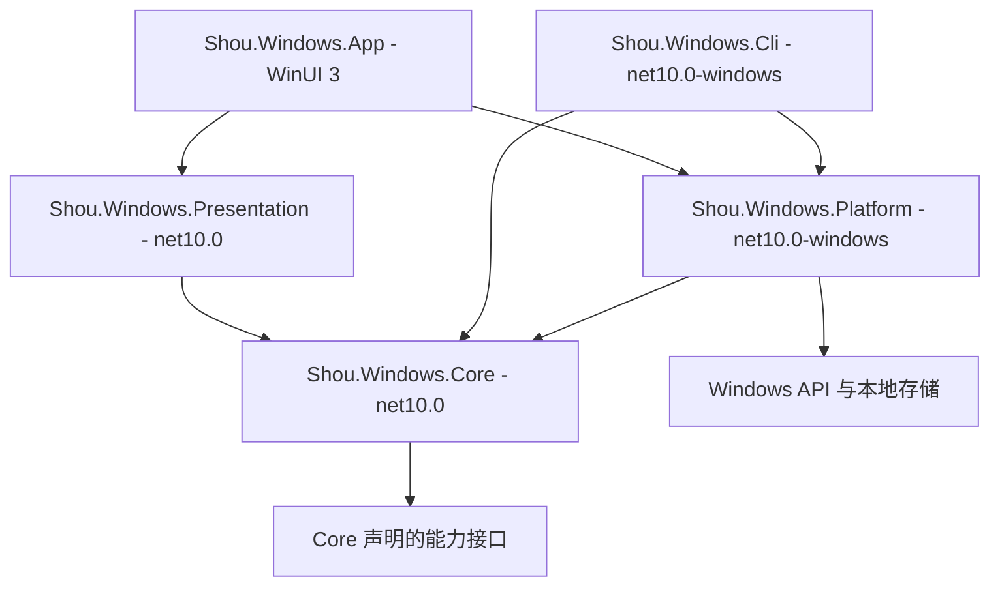
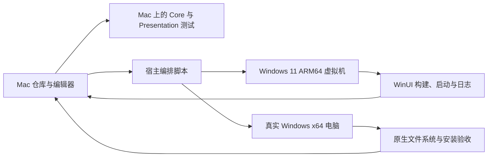

# Windows 原生实施方案

[English](../../engineering/windows-native-plan.md) | 简体中文

状态：设计已确定；Windows 应用、CLI、资源生成器和构建自动化均未实现。本文定义后续实现合同。

## 产品目标

提供原生 Windows 空间分析、可审查的清理与可复用规则，保持 Shou 的交互、语言与安全语义一致。目标系统为 Windows 11，支持 x64、ARM64。第一阶段依据固定的 Windows App SDK 验证并确定最低 Windows 系统版本。

## 技术决策

| 关注点 | 决策 | 原因 |
| --- | --- | --- |
| 语言和运行时 | C# / .NET 10 LTS | 原生 Windows 生态与长期运行时支持 |
| UI | WinUI 3 / Windows App SDK、MVVM | Fluent 控件、DPI 与原生可访问性 |
| 领域逻辑 | 独立、确定性的 C# Core | 直接表达 Windows 路径、身份与生命周期 |
| CLI | 共用 C# Core 的 .NET 控制台入口 | 终端可独立完成相同验证流程 |
| 分发 | 按架构提供自包含包 | 用户无需另装 .NET |
| 安装与更新 | Velopack，第一阶段验证可行性 | 安装生命周期和增量更新 |
| 签名 | Authenticode 与时间戳 | 可核验的发布者和分发完整性 |
| AI | 通过小接口隔离的 .NET 调查服务 | 领域执行保持确定性，模型供应商可替换 |

实现开始时在工程和锁文件固定 .NET SDK、Windows App SDK、构建工具及依赖版本，并联合核对支持矩阵。.NET 自包含发布不会自动包含 Windows App SDK；必须单独配置并验证 Windows App SDK 自包含部署。WinUI、COM 和更新兼容性验证前，不启用裁剪、单文件发布或 Native AOT。

## 四层职责与组装



| 层 | 负责 | 禁止承载 | macOS 检查 |
| --- | --- | --- | --- |
| Core | 规则语义、Windows 逻辑路径策略、排除、候选、不可变计划、确认绑定、回执、取消 | P/Invoke、注册表、UI、直接文件访问 | 构建与单元测试 |
| Platform | 文件句柄和身份、注册表、Win32/COM、进程、回收站、本地记录与凭据 | 界面决策或重复的规则匹配逻辑 | Targeting Pack 支持时做引用编译 |
| Presentation | 页面状态、命令、选择、进度、异步取消和错误 | WinUI 控件、Dispatcher、系统调用 | 构建与状态测试 |
| App | XAML、对话框、可访问性、导航、依赖组装和 UI 线程调度 | 规则与删除策略 | 仅资源生成等源码检查 |

CLI 是独立组装入口，不属于 UI 层链条。App 和 CLI 为 Core 接口注册 Platform 实现。Presentation 消费服务接口，仅在需要时注入小型调度接口。macOS 上的 Windows API 引用编译按工具支持情况启用 `EnableWindowsTargeting`；这不代表可以运行 Windows 代码或完成 WinUI XAML 构建。

以下为目标目录，按阶段创建：

```text
apps/windows/
  global.json
  Directory.Build.props
  Shou.Windows.slnx
  src/
    Shou.Windows.Core/
    Shou.Windows.Platform/
    Shou.Windows.Presentation/
    Shou.Windows.App/
    Shou.Windows.Cli/
  tests/
    Shou.Windows.Core.Tests/
    Shou.Windows.Presentation.Tests/
    Shou.Windows.Platform.Tests/
    Shou.Windows.App.Tests/
```

## CLI 合同复用

Windows CLI 是 C# Core 上的薄 .NET 入口：负责参数解析、能力发现、版本化 JSON、错误与退出码映射及终端交互审查。规则、计划、策略和变更仍由 WinUI 使用的同一套领域服务负责。

跨端共享稳定命令名、字段语义、错误类别、确认要求与语义验收夹具。平台特有命令说明实际范围和不可用原因。对齐机器合同，不将本地存储或原生身份布局当作通用 ABI；刻意差异登记到对齐表。

npm 入口保持 `@limecloud/shou`，命令保持 `shou`，由平台启动器选择对应原生 CLI。[npm 分发方案](npm-distribution.md)负责包结构、版本协调与验收；Windows 原生产物及打包安装通过对应检查前，不声明 Windows npm 支持。

## 数据与安全合同

规则使用 `/` 分隔的相对路径。Core 使用显式 Windows 路径模型和模拟文件系统，测试不可借用 macOS `System.IO.Path` 推导 Windows 语义。Platform 核验真实卷行为与身份，完整保留卷标识、File ID 和 owner SID，不转换为 POSIX 字段。路径按实际目录的大小写行为比较；路径字符串相同不代表对象身份相同。

拒绝路径穿越、盘符相对路径、设备命名空间、备用数据流、网络根、junction 逃逸和未知 reparse point。云占位文件与未验证文件系统保持只读或不可用。变更前检查保护根、当前所有者、访问权限、排除项、活跃应用、完整目标清单及对象替换。硬链接计数与变更竞态必须用真实 Windows 句柄验证。

桌面产品默认永久删除，必须有精确范围的不可逆确认。可选回收站模式须独立验证移动与恢复，失败不能转为永久删除。CLI 变更需要与当前计划绑定的交互确认。每次变更前持久化意图，保留已完成、跳过、失败、取消和未知结果。取消停止派发新工作，并核实正在进行的系统操作，不能编造成功。

Windows 使用当前用户私有数据根、ACL、原子写入、持久化日志和跨进程变更锁。Schema 与记录版本由 Windows 实现拥有。产品错误语义与夹具预期和 macOS 对齐；二进制存储布局、平台身份 DTO 分别定义。

## 资源同步

规则 Schema、规则目录 JSON、品牌资产、文案 key 与语义夹具统一维护。生成 Windows 资源时记录源摘要和生成版本。将已确认的颜色、字号、间距、圆角和动效值提取为统一 token 源，生成 XAML；不复制 Swift 界面代码。遵循各平台键盘、窗口、DPI 和可访问性习惯。

每个功能或安全变化都在 [SYNC.md](../../../SYNC.md) 记录精确 macOS 源提交、路径、合同摘要、Windows 实现提交、差异和证据。CI 拒绝缺失 key、占位符不一致、Schema 无效与未经审查的生成差异。资源生成器属于计划交付物，当前没有对应可用命令。

## 研发拓扑



使用 Parallels 共享源码，或同步到明确提交的 Windows checkout。Windows `obj`、`bin`、NuGet 缓存和安装产物放在 Windows 本地存储；Swift 产物保留在 macOS，各项目输出目录独立。先验证共享目录的构建行为；如元数据或工具链不可靠，改为同步到 Windows 本地源码目录。

宿主脚本后续通过 `prlctl exec` 调用虚拟机 PowerShell，通过 SSH 调用真机。脚本接受明确参数、传递退出码、设置超时、打印有界诊断、隐藏密钥并收集启动异常。每次运行记录提交、工作区摘要、系统、架构和工具链。UI 自动化补足脚本无法覆盖的交互，系统授权弹框保留用户明确操作。

Windows ARM64 虚拟机可借助已安装工具链生成 x64 产物，但不能证明 x64 原生行为。ARM64 在自身运行环境验收，x64 在真实 x64 设备验收。远程桌面结果不能替代本地电池与物理显示效果验证。

## 实施阶段

| 阶段 | 交付物 | 必需退出证据 |
| --- | --- | --- |
| WN01 | 固定 SDK；最小 WinUI App、.NET CLI 与发布原型 | x64、ARM64 启动；包含 .NET 与 Windows App SDK；干净系统完成签名安装、更新、卸载；记录签名可行性 |
| WN02 | 纯 Core、Presentation 与共享资源生成器 | Mac 测试覆盖 Windows 路径语义、保护数据、过期计划与状态；全部语言占位符正确；生成结果可重复 |
| WN03 | 只读 Platform 与空间界面 | Windows 实测身份、ACL、reparse point、长路径、Unicode、硬链接、取消与部分覆盖；不开启删除 |
| WN04 | 受控清理和持久化历史 | 原生生成夹具验证永久删除、中断恢复、竞态、锁、磁盘满与排除文件哈希；可选回收站和恢复独立通过 |
| WN05 | 分批增加产品能力 | 个人规则、应用清理、启动项、隐私与 AI 分别补合同案例和原生 UI 证据；逐项更新对齐表 |
| WN06 | 分发验收 | 干净安装、升级、增量与完整包恢复、签名核验、x64/ARM64、真实 DPI/可访问性、SmartScreen 观察及卸载行为 |

第一条只读纵向链路完成后再扩展页面。未验证操作隐藏或显示准确的不可用原因。每阶段记录实际运行结果，文档完成不能代替运行验收。

## 测试与发布

macOS 运行纯领域和页面状态测试，Windows 运行 Platform 集成和 WinUI 检查。自动变更测试使用生成的临时目录与模拟工具。共享夹具必须包括过期身份、祖先替换、不完整目标、保护子项、伪造输入、确认重放、日志失败和跨进程争用。真实个人数据不作为回归夹具。

分别生成 `win-x64`、`win-arm64` 资产。按选定打包工具的要求，对可执行文件与安装、更新产物签名，添加时间戳，核验最终字节后计算校验和。最终签名后不得修改产物。测试中断或无效更新，不能扩大清理权限。有效签名与 SmartScreen 信誉分别观察和记录。

选择符合实际开发者身份和发布环境的证书服务，在 WN01 验证硬件或云端签名、会话过期、续期与无人值守能力。如需要交互认证，流水线停在准备好的未签名产物交接点，明确完成签名后继续验证。不在仓库保存私钥或一次性验证码。

## AI 开发执行规范

实现前阅读本方案、对应产品文档、[安全规范](../security/cleanup-safety.md)和对齐表中的目标项。仅修改所属模块与确定性生成产物。每次实现最小可用纵向链路，不增加跨端运行时胶水、通用插件宿主或未来数据迁移。提交对应单元、原生和 UI 验证证据；使用具体原因报告不支持的行为，并同步更新中英文文档。
