# Windows 开发

[English](../../engineering/windows.md) | 简体中文

状态：实现进行中。扫描、平台适配、页面状态与 CLI 已有源码；WinUI 包含空间浏览、应用注册浏览、清理审阅和历史页面。清理、启动任务控制和安装程序卸载仅在匹配的 Windows 11 原生 x64／ARM64 进程中开放；macOS 构建继续保持只读。v0.14.0 发布流水线构建未签名的 x64／ARM64 自包含便携预览。原生夹具、安装和完整界面／辅助功能证据见 SYNC.md。

Shou Windows 端采用 C#、.NET 10 LTS 与 Windows App SDK 的 WinUI 3。桌面和 CLI 直接调用同一套 C# 领域服务。代码编辑和纯 .NET 测试在 macOS 完成；Windows 构建和运行验证在 Windows 完成。

阿里云无影远程验收使用仓库内的 [shou-windows-cloud-test 技能](../../../.agents/skills/shou-windows-cloud-test/SKILL.md)。本地开发和界面对齐期间按 `StopCharging` 关机，完成本机检查并准备同步包后，再复用环境集中验收；关机保留一天的磁盘费用与期限独立记录。账号、钥匙串密码和实例状态保存在仓库外的本机私有目录。

| 需要了解 | 阅读入口 |
| --- | --- |
| 架构、工程目录、实施阶段 | [Windows 原生实施方案](windows-native-plan.md) |
| 平台职责和共享资源 | [Monorepo 边界](../architecture/monorepo-and-platforms.md) |
| 产品和安全行为 | [PRD](../product/prd.md)、[清理安全](../security/cleanup-safety.md) |
| 运行、研发与发布时序 | [流程与时序](../architecture/workflows-and-sequences.md) |
| 功能对齐与验证 | [SYNC.md](../../../SYNC.md) |
| 结构化日志、分层回归与真实桌面 E2E | [Windows 日志与测试](windows-testing.md) |

首个交付物是 x64、ARM64 上经过签名、可独立运行的 WinUI 窗口，随后完成只读扫描和确定性 Core 测试。具有破坏性的能力须通过独立原生验收后才能开放。各阶段退出条件见实施方案。

## 开发命令

使用 [global.json](../../../apps/windows/global.json) 固定的 .NET SDK，在仓库根目录执行：

```sh
python3 "scripts/generate-windows-resources.py" --check
sh "scripts/test-windows-core.sh"
sh "scripts/build-windows-cli.sh" win-arm64
sh "scripts/build-windows-cli.sh" win-x64
```

CLI 构建脚本将未签名的自包含开发产物放在 `.build/windows/publish/<runtime>/cli`。跨平台构建不代表通过 Windows 运行或 npm 验收。`Directory.Build.props` 中统一的 RID 列表保证宿主测试与按架构还原时锁文件保持稳定。

Windows 上准备固定的 .NET SDK 与 Python 3，使用本地输出目录；脚本默认将产物放到 `%LOCALAPPDATA%/ShouBuild`，与共享源码分开：

```powershell
./scripts/windows/test.ps1
./scripts/windows/build.ps1 -Runtime win-arm64 -Launch
./scripts/windows/build.ps1 -Runtime win-x64
```

`test.ps1` 检查资源、执行 Core/Presentation/原生 Platform/CLI 测试并构建 CLI，再运行隔离数据根下的生成夹具合同。Windows CI 分别执行测试和双架构构建，x64 另检查 CLI、WinUI 启动与正常关闭；所有任务均须通过。实际运行结果记于 [SYNC.md](../../../SYNC.md)；Windows Server 检查不能代替 Windows 11 桌面、ARM64 原生运行或真机体验验收。

保留的文件系统句柄同时申请数据读取／目录列举和元数据权限，使共享掩码实际参与原生替换及写入保护。隐私检查仅对最终数据库与辅助文件明确允许共享写入，仍禁止删除；仅有元数据权限的句柄不能提供该保护。生成原生夹具显式设置当前用户所有者和私有继承 ACL，SQLite 辅助文件亦如此；提升权限的构建机令牌否则可能默认使用 Administrators 所有者。生产所有者与 ACL 核验保持严格。

私有记录发布通过 `NtSetInformationFile` 的 `FileRenameInformation` 使用保留的父目录句柄。Win32 重命名包装接口拒绝非空 `RootDirectory`，实现不回退到绝对路径。发布目录允许 NT 目标打开所需的共享写入，仍禁止删除／重命名；私有 `mutation.lock` 串行化记录操作。既有原生记录测试核验替换、重新读取、私有 ACL 和并发租约。

修改规范资源后执行 `python3 scripts/generate-windows-resources.py` 重新生成。生成器记录输入与输出摘要，并校验当前文案的占位符。`assets/design/tokens.json` 同时生成 WinUI `Design.xaml` 与 macOS `ShouDesign.generated.swift`，`--check` 检查两端。WinUI 使用共享强调色、间距、圆角、侧栏与标题栏尺寸及起始页字号，按两组侧栏、统一工具栏和独立页面状态组织；应用、启动项与历史按需展开详情。规则目录支持来源／搜索过滤和具体位置的开关；空间浏览提供目录树、扩展名与矩形面积图。设置将语言、主题与减少动效保存到当前用户的私有原子记录；语言变更重建窗口。Windows 仍使用原生活动圆环，精确 Mac 图形、多层面积图和完整视觉／辅助功能验收待完成。详见[设计资源合同](interface-design.md#共享设计资源)。

Mac 检查证明纯逻辑语义和引用编译。Windows 测试、WinUI 启动、签名安装与更新均需要对应原生环境并分别取证。实际可用性以 `capabilities` 输出为准。规则文件在 Windows 上读取，核验其为无链接的本地普通文件，限制 256 KiB 与十秒期限。

## 生成 MSI 的原生卸载验收

`scripts/windows/test-uninstall-fixtures.ps1` 是独立的原生测试入口，默认测试不安装软件。使用原生架构的 PowerShell 7.4 及以上、固定的 .NET SDK 和 Python，在普通用户的 Windows 11 会话、本地 Windows 磁盘上执行：

```powershell
& "./scripts/windows/test-uninstall-fixtures.ps1" -RunGeneratedMsiFixtures
```

该命令明确启用本次进程内的夹具测试，不接受现有安装包、ProductCode 或安装位置参数。`GeneratedMsiFixture` 使用系统 Windows Installer API 从头创建 MSI，每次生成独立的 ProductCode、PackageCode、UpgradeCode 和组件 ID。包只安装一个生成文本文件，不包含自定义动作、服务、快捷方式或任意卸载命令；当前用户安装和无需提升权限的标记限制其安装方式。安装目录刻意包含中文和空格，运行时传递目录属性，数据库保持中性编码；包内的默认目标同样是随机的当前用户目录，不指向卷根。系统安装程序仍会维护该生成产品的登记和缓存。

用例直接组装测试服务，确认回调仅接受本次生成的精确身份。它们不开放 GUI／CLI 执行门禁，也不改变产品的当前交互确认。用例覆盖：

| 用例 | 原生断言 |
| --- | --- |
| 正常卸载 | 从真实登记发现生成应用，核验 MSI 上下文与 PackageCode，经当前确认和私有日志执行；安装程序成功且原身份不存在，原生文件已移除 |
| 额外数据与防重放 | 未注册的生成文件、源文件和旁边的保护文件哈希保持一致；重新读取结果不改记录，同一计划不能再次执行 |
| 拒绝确认 | 安装仍存在，文件不变，不产生执行意图 |
| 确认后安装消失 | 夹具自行卸载后，执行前拒绝；不再调用卸载适配，也不产生意图 |
| 用户变化与文件占用 | 原生适配拒绝不同用户；持有生成文件时阻止规划，文件保持不变 |

所有用例串行运行。设置进程内 `SHOU_TEST_GENERATED_MSI=1` 才会执行；直接运行常规测试时跳过。测试进程架构必须与 Windows 架构一致；x64 仿真不记作 ARM64 原生验收。脚本检查 TRX 中每项均实际通过，零用例或任何跳过都不能生成成功回执。

默认证据位于 `%LOCALAPPDATA%/ShouBuild/generated-uninstall-tests/run-<id>`，可用 `-ArtifactsRoot` 指定本地构建目录。每次保留源提交／工作区摘要、工具链、TRX、生成 MSI、安装与夹具回收日志、阶段 JSON、文件哈希及私有记录；成功回执为 `verification.json`。收尾前再次核对 ProductCode、PackageCode、名称、发布者、位置和当前用户上下文，只卸载仍与本次夹具一致的产品；不接受任意产品代码，不递归删除未知残留。生成证据保留供审查。

测试等待系统安装程序真实退出，不通过测试超时杀死或遗弃它。强制中断测试、进程崩溃或收尾核验失败可能保留生成产品；保留日志并独立核验，不能把缺少成功回执理解为未发生变更。该简单 MSI 保留未注册文件的结果不能推广为其他安装程序保留个人数据。MSIX、安装程序交互取消、重启、WinUI、其他架构及签名仍须独立取证。

当前仅在 Mac 完成引用编译和跳过行为检查，尚未实际执行这些安装／卸载用例。MSI 格式依据微软的 [File 表](https://learn.microsoft.com/en-us/windows/win32/msi/file-table)、[Word Count 属性](https://learn.microsoft.com/en-us/windows/win32/msi/word-count-summary)与[标准动作顺序](https://learn.microsoft.com/en-us/windows/win32/msi/suggested-installexecutesequence)。

## 启动注册发现

`startup list [--source <source>] [--search <text>] [--offset <n>] [--limit <n>] [--max-entries <n>] [--max-seconds <n>] --json` 查询固定 Run／RunOnce 注册表键、两个本地启动文件夹及本机可见的开机／登录计划任务及当前用户包清单的启动声明，不打开清理存储。共享默认预算为 2,000 条／五秒，最大 10,000 条／60 秒。页面在不可变快照内搜索分页，刷新时保留上次结果并显示部分覆盖。`startup_control_available` 仅在匹配的 Windows 11 原生 x64／ARM64 进程中为 true，其他主机保持只读。打包任务实际激活状态、启动有效性／应用进程检查和公开启停验收仍单独留证。来源名称、读取上限、状态及流程／时序图统一维护于[启动项合同](../product/startup-items.md#windows-启动项合同)，临时字段见[数据模型](../architecture/data-model.md#11-启动项发现)。逻辑及引用检查不代表原生注册表、文件夹、Task Scheduler COM、包清单原生读取或 UI 验收通过。

识别出的计划任务条目可含 `scheduled_task.enabled` 和任务引擎 `state`，与实际启动启用和应用活动分别表达。状态失败／变化保留注册并报告部分覆盖，WinUI 详情展示同一观察，不增加控制或执行权限。属性复核、状态值及原生证据要求由启动项合同定义。

## 应用注册发现

```powershell
shou applications summary --json
shou applications summary --search "Example" --sort registered-size --limit 100 --offset 0 --json
```

`applications summary` 使用 Core `ApplicationCatalog` 和 `WindowsApplicationInventory`，不实例化记录库。来源包括当前用户共享卸载键、整机 64/32 位卸载键及当前用户 MSIX；大小来自注册估算，不测量磁盘或推断文件归属。固定来源、预算、文本校验、MSIX 筛选及卸载边界由[应用合同](../product/application-uninstall.md#windows-应用发现与卸载边界)拥有。

可选 `--search` 最多 256 字符，`--sort name|registered-size` 默认名称，`--limit` 默认 100、范围 1–500，`--offset` 默认 0、范围 0–20,000。`--max-entries` 默认 4,000、最多 20,000，`--max-seconds` 默认 10、最多 60。返回不可变观察标识、时间、筛选总数、条目、分页和逐来源覆盖；任一来源有缺口则 partial、退出码 6。每次 CLI 调用重新观察，不能保证跨调用分页一致。平台不匹配先返回 `unsupported_platform`，不会创建记录目录。

WinUI 应用页面在一次观察上搜索、排序与分页，显示发布者、版本、来源、估算大小、注册标识和未核验位置。取消、刷新和销毁隔离旧结果；配置写入期间导航禁用。本次 Mac 可检查 Core、Presentation、CLI 及 Platform 引用；新增原生注册表夹具与真实 MSIX 读取须在 Windows 验证，不代表可卸载。

### 卸载审阅与计划

```sh
shou applications inspect --application-id <application_id> --json
shou applications plan --application-id <application_id> --review-digest <digest> --allow-installer-data-changes true --json
shou applications plan show --uninstall-plan-id <uninstall_plan_id> --json
```

先使用摘要中的精确应用 ID 审阅安装身份，再阅读 `blocking_reasons`、`warnings` 与事实 `digest`。`inspect` 不打开存储；`plan` 重新审阅，仅在摘要相同、无阻断且明确允许安装程序的数据影响时保存十五分钟计划。`plan show` 校验本地记录，不重新查询安装状态，不构成当前执行确认。未同意返回 `installer_data_consent_required`／退出码 `7`，安装变化为 `application_changed`／`4`，不支持或受保护为 `unsupported_capability`／`8`，损坏记录为 `corrupt_record`／`5`。

WinUI 提供相同审阅和默认未勾选的数据影响同意，准备期间禁用选择变化；选择或刷新清除旧审阅。MSI 绑定系统 ProductCode／PackageCode 和安装上下文；MSIX 绑定当前用户的精确包身份。系统安装程序可能改变个人数据，MSIX 也可能移除不再需要的依赖包。审阅与计划创建均重新核验安装目录内的活动，活动或未知状态阻止准备计划。Core／Platform／CLI 与 WinUI 已有当前确认、系统卸载与结果记录源码；GUI 与 CLI 共用严格的匹配原生 Windows 门禁，额外残留和恢复待实现。审阅和计划报告当前主机的 `execution_available`。完整边界与图表见[应用合同](../product/application-uninstall.md#安装身份审阅与计划)。

WinUI 已接入独立确认、停止等待和读取记录交互；执行期间禁用其他页面导航，正常关闭窗口会请求停止并保持窗口打开。记录错误仍保留精确计划的查询入口。对话框调度、保存结果与实时状态的区别及强制终止限制见[窗口生命周期合同](../product/application-uninstall.md#winui-确认与窗口生命周期)。源码和页面状态测试不代表原生 UI 通过。

### 系统卸载结果与执行门禁

```sh
shou applications execution show --uninstall-plan-id <uninstall_plan_id> --json
shou applications uninstall --uninstall-plan-id <uninstall_plan_id> --json
```

`execution show` 只读已有记录，验证其与计划、当前用户及状态的一致性；缺少记录返回 `not_found`／5，不创建存储，不重新观察或重试。在匹配的 Windows 11 原生进程中，`uninstall` 会重新核验计划、请求当前确认、只调用精确的 MSI／MSIX 系统安装程序、观察安装身份并记录终态；其他主机返回 `unsupported_capability`／8，不提示确认、不启动安装程序。`application_uninstall_available` 与普通文件变更能力分别发现。

执行源码使用最多一分钟、同一服务实例签发的一次性确认，准确短语为 `UNINSTALL <uninstall_plan_id>`。过期返回 `plan_stale`／4 或 `confirmation_required`／7；已有意图为 `plan_consumed`／4，包括未知和损坏结果。意图或结果发布无法确认返回 `journal_write_failed`／5，必须读取已有记录并独立核验，不自动重放。将来通过原生验收后，终端交互与数据／进程影响提示仍为必需条件。安装程序终态与精确身份观察分别记录；完成返回成功／0，取消为 cancelled／130，失败或未知为 partial／6。`restart_required` 只展示系统事实，不自动重启。调用与取消合同、存储失败和独立验收边界由[系统卸载合同](../product/application-uninstall.md#系统卸载执行与结果)维护。

## 位置发现与内置规则

当前源码可直接使用包内规则，无需先导入个人规则。以下命令仍须在 Windows 原生环境验收：

```powershell
shou rules catalog --json
shou system locations --include-projects true --json
shou system scan --include-projects true --max-entries 100000 --max-seconds 120 --json
```

`rules catalog` 不指定工作区时只读取包内模板，可在 Mac 检查；指定 `--workspace` 时返回适用于该位置的完整定义。目录包含 23 个 Windows 固定位置、39 条适用模板，其中 16 条为项目模板。常见项目目录来自两端共同读取的 `project-locations.json`。Local/Roaming AppData 由系统实际目录映射，支持重定向，不假定总在主目录内。

`system locations` 仅检查有限的位置元数据，不登记或遍历。默认检查固定位置；`--include-projects true` 同时检查已登记目录和常见项目目录，不递归搜索主目录。已有登记范围优先，自动建议不扩大或重叠原范围，按实际身份去重。缺失自动位置跳过；权限、链接、所有者或已有根身份变化报告问题。发现期限十秒。

`system scan` 先复核发现的目录身份，再在一次配置事务中核对发现时的修订并登记整批位置；冲突不发布部分登记。复用位置保留逻辑引用、排除与绑定。随后顺序扫描，共享条目与遍历／分析时间预算；预算耗尽的位置报告缺口，尚未实现公平调度。返回独立 `scans`、`issues`、`state` 和当前主机的清理 `execution_available`；存在缺口时返回 partial／退出码 6。登记先于扫描提交；取消不撤销已登记位置或已发布的前序扫描。

WinUI“扫描全部位置”通过 `ScanRegisteredAsync` 复用同一批量读取编排，只传页面列出的确切位置 ID，不执行发现或登记。结果可跨位置汇总并按位置筛选，停止后可查看此前保存的快照；配置失效或计划复核失败会清除可复用批次。状态、选择边界和流程／时序由[Windows 扫描与审阅](../product/unified-cleanup.md#windows-扫描与审阅)定义。分类、筛选、明确推荐选择和多位置计划已有源码；一次当前确认及全部来源预检复用同一执行服务，执行门禁保持关闭。

适用内置规则默认参与扫描。配置仅保存按稳定规则 ID 的启停偏好，停用在资源升级后仍保留；定义始终从当前包读取。固定缓存位置只接受精确路径映射，重叠或拼写含糊的范围不会退回通用项目模板。内置扫描仍执行所有源码保护、排除和覆盖检查，工具例外尚未实现。

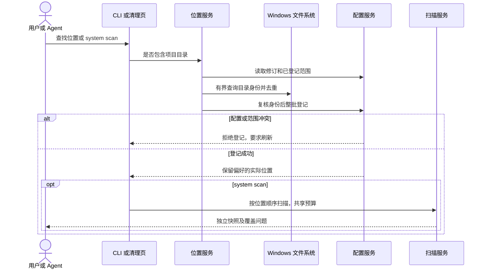

## 工作区与个人规则

当前 CLI 源码提供工作区注册、排除、规则版本导入与启停、启用规则扫描、草稿预览及分页结果。命令沿用共享 [CLI 合同](../ai/agent-and-cli-contract.md)，原生运行验收尚未完成：

```powershell
shou workspaces add --path "C:\Users\Alice\Projects" --root-ref developer-workspaces --json
shou rules validate --file ".\cache.rule.json" --json
shou rules import --file ".\cache.rule.json" --json
shou rules preview --file ".\cache.rule.json" --workspace "<返回的工作区 ID>" --json
shou scan results --scan-id "<返回的扫描 ID>" --limit 50 --json
shou rules enable --rule-id "<已导入的规则 ID>" --workspace "<返回的工作区 ID>" --json
shou scan --workspace "<返回的工作区 ID>" --json
```

导入不启用规则；`rules enable` 只改变本地绑定，不授权清理。`rules show`、`rules export` 通过结果信封返回可分享定义；当前 Windows `rules export` 不提供 `--output`。`rules list` 返回个人规则与绑定，并通过 `builtin_templates_available=true` 指向可单独查询的内置目录。

`analysis scan` 返回有界内存测量，不保存记录。`rules preview` 单独评估指定草稿，保存 `preview_only=true` 的证据；启用后必须使用 `scan --workspace` 重新扫描。普通扫描冻结当前有效内置定义与明确启用的个人规则，返回 `preview_only=false`；无适用规则时只测量。两类摘要均以 `rules` 数组返回规则 ID 与摘要，`scan results` 保留来源标记，游标绑定扫描 ID、记录内容与偏移，页大小为 1–500。

结果标为 `review` 或 `blocked`，CLI 返回当前主机的清理 `execution_available`。`plan create` 可组装计划而不修改目标；在匹配的 Windows 11 原生进程中，`plan execute` 仅执行明确确认的永久动作。源码、凭据、数据库、未知链接和用途不明的内容采用保守保护，个人规则不能申请内置工具例外。

遍历完成并复核的每个目录单独记录完整覆盖。无关子树有缺口时保留独立完整候选；目标自身不完整则阻止处理。规则、工作区和全局排除共同生效，受保护后代阻止父目录整体处理。保留期使用最新后代修改时间，不以访问时间推断未使用。

扫描默认最多 100,000 条目、120 秒、32 层，允许上限为 1,000,000 条目、3,600 秒、64 层。全部规则共用最多 2,000,000 次分析操作和扫描剩余时间；快照序列化与发布在该遍历时间预算之外，最多 128 MiB。取消不发布快照，部分覆盖和分析预算不足保持可见。扫描期间配置变化时返回 `plan_stale`，不能保存为当前证据。

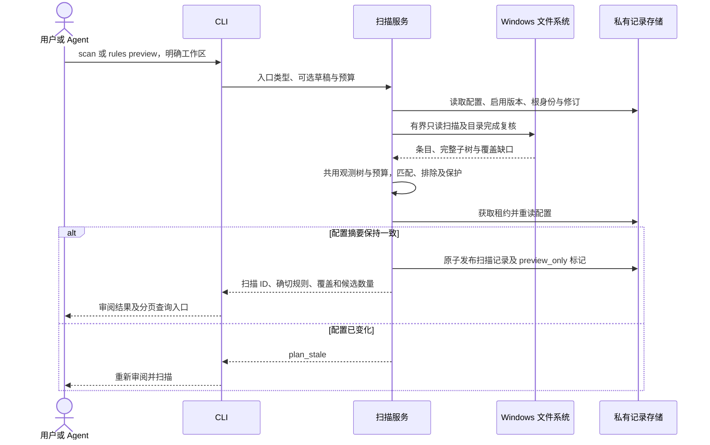

## 界面配置

WinUI“清理规则”页直接使用 CLI 的同一份配置服务，无需借助终端完成个人规则的扫描准备：

1. 通过系统文件选择器导入 JSON 规则，复用 CLI 的原生文件读取适配，单个文件最多 256 KiB、读取期限十秒，不跟随链接并核对读取前后的身份和元数据；Core 校验完整 Schema 和不可变版本。导入不改变已启用版本，非 Windows 规则可查看但不能启用。
2. 选择明确的规则版本。已有匹配扫描位置时自动选中；否则通过“为此规则选择文件夹”登记目录，逻辑引用来自规则，真实路径及当前用户身份由 Core/Platform 核验。同一逻辑引用只能绑定一个目录，不会静默改绑。
3. 在具体位置启用所选版本。导入更新版本不替换原绑定；页面同时显示实际绑定的版本。停用只作用于当前明确选中且已启用的版本。
4. 返回智能清理，重新扫描后审阅候选。内置规则随所选位置展示，可启停当前包内版本；个人规则仍绑定明确的不可变版本。推荐选择尚未实现。

扫描位置可单独移除，操作前展示确切路径并说明保留目标文件和导入规则；该位置绑定与局部排除随配置删除。排除设置支持所有位置、所选位置和项目范围。保存前预览最终相对模式，项目模式留空表示保护整个项目（`**`）；项目目录必须是确切相对路径。继承的全局保护单独展示，只能在所有位置范围移除。规则自身排除继续由规则定义拥有。

`ConfigurationViewModel` 串行化页面读写；写入和实际状态重读完成前禁用冲突操作与页面切换。每次刷新、保存开始时立即使清理页旧范围、扫描、选择和计划失效，迟到结果不能恢复旧证据。已派发的配置写入不提供取消或回滚承诺；窗口关闭后停止页面通知，不把关闭视为撤销。进程仍运行时，成功、失败或取消响应后均重新读取实际配置；重读失败时清除可编辑状态，要求刷新。目录／文件选择器取消及排除预览取消不会发起写入。

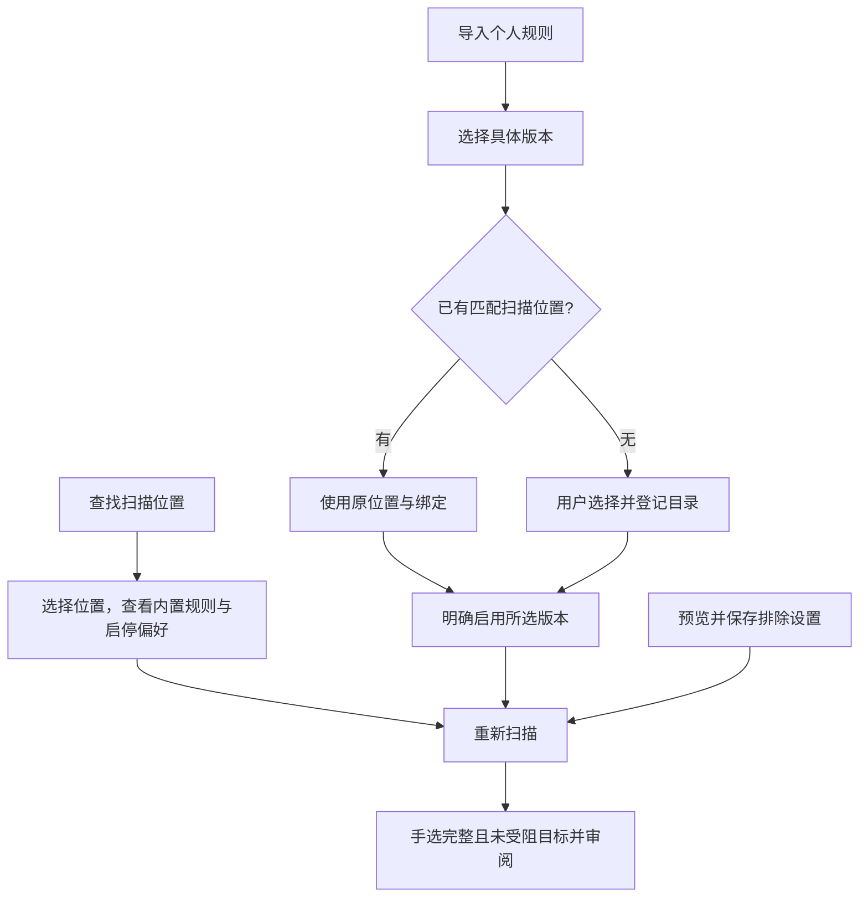

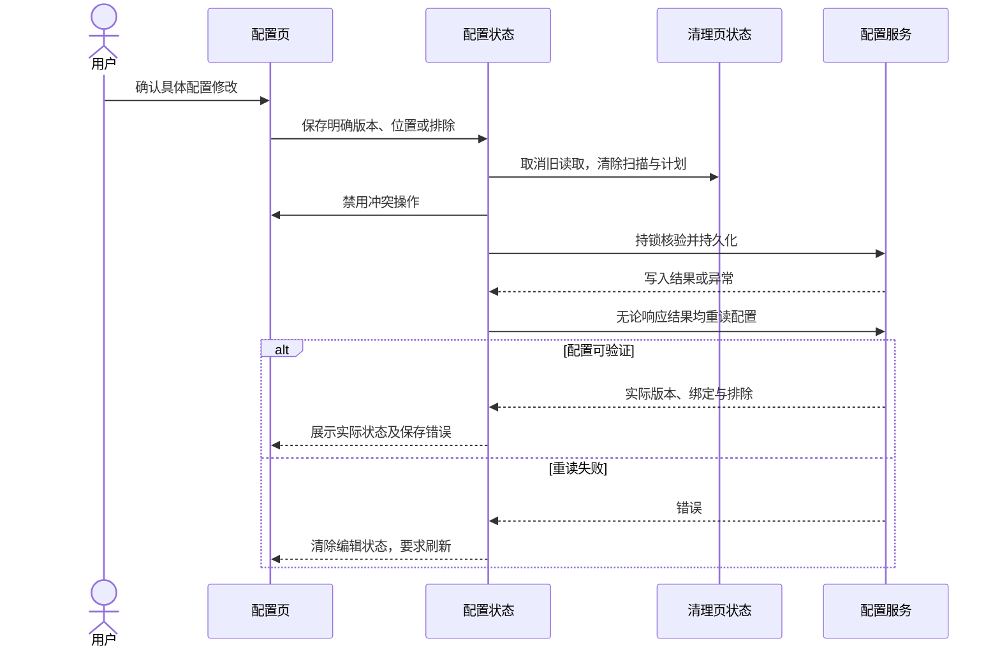

## 界面审阅与历史

WinUI 源码提供空间分析、智能清理审阅、清理规则与历史导航。清理页的“查找扫描位置”准备固定与常见项目目录，然后选择一个位置扫描内置及启用的个人规则。准备开始立即清除旧证据，登记响应后无论成功或失败都重读实际配置；已派发登记不提供停止或回滚承诺，关闭页面只抑制迟到结果。配置页随后刷新以显示内置偏好。界面可扫描页面列出的全部已配置位置，结果按类别、规则与路径汇总，支持保留跨位置选择的筛选、明确推荐选择及一个多位置计划的合并审阅；执行门禁和原生验收仍未完成。

`CleanupReviewViewModel` 负责异步状态、明确选择和计划审阅；App 中的 `NativeReviewOperations` 组装 Core 与 Platform，并将服务工作移出 UI 线程。页面每次显示 200 个候选，跨页保留最多 256 个手动选择。高风险项默认不选；受阻、不完整、草稿、重复范围与父子重叠项不能进入审阅集合。页面显示具体阻断原因，领域服务仍拥有最终资格和实时核验。

切换位置会清空选择和计划；批量结果可按位置重新查看，刷新或配置变化清空旧证据。新请求隔离迟到响应，规划失败后要求重新扫描。单位置扫描与计划请求取消后不发布未确认结果；批量读取保留此前已保存的快照，变更操作保留真实记录结果。配置写入按上一节核对实际状态。

“审阅所选项目”明确以永久动作创建计划，只展示完整路径、项目数、估计容量与风险，不生成确认授权。“永久清理”已有独立确认与执行处理器，当前因共享原生验收门禁关闭而禁用。清理审阅源码与页面状态测试不能作为原生变更验收。

历史页每页查询 50 条已记录摘要，详情重读并校验计划；“核对记录位置”只观察确切位置。界面分别展示已记录结果与当前观察，未知或未完成意图不会因为原位置消失而显示成功。分页与刷新不拼接不同查询快照，切换记录会清除旧观察。页面没有恢复、重试或日志改写入口。

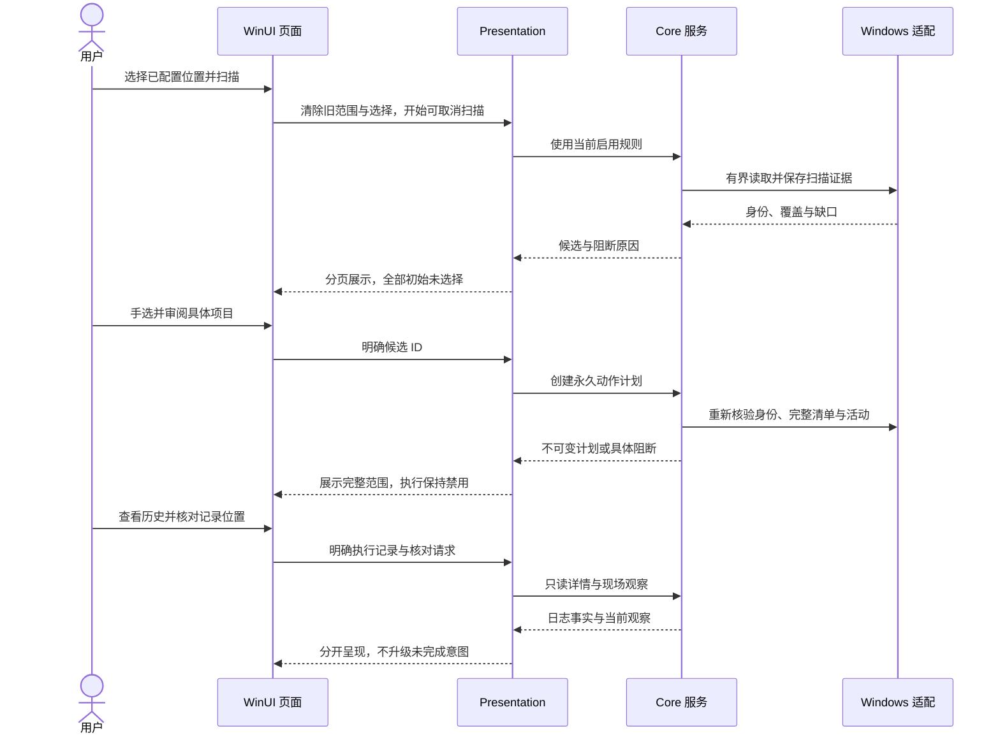

### 文件清理确认与窗口生命周期

`CleanupExecutionViewModel` 与审阅状态分离，只绑定当前永久计划。App 先检查 `WindowsCleanupMutation.PublicExecutionAvailable`，再由同一个 Core 服务请求当前确认并消费一次性同意；GUI 与 CLI 读取同一关闭门禁，不提供环境变量绕过。`WinUICleanupConfirmation` 在 UI 线程展示计划中的确切路径、数量、风险和不可恢复后果，默认取消，页面不可见或取消时不能完成确认。

开始执行即清空可执行计划、扫描与选择，期间禁止切换清理范围或离开清理页。停止及正常关窗只请求合作取消，窗口继续等待当前任务返回；结果即使晚于停止也按实际记录展示。强制终止进程不在这项保证内。已有意图、未知结果和日志写入失败不能自动重试；页面保留确切计划查询入口，读不到记录不表示没有变更。查询只校验该计划的日志，不改写状态或授予恢复。

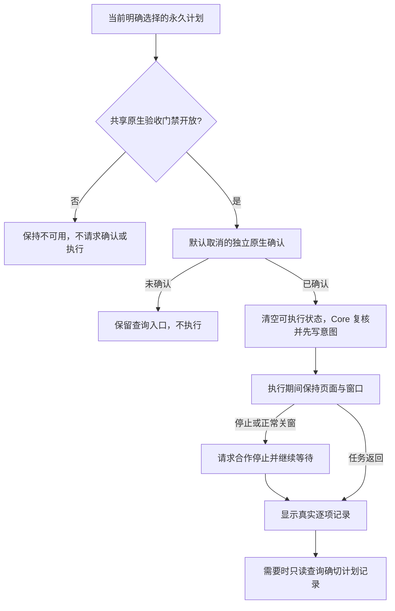

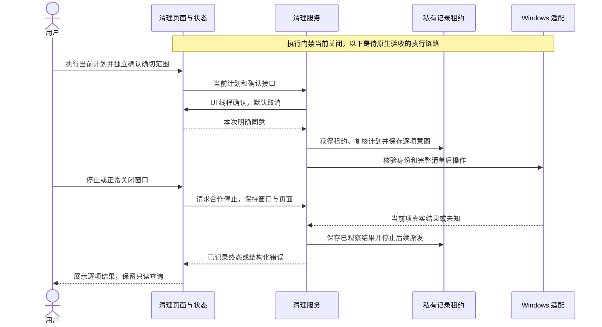

## 受控清理领域服务

Core 已有计划、当前确认和逐项日志编排，并使用内存夹具验证。CLI 已组装原生文件系统、活动检查和变更适配；`plan create` 与 `plan show` 可创建、读取计划；在匹配的 Windows 11 原生进程中 `plan execute` 执行确认的永久动作并记录每项结果，其他主机在触碰目标前返回 `unsupported_capability`（退出码 `8`）。能力发现公开运行时门禁，没有环境变量绕过。原生夹具和交互 UI 仍是独立验收门槛；WinUI 已有独立确认、停止等待、记录查询及正常关闭保护源码。

```powershell
shou plan create --scan-id "<普通扫描 ID>" --candidate "<候选 ID>" --mode permanent --json
shou plan show --plan-id "<返回的计划 ID>" --json
```

CLI 与共享合同一致，`--mode` 默认为 `trash`。当前回收站能力不可用，默认动作返回不可用；必须明确选择 `--mode permanent` 才能创建永久清理计划，不能自动降级。创建计划不会删除文件。重复 `--candidate` 可选择多项，不允许隐式全选或重复 ID。

仅普通启用规则扫描可创建计划，必须显式选择 1–256 个互不重叠的完整目标。计划冻结配置、规则、清单、祖先身份与 marker 元数据、动作和十分钟期限，并重新观测当前文件系统。活动必须明确为非活跃；未知状态阻止规划及执行。

当前确认绑定服务实例、计划摘要和动作，最长一分钟、单次消费，不可从 JSON 恢复。终端确认源码向 stderr 展示完整范围、摘要、风险与不可逆提示，要求精确的 `PURGE <plan-id>` 或 `TRASH <plan-id>`；输入最多 256 字符、一分钟内完成，stdin 与 stderr 都必须为交互终端，stdout 可用于 JSON。路径和规则字段的控制字符会被转义。注入提示的纯逻辑测试已运行，实际 Windows Console 行为尚未验收，当前关闭的执行入口不会发起提示。

提示期间不持修改锁；执行持异步存储租约，整批预检后逐项复核，先持久化 `purging` 或 `moving`，再调用原生能力接口并保存结果。未知结果停止后续派发，日志失败返回 `journal_write_failed`。任何已有执行意图都阻止计划重放；缺少最终状态不能推断成功。恢复仍未实现，历史只读入口见下文。

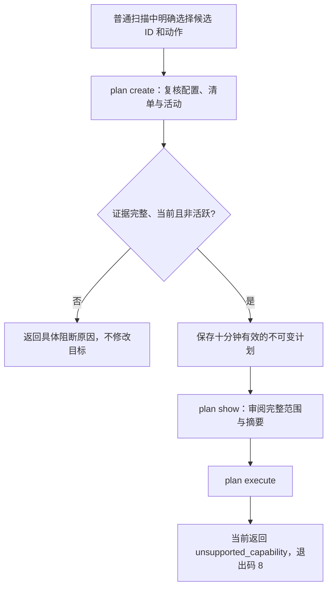

`WindowsCleanupMutation` 仅实现永久移除：固定工作区祖先和上下文，使用 `NtCreateFile` 相对父句柄打开对象，不跟随 reparse point；通过句柄枚举并完整预检清单，逐项按身份后序处理，再用 POSIX disposition 解除当前已打开名称。它不递归删除路径，不覆盖只读属性，并要求映像节检查；新增对象不进入清单。目录必须为空才能移除，原对象解除关联后才计数，不能确认时返回未知。默认每项两分钟协作预算，系统调用仍可能阻塞；取消后等待当前原生边界得到结果，再保存日志。回收站动作当前返回不可用。

`WindowsCleanupActivity` 组装两类只读观察：Restart Manager 查询目标文件和父级 marker 的占用；固定工具名单的进程快照查询已核验的工作目录是否与目标父级项目目录重叠。名单由 Core 固定，规则不能传入进程名。忽略 Shou 当前进程与通过已打开句柄确认退出的进程，不读取命令行、环境变量，不提权或终止其他进程。

两类检查共用十秒期限和有界原生 worker。最多检查 16,384 条快照记录、读取 64 个匹配工具的目录；权限不足、目录身份不明、不完整快照、超额或超时不能判为非活跃。有正向活动证据时返回活跃；否则只要任一观察未知就阻断，两类都无活动才返回非活跃。不同项目的工具不因同名而全局阻断。

已正向核验位于项目及祖先范围之外的目录不要求与目标具有相同 owner SID，也不授予任何清理权限。目录证据缺失仍阻断，范围重叠但所有者不同仍保持未知；目标、上下文和工作区的所有者检查不变。

工作目录适配通过 `NtQueryInformationProcess` 与 `ReadProcessMemory` 读取 PEB 中的目录字段，并前后核验指针、目录字节和文件系统身份，包含 native 64 位与 WOW64 布局。该内部 ABI 尚无 Windows 运行证据。工作目录只是活动线索：从其他目录通过绝对参数使用项目等情形可能不被观察，不能承诺发现所有使用方式。原生进程、竞态、中断和终端验收完成前，公开变更能力保持关闭。

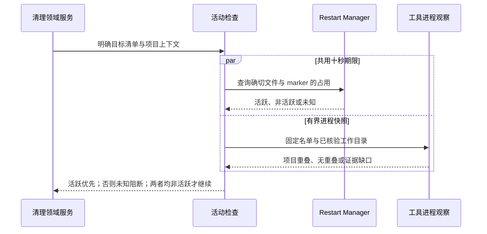

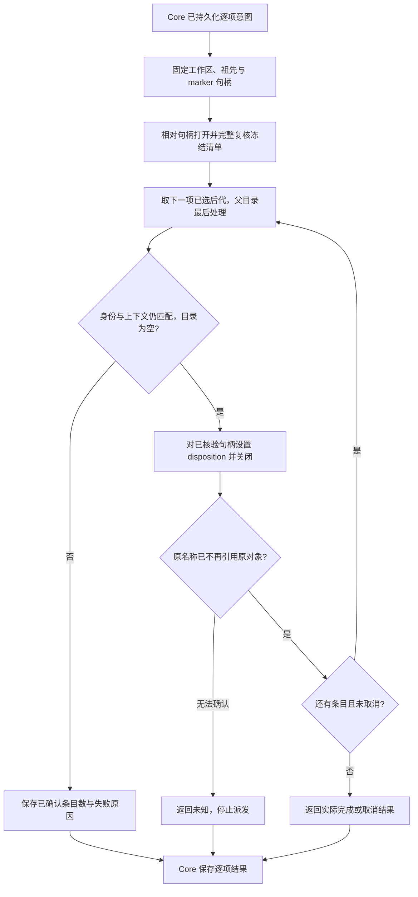

## 历史查询与现场核对

CLI 已接入以下只读命令，原生运行验收尚未完成。公开清理尚未开放，因此这些查询不会为用户产生新的清理记录。

```powershell
shou plan show --plan-id "<已保存的计划 ID>" --json
shou history list --limit 50 --json
shou history show --execution-id "<已保存的执行 ID>" --json
shou history inspect --execution-id "<已保存的执行 ID>" --max-entries 100000 --max-seconds 120 --json
```

`history list` 每次在同一存储租约内读取日志摘要，不加载目标清单，返回 `plan_verified=false`。默认每页 50 条，上限 500 条，按开始时间降序、执行 ID 升序排列。每次查询限制私有目录总计 4,096 个条目、32 MiB 执行日志与十秒；超出预算返回 `resource_limit` 或 `time_limit`。游标绑定日志集合、原始字节摘要、页大小和偏移，记录变化返回 `source_changed`。损坏行单独列入 `issues`，其他可读行仍可查询；无法读取原始字节时不提供续页游标。缺口返回 `status=partial` 与退出码 `6`。

`history show` 重读对应计划并校验摘要、动作、时间、逐项 ID、状态组合与回执身份。`plan show` 只读取并验证计划；过期历史仍可阅读，读取不恢复确认授权。历史查询不依赖当前配置仍保留该工作区或规则。

`history inspect` 从打开记录到完成观察始终持有同一跨进程租约。它只检查清单中的确切原路径和已记录回收站位置，不搜索回收站、不改写日志、不重试操作。`--max-entries` 与 `--max-seconds` 共用扫描上限，全部目标和位置共享预算；条目计量包含定位根的观察与扫描产出的条目，目录深度上限为 64。

结果保留 `recorded_state`、`unfinished` 和 `checked_at`，每个位置区分 `matches`、`missing`、`changed`、`unavailable`、`not_recorded`。匹配要求完整清单与全部身份、元数据相符；Windows 不放宽回收站根的变更时间校验。每项 `assessment` 为 `verified_permanent`、`verified_trash`、`unchanged`、`conflict` 或 `needs_verification`。已记录永久完成且原位置不存在，才能报告 `verified_permanent`；`purging` 或 `unknown` 即使原位置消失也仍须核实。未结束执行保持未结束。预算不足或存在待核实／冲突返回 `status=partial`、退出码 `6`，外部取消返回 `130`。所有结果均为 `records_changed=false`、`recovery_available=false`。

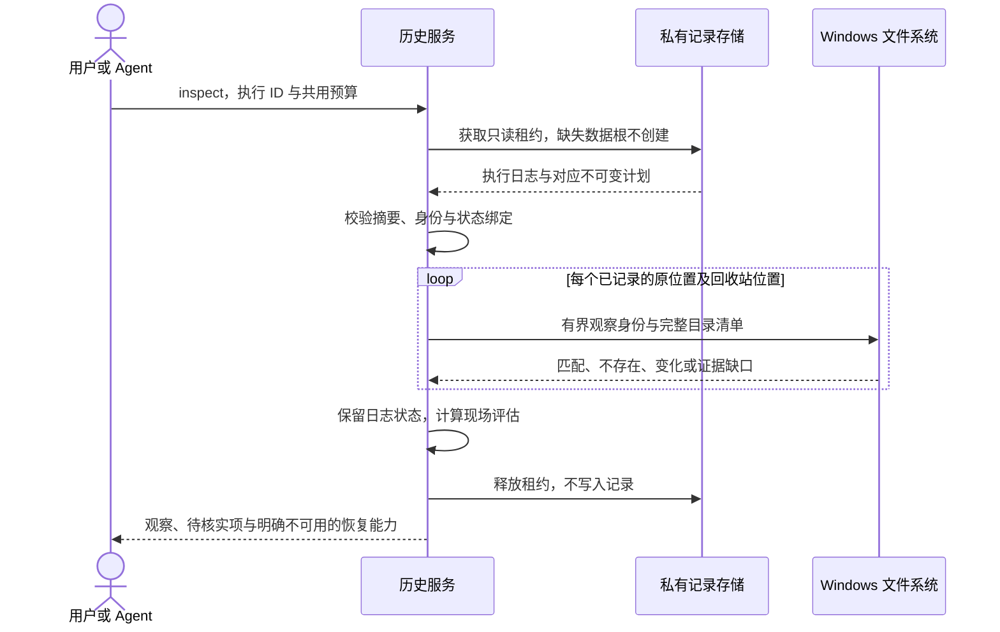

## 私有记录

默认数据根为 `%LOCALAPPDATA%/Shou/Data`。`SHOU_DATA_DIR` 可指定绝对本地目录，其父目录必须已存在并属于当前用户。缺失存储上的只读查询不创建数据根。目录与文件使用当前用户和 SYSTEM 的受限 ACL，拒绝现有宽权限、junction、云占位和多重硬链接记录，不自动修改权限。

读取与更新共用跨进程租约；竞争返回 `store_busy`。更新先写唯一临时文件、刷新，再按已固定的目录与文件句柄原子发布；单条记录原子替换不等于多记录事务。发布后刷新失败返回 `commit_unconfirmed`，调用方须检查结果，不能假定未提交并盲目重试。格式与限制见[Windows 数据合同](../architecture/data-model.md#windows-原生记录)。

## 计划任务开关

以下源码命令与启动发现分开；审阅不打开存储，执行与记录查询使用当前用户私有操作记录。

```sh
shou startup inspect --task-path '\Folder\Task' --action enable --json
shou startup control --task-path '\Folder\Task' --action enable --review-digest sha256:<digest> --json
shou startup execution show --startup-operation-id startup_control_<id> --json
```

动作仅为 `enable|disable`。`inspect` 返回五分钟内存审阅、阻断原因和当前主机的 `execution_available`。在匹配的 Windows 11 原生进程中，`control` 重新核对摘要、要求当前终端确认（`STARTUP ENABLE <当前操作ID>` 或 `STARTUP DISABLE <当前操作ID>`），只修改计划任务的 Enabled 标志；其他主机返回 `unsupported_capability`／8，不提示确认或设置任务。不接受 `--yes`、`--approved` 或重试参数。

`execution show` 为 read，只读已有记录，无记录返回 `not_found`／5，不创建存储。任务变化返回 `startup_changed`／4；日志写失败以 partial／6 返回当前操作 ID 与查询 next_action，不能据输出判断没有变更。平台不受支持返回 8，不创建记录目录。资格、安全边界及 UI 等待行为以[启动项合同](../product/startup-items.md#计划任务开关审阅与控制)为准，存储格式见[数据模型](../architecture/data-model.md#windows-计划任务开关记录)。原生控制和界面尚未验收。

## 生成计划任务的原生控制验收

状态：独立入口与六项原生用例已有源码；在 Mac 上仅验证编译、明确跳过和脚本拒绝行为，Windows 实际运行待取证。此入口直接验证原生适配与 Core 服务，保持产品公共门禁关闭，不能作为 UI 或真实终端确认验收。

在匹配架构的 Windows 11 x64／ARM64 上，从仓库根目录使用 PowerShell 7.4 或更高版本、固定的 .NET SDK 与 Python 执行：

```powershell
& "./scripts/windows/test-startup-fixtures.ps1" -RunGeneratedStartupFixtures
```

可用 `-ArtifactsRoot` 指定固定本地磁盘的输出目录，默认位于 `%LOCALAPPDATA%/ShouBuild/generated-startup-tests`。共享／映射网络盘与 UNC 不受支持。入口不接受现有任务、程序或账户参数，也不请求提权。未传明确开关、系统／架构不匹配或传入未知任务参数时拒绝执行；默认测试入口跳过这六项任务变更用例。

每项用例只创建一个随机 `\ShouGeneratedStartup-<id>` 目录中的当前用户任务。任务初始禁用，唯一的当前用户登录触发器与手动启动均明确禁用；动作指向本次夹具目录内不存在的 `.exe`，不调用任何运行任务的 API。注册使用 create-only，定义变化场景使用 update-only，防止更新意外变为创建。

| 用例 | 真实系统验证目标 |
| --- | --- |
| 开关往返与查询 | 启用／禁用 setter、回读、持久化结果、重开查询、防重放与参数不入日志 |
| 拒绝当前确认 | 开关不变，无变更调用或持久化意图 |
| 确认时定义变化 | 仅修改该生成任务的 Hidden 设置，复核摘要后拒绝变更，无意图 |
| 确认时停止 | 正确确认不能覆盖取消，无意图 |
| 原生边界身份不匹配 | 适配器拒绝不同执行者，开关不变 |
| 写意图后、派发前停止 | 保存 cancelled／not_started，开关不变，已有意图不能重放 |

夹具在清理前复核当前账户、确切目录／任务、所有者、唯一生成标记、禁用触发器／手动启动和定义摘要，再移除该任务与已确认为空的生成目录。不递归移除文件系统目录；原生所有权或定义无法核验时拒绝清理并保留诊断。生成标记文件、逐阶段 JSON 与私有操作记录保留在输出目录。

脚本要求六项全部实际执行并通过，不把跳过算作成功；核对测试前后源码摘要相同，以及六份初始禁用与最终任务目录移除回执。输出含 TRX、工具链、系统／进程架构、源码摘要、阶段事实、操作记录和文件 SHA-256 的 `verification.json`。普通列表发现不打开这些记录。该证据仍不覆盖调用中的强制中断、并发替换／ABA、权限矩阵、真实终端、WinUI、其他启动来源或签名分发，不能单独开放产品门禁。

## 浏览器隐私只读扫描

`privacy scan [--range last-hour|last-day|last-seven-days|all-time]` 保存固定时间窗口的汇总观察，`privacy scan show --scan-id <privacy_scan_id>` 严格读取元数据，不再次查询浏览器记录。WinUI 隐私页经 `PrivacyScanViewModel` 明确启动同一 Core 服务；改变范围或配置清空结果，停止丢弃迟到响应，离开页面请求取消。导航不会自动扫描，不提供隐私删除操作。CLI 部分观察返回 `status=partial`、退出码 `6`。

来源、ACL／句柄、SQLite、预算及不支持结构由[隐私清理](privacy-cleaning.md#windows-平台边界)定义，平台记录由[数据模型](../architecture/data-model.md#windows-隐私观察)定义。计划、当前确认、事务删除及回执仍待实现。
