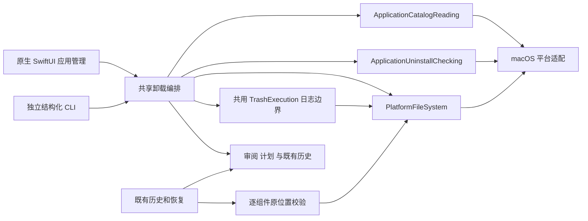
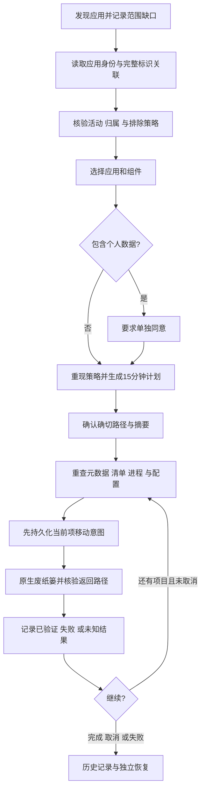
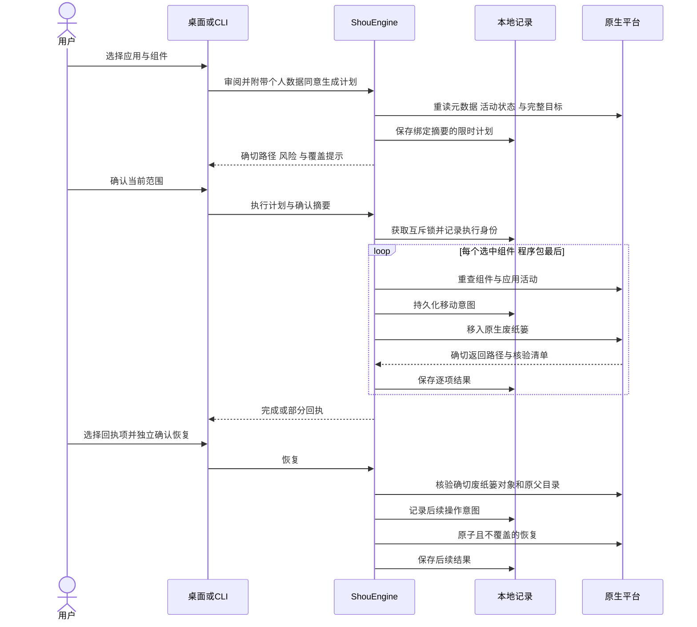

# 应用卸载与关联文件

[English](../../product/application-uninstall.md)

状态：macOS 已实现，并通过生成夹具的本机验证，验收构建已安装本机；确切运行证据与边界见[验收记录](../engineering/acceptance-and-testing.md)。本能力独立于可重建缓存规则，不能据此推导已发布版本具备相同功能。

## 背景、目的与收益

移除应用后，缓存、偏好设置和数据库可能继续占用空间。用户需要同时看清这些组件的路径与归属，并单独决定是否保留个人数据。桌面“应用管理”和独立 CLI 共用审阅、计划与执行流程；已有 Codex、Claude Code 等可以读取结构化结果并准备计划，Shou 不接入模型、不开发 Agent。

用户可以按名称、完整标识或路径搜索应用，逐项审阅程序包与关联数据，在明确范围后移入原生废纸篓，再从历史记录按原位置恢复。收益是减少查找残留的重复工作，并让每一步都有具体路径和回执。

## 用户故事与用例

| 用户故事 | 行为与结果 |
| --- | --- |
| 卸载不再使用的工具 | 选定确切安装路径，审阅程序包、缓存和日志，预览后确认 |
| 保留软件中的工作内容 | 个人数据默认不选；偏好设置、数据库、会话和容器需要单独允许再逐项选择 |
| 同一个软件安装多个版本 | 不同路径作为独立应用；发现同标识安装时，保护可能共享的关联数据 |
| 让现有 Agent 准备操作 | CLI 输出标识、路径、风险、覆盖提示及计划；执行保留用户交互确认 |
| 误选后恢复 | 从历史记录选择已验证的移动项，独立确认恢复；原位置已有文件时拒绝覆盖 |
| 清理中途停止 | 当前已开始项完成原生核验，下一个项目不再开始；部分结果保留回执 |

这是一组逐项记录的文件操作，不是跨多个目录的原子事务。失败或取消可能形成部分结果，应按回执恢复已验证移动的项目。移入废纸篓不代表立即释放磁盘空间。此阶段卸载回执仅支持恢复，不提供应用内永久移除。

## 范围与归属证据

| 组件 | 关联方式 | 个人数据同意 |
| --- | --- | --- |
| 应用程序包 | 确切安装路径、元数据及设备／inode 标识 | 选择应用本身 |
| 缓存、日志 | `~/Library/Caches/<id>`、`~/Library/Logs/<id>` | 无额外数据同意；仍需审阅 |
| 偏好设置 | `~/Library/Preferences/<id>.plist` | 必须 |
| 应用支持数据 | `~/Library/Application Support/<id>` | 必须 |
| 保存的状态 | `~/Library/Saved Application State/<id>.savedState` | 必须 |
| 应用容器 | `~/Library/Containers/<id>`，且 `MCMMetadataIdentifier` 完全匹配 | 必须 |
| 共享组容器 | `~/Library/Group Containers/<name>`，且系统容器元数据匹配 `<id>` 或 `group.<id>` | 必须 |
| WebKit、HTTP 存储 | 对应 Library 类别下完整标识目录 | 必须 |

完整标识只能证明关联线索，不能证明独占归属。发现重复标识时阻止处理关联组件。共享组容器只有在系统容器元数据确认属于当前应用时才会进入审阅，无法确认或可能共享的容器仍受保护。发现范围不完整时显示提示，并取消关联组件的自动选择，用户需逐项决定。安装包收据、外部辅助程序注册、自定义数据路径、其他账户及仅剩残留而原应用已不存在的发现流程，不在此阶段范围内。名称相似、子串或推测的厂商前缀均不授权删除。元数据无效的应用保留在列表中，但不能生成卸载审阅。

默认检查 `~/Applications`、`/Applications` 及其下两层容器文件夹。主动包含的 `/System/Applications` 受保护。遇到应用包后不继续发现其内嵌辅助应用。发现默认预算为 4,000 项、10 秒；不能读取、深度和预算缺口均明确记录。`Contents/Info.plist` 支持 XML／binary，上限 256 KiB，仅输出白名单展示字段。

## 架构



核心层负责关联、同意、排除、计划验证和回执状态；平台层负责有界不跟随读取、当前账户进程证据、容器元数据和原生文件操作；UI／CLI 负责明确选择与确认。`TrashExecution` 与普通清理共用，不增加第二套删除循环或 Shell 规则。

普通工作区的受保护根目录限制保持有效。应用恢复使用独立且受限的安装父目录能力；关联数据保存其自己的用户目录身份。历史核验与恢复必须先重现组件类型对应的确切原路径。

## 流程图



程序包最后处理。计划绑定应用元数据、组件完整清单、配置摘要、个人数据同意及到期时间；存储记录本身不构成执行权限。每项移动前重新检查当前应用、进程、相关重复标识、组件父目录与文件清单。当前账户进程证据覆盖 GUI 标识及应用包内可执行路径，不能证明其他账户或所有外部辅助程序均已停止；不会主动结束进程。

## 时序图



## 安全与边界

- 系统／Apple 应用、当前执行应用、运行中的应用及辅助程序、未知活动、其他所有者条目、特殊文件、多重硬链接文件、Shou 存储和匹配的排除项受保护。
- 父路径及目标根不跟随符号链接。包内链接只记录、不解引用；仍需本机文件系统与完整清单。
- 单独偏好设置文件计算内容摘要，上限 16 MiB。经验证的移动／恢复仅允许根 ctime 差异；内容、身份、mtime、权限、链接数仍需匹配。旧目录清单编码不变。
- 目录继续使用完整元数据清单，不承诺对整个应用的每个文件内容计算哈希。
- 取消在项目边界生效。已有持久化意图的原生操作完成核验并记录结果；未知结果不会自动重试。
- 恢复校验每个组件的原父目录，不重建缺失父目录、不覆盖已有文件。历史核验只读确切记录位置，不枚举废纸篓、不修补回执。
- 不增加管理员提权、特权辅助进程、launchctl 修改、权限变更、模型接入或 Windows 支持。

## CLI 合同

```sh
shou applications list --json
shou applications inspect --path "/Applications/Example.app" --json
shou applications plan --review-id <review-id> --component <app-id> --component <cache-id> --json
shou applications plan show --plan-id <plan-id> --json
shou applications uninstall --plan-id <plan-id> --json
shou history inspect --execution-id <execution-id> --json
shou history restore --execution-id <execution-id> --item <item-id> --json
```

计划创建时的 `--include-user-data true` 仅允许明确选择的个人数据，不会自动勾选。卸载需要控制终端及完整短语 `UNINSTALL <plan-id>`；管道或 `--yes` 不能绕过。恢复另行确认 `RESTORE <execution-id>`。读取与计划操作可由现有编码 Agent 协助完成。

验证仅使用生成的独立应用与数据，自动化、CLI、桌面和安装的实际范围见[验收](../engineering/acceptance-and-testing.md)。第三方产品参考统一见[鸣谢](../../../README.zh-CN.md#鸣谢)。
