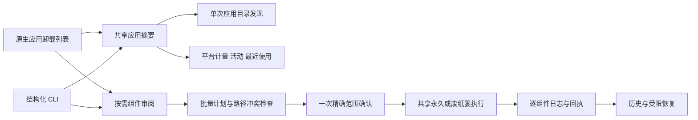
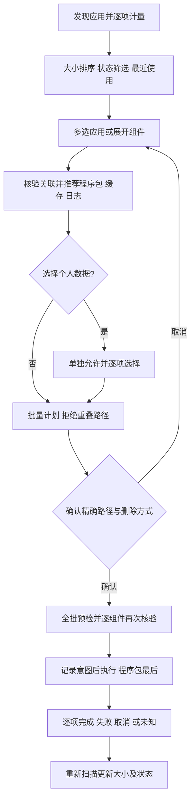
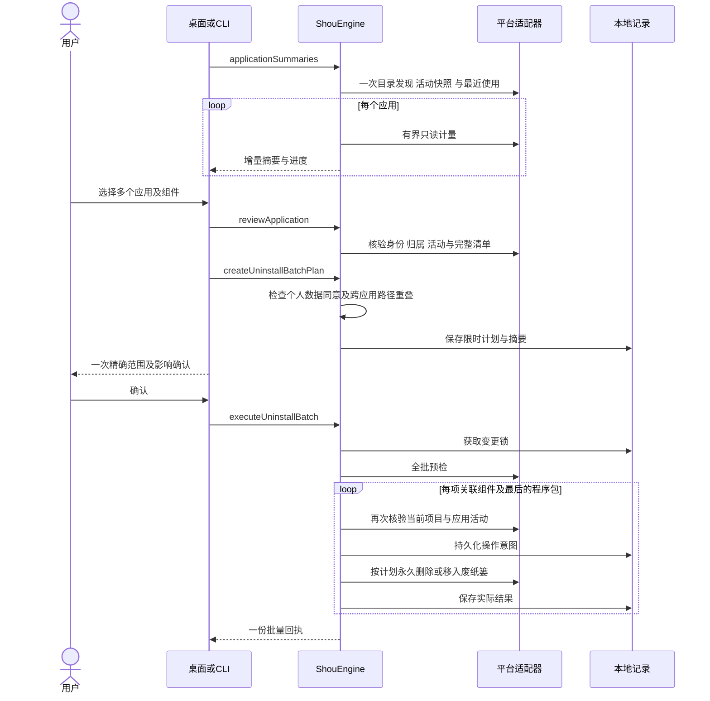
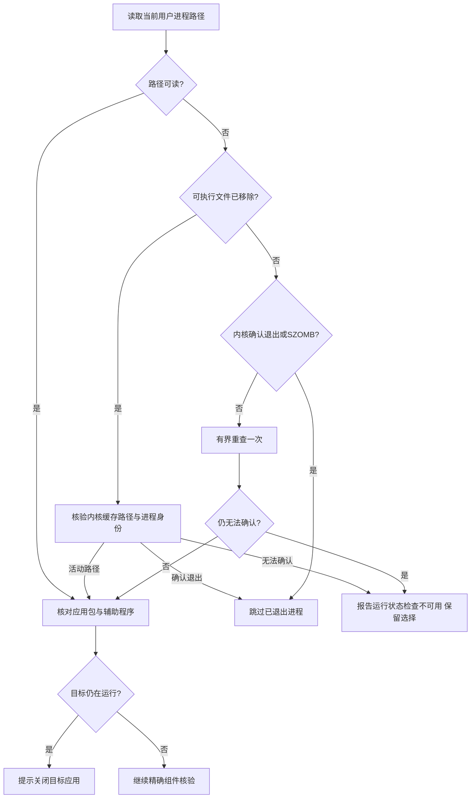

# 应用卸载与关联文件

[English](../../product/application-uninstall.md)

应用卸载独立于可重建缓存规则。桌面与 CLI 共用应用摘要、组件审阅、批量计划、原生执行和历史；卸载执行不依赖模型；下一阶段内置清理 AI 不能绕过组件选择、个人数据同意和实际卸载确认。当前实现和实际验收分别记录，测试范围见[验收记录](../engineering/acceptance-and-testing.md)。

## 背景、目的与收益

用户需要一次选中多个不再使用的应用，直接看清程序包、缓存与个人数据，统一确认和卸载。反复进入单应用详情页会增加操作成本，也不便比较大小。列表以应用为单位展示图标、版本、确切标识、状态、应用本体分配容量估算和系统最近使用记录；展开或选择时再测量关联文件，不为整个应用目录预先保存所有删除清单。

## 用户故事与交互

| 场景 | 交互与结果 |
| --- | --- |
| 找出占用大的应用 | 默认按大小降序；可按名称、状态、大小、最近使用排序，搜索名称、完整标识、版本或路径 |
| 一次卸载多个应用 | 初始无选择；勾选应用时审阅并默认选择合格的程序包、缓存与日志；底栏持续显示应用数及实际所选组件容量 |
| 检查关联文件 | 在同一列表展开应用，查看每项的路径、大小、风险和不可用原因，不进入另一页 |
| 保留工作内容与登录状态 | 偏好、数据库、保存状态及容器默认保留；必须允许个人应用数据后逐项勾选 |
| 调整批量范围 | 表头全选仅作用于当前筛选内可卸载的应用；筛选外及自定义组件选择保留；取消必选程序包即取消该应用 |
| 运行中的应用 | 显示“需关闭应用”，可请求正常退出，关闭后重新扫描；不强制结束进程，不自动勾选 |
| 需要管理员权限的应用 | 可选择的锁标记；符合条件的当前用户／root 所有程序包通过 Finder 原生方式移到废纸篓，按需由 macOS 验证身份，关联数据保留 |
| 受保护应用 | 系统／当前应用、其他用户内容及无法核验的目标继续不可用 |
| 确认卸载 | 桌面默认移到废纸篓并确认精确范围；符合条件的用户自有应用可在菜单主动选择永久卸载 |
| 查看结果或恢复 | 每项结果进入共享历史；只有已核验的废纸篓项可以恢复，永久删除无法恢复 |

大小是分配容量估算，不保证等量释放；列表摘要只统计应用本体，底栏统计所选程序包及关联组件。系统最近使用记录缺失显示“暂无使用记录”，不以修改时间替代。应用目录发现缺口、未知大小、运行检查失败均明确显示。修改选择、重新扫描或完成变更后不能沿用旧确认；变更后应重新扫描更新状态和计量。

## 组件与归属

| 组件 | 关联方式 | 个人数据同意 |
| --- | --- | --- |
| 程序包 | 确切安装路径、元数据、device/inode | 选择应用本身，卸载必选 |
| 缓存、日志 | `~/Library/Caches/<id>`、`~/Library/Logs/<id>` | 默认仅推荐合格且无覆盖警告的项 |
| 偏好 | `~/Library/Preferences/<id>.plist` | 必须 |
| 应用支持、保存状态 | 对应 Library 类别下完整标识路径 | 必须 |
| 应用容器 | 完整标识路径及原生容器元数据匹配 | 必须 |
| 共享组容器 | 原生容器元数据明确关联当前应用 | 必须 |
| WebKit、HTTP 存储 | 对应 Library 类别下完整标识路径 | 必须 |

完整标识是关联线索，不能单独证明独占归属。重复安装可能共享组件；共享或无法验证的组件受保护。跨应用选择的相同或父子重叠路径在批量计划阶段整体拒绝。名称相似、厂商前缀和仅存在孤儿残留均不授权删除。安装包收据、外部辅助程序注册、自定义数据路径和其他账户不在本阶段范围内。

默认发现 `~/Applications`、`/Applications` 及其下两层容器目录；主动包含的系统应用保留保护。遇到应用包后不发现内嵌应用。发现预算为 4,000 项、10 秒；每个应用独立进行有界大小测量，关联组件在选择时接受完整清单核验。Windows 尚未验收。

## 架构



`ApplicationsSession` 仅管理界面状态、筛选外选择、组件缓存及操作生命周期。`ShouEngine` 负责归属、同意、排除、摘要绑定与变更前核验。`ApplicationCatalogReading`、`ApplicationUninstallChecking` 和文件系统适配器提供平台事实。批量卸载复用 `TrashExecution` 或 `PermanentExecution`，一个回执保存每个组件的精确原位置；不增加第二套删除循环。

## 流程



## 时序



## 执行与恢复边界

计划有效期为 15 分钟，绑定应用身份、组件完整清单、配置、个人数据同意和删除方式。全批预检失败时不开始删除；开始后的失败或取消可能形成部分结果，这不是跨应用原子事务。停止在项目安全边界生效，已处理项不会自动回滚，未知结果不自动重试。

系统与当前应用、运行中的所属进程、未知活动、其他用户所有者内容、特殊文件、多重硬链接、凭据、Shou 记录及排除项受保护。包内符号链接只处理链接自身。个人偏好文件保存有界内容摘要，目录核验使用完整元数据清单。恢复重现每个组件的精确原父目录，不重建缺失父目录、不覆盖文件。永久删除结果不能进入恢复操作。

macOS 上，包含 root 所有内容且符合条件的程序包可单独通过 `NSWorkspace.recycle` 移到废纸篓，由 Finder 提供系统交互。应用不收集密码、不执行提权删除命令；仍复用完整预检、逐项日志及目标身份／内容回读。取消身份验证后，应用及关联数据保留。其他用户内容、受保护应用继续阻止；管理员应用计划不包含关联数据，并拒绝永久删除。恢复到受限安装位置时可能仍需通过访达操作。

进程检查同时读取运行应用标识及当前用户的可执行文件路径。`kill(pid, 0)` 对僵尸进程也会成功，因此路径读取失败时，只有系统内核确认进程已退出或状态为 `SZOMB` 才可跳过；仍在运行或无法确认的进程保持阻断。退出竞态最多重查一次，继续受取消和三秒检查时限约束。

若软件包更新移除了仍在运行的可执行文件（`ENOENT`），该进程仍参与活动检查。平台层从内核缓存中提取可执行路径前缀，核验当前用户所有权和前后一致的进程启动身份，再丢弃临时参数／环境缓冲；不记录或返回参数及环境值。经核验位于目标应用之外的路径不再阻止无关应用卸载，位于其包内的辅助进程仍会阻止删除。核验失败继续报告状态不可用。



活动检查失败使用 `application_activity_unavailable`，目标运行使用 `application_running`，不再统一误报文件变化。预检失败不创建执行回执、不修改组件；活动检查不可用时桌面保留选择并允许重新审阅，之后仍须重新确认当前计划。实际身份、配置或内容变化继续使旧计划失效。

## CLI

```sh
shou applications summary --json
shou applications inspect --path "/Applications/Example.app" --json
shou applications plan --review-id <review-id> --component <app-id> --mode trash --json
shou applications batch plan --file selections.json --mode permanent --json
shou applications batch plan show --plan-id <plan-id> --json
shou applications batch uninstall --plan-id <plan-id> --json
shou history inspect --execution-id <execution-id> --json
```

批量输入为显式选择数组，每项包含 `review_id`、`component_ids` 和可选 `include_user_data`。旧单应用计划默认废纸篓，批量默认永久卸载；机器调用必须读取计划的实际模式。执行需要当前控制终端的一次精确范围确认，非交互 Agent 可以准备和检查计划。废纸篓恢复另行确认。

## 鸣谢

MangoDisk 的应用列表、行内组件、状态筛选、排序和批量操作体验为本轮设计提供参考。Shou 保持原生实现和独立的执行、个人数据及历史合同；参考产品可见页面不证明 Shou 已通过全部同类能力验收。
