# 应用卸载与关联文件

[English](../../product/application-uninstall.md)

应用卸载独立于可重建缓存规则。桌面与 CLI 共用应用摘要、组件审阅、批量计划、原生执行和历史；卸载执行不依赖模型；下一阶段内置清理 AI 不能绕过组件选择、个人数据同意和实际卸载确认。当前实现和实际验收分别记录，测试范围见[验收记录](../engineering/acceptance-and-testing.md)。

平台状态：macOS 已有应用包、组件审阅与卸载源码；Windows 已有应用注册发现、安装身份审阅、显式数据影响同意和限时计划的 CLI 与界面源码，原生验收待完成，尚不提供卸载执行。下文的应用包、Library、Finder 和废纸篓细节属于 macOS；Windows 的独立合同见下节。

## Windows 应用发现与卸载边界

Windows 使用本平台的 `ApplicationCatalog`，桌面和 CLI 共用一次有界观察。发现结果保留来源与精确注册标识，不以名称合并不同安装。

| 来源 | 范围与限制 |
| --- | --- |
| 当前用户注册表 | `HKCU/Software/Microsoft/Windows/CurrentVersion/Uninstall`；该路径在受支持系统共享视图，只读取一次 |
| 整机 64 位注册表 | `HKLM` 对应卸载路径的 64 位视图；不代表其中每个应用都是 64 位 |
| 整机 32 位注册表 | `HKLM` 对应路径的 32 位视图；保持与另一视图分离 |
| 当前用户 MSIX | `PackageManager.FindPackagesForUser("")`；不枚举其他用户或预配包，排除框架、资源包和 bundle 容器 |

注册表中标为系统组件、带父项关联的组件和明确更新项不作为独立应用展示。MSIX 系统签名作为平台事实展示，不推断通用卸载资格。便携应用、自定义安装位置和完全无注册记录的软件不在发现覆盖范围内。来源枚举完成只表示读完本次已声明来源，不代表找到电脑上的全部应用。

四个来源共享默认 4,000 条、10 秒预算，上限 20,000 条、60 秒；隐藏和不展示的条目也消耗条数。注册表键名和每个值分别有固定读取上限，值最多 8 KiB，不读取卸载命令或命令行。来源逐个报告 `complete`、`partial`、`unavailable` 或 `not_read` 及原因。权限失败、导致条目无法展示的无效值、条目上限和超时不能报告为完整发现；仅安装位置格式无效时保留应用，并单独标明该字段不可用。观察不提供系统范围的原子快照。被内核阻塞的读取继续占用有界 worker 槽，调用方停止等待不意味着原生调用已被强制中断。

名称、版本、发布者和稳定注册 ID 可用于搜索；界面还可搜索已登记位置。默认按名称排序，可选择注册大小降序。`RegisteredEstimatedBytes` 来自安装程序登记的 KiB，不读取应用目录计算，不等于实际分配容量或卸载后释放空间；缺失保持未知。安装位置不展开环境变量、不跟随目录、不证明独占归属。MSIX 包标识不转换为可直接删除的安装目录。

如果原生调用阻塞而调用方达到等待期限，来源标为 `unavailable`、原因 `time_limit`，`inspected_entries` 为 `null`，表示无法取得可信进度；不能编造零条或声称从未尝试读取。正常获得的部分结果保留已知计数。

界面在同一不可变快照上搜索、排序和分页。CLI 每次调用重新观察，返回 `snapshot_id`、`observed_at`、`total`、`offset`、`items`、`has_next`、逐来源覆盖和限制；跨调用的偏移页不保证属于同一快照。CLI 单页最多 500 项，目前不保存跨调用快照；超过单页的一致性查询尚不支持，不得把不同快照拼成一份完整观察。只读查询不创建清理存储、不保存计划、不请求管理员权限。取消和刷新隔离迟到结果，关窗取消当前请求。

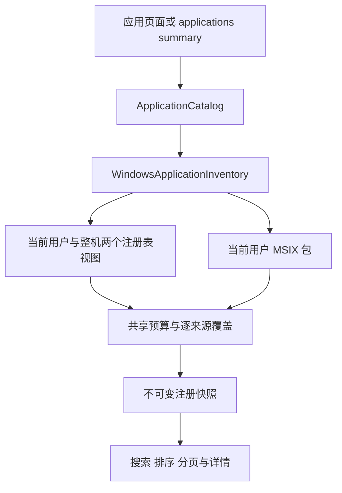

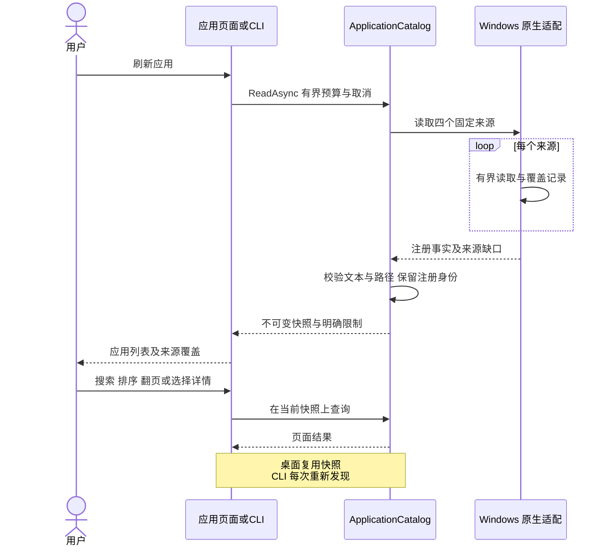

### 安装身份审阅与计划

`applications inspect --application-id <id>` 重新发现精确注册项，由 `ApplicationUninstallReviewer` 与 `WindowsApplicationUninstallInspector` 读取系统安装身份。审阅只读、不打开记录库，默认观察预算之外另有十秒安装核验期限。超时、权限不足和身份冲突返回明确阻断原因。已安装目录只在可核验时附带目录身份；缺失显示警告，不凭注册路径授予文件权限。

| 安装类型 | 核验与绑定 |
| --- | --- |
| MSI | `WindowsInstaller=1` 仅是线索；通过 `MsiGetProductInfoExW` 查询当前用户 managed、unmanaged 和 machine 上下文，必须恰好一个上下文为已安装，且与注册来源相符；绑定 ProductCode、PackageCode、上下文、用户 SID、系统名称、版本与发布者 |
| MSIX | 重新查询当前用户的精确 package full name，绑定 family name 与当前用户 SID；系统签名、框架、资源包和 bundle 容器保持受保护 |
| 其他安装程序 | 返回不支持，既不读取也不执行 `UninstallString`，不拼接 Shell |

MSI 自定义动作和普通 MSIX 移除可能改变安装程序管理的数据。不能把“不额外清理残留”表述为“个人数据一定保留”；MSIX 系统操作还可能移除该用户不再需要的依赖包。界面默认不勾选数据影响同意，CLI 必须明确传入 `--allow-installer-data-changes true` 才能准备计划。该同意仅覆盖系统安装程序的数据影响，不授予额外残留清理或执行权限。

计划创建再次审阅，要求安装事实摘要与用户已审阅的 `review_digest` 完全一致；观察时间不进入摘要。变化返回 `application_changed`，受保护或无法核验的安装不能保存计划。计划使用当前用户私有记录库及跨进程租约，期限十五分钟。选择变化、刷新、新审阅或计划错误清除旧审阅／同意；取消和关窗隔离迟到结果。

审阅与计划重查均调用 `ApplicationActivityService`。它以已核验安装目录为范围，在共用十秒期限内扫描最多 20,000 个条目、32 层；全部目录必须完整，扫描前后身份一致，未知 reparse point、跨卷、不可读条目和多重硬链接使观察不可用。Restart Manager 查询范围内所有普通文件的占用；从实际观察到的 `.exe`／`.com` 文件提取最多 128 个名称，在最多 16,384 个进程的快照中查询匹配进程的完整映像路径，最多读取 256 个匹配进程。名称只用于缩小查询，不能单独证明归属。相同名称但映像位于其他目录不阻断；位于安装目录内的当前 Shou 进程也不豁免。

映像读取只申请查询及同步权限，不读取工作目录、进程内存、参数或环境变量，也不提权、请求退出或终止进程。检查结束重新读取已观察条目，目录新增、文件替换或写入使观察不可用。只有完整且未观察到文件或映像用户时报告 `idle`；活动为 `active`，未知为 `unknown`。后两者均阻止计划，缺少安装目录同样阻断。`activity` 状态和原因进入审阅摘要，因此审阅后启动应用会使原摘要失效。该证据只覆盖安装目录，外部组件不在范围内，不能作为未来执行授权。真实 Windows 文件占用、映像查询和 UI 仍待原生验收。

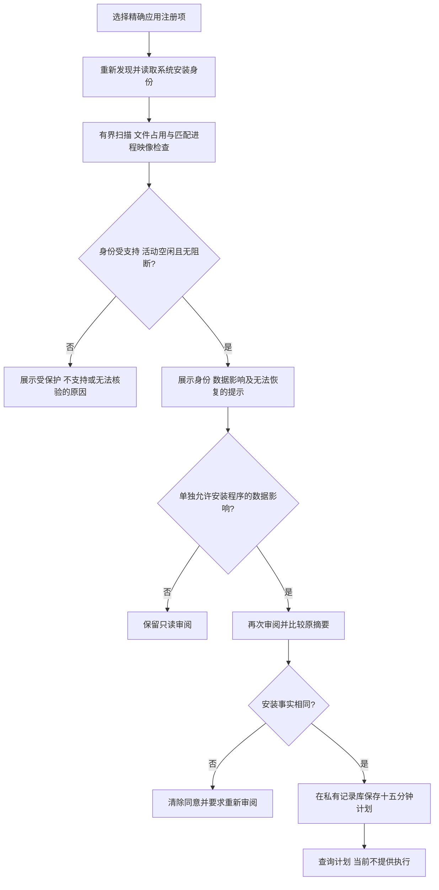

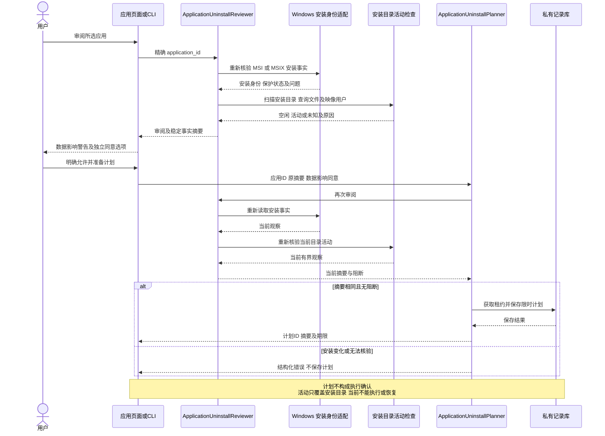

### 系统卸载执行与结果

源码已接入 `ApplicationUninstallService`、`WindowsApplicationUninstallMutation`、CLI 的终端确认／结果查询与 WinUI 执行交互。GUI 与 CLI 共用 `WindowsApplicationUninstallMutation.PublicExecutionAvailable`，当前为 `false`；界面禁用执行，公开 `applications uninstall` 返回 `unsupported_capability`／退出码 8，不提示确认或启动安装程序。原生卸载、安装程序数据影响与中断行为尚未验收。

确认前重新核验身份和安装目录活动，展示完整计划、系统身份、数据影响、可能停止安装程序管理的应用或服务以及无法由 Shou 恢复的后果。CLI 必须输入 `UNINSTALL <uninstall_plan_id>`；WinUI 使用默认取消的独立对话框，明确展示应用、安装身份和系统影响后，用户主动点击“卸载”。数据影响复选框不替代执行确认；没有无人值守同意选项。确认只存在于签发服务实例，绑定计划 ID 和摘要，最多有效一分钟且不超过计划期限，只能消费一次。

执行持有现有跨进程变更租约，重新读取并校验计划、确认和当前审阅；失效不写执行意图。随后先持久化 `uninstalling`，再交给 Platform 复核当前用户、身份、活动及授权期限后调用系统安装程序。系统 API 不提供覆盖身份检查与卸载的原子事务；外部安装变化与安装程序自定义动作仍需原生验证，不能声称冻结了系统安装。

| 安装类型 | 调用及取消合同 |
| --- | --- |
| MSI | 直接启动 Windows 系统目录的 `msiexec.exe`，固定参数数组 `/x <ProductCode> /qb /norestart REBOOT=ReallySuppress MSIRESTARTMANAGERCONTROL=Disable`；不拼接 Shell，不读取注册表卸载命令。保留安装程序基本界面及取消按钮，不请求系统重启或 Restart Manager 关闭应用。启动后的 Shou 取消不杀死进程，等待安装程序实际退出；可在其界面取消 |
| MSIX | 对当前用户的精确 full name 调用 `RemovePackageAsync`，不添加其他用户或全用户标志；Shou 取消只请求部署取消，继续等待原生终态。系统可能关闭包内运行程序、移除受管理数据与不再使用的依赖 |

两种路径均不额外递归删除残留，不自行提权或终止进程。安装程序可管理服务、进程和自定义数据，其影响不能由安装目录的只读活动检查完全约束。正常结果等待结束前保留变更租约；无法获取可靠结果时记为未知，不推断未发生变更。

结果分别记录安装程序的 `outcome`、原生状态码、`restart_required` 与后续精确安装身份的 `presence`。身份复核单独限制为十秒；只有安装程序报告成功且原身份已不存在才记 `completed`。成功但仍存在、变化或无法核验均为 `unknown`；失败和取消保留各自原生事实，不承诺数据完整或自动回滚。MSI 的 3010 记录需重启，但 Shou 不主动重启。

`applications execution show --uninstall-plan-id <id>` 只读保存的意图与结果，不重新观察、不修复日志、不执行重试。任意已有意图，包括损坏日志和结果发布失败留下的 `uninstalling`，都阻止重放同一计划。日志不等于安装程序事务，读取日志也不能证明当前安装状态；未知结果需后续独立核验。系统卸载不可由 Shou 恢复。残留清理仍需要独立组件审阅、当前归属、个人数据同意与精确范围计划，共享和未知归属保持受保护。

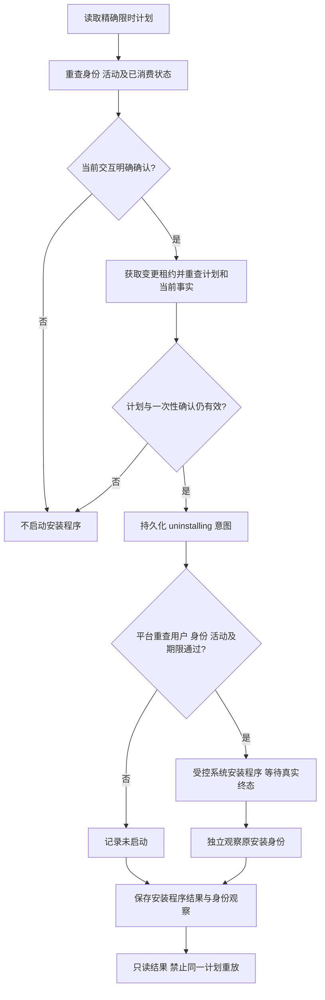

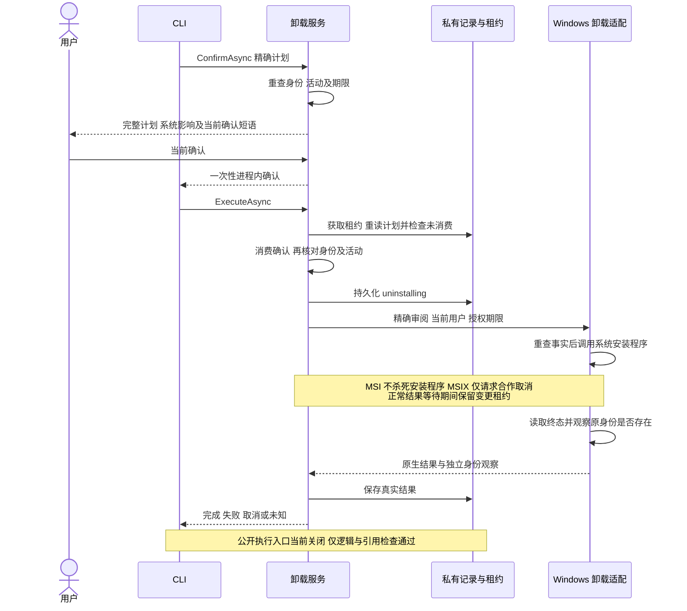

### WinUI 确认与窗口生命周期

应用页把安装程序数据影响同意、准备计划和当前执行确认分开。执行时清除可再次执行的页面计划与同意状态，保留精确计划 ID 供只读查询；计划过期或时钟回退不能派发执行。确认适配通过 DispatcherQueue 回到 UI 线程，取消、页面失效和调度失败都不能产生同意。原生 UI 仍待验证。

从确认开始到执行任务返回，应用页禁用选择、刷新和其他页面导航。点击停止或正常关闭窗口会请求取消，保持窗口打开并等待实际结果；MSI 仍需在安装程序界面取消。返回的真实结果即使晚于停止请求，也必须展示。正常结束后用户可以再关闭窗口；强制终止进程可能只留下 `uninstalling`，不能据此判断安装程序是否继续或完成。

结果区明确显示保存时间、安装程序结果和当时的身份观察；不会自动重启、重试、恢复或清理额外残留。结果发布失败仍保留“读取卸载记录”，该查询只读取绑定计划的保存记录，不刷新现场，也不修复意图。新选择或刷新会清除页面内的记录查询上下文；CLI 可按原计划 ID 查询。

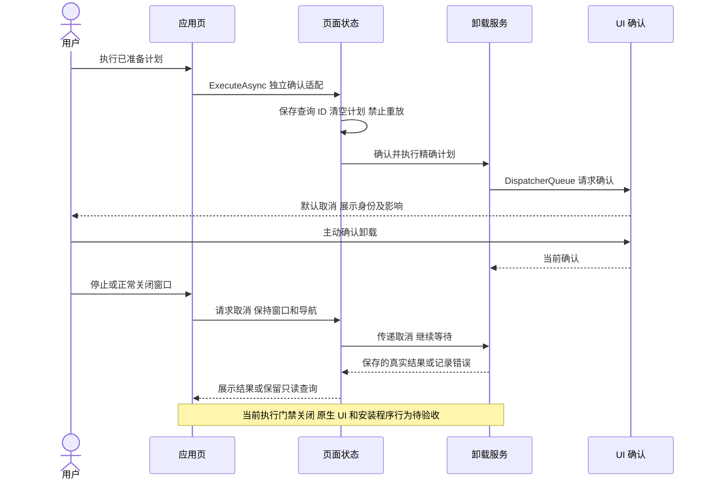

## 背景、目的与收益

用户需要一次选中多个不再使用的应用，直接看清程序包、缓存与个人数据，统一确认和卸载。反复进入单应用详情页会增加操作成本，也不便比较大小。列表以应用为单位展示图标、版本、确切标识、状态、应用本体分配容量估算和系统最近使用记录；展开或选择时再测量关联文件，不为整个应用目录预先保存所有删除清单。

## 用户故事与交互

| 场景 | 交互与结果 |
| --- | --- |
| 找出占用大的应用 | 默认按大小降序；可按名称、状态、大小、最近使用排序，搜索名称、完整标识、版本或路径 |
| 一次卸载多个应用 | 初始无选择；勾选应用时审阅并默认选择合格的程序包、缓存与日志；底栏持续显示应用数及实际所选组件容量 |
| 检查关联文件 | 在同一列表展开应用，查看每项的路径、大小、风险和不可用原因，不进入另一页 |
| 保留工作内容与登录状态 | 偏好、数据库、保存状态及容器默认保留；必须允许个人应用数据后逐项勾选 |
| 调整批量范围 | 表头全选仅作用于当前筛选内可卸载的应用；筛选外及自定义组件选择保留；取消必选程序包即取消该应用 |
| 运行中的应用 | 显示“需关闭应用”，可请求正常退出，关闭后重新扫描；不强制结束进程，不自动勾选 |
| 需要管理员权限的应用 | 可选择的锁标记；符合条件的当前用户／root 所有程序包通过 Finder 原生方式移到废纸篓，按需由 macOS 验证身份，关联数据保留 |
| 受保护应用 | 系统／当前应用、其他用户内容及无法核验的目标继续不可用 |
| 确认卸载 | 桌面默认移到废纸篓并确认精确范围；符合条件的用户自有应用可在菜单主动选择永久卸载 |
| 查看结果或恢复 | 每项结果进入共享历史；只有已核验的废纸篓项可以恢复，永久删除无法恢复 |

大小是分配容量估算，不保证等量释放；列表摘要只统计应用本体，底栏统计所选程序包及关联组件。系统最近使用记录缺失显示“暂无使用记录”，不以修改时间替代。应用目录发现缺口、未知大小、运行检查失败均明确显示。修改选择、重新扫描或完成变更后不能沿用旧确认；变更后应重新扫描更新状态和计量。

## 组件与归属

| 组件 | 关联方式 | 个人数据同意 |
| --- | --- | --- |
| 程序包 | 确切安装路径、元数据、device/inode | 选择应用本身，卸载必选 |
| 缓存、日志 | `~/Library/Caches/<id>`、`~/Library/Logs/<id>` | 默认仅推荐合格且无覆盖警告的项 |
| 偏好 | `~/Library/Preferences/<id>.plist` | 必须 |
| 应用支持、保存状态 | 对应 Library 类别下完整标识路径 | 必须 |
| 应用容器 | 完整标识路径及原生容器元数据匹配 | 必须 |
| 共享组容器 | 原生容器元数据明确关联当前应用 | 必须 |
| WebKit、HTTP 存储 | 对应 Library 类别下完整标识路径 | 必须 |

完整标识是关联线索，不能单独证明独占归属。重复安装可能共享组件；共享或无法验证的组件受保护。跨应用选择的相同或父子重叠路径在批量计划阶段整体拒绝。名称相似、厂商前缀和仅存在孤儿残留均不授权删除。安装包收据、外部辅助程序注册、自定义数据路径和其他账户不在本阶段范围内。

默认发现 `~/Applications`、`/Applications` 及其下两层容器目录；主动包含的系统应用保留保护。遇到应用包后不发现内嵌应用。发现预算为 4,000 项、10 秒；每个应用独立进行有界大小测量，关联组件在选择时接受完整清单核验。Windows 尚未验收。

macOS 桌面与 CLI 将容器归属元数据读取放入现有只读子进程。组容器发现和单个元数据读取分别使用三秒、两秒预算，另有共享的两秒 IPC 余量。停止不等待被内核阻塞的读取，仅终止本次拥有的子进程；尚未退出的子进程继续占用共享的两个槽位。超时、取消和组目录发现截断不产生归属授权。子进程不打开业务记录、不执行清理。

## 架构

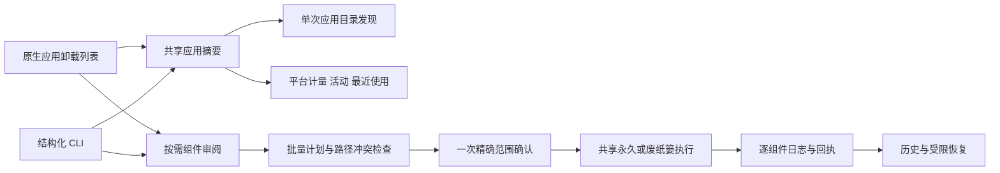

`ApplicationsSession` 仅管理界面状态、筛选外选择、组件缓存及操作生命周期。`ShouEngine` 负责归属、同意、排除、摘要绑定与变更前核验。`ApplicationCatalogReading`、`ApplicationUninstallChecking` 和文件系统适配器提供平台事实。批量卸载复用 `TrashExecution` 或 `PermanentExecution`，一个回执保存每个组件的精确原位置；不增加第二套删除循环。

## 流程

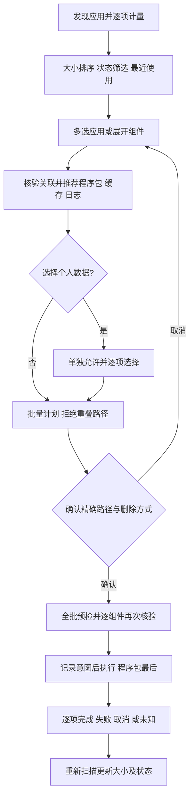

## 时序

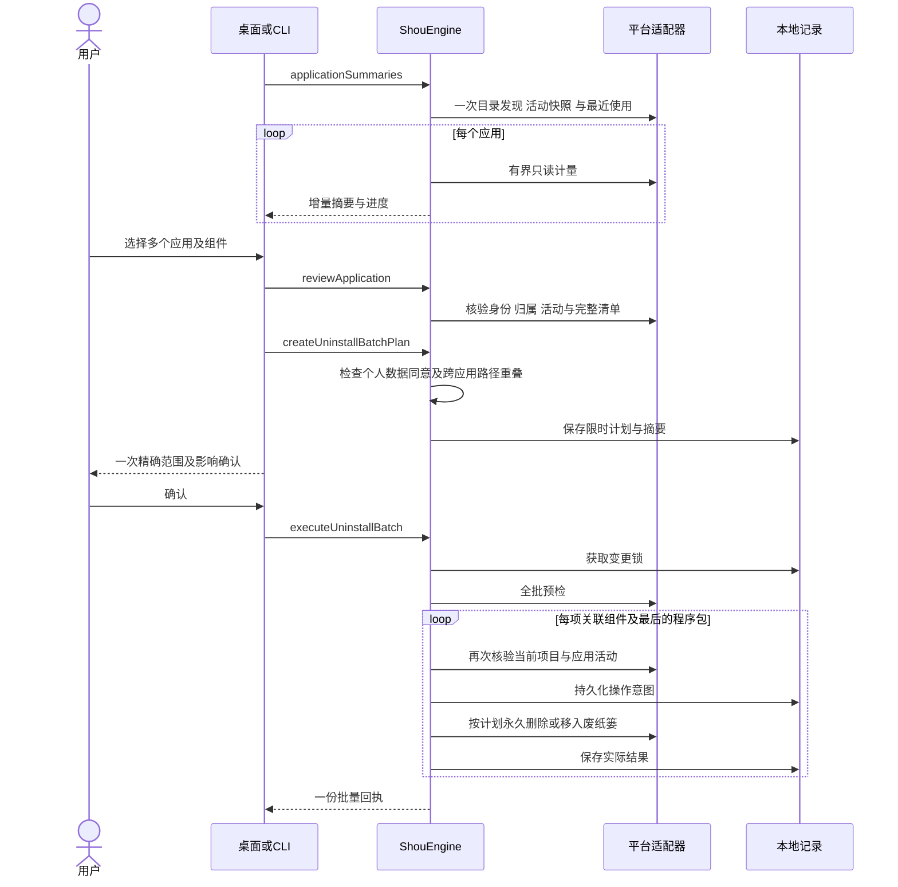

## 执行与恢复边界

计划有效期为 15 分钟，绑定应用身份、组件完整清单、配置、个人数据同意和删除方式。全批预检失败时不开始删除；开始后的失败或取消可能形成部分结果，这不是跨应用原子事务。停止在项目安全边界生效，已处理项不会自动回滚，未知结果不自动重试。

系统与当前应用、运行中的所属进程、未知活动、其他用户所有者内容、特殊文件、多重硬链接、凭据、Shou 记录及排除项受保护。包内符号链接只处理链接自身。个人偏好文件保存有界内容摘要，目录核验使用完整元数据清单。恢复重现每个组件的精确原父目录，不重建缺失父目录、不覆盖文件。永久删除结果不能进入恢复操作。

macOS 上，包含 root 所有内容且符合条件的程序包可单独通过 `NSWorkspace.recycle` 移到废纸篓，由 Finder 提供系统交互。应用不收集密码、不执行提权删除命令；仍复用完整预检、逐项日志及目标身份／内容回读。取消身份验证后，应用及关联数据保留。其他用户内容、受保护应用继续阻止；管理员应用计划不包含关联数据，并拒绝永久删除。恢复到受限安装位置时可能仍需通过访达操作。

进程检查同时读取运行应用标识及当前用户的可执行文件路径。`kill(pid, 0)` 对僵尸进程也会成功，因此路径读取失败时，只有系统内核确认进程已退出或状态为 `SZOMB` 才可跳过；仍在运行或无法确认的进程保持阻断。退出竞态最多重查一次，继续受取消和三秒检查时限约束。

若软件包更新移除了仍在运行的可执行文件（`ENOENT`），该进程仍参与活动检查。平台层从内核缓存中提取可执行路径前缀，核验当前用户所有权和前后一致的进程启动身份，再丢弃临时参数／环境缓冲；不记录或返回参数及环境值。经核验位于目标应用之外的路径不再阻止无关应用卸载，位于其包内的辅助进程仍会阻止删除。核验失败继续报告状态不可用。

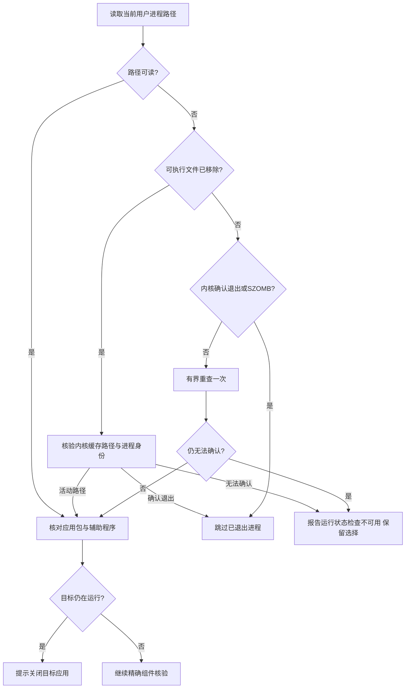

活动检查失败使用 `application_activity_unavailable`，目标运行使用 `application_running`，不再统一误报文件变化。预检失败不创建执行回执、不修改组件；活动检查不可用时桌面保留选择并允许重新审阅，之后仍须重新确认当前计划。实际身份、配置或内容变化继续使旧计划失效。

## CLI

```sh
shou applications summary --json
shou applications inspect --path "/Applications/Example.app" --json
shou applications plan --review-id <review-id> --component <app-id> --mode trash --json
shou applications batch plan --file selections.json --mode permanent --json
shou applications batch plan show --plan-id <plan-id> --json
shou applications batch uninstall --plan-id <plan-id> --json
shou history inspect --execution-id <execution-id> --json
```

批量输入为显式选择数组，每项包含 `review_id`、`component_ids` 和可选 `include_user_data`。旧单应用计划默认废纸篓，批量默认永久卸载；机器调用必须读取计划的实际模式。执行需要当前控制终端的一次精确范围确认，非交互 Agent 可以准备和检查计划。废纸篓恢复另行确认。

## 鸣谢

MangoDisk 的应用列表、行内组件、状态筛选、排序和批量操作体验为本轮设计提供参考。Shou 保持原生实现和独立的执行、个人数据及历史合同；参考产品可见页面不证明 Shou 已通过全部同类能力验收。
