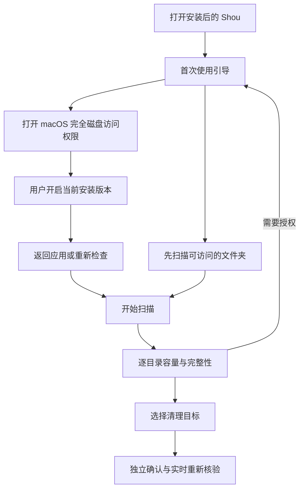
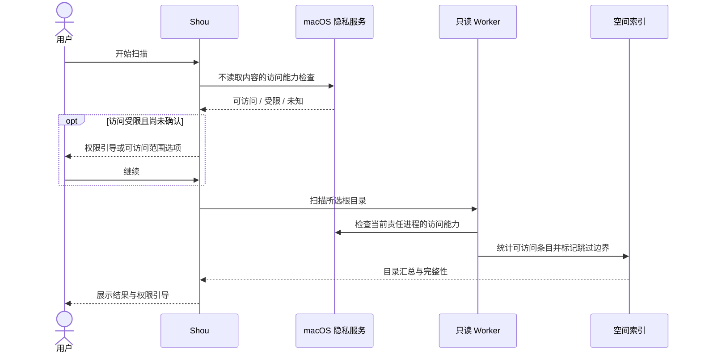

# 安装与磁盘访问权限

[English](../../product/installation-and-access.md) | 简体中文

## 暂无开发者证书时的安装

当前 Mac 版本使用临时签名，尚无 Apple 开发者证书和 Apple 公证。从本仓库 [Releases](https://github.com/limecloud/shou/releases) 下载并将 `Shou.app` 放入**应用程序**后，如果 macOS 阻止首次打开，在“终端”执行：

```sh
xattr -dr com.apple.quarantine "/Applications/Shou.app"
open "/Applications/Shou.app"
```

命令仅递归移除该应用的 `com.apple.quarantine` 下载隔离属性；安装在其他目录时，替换为实际 `Shou.app` 路径。此步骤不授予完全磁盘访问权限，磁盘扫描仍按下方引导单独授权。

先将 Shou 安装到**应用程序**，再设置磁盘访问权限。打开安装后的应用，通过**设置 → 安装与 CLI → 设置引导**完成配置。首次启动会显示引导，之后也可从设置或扫描范围提示重新打开。

## 首次使用

1. 将磁盘映像中的 `Shou.app` 拖入应用程序，并打开安装后的应用。
2. 在引导中选择**打开系统设置**。进入**隐私与安全性 → 完全磁盘访问权限**，开启 Shou。列表中没有时，用 **+** 选择 `/Applications/Shou.app`。macOS 可能要求退出并重新打开应用。
3. 返回 Shou，或选择**重新检查**。受保护目录检查成功后，扫描可尝试访问相应区域；个别目录的实际失败仍会记录在结果中。授权不会开始清理。
4. 按需安装 CLI 命令。安装器创建 `~/.local/bin/shou`，保留冲突命令与符号链接，不修改 Shell 配置。如果该目录不在 PATH 中，可使用引导中显示的完整路径。

引导提供**先使用可访问范围**选项，并记住此次选择。后续扫描直接开始，扫描范围提示保留完善设置入口。已知受保护的应用容器显示为未统计边界，可访问的项目与缓存继续扫描。完成授权后，需要重新扫描才能包含这些区域。

桌面应用与运行 CLI 的终端具有独立的 macOS 隐私身份。Shou 获得权限，不代表终端或外部 AI Agent 获得同等权限。CLI 错误与部分覆盖状态保持机器可读，Agent 不应修改 TCC 或静默更改系统隐私权限。



## 权限依据与边界

macOS 没有返回通用完全磁盘访问授权状态的受支持 API。Shou 只读打开系统保护的 `/Library/Application Support/com.apple.TCC/TCC.db` 探测文件，并立即关闭，不读取内容。这属于访问能力的实际证据，并非查询该数据库；文件缺失或其他异常保持未知。设置页不会为检查状态而探测其他应用的容器。

检查结果受限或未知时，原生扫描器不进入已知的应用容器、邮件、信息、浏览器等受保护边界，记录 `authorization_required`，保留可访问的同级目录，也不会将跳过的子树显示为已完整统计的零字节。策略同时适用于只读 Worker 和直接扫描。它不穷尽 macOS 现在及未来的所有隐私边界，其他无法访问的位置仍记录为覆盖缺口，macOS 也可能请求特定文件夹的访问许可。

管理员权限由 Platform 的进程期会话统一提供。可从“设置 → 扫描与隐私”或受阻应用行点击“授权”，首次实际管理员操作也会按需请求系统认证。密码／Touch ID 界面由 macOS 提供，Shou 不保存密码；后续受支持的扫描、清理、配置／日志和系统操作复用会话，直到退出应用或通道失效。系统授权只获得底层能力，每次清理仍对确切选择确认一次并逐项记录结果。完全磁盘访问仍需独立系统开关，不安装常驻 root 服务。



## 更新与签名

隐私授权与代码身份关联。重新构建临时签名应用会改变代码要求，原授权可能失效；仅保持 Bundle ID 与安装路径无法解决。Developer ID 构建显式选择签名身份，并使用固定 CLI 标识，后续更新应保持相同的可信签名身份。代码签名与 Apple 公证是不同环节，签名不会授予磁盘访问权限。

如果系统开关已开启，但当前开发版本仍无法访问受保护区域，请移除旧的完全磁盘访问条目，重新添加当前安装的应用，并退出后重新打开。Shou 不会自动修改 TCC、重置隐私授权或降低签名校验要求。

参见[本地安装与签名](../engineering/development.md)和[发布要求](../engineering/releasing.md)。
