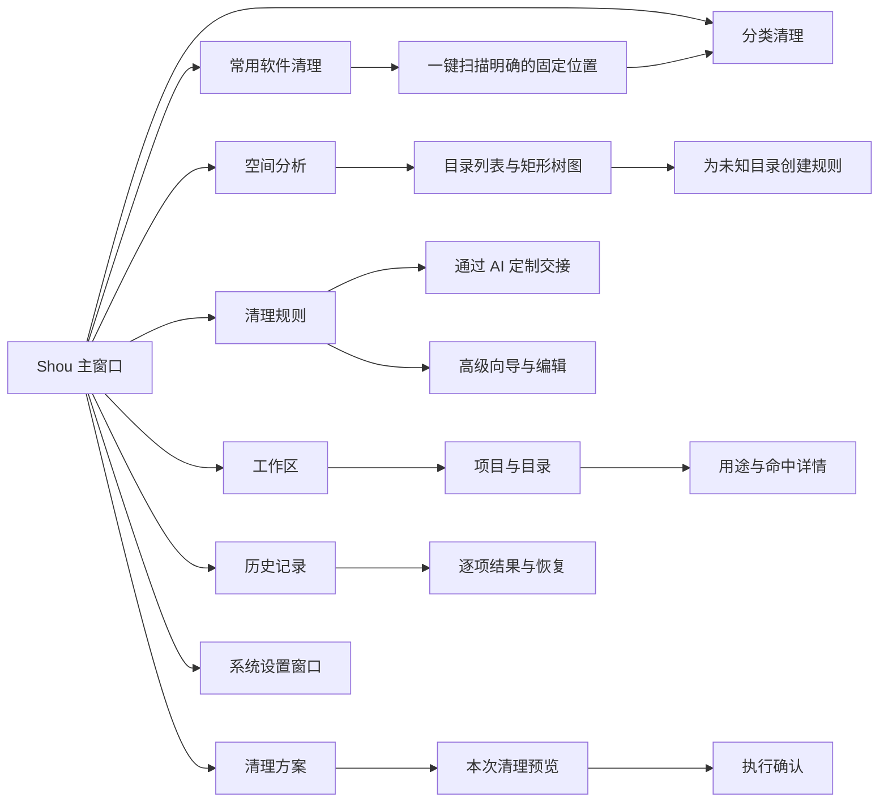
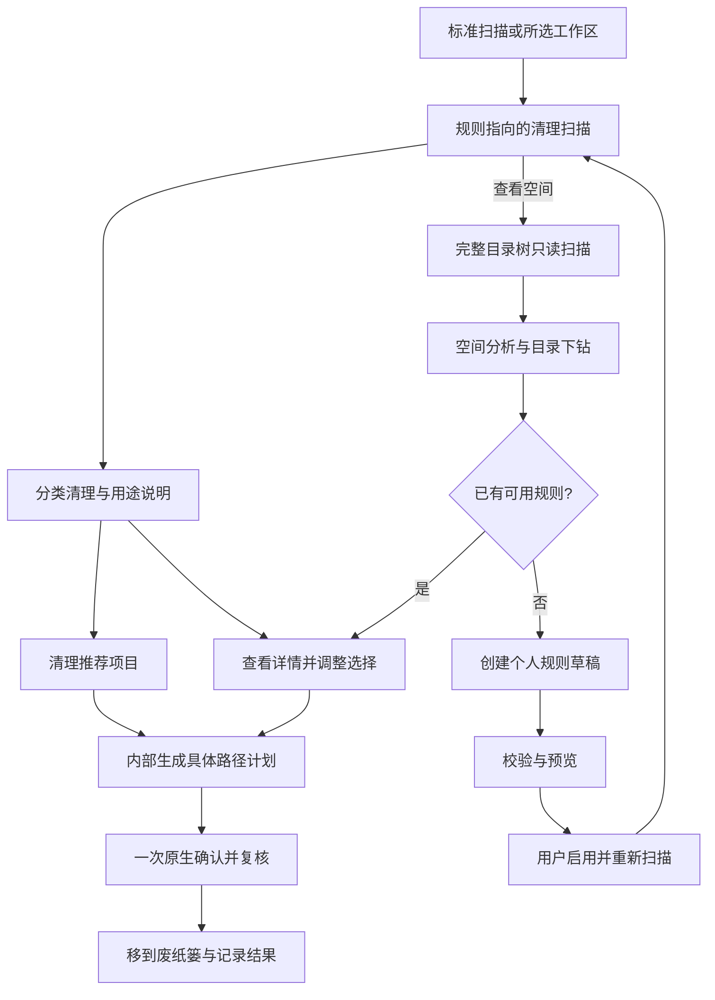

# macOS 产品体验与信息架构

[English](../../product/macos-experience.md) | 简体中文

当前桌面导航、自动发现及个人规则复用以此为准：[统一日常清理](../product/unified-cleanup.md)。

状态：原生开发版已实现分类清理与空间分析；本文件同时保留后续交互验收要求。约束：原生 Swift、SwiftUI 为主，必要时使用 AppKit。

桌面清理主操作为“清理并释放空间”，默认直接永久删除，执行前一次确认精确路径与不可恢复性。空间分析主操作明确标为“永久删除”。“移入废纸篓”仅保留为菜单中的主动选择。结果区分移除容量估计和卷可用空间实测；快照与打开的文件可能延迟回收。CLI 默认保持兼容，直接删除使用 `--mode permanent`。

## 1. 设计目标

Shou 应像一个熟悉的 Mac 工具：信息密度适中、路径易于检查、键盘操作完整，重要动作有明确对象和结果。

视觉表达采用系统材质、语义色、SF Symbols、系统字体和标准控件。避免网页式大面积卡片堆叠、全屏营销文案与自绘窗口控制按钮。品牌色只作为强调，风险和状态不能仅依靠颜色区分。

## 2. 信息架构

“启动项”现提供[配置发现流程](startup-items.md)，包含搜索、确切路径详情、覆盖说明与原生登录项设置引导。应用卸载在实现前不进入主导航。

## 3. 主窗口结构

- 标准 macOS 标题栏与工具栏，保留系统窗口控制。
- 侧边栏采用 `NavigationSplitView`，窗口宽度变化时遵循系统折叠行为。
- 主区域使用 `Table` 或经验证的 AppKit 表格展示可排序列表。
- 详情检查器展示当前选中项；需要大量路径信息时支持展开。
- 窗口建议初始尺寸约 1100 × 760 pt，最小尺寸由可用性测试确定；不要求用户全屏使用。

| 区域 | 主要内容 |
| --- | --- |
| 工具栏 | 添加工作区、扫描/停止、筛选、显示检查器 |
| 侧边栏 | 空间概览、工作区、规则、方案、历史 |
| 主列表 | 名称、占用估计、类型、所属项目、状态、最新修改 |
| 检查器 | 完整路径、规则证据、风险、重新生成条件、排除操作 |
| 容量摘要 | 已选项数、估计占用、处理方式、明确的下一步按钮 |

## 4. 关键页面

### 4.1 空间概览

- 顶部显示当前卷可用容量、最近一次扫描时间与覆盖范围。
- 展示占用最大的工作区和目录，不把所有大目录都标为“垃圾”。
- 将“规则候选”“待判断”“已排除”“无权限”明确区分。
- 提供“查看大目录”和“使用清理方案”入口，避免只有一个信息不透明的清理按钮。

### 4.2 工作区与项目列表

- 表格支持按大小、名称和最新修改时间排序。
- 目录可展开，路径面包屑可定位，不默认展开海量节点。
- 右键菜单提供“在 Finder 中显示”“复制路径”“排除”“建立规则”。
- 权限错误在相应行及汇总中可见，不能用空白或 `0 B` 代替。
- 选中当前项目后可设为排除；排除依据展示在详情中。

列表是主操作入口，按需提供矩形树图观察空间分布；图与表同步定位但不隐式同步勾选。树图必须支持向下导航、面包屑、键盘/辅助功能替代路径，并清楚区分占用与可处理量。具体分类见[开发者场景](developer-space-scenarios.md)。

### 4.3 Agent 定制规则与高级向导

规则页以**通过 AI 定制**为主入口。原生面板说明外部 Agent 工作流，提供包含随包 Skill、确切 CLI 与工作区路径的可复制请求，并可在访达中显示 Skill；不启动客户端、不连接模型。用户在已有 Agent 中回答用途、重建方式与保留项等必要问题，导入草稿后回到 Shou 预览并启用。手工创建与导入保留在“高级”菜单。

分为五步：

1. **选择范围**：绑定已有工作区，选择具体相对目录或受限模式。
2. **说明用途**：填写产生该目录的软件、用途及重建条件。
3. **保留条件**：设置年龄、最小占用和排除项。
4. **查看预览**：列出命中、跳过、保护和未知项。
5. **保存规则**：显示来源、版本与启用状态，由用户主动启用。

高级编辑器与向导共用校验器。若高级 JSON 无法无损映射到向导，保留原文并明确提示，不能静默改写规则。

当前个人规则提供“编辑规则”入口，直接编辑完整 JSON，并保留多条匹配模式、排除、平台及条件。编辑器建议尚未使用的补丁版本，要求保留规则 ID；校验失败时显示问题，修改文本后须重新校验。保存只新增禁用版本，已有工作区绑定继续使用原版本。用户先预览新草稿，再手动启用并重新扫描；导入、保存及启停规则都会清除桌面旧扫描和选择。版本唯一性在核心持有修改锁时再次检查，避免外部 CLI 同时导入造成覆盖。规则页通过“全部／内置／个人”切换来源。

### 排除与保护

“清理规则 → 排除设置…”及“设置 → 扫描与隐私 → 管理…”打开原生管理面板，提供所有工作区、工作区、项目三个范围。支持相对模式校验、保存前预览及逐项移除。全局模式由当前和未来工作区继承，继承列表提示在“所有工作区”中统一管理；规则自身的排除仍保存在规则定义中。

项目范围填写确切的相对目录，模式留空时保护整个项目，例如 `demo/**`。绝对路径、向上访问父目录及带通配符的项目目录会被拒绝。后代命中排除时，包含它的整个清理目标受保护。保存成功清除旧扫描、选择与确认状态，提示重新扫描；移除保护只更新配置，不修改文件。全局范围说明保存全局保护会升级本地配置，较早构建无法读取。

### 4.4 清理预览

- 常用软件清理采用“扫描一次 → 清理推荐项目”两步体验。已核验的内置规则命中项自动选中并按应用、浏览器、开发工具和项目产物归类；个人规则确认启用后自动参与。
- “查看详情”展开具体路径、规则来源、重建代价和风险，用户可以调整分类与逐项选择；“清理已选项目”用于精细控制。
- 主要按钮为“清理推荐项目”，点击后直接生成内部不可变计划并打开一次原生确认 sheet。计划、清单和执行前复核是核心边界，不作为用户必须浏览的额外页面。
- 显示本次具体路径，重复命中合并，父子范围冲突在确认前解决。变更规则、排除、选择或处理方式会使旧摘要和确认失效。
- 详情审阅的动作菜单也提供“永久移除 · N 项”，仅用于证据完整的具体批次。确认面板明确说明不可撤销并列出确切路径；桌面内部创建 `action=permanent` 并路由到 `PermanentExecution`，自定义或有歧义的项目仍保留在“查看详情”。
- CLI 与 Agent 保留显式 scan → plan → execute 检查点，便于机器读取、暂停和恢复；桌面固定规则不强迫用户走这套中间步骤。

### 4.5 结果与历史

- 成功、跳过、失败、已取消分组；支持查看逐项原因。
- “已移到废纸篓”不写成“已释放”。
- “永久移除本次项目”是独立危险动作，使用系统破坏性操作样式并再次确认；既可来自当前审阅计划，也可来自历史中已核验的废纸篓项目。
- 恢复入口仅在对象可核验且尚未永久移除时启用。

每批记录提供“核验位置…”。可取消的原生面板比较记录中的原始／废纸篓确切路径及目录清单，显示恢复位置占用、对象变化／缺失和未完成的后续操作，并可再次只读核验。保留原始回执，不重试操作；不确定或 pending 的后续操作仍不能恢复／永久移除。恢复失败的具体原因显示在对应历史项旁；解决已知恢复冲突后，仍须重新审阅并单独确认重试。

执行中的旧记录显示“未完成的清理”。其中 pending／moving 项计为“需要核实”，只有已停止批次的 pending 项显示已跳过。失败原因逐行本地化；不同批次即使包含相同项目 ID，选择及后续操作状态仍相互独立。

每个批次在项目列表上方提供原生三态复选框、已选数量与“取消选择”，仅选择该批次当前可操作的项目。已有完成或待核验后续记录的项目不可选。整批勾选只改变选择；“恢复”与“永久移除”仍逐路径预览并单独确认。准备预览及执行期间禁用选择，历史刷新后已完成项目退出选择。

## 5. 原生交互

| 交互 | 设计要求 |
| --- | --- |
| 授权目录 | `NSOpenPanel` 或系统文件导入面板，明确目录范围 |
| 设置 | `Settings` scene，遵循 `⌘,` 习惯 |
| 关闭窗口 | 尊重 `⌘W`，不隐式转入不可见的删除任务 |
| 退出应用 | 执行中说明已完成与待处理项目，在安全边界停止 |
| 快速查看 | 路径与用途可快速检查，内容预览不默认读取敏感文件 |
| 扫描取消 | 始终可见且可通过键盘聚焦，不用无期限阻塞 sheet |
| 恢复 | 明确用户动作，不把不完整的“撤销”伪装成系统事务 |

快捷键在工程阶段结合系统惯例验证，破坏性操作不配置容易误触的单键快捷键。

确认后的清理、恢复或永久移除过程中，`⌘W` 与 `⌘Q` 弹出本地化原生提示，默认选择“保持打开”。“停止并关闭”或“停止并退出”请求取消并等待执行任务与回执完成；存在错误或不确定结果时保留应用供检查。成功关窗会收起完成面板并关闭窗口，应用仍在后台；退出则结束应用。已处理项目不会自动恢复。空闲窗口按系统惯例正常关闭。

启动时先呈现窗口，再在后台打开本地数据。初始化期间显示“正在打开本地数据…”，禁用业务操作；边栏导航与正常退出保持可用。底层文件系统调用受阻时，不阻塞主线程，也不把尚未加载的数据呈现为可执行结果。

## 6. 状态与文案

| 状态 | 示例文案 | 可用操作 |
| --- | --- | --- |
| 初次使用 | “选择一个工作区，看看空间用在哪里。” | 添加工作区 |
| 扫描中 | “正在扫描，已检查 12,400 个项目。” | 停止扫描 |
| 部分完成 | “部分目录无法读取，结果尚不完整。” | 查看原因、重新授权 |
| 未找到候选 | “当前条件下没有匹配项。” | 调整条件、查看大目录 |
| 待判断 | “暂不清楚此目录的用途。” | 查看详情、建立规则 |
| 计划失效 | “文件或规则已变化，请重新预览。” | 重新扫描 |
| 已移入废纸篓 | “已移到废纸篓，尚未永久移除。” | 恢复、永久移除本次项目 |
| 永久移除完成 | “已永久移除，此操作无法恢复。” | 查看记录 |

## 7. 辅助功能与国际化

- 每个图标按钮具备本地化名称与辅助功能标签。
- 风险同时使用图标、文字和颜色；图表提供可读列表。
- 表格勾选状态、扫描进度与错误支持 VoiceOver。
- 采用 String Catalog，首版覆盖简体中文和英文，不拼接难以翻译的句子。
- 路径使用适当的文本截断，完整值始终可复制；处理 Unicode、中文和超长文件名。
- 容量内部统一使用字节；UI 明确采用十进制 GB，必要时详情同时显示原始字节。

设置提供持久化“减少动态效果”开关：关闭时跟随 macOS，开启时额外要求收减少动态效果。实际设置取应用与系统偏好的逻辑或，并覆盖弹窗；不确定进度改用静态沙漏和文字，真实计数与路径仍持续更新。扫描阶段具备本地化辅助名称和值。无障碍通知覆盖扫描开始／结束、执行开始／停止请求及完成，逐文件更新不触发播报；VoiceOver 实际语音仍需独立运行验收。

原生清理表格用方向键浏览和展开分类，空格切换当前行或分组勾选，Shift-F10 打开当前路径的操作菜单。键盘与鼠标共用资格检查，受保护项保持未勾选。分组选择一次更新整个集合，并保留其他类别的选择；排序和语言切换保留展开状态、焦点对应的候选身份及勾选项。表格和复选框提供本地化名称、完整路径、保护／重建说明，高风险项另有明确风险描述。

## 8. 首版设计验证

使用可交互 SwiftUI 原型验证：侧边栏与表格布局、十万级结果的分页/虚拟化、键盘焦点、权限失败、部分扫描、清理确认与恢复冲突。验证需包含实际操作、状态变化和辅助功能证据。

## 9. 当前实现：首次使用与双入口

首次默认进入智能清理，一键以清理模式扫描明确的应用／开发工具缓存位置及自动发现及记住的项目，无需先选择目录；通过常见开发目录元数据发现项目，不递归枚举整个主目录；扫描完成后内置规则命中项自动进入“清理推荐项目”，已启用个人规则自动参与。其他位置可以一次包含并记住，无需逐个管理项目。先登记全部可用固定根，再分别执行只读扫描，无需先编写规则。固定位置规则只适用于对应的实际用户目录，不能仅凭工作区名称扩大范围。缺失、权限问题及不完整结果分别展示；结果按应用缓存、浏览器缓存、开发工具、项目产物与个人规则归类，再展开规则和具体路径。多个位置可统一查看并一次确认，内部子计划仍绑定独立摘要并分别执行校验。

**清理**按构建产物、项目依赖、项目缓存、包管理器缓存和个人规则汇总。展示非重叠候选的容量、文件数、用途与风险。已核验的内置规则候选默认进入“清理推荐项目”，已启用个人规则自动参与；受阻目标不推荐，高风险与重建代价在确认中说明。内置规则可以逐项关闭，关闭后旧扫描与计划失效。

**空间分析**使用独立的卷或目录入口与 `StorageScan` 证据，无需注册规则工作区。目录列表与矩形树图共用导航及明确的文件和目录复选框；单击聚焦、双击进入，不隐式选择删除目标。超过 160 个直接子项时合并剩余图形面积，目录列表保留全部项目。删除只需确认一次精确范围，支持废纸篓和永久删除；规则清理保留其独立资格判断。

目录大小按已分配空间估计。硬链接在空间树中按路径顺序归属一个对象，父子容量不重复相加；文件系统快照、压缩、克隆与废纸篓会影响实际释放量。部分扫描继续可查看，但仅独立完整且符合策略的目标可以进入清理计划；旧记录缺少覆盖字段不能使不完整目标获得资格。清理扫描完成不代表全树已测量。

## 清理页布局规范

采用紧凑的页标题与单个容量摘要区。左侧显示可审阅容量和已选项数，右侧展示本次选择的审阅动作。点阵图表达已测量空间分布，文字图例保持可读；摘要描述当前工作区，卷可用容量单独标注。

下方使用 AppKit `NSOutlineView`，统一名称、大小、文件数与修改时间四列，使用原生展开三角、复选框中间态、排序表头和交替行底色。类别采用紧凑行布局，重新生成说明放在行内，展开后显示具体相对路径。选择行用于查看详情，复选框用于改变清理范围。检查器默认关闭，避免另一个选择底栏与主要操作竞争。

标题和容量摘要置顶，结果区占据剩余高度，状态栏固定在窗口底部。扫描时使用统一居中进度页，装饰动效最高 24 fps，独立于业务数量。文件发现、规则匹配、结果保存三个阶段对应真实状态，显示累积条目数和当前路径；应用扫描等已知总量场景额外显示百分比。容量尚未测量时使用横线，不编造容量增长或完成百分比。

扫描完成后，活动区以 250 ms 淡入淡出切换为结果列表；已测量容量和勾选容量使用 200–350 ms 数字过渡。遵循 macOS“减少动态效果”：点阵静止，关闭数字和布局过渡，文字继续报告真实进度。扫描结束后停止循环动画。

桌面端使用 500,000 项、180 秒的有界扫描；CLI 默认 100,000 项、60 秒，并支持显式调整到受限上限。计划复核沿用扫描模式与预算。覆盖不完整须明确标注，独立完整目标保留资格，不完整目标继续受阻。

执行中使用居中原生进度页展示真实阶段、醒目百分比、当前路径与已处理／总项目数；多个位置保持同一总数与累积计数。请求停止后明确显示状态并禁用重复请求；已写入意图的废纸篓移动或恢复完成当前项核验及记录后再停止。永久移除可能在后代条目间停止，留下需要检查的部分项目。完成页区分位置级问题与失败项目回执，并分别呈现移入、跳过和需核实项目。实际覆盖范围见[验收记录](../engineering/acceptance-and-testing.md)。

恢复和永久移除共用该进度区，总数仅计本次明确选择的后续项目。已处理数量在结果持久化后递增，包含已记录的失败结果，不等于成功数量。只读核验与实际恢复／移除分别显示阶段文案；停止后，尚未开始的项目可另行审阅处理。

### 原生导航与规则覆盖

主导航提供智能清理、空间分析、规则、启动项、应用管理与操作记录，不再提供独立项目清理或工作区列表。扫描位置放在可选查看页，常见开发目录自动发现，额外目录只需包含一次。保存已启用规则的入口收在规则页的次级菜单，不再独占空白导航页。当前目录包含 210 条内置模板、660 个路径模式与 65 个固定位置，规则匹配及应用运行约束由声明式数据提供。UI 使用系统侧栏、列表、DisclosureGroup、原生混合复选框和菜单；窄窗口将分类列切换为选择器。应用 Logo 直接读取包内 icns，避免自身图标依赖系统缓存。

## 空间分析直接删除

空间分析支持本地卷或目录发现，以及明确选中文件和目录后的直接删除，独立于清理规则工作区。桌面列表和树图共用导航与去重选择；确认及执行时核验当前完整清单和排除配置，复用既有执行日志与历史。详见[空间分析架构、流程与时序](../product/space-analysis.md)。

进度组件、计数口径、动效与停止状态的完整合同及图示见[操作进度与反馈](operation-progress.md)。
