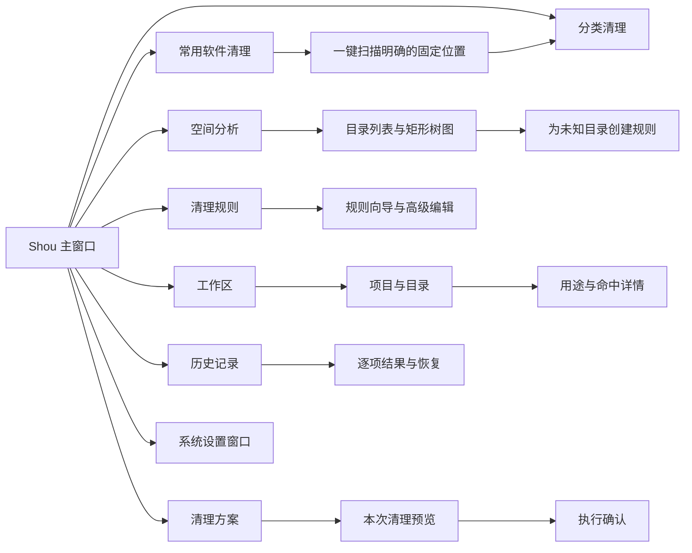
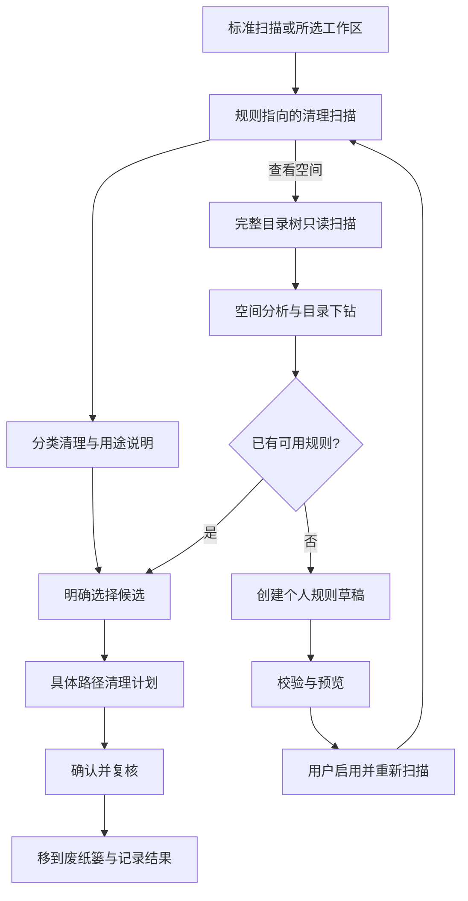

# macOS 产品体验与信息架构

[English](../../product/macos-experience.md) | 简体中文

状态：原生开发版已实现分类清理与空间分析；本文件同时保留后续交互验收要求。约束：原生 Swift、SwiftUI 为主，必要时使用 AppKit。

## 1. 设计目标

Shou 应像一个熟悉的 Mac 工具：信息密度适中、路径易于检查、键盘操作完整，重要动作有明确对象和结果。

视觉表达采用系统材质、语义色、SF Symbols、系统字体和标准控件。避免网页式大面积卡片堆叠、全屏营销文案与自绘窗口控制按钮。品牌色只作为强调，风险和状态不能仅依靠颜色区分。

## 2. 信息架构

应用卸载与启动项在对应功能实现后再进入侧边栏，首版不展示可点击但未实现的主入口。

## 3. 主窗口结构

- 标准 macOS 标题栏与工具栏，保留系统窗口控制。
- 侧边栏采用 `NavigationSplitView`，窗口宽度变化时遵循系统折叠行为。
- 主区域使用 `Table` 或经验证的 AppKit 表格展示可排序列表。
- 详情检查器展示当前选中项；需要大量路径信息时支持展开。
- 窗口建议初始尺寸约 1100 × 760 pt，最小尺寸由可用性测试确定；不要求用户全屏使用。

| 区域 | 主要内容 |
| --- | --- |
| 工具栏 | 添加工作区、扫描/停止、筛选、显示检查器 |
| 侧边栏 | 空间概览、工作区、规则、方案、历史 |
| 主列表 | 名称、占用估计、类型、所属项目、状态、最新修改 |
| 检查器 | 完整路径、规则证据、风险、重新生成条件、排除操作 |
| 容量摘要 | 已选项数、估计占用、处理方式、明确的下一步按钮 |

## 4. 关键页面

### 4.1 空间概览

- 顶部显示当前卷可用容量、最近一次扫描时间与覆盖范围。
- 展示占用最大的工作区和目录，不把所有大目录都标为“垃圾”。
- 将“规则候选”“待判断”“已排除”“无权限”明确区分。
- 提供“查看大目录”和“使用清理方案”入口，避免只有一个信息不透明的清理按钮。

### 4.2 工作区与项目列表

- 表格支持按大小、名称和最新修改时间排序。
- 目录可展开，路径面包屑可定位，不默认展开海量节点。
- 右键菜单提供“在 Finder 中显示”“复制路径”“排除”“建立规则”。
- 权限错误在相应行及汇总中可见，不能用空白或 `0 B` 代替。
- 选中当前项目后可设为排除；排除依据展示在详情中。

列表是主操作入口，按需提供矩形树图观察空间分布；图与表同步定位但不隐式同步勾选。树图必须支持向下导航、面包屑、键盘/辅助功能替代路径，并清楚区分占用与可处理量。具体分类见[开发者场景](developer-space-scenarios.md)。

### 4.3 规则向导

分为五步：

1. **选择范围**：绑定已有工作区，选择具体相对目录或受限模式。
2. **说明用途**：填写产生该目录的软件、用途及重建条件。
3. **保留条件**：设置年龄、最小占用和排除项。
4. **查看预览**：列出命中、跳过、保护和未知项。
5. **保存规则**：显示来源、版本与启用状态，由用户主动启用。

高级编辑器与向导共用校验器。若高级 JSON 无法无损映射到向导，保留原文并明确提示，不能静默改写规则。

### 4.4 清理预览

- 初始不全选；显示规则来源，允许逐项选择与取消。
- 显示本次具体路径，重复命中合并，父子范围冲突要在确认前解决。
- 主要按钮为“移到废纸篓 · N 项”，点击后以原生 sheet 展示最终摘要。
- 变更规则、排除、选择或处理方式都要生成新的计划摘要；旧确认失效。
- 用户确认后执行前还需复核；失效项提示重新扫描。

### 4.5 结果与历史

- 成功、跳过、失败、已取消分组；支持查看逐项原因。
- “已移到废纸篓”不写成“已释放”。
- “永久移除本次项目”是独立危险动作，使用系统破坏性操作样式并再次确认。
- 恢复入口仅在对象可核验且尚未永久移除时启用。

## 5. 原生交互

| 交互 | 设计要求 |
| --- | --- |
| 授权目录 | `NSOpenPanel` 或系统文件导入面板，明确目录范围 |
| 设置 | `Settings` scene，遵循 `⌘,` 习惯 |
| 关闭窗口 | 尊重 `⌘W`，不隐式转入不可见的删除任务 |
| 退出应用 | 执行中说明已完成与待处理项目，在安全边界停止 |
| 快速查看 | 路径与用途可快速检查，内容预览不默认读取敏感文件 |
| 扫描取消 | 始终可见且可通过键盘聚焦，不用无期限阻塞 sheet |
| 恢复 | 明确用户动作，不把不完整的“撤销”伪装成系统事务 |

快捷键在工程阶段结合系统惯例验证，破坏性操作不配置容易误触的单键快捷键。

## 6. 状态与文案

| 状态 | 示例文案 | 可用操作 |
| --- | --- | --- |
| 初次使用 | “选择一个工作区，看看空间用在哪里。” | 添加工作区 |
| 扫描中 | “正在扫描，已检查 12,400 个项目。” | 停止扫描 |
| 部分完成 | “部分目录无法读取，结果尚不完整。” | 查看原因、重新授权 |
| 未找到候选 | “当前条件下没有匹配项。” | 调整条件、查看大目录 |
| 待判断 | “暂不清楚此目录的用途。” | 查看详情、建立规则 |
| 计划失效 | “文件或规则已变化，请重新预览。” | 重新扫描 |
| 已移入废纸篓 | “已移到废纸篓，尚未永久移除。” | 恢复、永久移除本次项目 |
| 永久移除完成 | “已永久移除，此操作无法恢复。” | 查看记录 |

## 7. 辅助功能与国际化

- 每个图标按钮具备本地化名称与辅助功能标签。
- 风险同时使用图标、文字和颜色；图表提供可读列表。
- 表格勾选状态、扫描进度与错误支持 VoiceOver。
- 采用 String Catalog，首版覆盖简体中文和英文，不拼接难以翻译的句子。
- 路径使用适当的文本截断，完整值始终可复制；处理 Unicode、中文和超长文件名。
- 容量内部统一使用字节；UI 明确采用十进制 GB，必要时详情同时显示原始字节。

## 8. 首版设计验证

使用可交互 SwiftUI 原型验证：侧边栏与表格布局、十万级结果的分页/虚拟化、键盘焦点、权限失败、部分扫描、清理确认与恢复冲突。验证需包含实际操作、状态变化和辅助功能证据。

## 9. 当前实现：首次使用与双入口

首次默认进入常用软件清理，一键以清理模式扫描明确的应用／开发工具缓存位置及已登记项目，无需选择目录，也不隐式遍历主目录发现项目；仍可单独选择项目或固定位置。先登记全部可用固定根，再分别执行只读扫描，无需先编写规则。固定位置规则只适用于对应的实际用户目录，不能仅凭工作区名称扩大范围。缺失、权限问题及不完整结果分别展示；结果按应用缓存、浏览器缓存、开发工具、项目产物与个人规则归类，再展开规则和具体路径。多个位置可统一选择和预览，每个子计划仍绑定独立摘要并分别执行校验。

**清理**按构建产物、项目依赖、项目缓存、包管理器缓存和个人规则汇总。展示非重叠候选的容量、文件数、用途与风险。首次不勾选任何项目；通过类别与候选复选框明确改变选择，随后仍须预览和确认。内置规则可以逐项关闭，关闭后旧扫描与计划失效。

**空间分析**需要完整模式扫描事实，提供按占用排序的目录列表、矩形树图、目录下钻与面包屑。清理快照只包含规则指向的稀疏证据，须显示限制并提供完整扫描入口，不能当作总占用。图表点击只导航或聚焦，不勾选清理对象；大于 60 个直接子项时，图中合并剩余面积，完整项目仍保留在列表中。未知目录可以预填相对路径并创建禁用的个人规则草稿。

目录大小按已分配空间估计。硬链接在空间树中按路径顺序归属一个对象，父子容量不重复相加；文件系统快照、压缩、克隆与废纸篓会影响实际释放量。部分扫描继续可查看，但仅独立完整且符合策略的目标可以进入清理计划；旧记录缺少覆盖字段不能使不完整目标获得资格。清理扫描完成不代表全树已测量。

## 清理页布局规范

采用紧凑的页标题与单个容量摘要区。左侧显示可审阅容量和已选项数，右侧展示本次选择的审阅动作。点阵图表达已测量空间分布，文字图例保持可读；摘要描述当前工作区，卷可用容量单独标注。

下方使用 AppKit `NSOutlineView`，统一名称、大小、文件数与修改时间四列，使用原生展开三角、复选框中间态、排序表头和交替行底色。类别采用紧凑行布局，重新生成说明放在行内，展开后显示具体相对路径。选择行用于查看详情，复选框用于改变清理范围。检查器默认关闭，避免另一个选择底栏与主要操作竞争。

标题和容量摘要置顶，结果区占据剩余高度，状态栏固定在窗口底部。扫描时点阵以最高 24 fps 播放克制的斜向扫光，只刷新装饰性 Canvas。文件发现、规则匹配、结果保存三个阶段对应真实进度，显示已检查条目数和当前路径。容量尚未测量时使用横线，不编造容量增长或完成百分比。工具栏保留一个停止入口，避免重复的转圈和按钮。

扫描完成后，活动区以 250 ms 淡入淡出切换为结果列表；已测量容量和勾选容量使用 200–350 ms 数字过渡。遵循 macOS“减少动态效果”：点阵静止，关闭数字和布局过渡，文字继续报告真实进度。扫描结束后停止循环动画。

桌面端使用 500,000 项、180 秒的有界扫描；CLI 默认 100,000 项、60 秒，并支持显式调整到受限上限。计划复核沿用扫描模式与预算。覆盖不完整须明确标注，独立完整目标保留资格，不完整目标继续受阻。

执行中使用紧凑原生状态区展示真实阶段、当前路径与已处理／总项目数。请求停止后明确显示状态并禁用重复请求；停止发生在安全项目边界，单次系统废纸篓调用可能先完成，随后必须记录结果。完成页区分位置级问题与失败项目回执，并分别呈现移入、跳过和需核实项目。本段规定交互合同，更新后的 GUI 闭环仍须实际验收。

### 原生导航与规则覆盖

主导航仅保留常用软件清理、项目清理、空间分析、规则与历史。用户添加的项目才进入工作区列表；固定软件位置由规则目录管理。保存已启用规则的入口收在规则页的次级菜单，不再独占空白导航页。当前目录包含 74 条内置模板与 35 个固定位置，规则匹配及应用运行约束由声明式数据提供。UI 使用系统侧栏、列表、DisclosureGroup、原生混合复选框和菜单；窄窗口将分类列切换为选择器。应用 Logo 直接读取包内 icns，避免自身图标依赖系统缓存。
