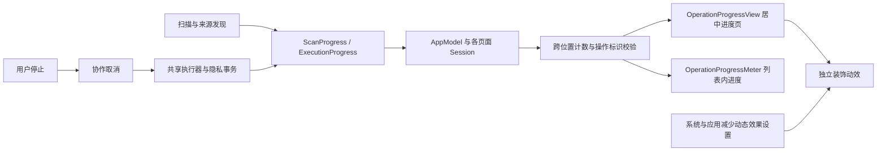
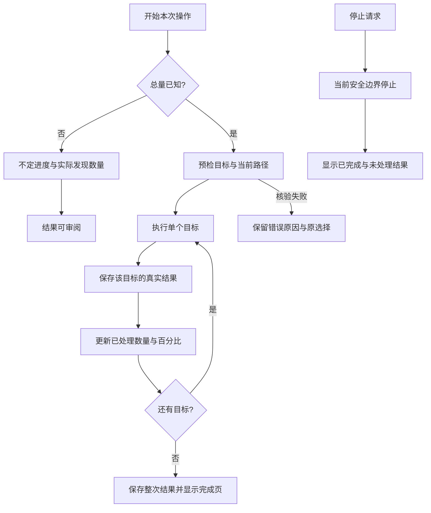
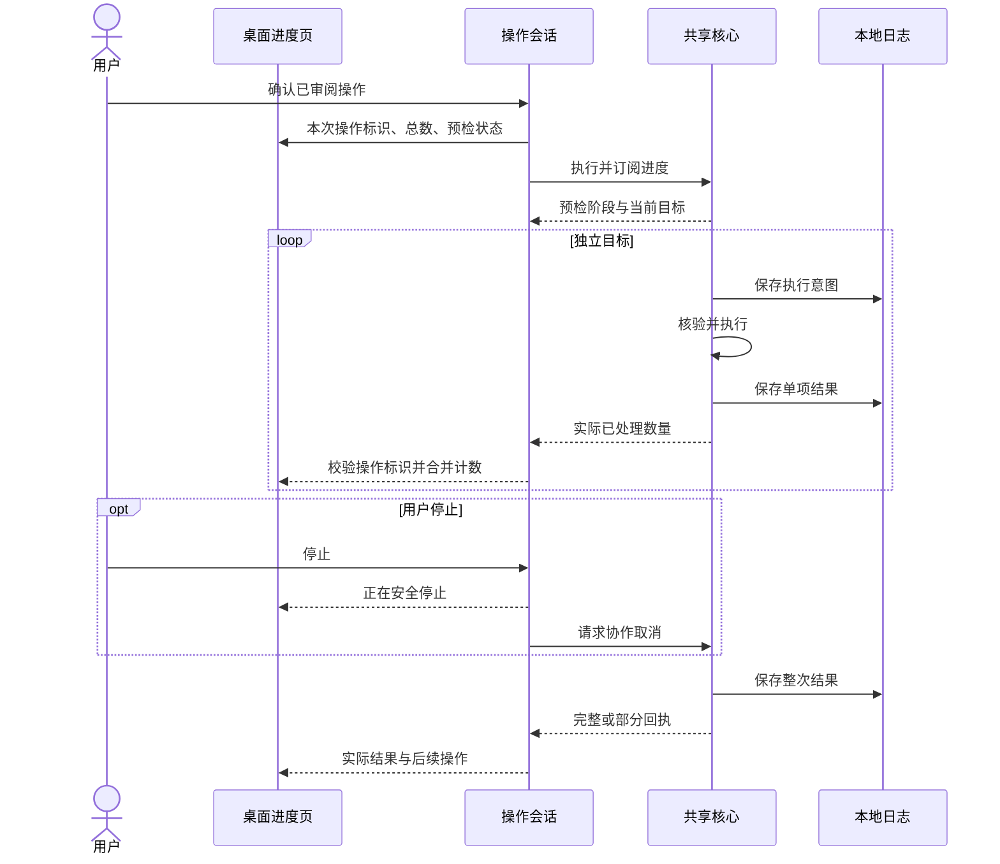

# 操作进度与反馈

[English](../../product/operation-progress.md) | 简体中文

扫描、规则清理、应用卸载、空间分析、大文件删除、历史恢复和隐私清理使用同一套进度组件。交互目标是让用户看清当前动作、处理数量和停止状态。

## 展示合同

| 场景 | 数量来源 | 展示 |
| --- | --- | --- |
| 智能清理扫描 | 各位置实际发现条目的最大值之和 | 累积数量、阶段、当前路径、不定进度 |
| 空间分析与大文件扫描 | 只读扫描实际测量条目 | 实际数量、当前路径、用时、不定进度 |
| 应用扫描与组件审阅 | 本次应用集合与已检查数量 | 百分比、已处理／总数、当前应用；结果持续进入列表 |
| 规则清理、卸载、直接删除、恢复 | 本次审阅的独立目标及持久化结果 | 居中进度页、百分比、已处理／总数、当前目标、停止 |
| 隐私扫描与删除 | 发现或审阅的数据库来源及事务结果 | 按来源计数和百分比；仅显示浏览器、配置名称 |
| 启动项发现、准备计划 | 总量尚未确定 | 当前动作、不定进度、停止 |

百分比表示已处理目标占已知目标的比例，不表示预计耗时、已成功清理比例或释放空间。一个目录是一个审阅目标；其内部文件没有单独进度事件时，不伪造文件级计数。扫描未知总量时不显示估算百分比。

预检不会推进删除数量。执行器在单项结果写入日志后才推进数量；失败、跳过也属于已处理结果，完成页另列成功、失败和未处理项。结果保存阶段使用“正在整理清理结果”。部分结果和取消不会被补齐至 100%。

多个位置连续清理保留整次操作的分母，后一个位置从前一个位置已持久化的处理数量继续。先前计划未处理的尾部不会算作完成。异步回调携带本次操作标识，上一轮回调及倒退计数不会覆盖当前界面。

## 组件架构

装饰动效与计数分离，不驱动业务进度。停止请求、非活动窗口、系统或应用的“减少动态效果”设置均停止装饰动画。界面使用原生字体、控件、强调色和辅助功能标识；动态数字使用等宽数字和数字过渡。低高度窗口使用紧凑布局，保留百分比、数量、路径和停止操作。智能扫描只保留一个停止入口，主计数明确标注为累计发现数量。

## 状态流程

## 执行时序

隐私删除在每个数据库的独立事务完成后推进来源计数，不显示浏览内容、Cookie 值或站点。停止后已提交来源保留结果，其他来源保持未清理。核心和 CLI 的授权、确认及执行语义不由动效改变。

## 验证范围

`shou-tests --operation-progress-only` 验证多位置总数、部分计划边界、整数边界、隐私来源进度、事务完成与取消、历史恢复的持久化边界。桌面仍需用本机安装包检查扫描、执行、停止、减少动态效果与中英切换；自动化测试只使用独立生成数据。

关联：[系统架构](../architecture/system-design.md)、[统一日常清理](unified-cleanup.md)、[验收与测试](../engineering/acceptance-and-testing.md)。第三方产品参考归入[鸣谢](../../../README.zh-CN.md#鸣谢)。
