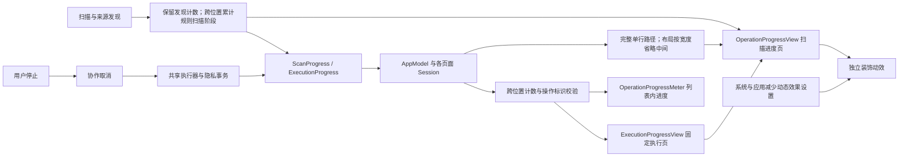
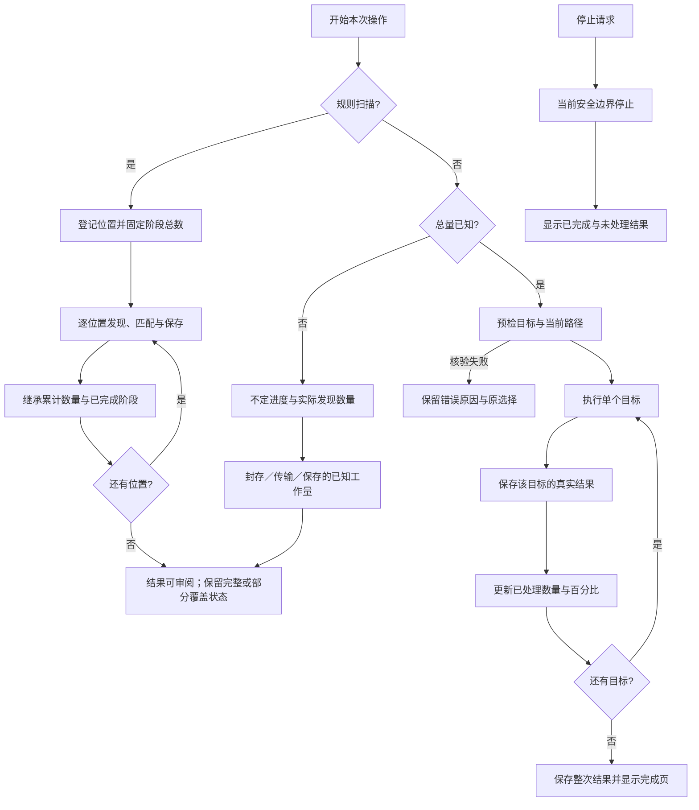
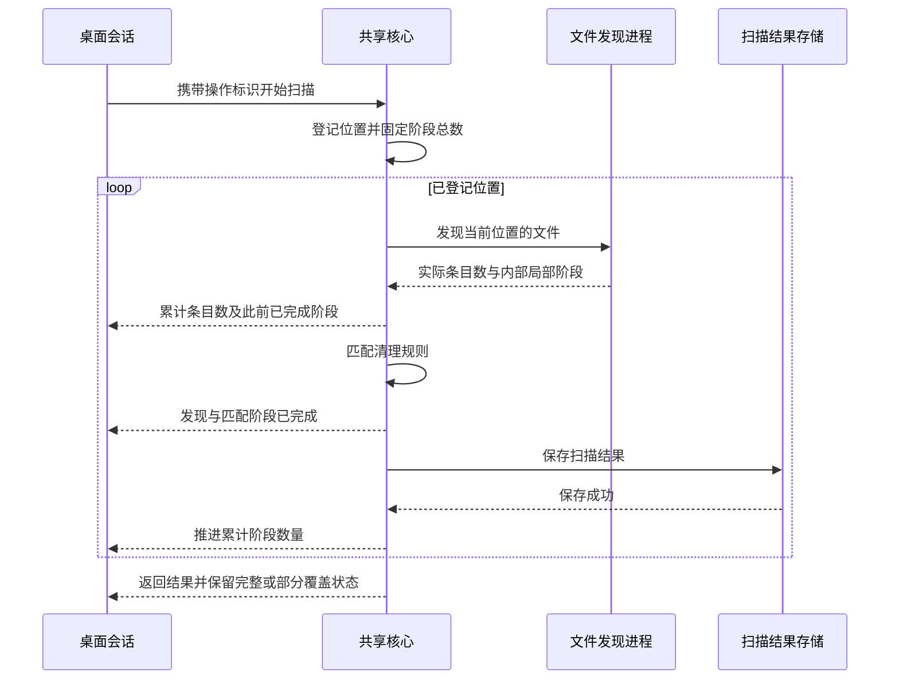
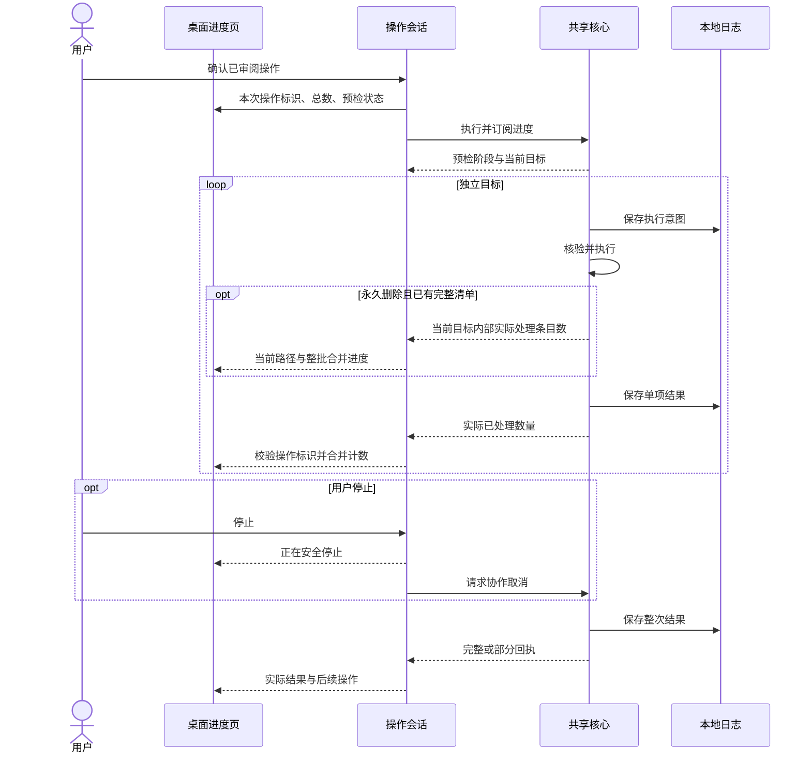

# 操作进度与反馈

[English](../../product/operation-progress.md) | 简体中文

扫描、规则清理、应用卸载、空间分析、大文件删除、历史恢复和隐私清理共用平面文件聚拢动效与简洁进度展示：动作、已知时的实际百分比、中间省略的单行路径和停止。省略详细进度数量与耗时，领域事件及结果证据仍保留完整值。

## 展示合同

规则扫描按每个已登记位置的“发现文件、匹配规则、保存扫描结果”三个真实处理阶段统计整体进度。登记完成后固定整批阶段总数，每个新位置继承此前位置已处理的阶段与累计发现数量。worker 内部的汇总与传输仍属于发现文件，不把局部百分比当作整体进度；单位置发现数量保持已观测最大值，后续阶段或位置不会清零。单工作区在未知发现阶段保持不确定进度，发现完成后从 1/3 开始、保存阶段从 2/3 开始，持久化完成才报告完成。百分比表示处理阶段完成比例，不表示耗时、磁盘覆盖或成功清理比例。

读取中失败的位置仍保留已发现计数，处理结束后推进该位置的阶段，失败原因继续保留；取消不会补齐未处理阶段。桌面拒绝同一次操作中的回退事件；底部状态使用累计证据。频繁更新的百分比数字直接显示，避免滚动数字重叠，进度条保留过渡动画。智能扫描只显示整体进度与当前路径，不显示逐位置阶段导航。

| 场景 | 数量来源 | 展示 |
| --- | --- | --- |
| 智能清理扫描 | 核心累计各位置实际发现条目的最大值 | 跨位置的处理阶段整体百分比与当前路径；累计发现数量保留在领域事件和页脚上下文 |
| 单工作区规则扫描 | 实际发现数量的最大值 | 发现阶段不定进度；匹配从 1/3 开始、保存从 2/3 开始，快照持久化后完成 |
| 空间分析与大文件扫描 | 实际测量条目；封存、传输及保存阶段的已知工作量 | 统一动效、中间省略的路径；已知总量的阶段显示当前阶段百分比 |
| 应用扫描与组件审阅 | 本次应用集合与已检查数量 | 实际百分比、当前应用单行路径；结果持续进入列表 |
| 规则清理、卸载、直接删除、恢复 | 本次审阅的独立目标及持久化结果 | 准备至执行共用页面；阶段标题、聚拢收纳动效、百分比、细进度条、快速更新且中间省略的路径与停止 |
| 隐私扫描与删除 | 发现或审阅的数据库来源及事务结果 | 扫描显示实际百分比与脱敏来源上下文；删除使用同一执行页，不展示路径或浏览内容 |
| 启动项发现、准备计划 | 总量尚未确定 | 当前动作、不定进度、停止 |

百分比表示已处理工作占已知工作量的比例，不表示预计耗时、已成功清理比例或释放空间。一个目录是一个审阅目标；永久删除可以报告当前目标内部实际处理的清单条目，将子进度与批次位置合并，但不在回执保存前把该目标计为持久化完成。没有条目级事件时，不伪造文件计数。发现阶段总量未知时不显示估算百分比；封存、传输和保存可以显示当前阶段百分比，部分扫描完成保存也可达到 100%，但覆盖状态仍独立标明。

进度路径保留开头与文件名，空间不足时仅省略中间部分。只显示一个省略号，不拆分 Unicode 字素；悬停和辅助功能提供完整原值，CLI 与领域数据保留完整路径。

预检不会推进删除数量。执行器在单项结果写入日志后才推进数量；失败、跳过也属于已处理结果，完成页另列成功、失败和未处理项。结果保存阶段保留本次已确认动作的标题。部分结果和取消不会被补齐至 100%。

多个位置连续清理保留整次操作的分母，后一个位置从前一个位置已持久化的处理数量继续。先前计划未处理的尾部不会算作完成。异步回调携带本次操作标识，上一轮回调及倒退计数不会覆盖当前界面。

macOS 清理过程留在主内容页：文件向中央收纳口聚拢并消失，下方依次为当前阶段标题、实际百分比、细进度条、快速更新的一行路径和停止入口。准备计划、逐项目复核、删除与保存结果共用同一页面；准备和清单复核显示“正在检查所选文件…”，移除阶段显示清理动作。准备总量未知时显示不确定动效，不显示虚假的 0%；已知删除进度保留实际百分比；空间分析与大文件在准备计划前进入该页。页脚保留所选动作。执行期间省略逐项列表、用时及详细条目数量；百分比数字直接更新，不滚动叠字。

路径在进度条下方保留固定单行空间，展示开头与末尾，空间不足时仅省略中间；文本直接替换，不滚动、不交叠渐变，悬停与辅助功能保留完整路径。动效仅表示正在处理，不代表删除文件数量。迟到事件不能更改本次分母、回退整批数量，或跨阶段抹去目录内部进度；真实结果在完成页区分。

停止入口直接请求协作取消，页面保留至真实安全边界，已处理结果不回滚。关窗／退出仍由现有生命周期保护请求停止并等待。执行展示不增加弹窗；执行前对精确范围与不可逆后果的独立确认继续保留。扫描使用同一简洁布局与动效，按任务使用不同图标；已知阶段百分比保留阶段标题，未知总量保持不定进度。

## 组件架构

装饰动效与计数分离，不驱动业务进度。停止请求、系统或应用的“减少动态效果”设置停止装饰动画；可见进度页失去焦点时继续播放。界面使用原生字体、控件、强调色和辅助功能标识；文字直接更新，进度条保留过渡。低高度窗口使用紧凑布局，保留动作、百分比、路径和停止操作；详细数量仍保留在领域事件与结果中。智能扫描只保留一个停止入口。

## 状态流程

## 规则扫描时序

## 执行时序

隐私删除在每个数据库的独立事务完成后推进来源计数，不显示浏览内容、Cookie 值或站点。停止后已提交来源保留结果，其他来源保持未清理。核心和 CLI 的授权、确认及执行语义不由动效改变。

## 完成页合同

成功路径保持短流程：完成图标、实际释放或处理的容量（无法测量时显示处理数量）、一句结果说明和“完成”。成功后不强制跳转历史。出现部分完成、取消、失败或待核验时，页面才增加“已处理、已跳过、失败项、需核实”四项统计；逐项详情默认收起，并提供“重新扫描”“查看操作记录”“关闭”三个出口。

“重新扫描”会回到产生结果的功能入口，使用当前文件证据创建新的扫描和计划，不重放旧计划，也不假设失败路径仍然存在。“查看操作记录”打开持久化回执，展示逐项状态和诊断。Windows 后续通过独立 C# 服务实现对等回执和后续操作语义。

## 验证范围

`shou-tests --operation-progress-only` 验证多位置总数、部分计划边界、整数边界、迟到阶段与条目回调、隐私来源进度、事务完成与取消、历史恢复的持久化边界。桌面仍需用本机安装包检查扫描、执行、停止、减少动态效果与中英切换；自动化测试只使用独立生成数据。

`shou-tests --rule-scan-progress-only` 验证 worker 阶段切换、跨位置累计数量与百分比、读取失败、完成前取消、登记顺序及原有部分结果行为。

关联：[系统架构](../architecture/system-design.md)、[统一日常清理](unified-cleanup.md)、[验收与测试](../engineering/acceptance-and-testing.md)。第三方产品参考归入[鸣谢](../../../README.zh-CN.md#鸣谢)。

Windows 执行源码采用同样的主内容区交互：原生活动圆环动画、阶段标题、实际条目百分比、一行中间缩略路径和直接协作停止。准备阶段保持不确定进度，回调限频并拒绝迟到／倒退更新。WinUI 视觉、减少动态效果和原生执行仍须 Windows 验收，公开执行门禁保持关闭。
