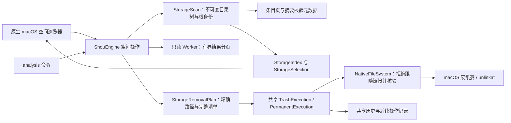
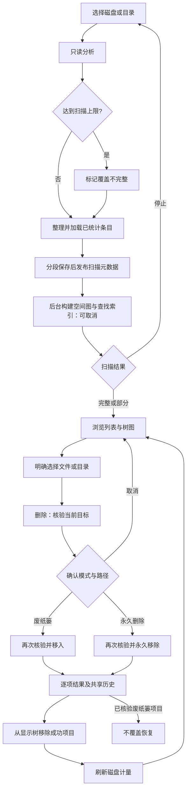
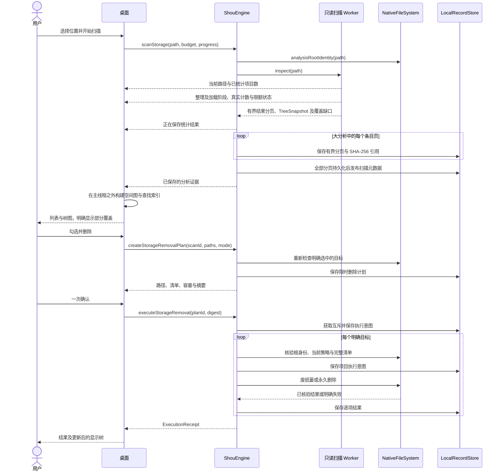

# 空间分析与显式删除

空间分析是 Shou 的核心使用流程：找出磁盘占用，并直接删除用户明确选中的文件和文件夹，无需先创建清理规则。重复性清理由内置规则或外部 AI Agent 定制规则承担。

## 产品行为

- 可选择本地挂载卷、用户主目录或任意文件夹。启动磁盘分析其 APFS 数据卷，避免 firmlink 重复计量；这不代表已测量只读系统卷及其他挂载卷。
- 扫描仅只读统计，显示当前路径、项目数、耗时和停止操作，不展示虚构百分比。停止会丢弃中断的 worker 结果，并保留此前已有的分析。权限或扫描限额造成的缺口必须显示为部分结果。
- 左侧为按大小排序的目录列表，右侧为按实际占用比例划分的矩形树图。支持单击查看、双击进入、后退、前进、返回上级、路径导航、当前目录筛选及按大小、名称、文件数排序。浏览时空格打开原生快速查看，⌘A 选中当前可选项目，Escape 清空选择；文本输入保留自身快捷键。
- 文件与目录均可勾选；列表和树图共用选择状态。全选作用于当前筛选目录中的可选项目，清空选择作用于全部选择。目录右键可通过“通过 AI 定制”把精确目录带入 Agent 请求。跨目录保留选择；父项覆盖子项，取消父项下某个子项时保留其兄弟项。
- 主操作为“永久删除”，只需一次具体范围与不可恢复确认；菜单保留“移入废纸篓”作为主动选择，后者不会释放空间。确认前重新核验并展示精确路径与容量估计；内部生成计划不成为单独的桌面步骤。
- 逐项展示成功、失败、取消和未知结果。成功项从列表和树图同步移除；刷新重新获取权威计量，移除已处理项不等于完成新扫描。废纸篓项目可从共享历史恢复且不覆盖已有文件，也可单独确认永久移除。

## 共享架构



`StorageSession` 管理桌面导航、选择、进度和取消；删除资格由共享核心判断。`ShouEngine` 保存分析证据、核验具体目标和当前排除配置，生成有效期 15 分钟的确认摘要，并复用已有跨进程互斥。平台层处理本地元数据、限额遍历、大文件流式 SHA-256、原生废纸篓、不覆盖恢复和按清单永久删除。不引入模型、Agent 运行时、守护进程或特权辅助服务。

## 流程



## 时序



## 数据与边界

`StorageScan` 包含 ID、只读根路径、根身份、时间与 `TreeSnapshot`，独立于规则工作区。`StorageRemovalPlan` 包含分析 ID、根身份、去重后的精确路径、目标当前完整清单、动作、有效期、状态与摘要。分别存入 `storage-scans` 和 `storage-plans`；共享历史使用 `storage_removal` 或 `storage_permanent_removal` 操作类型。

分析整盘不授予删除卷根的权限。系统位置、容器根、凭据、云同步目录、Shou 自身记录、链接目标及特殊文件受保护。每个所选根目标必须属于当前用户；已注册工作区的当前排除配置也保护对应选中项及已测量后代。确认后文件发生变化会拒绝处理该项目，错误不会记作成功。停止扫描结束只读 worker；停止删除在已记账项目之间生效。

限制必须明确：默认扫描最多 100 万项目、600 秒、128 层；一次请求最多 5000 条明确路径。确认前必须完整重新计量每个目标。本地 JSON 单条记录上限为 256 MiB。超过 10000 条目的分析按页保存并记录 SHA-256 摘要，所有页面持久化后才发布扫描元数据，既有单条扫描记录仍可读取；过大的计划在写入前拒绝。进度区分计量、结果加载、保存与空间图索引，停止操作也会在有界检查点取消索引。文件校验流式读取且内存有界，极大文件仍可能耗时或超过读取期限。符号链接按不透明项目计量，不能作为独立删除目标。遍历不跨文件系统、不下载云占位内容。硬链接计量是估计；APFS 克隆、快照及废纸篓会影响实际释放空间。树图前 160 项之后归入其他项目，目录列表保留全部已测量项目。

## CLI

```sh
shou analysis scan --path "/absolute/local/folder" --json
shou analysis summary --scan-id "storage_…" --json
shou analysis children --scan-id "storage_…" --path "." --limit 50 --json
shou analysis plan --scan-id "storage_…" --path "build" --path "large.bin" --mode permanent --json
shou analysis plan show --plan-id "storage-plan_…" --json
shou analysis remove --plan-id "storage-plan_…" --json
```

`analysis plan` 路径为相对分析根的字面值，不解释为通配符。`--mode permanent` 直接永久删除；CLI 为兼容保留默认 `trash`。`analysis remove` 复用现有真实终端确认。非交互 Agent 可以发现、分析和准备，JSON 输出不构成删除授权。部分结果沿用现有信封与退出码 6；已有工作区版 `analysis summary`、`analysis children` 保持可用。

## 验证

`shou-tests --storage-only` 覆盖选择展开、根保护、变更拒绝、部分分析、当前排除项与新增后代、20 MiB 文件与目录的废纸篓及恢复，以及生成夹具的永久删除和历史核验。`scripts/verify-storage-cli.py` 覆盖发现、分页、父子去重、普通文件选择、非法输入、部分结果与无 TTY 拒绝，不授权删除。桌面验收使用独立 Bundle ID、独立记录目录与生成文件。详见[验收记录](../engineering/acceptance-and-testing.md)与[参考鸣谢](../engineering/reference-design.md)。
