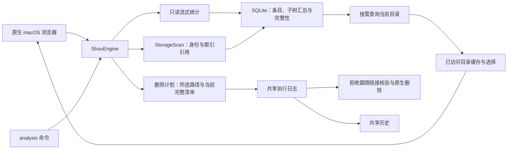
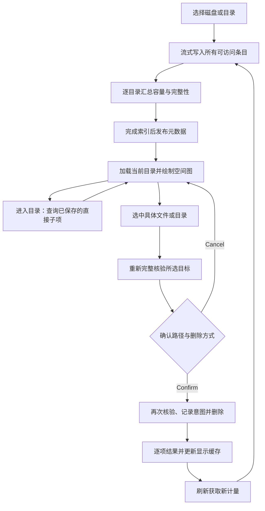
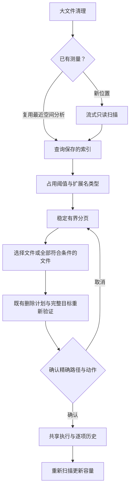
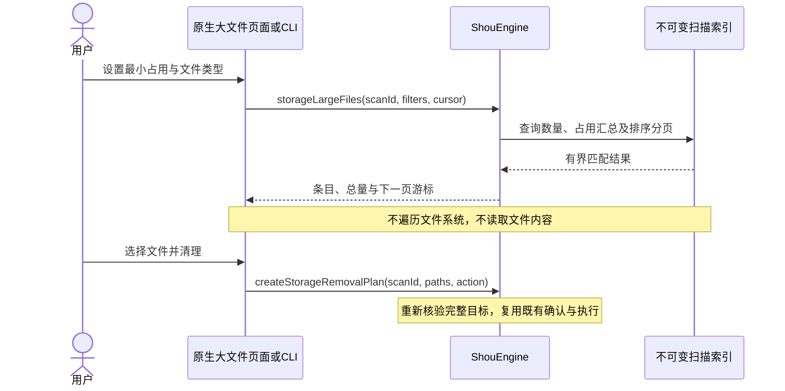

# 空间分析与显式删除

空间分析是 Shou 的核心使用流程：找出磁盘占用，并直接删除用户明确选中的文件和文件夹，无需先创建清理规则。重复性清理由内置规则或外部 AI Agent 定制规则承担。

## 产品行为

- 可选择本地挂载卷、用户主目录或任意文件夹。启动磁盘分析其 APFS 数据卷，避免 firmlink 重复计量；这不代表已测量只读系统卷及其他挂载卷。
- 扫描仅只读统计，显示当前路径、项目数、耗时和停止操作，不展示虚构百分比。停止会丢弃中断的 worker 结果，并保留此前已有的分析。权限或扫描限额造成的缺口必须显示为部分结果。
- 左侧为按大小排序的目录列表，右侧为按实际占用比例划分的矩形树图。支持单击查看、双击进入、后退、前进、返回上级、路径导航、当前目录筛选及按大小、名称、文件数排序。浏览时空格打开原生快速查看，⌘A 选中当前可选项目，Escape 清空选择；文本输入保留自身快捷键。
- 文件与目录均可勾选；列表和树图共用选择状态。全选作用于当前筛选目录中的可选项目，清空选择作用于全部选择。目录右键可通过“通过 AI 定制”把精确目录带入 Agent 请求。跨目录保留选择；父项覆盖子项，取消父项下某个子项时保留其兄弟项。
- 主操作为“永久删除”，只需一次具体范围与不可恢复确认；菜单保留“移入废纸篓”作为主动选择，后者不会释放空间。确认前重新核验并展示精确路径与容量估计；内部生成计划不成为单独的桌面步骤。
- 逐项展示成功、失败、取消和未知结果。成功项从列表和树图同步移除；刷新重新获取权威计量，移除已处理项不等于完成新扫描。废纸篓项目可从共享历史恢复且不覆盖已有文件，也可单独确认永久移除。

## 共享架构



`StorageSession` 缓存已访问目录，按需加载文件列表，不再在 UI 内存中构造整盘所有文件的 Dictionary。`ShouEngine` 管理不可变分析记录、目录查询、具体删除目标与当前排除策略。平台层只读遍历本地元数据，将条目和子树汇总流式写入共享 SQLite 索引；删除仍独立生成所选目标的完整清单，复用原生删除、互斥、日志与历史。不引入模型、Agent 运行时、守护进程或特权辅助服务。

## 流程



## 时序

```mermaid
sequenceDiagram
  actor User
  participant UI as Desktop / CLI
  participant Engine as ShouEngine
  participant Worker as Read-only worker
  participant FS as Native filesystem
  participant Store as Catalog / record store
  User->>UI: Choose location; scan
  UI->>Engine: scanStorage(path)
  Engine->>Worker: measureStorage(path, catalog)
  loop Every accessible directory and file
    Worker->>FS: Read no-follow metadata
    Worker->>Store: Append row; accumulate subtree totals and coverage
    Worker-->>UI: Current path and measured entry count
  end
  Worker->>Store: Seal catalog and child index
  Worker-->>Engine: Root identity, measured count and issues
  Engine->>Store: Publish StorageScan metadata last
  UI->>Engine: storageDirectory(scanId, path)
  Engine->>Store: Query saved totals and direct children
  Engine-->>UI: Directory list and completeness
  UI-->>User: List and map; partial sizes use ≥
  User->>UI: Select items; delete
  UI->>Engine: createStorageRemovalPlan(paths, mode)
  Engine->>FS: Fresh complete manifests for selected targets
  Engine-->>User: Exact scope, estimates and confirmation
  User->>Engine: Confirm plan digest
  Engine->>Store: Acquire mutation lease; record intent
  Engine->>FS: Reverify current targets; remove
  Engine->>Store: Save each outcome
  Engine-->>UI: Shared history and per-item results
```

## 数据与边界

`StorageScan` 包含扫描 ID、绝对根路径、根身份、时间、覆盖情况、测量条目数与可选 `catalog_id`。私有 `storage-catalogs` 保存 SQLite 索引，`storage-scans` 保存少量 JSON 元数据，索引完成后才发布扫描记录。每个已测量文件都保留；文件行只保存名称和父目录 ID，完整目录路径仅保存一次。遍历时累加子树容量；硬链接去重集合也放在磁盘，避免整盘身份集合占用内存。每个节点提供 `is_complete`，部分目录容量显示 `≥`，不影响完整兄弟目录。旧单记录和摘要分页记录继续可读，以 `completedPaths` 恢复目录完整性，不改写旧记录。`StorageRemovalPlan` 仍保存具体路径、当前完整清单、动作、有效期与确认摘要，空间索引不充当删除授权。

分析整盘不授予删除卷根的权限。系统位置、容器根、凭据、云同步目录、Shou 自身记录、链接目标及特殊文件受保护。每个所选根目标必须属于当前用户；已注册工作区的当前排除配置也保护对应选中项及已测量后代。确认后文件发生变化会拒绝处理该项目，错误不会记作成功。停止扫描结束只读 worker；停止删除在已记账项目之间生效。

默认空间分析不设文件条目数上限；运行边界为 1 小时、512 层目录和 4 GiB 磁盘索引。无法读取、扫描期间变化、跨卷和云占位边界均报告为覆盖缺口。索引写入失败会终止尚未发布的分析，取消也不发布新记录。每个目录独立记录完整性；未测量字节属于未知，不能当作零。删除仍接受最多 5,000 个具体路径，所选目标必须分别通过既有有界、完整的清单与内容核验；空间统计范围扩大不改变删除授权。单条 JSON 记录仍限制为 256 MiB；CLI 显式指定扫描预算时保留旧版有界快照与摘要分页。符号链接不跟随，云占位和跨卷边界显示为不可删除条目，不触发云内容下载。容量采用 `st_blocks × 512`，硬链接按统计遍历顺序只计一次；APFS 克隆、快照和废纸篓决定其不等于必然释放量。树图最多展示 160 块，其余合并，但所有已测量条目均可在各自目录列表访问。成功删除只更新显示缓存，刷新才生成新的权威计量。

## CLI

```sh
shou analysis scan --path "/absolute/local/folder" --json
shou analysis summary --scan-id "storage_…" --json
shou analysis children --scan-id "storage_…" --path "." --limit 50 --json
shou analysis plan --scan-id "storage_…" --path "build" --path "large.bin" --mode permanent --json
shou analysis plan show --plan-id "storage-plan_…" --json
shou analysis remove --plan-id "storage-plan_…" --json
```

`analysis plan` 路径为相对分析根的字面值，不解释为通配符。`--mode permanent` 直接永久删除；CLI 为兼容保留默认 `trash`。`analysis remove` 复用现有真实终端确认。非交互 Agent 可以发现、分析和准备，JSON 输出不构成删除授权。部分结果沿用现有信封与退出码 6；已有工作区版 `analysis summary`、`analysis children` 保持可用。

## 验证

`shou-tests --storage-only` 覆盖选择展开、根保护、变更拒绝、部分分析、当前排除项与新增后代、20 MiB 文件与目录的废纸篓及恢复，以及生成夹具的永久删除和历史核验。`scripts/verify-storage-cli.py` 覆盖发现、分页、父子去重、普通文件选择、非法输入、部分结果与无 TTY 拒绝，不授权删除。桌面验收使用独立 Bundle ID、独立记录目录与生成文件。详见[验收记录](../engineering/acceptance-and-testing.md)与[参考鸣谢](../engineering/reference-design.md)。

默认 `analysis scan` 使用完整空间索引；显式提供 `--max-entries` 或 `--max-seconds` 时采用旧版有界快照。`analysis summary` 返回测量条目数；`analysis children` 为每个节点返回 `is_complete`。

macOS 空间计量仅在身份字段完整时通过 `getattrlistbulk` 批量读取普通文件元数据；目录与链接继续使用 `fstatat`，不支持或字段缺失时回退原 stat 枚举。遍历直接向 SQLite 传递已知父目录行 ID，减少重复路径解析和父项查询。单目录批量元数据保留达到 65,536 条时改走完整回退路径，并不会截断扫描。优化保留准确元数据与实际占用口径。[权限引导](installation-and-access.md)在广泛扫描前提供，并如实记录受保护边界。


## 跨目录大文件清理

原生“大文件清理”页面从已有空间分析中跨目录查询普通文件，不要求清理规则。可以开始新的只读扫描，也可以主动复用最近一份未经过清理修改的空间分析结果；两个页面分别维护选择。

- 默认最小占用为 50 MiB。桌面提供 50／100／500 MiB 和 1 GiB，CLI 接受整数的字节阈值。
- 类型包含全部、视频、音频、图片、压缩文件、文档、AI 模型与其他。只按文件扩展名分类，不读取内容；磁盘映像、安装包和含义不明确的原始二进制归为其他。
- 按已计费占用空间降序、完整相对路径 UTF-8 二进制升序排列。硬链接遵循已有扫描的计费规则。
- 切换阈值、类型只查询保存的证据，不重新扫描磁盘。每页最多 500 条，游标绑定扫描与筛选条件，不建立全盘 UI 内存字典。
- 支持逐文件选择、选择已载入文件、“选择全部符合条件的文件”、清空选择、快速查看、访达定位与复制路径。全选遍历所有查询页，只选符合既有删除条件的文件；支持取消，完成后才发布整份选择。
- 底部固定展示权威所选数量与占用估计。默认永久删除，通过共享确认界面审阅精确路径；废纸篓是可选动作。两者继续使用完整目标重新验证、执行日志与操作历史。
- 离开页面后返回会按需载入已完成的扫描，已载入的筛选与选择保持不变。中断结果读取会明确保留未完成状态并支持继续；复用分析期间可查看进度并停止。
- 清理成功后移除对应行；更新容量汇总需要重新扫描，原索引保持不可变。未读位置继续显示覆盖缺口，不能按零容量处理。





CLI 示例：

```sh
shou analysis scan --path "$HOME" --json
shou analysis large-files --scan-id "storage_example" --minimum-bytes 52428800 --type ai-model --limit 100 --json
```

返回的相对路径可传入 `analysis plan`。查询结果不授予执行权限，CLI 仍遵循既有确认合同。部分扫描返回已测量匹配项，并保留原覆盖问题。
